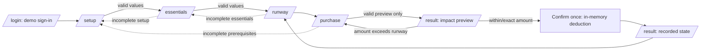

# ASM3 Frontend UI/UX Functional Freeze Audit

> Project: Student Money Runway — BUS4012 Assignment 02
> Student: Thien Khuong Vu
> Phase: ASM3 frontend readiness audit
> Evidence date: 2026-10-11 (Australia/Sydney)
> Scope: Read-only frontend source, current Playwright execution, existing rendered evidence, and Figma-reference comparison. No application source was modified.

## 01. Executive Verdict

**FE FREEZE PASS — READY FOR ASM3 BACKEND ARCHITECTURE.** The six-route React frontend completes the intended in-memory planning, preview and explicit-confirmation flow. Current browser automation passed the canonical preview, exceeds-runway and confirmation branches. Lint and production build pass. No critical or high frontend defect was found.

The frontend is intentionally not yet persistent or authenticated. Those are ASM3 integration requirements, not failures of the ASM2 frontend freeze. One low-priority user-feedback improvement and a source-hygiene encoding issue are recorded; neither blocks backend architecture.

## 02. Current Screen Inventory

| Route/state | Component | Visible sections/data | Actions/guard | Browser status |
|---|---|---|---|---|
| `/` | `App.tsx` | none | replace redirect to `/login` | SOURCE-ONLY |
| `/login` | `LoginPage.tsx` | product heading; email/password form | Continue; syntax/presence validation | Historical browser evidence; current core test begins here |
| `/setup` | `RunwaySetupPage.tsx` | available funds, planning date, buffer, setup note | Continue/back; validates three fields | Historical browser evidence |
| `/essentials` | `ProtectEssentialsPage.tsx` | fixed/flexible fields; protected-total side summary | calculate/two back actions; setup guard | Historical browser evidence |
| `/runway` | `RunwayResultPage.tsx` | runway, breakdown, optional shortfall alert | edit/review; start purchase; prerequisites guarded | Historical browser evidence |
| `/purchase` | `PurchaseCheckPage.tsx` | purchase name/amount, preview notice, current runway | Preview/back; plan guard | Current browser core flow passed |
| `/result` preview | `ResultPage.tsx` | proposed expense, impact breakdown, status, actions | back/edit; confirm only when eligible | Current browser core flow passed |
| `/result` confirmed | `ResultPage.tsx` conditional branch | recorded purchase, updated runway | view runway/new purchase | Current browser core flow passed |
| `/result` exceeds | `ResultPage.tsx` conditional branch | amount above runway warning | return/edit; no confirm control | Current browser core flow passed |
| `*` | `App.tsx` | none | replace redirect to `/login` | SOURCE-ONLY |

Routes are declared in `src/App.tsx:59-96`. Prerequisite guards are in the page components, not a global auth guard: e.g. `PurchaseCheckPage.tsx:43-48` and `ResultPage.tsx:43-50`.

## 03. Current User Flow

The next action is visible on each primary screen. State remains in `App` while navigating; it resets only on login start, a new purchase, or browser refresh. Preview navigation does not mutate funds; only `handlePurchaseConfirmation` does (`src/App.tsx:38-56`).

## 04. Full Navigation and Button Test Matrix

| Source | Control/action | Target / actual behaviour | Result | Evidence |
|---|---|---|---|---|
| Login | Continue | valid input resets state then `/setup` | PASS (demo-only auth) | `LoginPage.tsx:58-68`; historical L03 |
| Setup | Continue | valid → `/essentials`; invalid remains with errors | PASS | `RunwaySetupPage.tsx:52-59`; historical S01–S05 |
| Setup | Header/secondary Back | `/login` | PASS SOURCE-ONLY | `RunwaySetupPage.tsx:69,141-145` |
| Essentials | Calculate my runway | valid → `/runway` | PASS | `ProtectEssentialsPage.tsx:64-71`; historical E cases |
| Essentials | Both Back actions | `/setup` | PASS SOURCE-ONLY | `ProtectEssentialsPage.tsx:78,131-136` |
| Runway | Edit/Review protected amounts | `/essentials` | PASS SOURCE-ONLY | `RunwayResultPage.tsx:77-82,127-132` |
| Runway | Check a purchase | clears draft → `/purchase` | PASS SOURCE-ONLY | `RunwayResultPage.tsx:94-100` |
| AppShell | Desktop/mobile Runway, Check, Manage | navigates through `NavLink`; guards prevent invalid states | PASS SOURCE-ONLY | `AppShell.tsx:73-102` |
| Purchase | Preview impact | valid → `/result`, no mutation | PASS | current `npm run verify` |
| Purchase | Back to runway | `/runway` | PASS SOURCE-ONLY | `PurchaseCheckPage.tsx:169-175` |
| Result preview | Back without saving / Edit purchase | both return `/purchase`, retaining draft | PASS; labels are deliberately redundant but understandable | `ResultPage.tsx:166-180`; historical B01 |
| Result preview | Mark as spent | eligible only; revalidates and deducts once | PASS | current `npm run verify` |
| Result confirmed | View updated runway | `/runway` | PASS SOURCE-ONLY | `ResultPage.tsx:84-100` |
| Result confirmed | Check another purchase | clears draft and `/purchase` | PASS SOURCE-ONLY | `ResultPage.tsx:91-100` |
| Purchase confirmed state | Check another purchase | clears draft; remains on `/purchase` | PARTIAL UX feedback only (FE-01) | `PurchaseCheckPage.tsx:97-104` |

All controls are native buttons or links, so normal mouse, Enter, and Space semantics are available. The historical runtime report records a limitation in CDP-generated Enter events only; it does not establish a source accessibility defect.

## 05. Functional Browser Test Results

Fresh execution on 2026-10-11: `tools/demo-recorder/npm run verify` returned `PRODUCT_FLOW_VERIFIED=PASS`. Its Playwright script starts/reuses Vite, drives a fresh Chromium context, validates login, setup and essentials, previews a within-runway purchase, checks the no-confirm excess branch, edits, and confirms the valid purchase (`tools/demo-recorder/verify-product-flow.mjs:20-54`).

Existing actual-browser evidence remains available in `docs/evidence/runtime/final-runtime-test-report.md` and `docs/evidence/screenshots/manifest.md`: validation, exact boundary, shortfall, repeat confirmation, second purchase, direct-route guards, 1280px desktop and 390px mobile states. It was captured on 2026-09-17 and is therefore cited as historical rather than a new test result. No new screenshots were captured in this audit.

## 06. Business Scenario Regression

| Scenario | Expected | Actual | Browser evidence |
|---|---|---|---|
| A canonical 950/100/455/180 | protected 735; runway 215 | PASS | historical R01; calculation source `runwayCalculations.ts:12-39` |
| B purchase 160 preview | 55 left; funds still 950 | PASS | current verifier; historical P06/B01 |
| C confirmation | funds 790; runway 55 | PASS | current verifier |
| D purchase 300 | excess 85; no confirmation | PASS | current verifier |
| E purchase 215 | 0 left; confirmation available | PASS | historical P07 |
| F shortfall 650/734 | runway 0; shortfall 84 | PASS | historical R02 |
| G second purchase | uses 55; no second deduction | PASS | historical C02/C03 |
| H Back without saving | no source-state mutation | PASS | historical B01 |
| I refresh | state can reset | Expected current ASM2 behaviour; ASM3 integration gap | static F01 plus historical direct-route state |

## 07. Validation and Recovery

`src/utils/moneyValidation.ts:11-29` accepts non-negative strings with a maximum of two decimal places; `PurchaseCheckPage.tsx:62-70` additionally rejects zero purchases and blank/whitespace names. Setup/essentials allow zero where their helper text says it is valid. Error messages are rendered adjacent to controls with `role="alert"`; controls use labels, `aria-invalid`, and `aria-describedby` (`MoneyInput.tsx:43-92`).

Historical browser coverage records empty/invalid login, empty setup, negative setup/buffer, zero buffer, empty essentials, empty/whitespace/zero/negative/malformed purchase input, and recovery to valid navigation. No `NaN`/`Infinity` was observed in direct-route tests. Excessively large finite monetary values have not been browser-tested; this is an integration-side input bound to add before persistence, not a demonstrated current UI failure.

## 08. Desktop/Mobile Responsive Results

| Viewport | Current audit evidence | Result |
|---|---|---|
| 390×844 mobile | historical rendered M01–M10 screenshots; visual inspection in this audit of M01/M07 | PASS for core screen/layout states; no fresh interaction run at this size |
| 768×1024 tablet | historical responsive report P9 | PASS historically; NOT RETESTED this audit |
| 1024×768 small desktop | historical responsive report P9 | PASS historically; NOT RETESTED this audit |
| 1280×900 desktop | historical D01–D10 screenshots, visual inspection D01/D07; current verifier uses 1440×810 | PASS |

`AppShell.tsx:67-103` supplies top desktop navigation, fixed mobile navigation and mobile bottom padding. Inspected images show no clipping on login or purchase preview; long purchase text wraps in the mobile result. The 768px and 1024px conclusions rely on existing evidence, not a new browser capture.

## 09. Figma Comparison

Rendered references inspected: `docs/evidence/screenshots/desktop/D01-login.png`, `D07-preview-remaining-55.png`, `mobile/M01-login-390.png`, `mobile/M07-preview-remaining-55-390.png`; compared against `docs/figma-reference/screens/desktop/p01-home-landing-hifi.png` and `p06-purchase-impact-preview-hifi.png`.

| Area | Classification | Finding |
|---|---|---|
| Entry screen | INTENTIONAL AND ACCEPTABLE | Implementation is a focused sign-in screen, while P01 is a marketing landing page. The route inventory requires `/login`; removing marketing content reduces distraction for the demo flow. |
| Purchase preview hierarchy | INTENTIONAL AND ACCEPTABLE | Implementation preserves heading, purchase amount, before/after calculation, status and confirmation. It is visually simpler and omits Figma’s protected-funds side panel, but improves scannability at the tested width. |
| Tokens/layout | INTENTIONAL AND ACCEPTABLE | Blue primary, neutral surface, card/border treatment, money hierarchy and responsive navigation are consistent with references. |
| Mobile layout | PASS | Inspected M01/M07 retain readable controls, wrapping and bottom navigation; the long preview scrolls naturally rather than overlaps. |
| Information density | UX IMPROVEMENT OVER FIGMA | Clear preview-only text and an explicit “Back without saving” clarify mutation semantics. |

No visual regression was proven from the inspected image pair. Pixel-perfect equivalence was not a criterion.

## 10. Reusable Component Review

| Component | Review | Freeze verdict |
|---|---|---|
| `FormSection.tsx` | Presentational section with typed title/description/children; used across three forms. | PASS; suitable unchanged. |
| `MoneyInput.tsx` | Controlled input contract, label, helper/error association and optional disabled/blur support. | PASS; can expose future saving disable state. |
| `SummaryRow.tsx` | Typed label/value/supporting text and responsive value wrapping. | PASS; supports result layouts and long amounts. |
| `StatusActionButton.tsx` | Native button with `aria-busy`, disabled semantics, polite status and reduced-motion handling. | PASS; future `processing` state can support server confirmation. |
| `AppShell.tsx` | Semantic named desktop/mobile navigation and responsive page boundary. | PASS; future logout/session state belongs here. |

No component has business calculations embedded in its presentation layer. Page-specific name/date fields are reasonable local markup; no unjustified component extraction is indicated.

## 11. UI/UX Weaknesses

| ID | Severity / priority | Route/source | Actual consequence | Browser tested | Recommendation | New route? |
|---|---|---|---|---|---|---|
| FE-01 | LOW / P3 | `/purchase`, `PurchaseCheckPage.tsx:97-104` | After confirmed-state “Check another purchase”, input draft clears but user gets no focus or status confirmation because route does not change. | NO, source-only | Move focus to purchase-name or announce draft reset; retain the route. | No |
| FE-02 | LOW / P2 | source headers, e.g. `RunwayResultPage.tsx:3,5`; docs rendered with mojibake in shell | Encoding corruption markers (`â…`) exist in source text; user-visible JSX inspected does not show corrupt characters. | NO, source-only | Repair header/document UTF-8 encoding in a dedicated source-hygiene task, without altering product behaviour. | No |
| FE-03 | LOW / P2 | prerequisite redirects in `PurchaseCheckPage.tsx:43-48`, `ResultPage.tsx:43-50` | A direct visitor is silently redirected and does not receive an explanation. Safe, but less orienting. | Historical direct-route pass | Add a transient “complete setup first” message only when backend/auth states are designed. | No |

No dead button, broken link, core state reset defect, inaccessible control, or incorrect core destination was demonstrated.

## 12. Missing Screens vs Missing States

| Candidate | Classification | Minimum shape |
|---|---|---|
| Sign-up / password recovery | NEEDED FOR ASM3 AUTH/API INTEGRATION if chosen auth method requires them | conditional/login links or provider-hosted flow |
| Logout and signed-in user status | NEEDED FOR ASM3 AUTH/API INTEGRATION | AppShell controls |
| Empty, loading, save failure/retry | NEEDED FOR ASM3 AUTH/API INTEGRATION | existing-page conditional state plus reusable status message |
| Session expired | NEEDED FOR ASM3 AUTH/API INTEGRATION | global/auth boundary and login notice |
| Saved-plan editing | NEEDED FOR ASM3 AUTH/API INTEGRATION | reuse setup/essentials pages |
| Purchase confirmation success | EXISTS | R6 confirmed branch |
| Purchase history | HIGH-VALUE UX IMPROVEMENT | compact runway/confirmed-state section; no route necessary |
| User settings/multiple plans | OPTIONAL | no implementation in minimum scope |
| Dedicated not-found page | OPTIONAL | current safe redirect is sufficient |

## 13. FE-to-BE Integration Readiness

| UI area | Required future interaction | Existing page/component accommodation |
|---|---|---|
| Login | Supabase auth, auth-loading, unauthenticated/session-expired state | retain `LoginPage`; replace demo callback |
| Setup/Essentials | load, save, save-success/error, empty plan | retain controlled forms and `MoneyInput` |
| Runway | render authoritative loaded source values; loading/error state | retain derived display/`SummaryRow` |
| Purchase | client-only preview from loaded values | retain non-mutating form |
| Result | confirming, success/error; update client from server response | `StatusActionButton` already supports processing/success presentation |
| AppShell | authenticated user and logout | add conditional session controls |

Integration states can be conditional UI on existing pages/components: `AUTH_LOADING`, `UNAUTHENTICATED`, `LOADING_PLAN`, `EMPTY_PLAN`, `SAVING_PLAN`, `SAVE_SUCCESS`, `SAVE_ERROR`, `CONFIRMING_PURCHASE`, `CONFIRM_SUCCESS`, `CONFIRM_ERROR`, and `SESSION_EXPIRED`. None requires a frontend redesign. Server responses must become authoritative for confirmed funds/runway; the preview should remain non-mutating.

## 14. Source Code Health

Fresh checks: `npm run lint` **PASS** with no output; `npm run build` **PASS** (438 modules transformed, 406.93 kB JS / 126.20 kB gzip). No broken imports, unused application modules, unnecessary effects, console calls, context/hook layer, or dead interactive control was found by source review. The bundle size is not a demonstrated problem for this small MVP; no speculative optimization is recommended.

The only source-hygiene finding is FE-02 encoding artefacts in headers. The audit document and frontend implementation are otherwise left untouched.

## 15. Prioritised Frontend Defect Register

| ID | Severity | Priority | Status before FE freeze |
|---|---|---|---|
| FE-03 | LOW | P2 | defer to auth/loading design phase |
| FE-02 | LOW | P2 | repair separately if source hygiene is in scope |
| FE-01 | LOW | P3 | optional polish during API integration |

All P0/P1 frontend defects: **none demonstrated**.

## 16. Exact Repair Recommendations

1. During backend integration, add typed API/auth loading, error and session states to existing pages; do not add routes unless the selected auth provider requires them.
2. When purchase confirmation becomes asynchronous, pass `processing` to `StatusActionButton` and disable duplicate client attempts while the backend enforces idempotency.
3. Add an accessible status message and focus reset after `/purchase` clears a confirmed draft (FE-01).
4. Correct source-header/document encoding artefacts using UTF-8 without product-code behaviour changes (FE-02).
5. After auth exists, replace silent prerequisite redirects with an appropriate setup/session explanatory message (FE-03).

## 17. FE Freeze Acceptance Checklist

| Criterion | Result |
|---|---|
| Six core routes inspected | PASS |
| Core browser flow succeeds | PASS — current Playwright verifier |
| Important navigation actions evaluated | PASS (current or historical/source-only evidence labelled) |
| Invalid input recoverable | PASS — historical browser evidence |
| Preview is non-mutating | PASS |
| Confirmation correct in memory | PASS |
| Second purchase uses updated state | PASS — historical browser evidence |
| Direct-route guards safe | PASS — historical browser evidence |
| Desktop/mobile layouts verified | PASS — historical actual captures; current desktop core run |
| Critical/high frontend defects | PASS — none found |
| Lint/build | PASS |
| API/auth/loading integration points identified | PASS |

## 18. Final Go / No-Go Decision

**GO.** Freeze the current frontend’s calculation, route and interaction contract, then begin ASM3 backend architecture: authenticated plan loading/saving and an authoritative purchase-confirmation API. Do not redesign the UI or rewrite the calculation utilities as a prerequisite.
