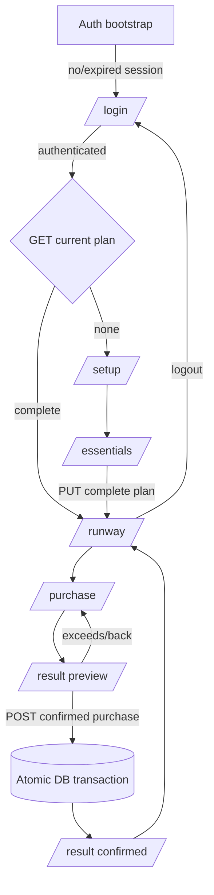

# ASM3 P0 Scope Freeze and Architecture Blueprint

> Project: Student Money Runway — BUS4012 Assignment 02
> Student: Thien Khuong Vu
> Phase: P0 — architecture design only
> Evidence date: 2026-10-11 (Australia/Sydney)
> Status: Design proposal only. No application, database, credential, deployment, or package changes were made.

## 01. Executive Architecture Verdict

**PASS.** The frozen React frontend can be extended without a rewrite. This blueprint selects Supabase Auth in the browser, verified JWTs on a small FastAPI API, one active user-owned plan, integer-cent storage, and an atomic PostgreSQL purchase RPC. It preserves all six routes and the locked financial formula.

**OFFICIAL ASM3 BRIEF NOT DIRECTLY VERIFIED HERE.** The supplied task direction—not independently inspected rubric wording—is the basis for React, Python, Supabase, Vercel, GitHub, persistence and demonstration requirements. Current Vercel documentation confirms Python Functions support FastAPI applications and root dependency manifests; its Python runtime remains Beta, so deployment must be verified in P7. [Vercel Python runtime](https://vercel.com/docs/functions/runtimes/python)

## 02. Verified ASM2 Frontend Baseline

The FE freeze passed. `src/App.tsx:59-96` preserves `/login`, `/setup`, `/essentials`, `/runway`, `/purchase`, and `/result`; shared raw form state is owned by `App.tsx:23-56`. `runwayCalculations.ts:12-39` provides pure protected-total, runway, shortfall, remaining and excess calculations. Preview only navigates (`PurchaseCheckPage.tsx:76-82`); confirmation is the only current mutation (`App.tsx:38-56`). Current Playwright core-flow verification, lint and build passed. The two preceding audit documents are the source of this baseline.

## 03. ASM3 Requirement and Course Alignment

| Supplied direction | Frozen response | Current state |
|---|---|---|
| React functional application | retain current Vite/React UI | present |
| Python backend + Supabase | FastAPI API and PostgreSQL schema/RLS | missing; P1–P4 |
| Save/retrieve user data | authenticated plan API | missing |
| Security | verified token, RLS, server secret isolation, atomic write | missing |
| Vercel/GitHub/live demonstration | monorepo Vercel deployment and clean Git workflow | missing/not verified |

The design follows the course principles evident in the existing prompts: controlled inputs, props/callbacks, pure calculations, REST boundaries, relational integrity and secret-free source. No course sample code was found in the workspace.

## 04. Frozen Product Scope

| Scope | Features |
|---|---|
| MUST HAVE | Supabase Auth; route/session guard; one active plan per user; complete-plan save/load/edit; refresh restoration; FastAPI; Supabase/Postgres; per-user authorization; server validation; non-mutating preview; confirmed-purchase persistence; atomic/idempotent deduction; basic loading/empty/error UI; logout; GitHub; Vercel deployment. |
| SHOULD HAVE | compact read-only confirmed-purchase history on existing runway/confirmed result; save/confirmation feedback; expired-session notice; focus/announcement feedback. |
| OPTIONAL | password recovery UI; multiple plans; dedicated history; profile/settings. |
| OUT OF SCOPE | bank/payments, AI advice, lending/investments, admin/analytics, complex categories, social/peer-review product features, Redux/Next.js rewrite. |

## 05. Final Route and User Flow Design



| Route | Prerequisite and API | visible async/error states | navigation |
|---|---|---|---|
| `/login` | no session; Supabase sign-in | auth loading/error | valid session loads plan, then runway or setup |
| `/setup` | authenticated, no/incomplete plan | loading, save error/retry | local entries → essentials; back does not discard draft |
| `/essentials` | authenticated setup draft | saving/save-success/error | valid submit performs one complete plan PUT → runway |
| `/runway` | authenticated complete plan | loading/retrieval error/history states | edit uses existing setup/essentials; purchase starts draft |
| `/purchase` | authenticated complete plan | no write; plan-load error | preview remains `/result` |
| `/result` | valid local preview + complete plan | confirming/success/error/stale-plan message | server result becomes authoritative; back has no write |

No new route is required. Logout is an AppShell action. API failure retains typed form/draft values and offers retry.

## 06. Authentication and Session Architecture

**ADR-01 chosen approach: browser-managed Supabase Auth plus protected FastAPI API.** React uses the Supabase browser client with the public/publishable key only, receives/restores its Auth session, and sends `Authorization: Bearer <access token>` to `/api/*`. FastAPI verifies signature, issuer, audience, expiry and subject against project JWKS (or, if the project uses legacy HS256, calls Supabase Auth’s `/user` verification endpoint). It never accepts browser `userId` as authority. Supabase documents JWKS verification and required claims; access tokens must be verified rather than decoded. [Supabase JWT verification](https://supabase.com/docs/guides/auth/jwts)

This is smaller than backend-mediated password handling, keeps passwords out of the application API/database, and meets the requested Supabase identity architecture. Sign-up is conditional on course account provisioning; do not invent it if accounts are pre-provisioned. Logout calls Supabase sign-out, clears in-memory plan/purchase state, and replaces protected routes with `/login`. Expired/invalid tokens clear protected state and show an accessible re-authentication notice.

Residual risk: JWT/JWKS cache and key rotation require operational testing; use a mature verifier and bounded refresh rather than hand-written crypto.

## 07. Database Schema Design

Decision: exactly one current `public.plans` row per `auth.users` row and append-only confirmed `public.purchases`. A plan is first written only after Essentials submits the complete validated plan. Incomplete drafts remain browser-only. Edits overwrite the current financial snapshot; confirmed purchase history is retained as evidence but is not a full ledger/reconciliation system.

```mermaid
erDiagram
  AUTH_USERS ||--o| PLANS : owns
  PLANS ||--o{ PURCHASES : records
  AUTH_USERS ||--o{ PURCHASES : owns
  PLANS { uuid id PK
          uuid user_id UK_FK
          date planning_date
          bigint available_funds_cents
          bigint safety_buffer_cents
          bigint fixed_essentials_cents
          bigint flexible_essentials_cents }
  PURCHASES { uuid id PK
              uuid plan_id FK
              uuid user_id FK
              text name
              bigint amount_cents
              uuid idempotency_key UK
              timestamptz created_at }
```

## 08. Database Constraints and RLS Plan

Draft SQL, **not executed**:

```sql
create table public.plans (
  id uuid primary key default gen_random_uuid(),
  user_id uuid not null unique references auth.users(id) on delete cascade,
  planning_date date not null,
  available_funds_cents bigint not null check (available_funds_cents between 0 and 100000000),
  safety_buffer_cents bigint not null check (safety_buffer_cents between 0 and 100000000),
  fixed_essentials_cents bigint not null check (fixed_essentials_cents between 0 and 100000000),
  flexible_essentials_cents bigint not null check (flexible_essentials_cents between 0 and 100000000),
  created_at timestamptz not null default now(), updated_at timestamptz not null default now());
create table public.purchases (
  id uuid primary key default gen_random_uuid(), plan_id uuid not null references public.plans(id) on delete restrict,
  user_id uuid not null references auth.users(id) on delete cascade, name text not null check (length(trim(name)) between 1 and 120),
  amount_cents bigint not null check (amount_cents between 1 and 100000000),
  idempotency_key uuid not null unique, created_at timestamptz not null default now());
```

Enable RLS on both tables. For `authenticated`, SELECT/INSERT/UPDATE/DELETE policies require `user_id = auth.uid()`; purchase INSERT also requires the referenced plan to have that owner. Delete is not exposed by the API and is denied in product operation. Index `purchases(plan_id, created_at desc)`.

The API uses a Supabase secret key only server-side after independently verified identity, so it bypasses RLS and must apply explicit `user_id` predicates/ownership tests. RLS still protects future direct user-token access and is defense in depth. Secret/service keys bypass RLS and must never reach React. [Supabase secure data](https://supabase.com/docs/guides/database/secure-data), [API keys](https://supabase.com/docs/guides/getting-started/api-keys)

## 09. Financial Data Contract

**ADR-02: signed 64-bit integer cents.** API values are JSON safe integers named `*Cents`; bounds 0–100,000,000 cents (AUD 1,000,000) are far below JavaScript’s safe integer limit. Purchase amounts are 1–100,000,000 cents. React parses only `/^\d+(\.\d{1,2})?$/`, converts `whole * 100 + paddedFraction` without floating-point arithmetic, and serializes integers. FastAPI accepts Pydantic integers; PostgreSQL stores `bigint`; responses return the same integer values. UI formats cents at the boundary. Zero is permitted for plan fields, never for purchase amount. Derived totals/runway/shortfall are recalculated from source cents; they are not database columns.

## 10. Python/FastAPI Architecture

Frozen proposed tree (not created in P0):

```text
api/index.py                 # Vercel ASGI entry: app
backend/app/main.py          # FastAPI app, CORS, routers
backend/app/config.py        # validated environment settings
backend/app/security.py      # bearer dependency/JWKS verification
backend/app/schemas.py       # Pydantic request/response models
backend/app/routers/plans.py # GET/PUT/history transport
backend/app/routers/purchases.py
backend/app/services/plans.py
backend/app/services/purchases.py
backend/app/db.py            # server Supabase client/RPC boundary
requirements.txt
```

Transport parses HTTP only; services own validation/business sequencing; `db.py` owns database calls; `security.py` returns verified `user_id`. Keep the locked frontend utility formula as reference, but implement one matching server cents calculation in a dedicated service—not in routers or SQL scattered across endpoints.

## 11. Complete REST API Contract

All non-health endpoints require bearer auth and use `{ "error": { "code", "message" } }` on failure.

| Method/path | Request | Success response/effect | Errors / caller |
|---|---|---|---|
| GET `/api/health` | none | `200 {"status":"ok"}`; no DB write | `503`; deployment smoke |
| GET `/api/plans/current` | none | `200 {"plan": Plan}` or `404 {"error":{"code":"PLAN_NOT_FOUND"...}}`; read own plan | 401/503; bootstrap |
| PUT `/api/plans/current` | `{planningDate,availableFundsCents,safetyBufferCents,fixedEssentialsCents,flexibleEssentialsCents}` | `200 {"plan": Plan}` upserts caller’s one plan | 401/422/503; Essentials |
| GET `/api/plans/current/purchases` | none | `200 {"purchases":[Purchase]}` ordered newest first | 401/404/503; Runway optional history |
| POST `/api/plans/current/purchases` | `{name,amountCents,idempotencyKey}` | `201 {"purchase": Purchase,"plan": Plan}`; atomic insert/deduct | 401/404/409 insufficient/stale or duplicate mismatch/422/503; Result |

`Plan` uses camel-case date/cents fields plus ISO timestamps. `Purchase` includes id, name, amountCents, createdAt. Repeating exactly the same idempotency key returns `200` with the original `{purchase,plan}`; a reused key with different payload returns `409 IDEMPOTENCY_KEY_REUSED`.

## 12. Plan Save/Retrieve Lifecycle

**ADR-04: save once on successful Essentials submission.** Setup collects a browser draft; Essentials validates all five inputs and makes one full PUT, so no partial API record can overwrite another section. A new user receives explicit `404 PLAN_NOT_FOUND`, sees Setup, and first save leads to Runway. Returning user bootstraps Auth then GETs its plan before route selection. Editing starts from existing values, repeats the full PUT, and derives results again.

If a save fails, retain all raw inputs and show retry; do not navigate to a false success. Editing a saved plan does not delete purchase history. It represents a current plan snapshot, not accounting adjustment; UI should explain this when history is shown.

## 13. Preview and Confirmed Purchase Contract

Preview is entirely local and non-mutating: validate name/amount, derive impact from loaded plan cents, navigate to Result; no POST or purchase row. Back/edit changes only draft. At confirmation the server ignores any client-provided runway/remaining calculation, reloads the authoritative current plan, recalculates, and returns either updated authority or a structured insufficient/stale error. A changed plan invalidates the old preview presentation and asks the user to review the returned current runway.

## 14. Atomicity and Idempotency Design

**ADR-05:** use one PostgreSQL `confirm_purchase(user_id, name, amount_cents, idempotency_key)` function invoked by the verified FastAPI service in a single transaction. It locks the caller’s plan row with `FOR UPDATE`, checks an existing idempotency key first, validates ownership/name/amount, calculates protected total/runway from current cents, rejects excess, inserts one purchase, decrements `available_funds_cents`, updates timestamp, and returns purchase plus plan. Any failure rolls back both writes.

For a timeout after commit, retrying the same key returns the original completed response; never generate a new key for the retry. Concurrent browser tabs serialize on the plan row, so the second request sees the updated runway. The function must be schema-qualified, have a pinned search path, revoke default public execute, and be granted only to the server role. Database functions can bypass RLS depending on ownership/security; ownership must therefore be checked in the function, not assumed from an execute grant. [Supabase database function security](https://supabase.com/docs/guides/database/functions)

## 15. React Integration and Async UI States

**ADR-07:** retain `App.tsx` as plan-source owner; add a small `AuthProvider` only for session/bootstrap state and a typed service layer (`src/services/apiClient.ts`, `planApi.ts`, `purchaseApi.ts`, `auth.ts`, `src/types/api.ts`). No Redux. Hydrate existing `RunwayState` from `Plan`; continue deriving values locally for display; replace it only from successful server responses.

| State | Screen/component behaviour |
|---|---|
| auth loading/unauthenticated/auth error | Login/app boundary; disable submit, announce error/retry |
| loading/empty plan | route guard waits; show loading or Setup—not premature redirect |
| saving/save error/success | Essentials buttons disabled only during request; preserve inputs; status message |
| confirming/confirm error/success | Result uses `StatusActionButton` processing/success; disable repeat; retry same key after unknown outcome |
| session expired | clear plan/draft, redirect Login with notice |

## 16. Route Guards and Error Handling

Deterministic guard table: auth unknown → loading; no session/expired → `/login`; session plus plan loading → loading in place; authenticated 404 plan → `/setup`; authenticated complete plan → `/runway`, `/purchase`, `/result` subject to existing draft guards; retrieval failure → retry state with no financial data disclosure. Setup/Essentials remain permitted for an authenticated draft/edit. Logout clears all protected values before route replacement.

401 triggers re-authentication; 422 leaves inputs intact with field/general message; 409 insufficient runway reloads returned/current plan then Result asks review; 503/API unavailable preserves input/draft and shows retry. For an unknown post timeout, retry same idempotency key or GET plan/history before saying confirmation failed.

## 17. Security Threat Model

| Threat | Impact | Mitigation / verification | Severity |
|---|---|---|---|
| unauthenticated/cross-user access | financial disclosure | verified bearer, explicit owner filters, RLS isolation test | High |
| fake user ID/tampered request | other-user write | derive subject only from verified JWT; ignore body IDs | High |
| forged/expired token | unauthorized API | signature/JWKS, issuer/audience/exp checks; 401 tests | High |
| exposed secret | full DB access | server env only, no `VITE_*` secret, secret scan | Critical |
| replay/double/concurrent confirmation | double deduction | unique key + locked atomic RPC; concurrency tests | Critical |
| excessive/invalid money | corrupt result | cents bounds at UI/API/DB; validation tests | Medium |
| permissive RLS/function | cross-user access | policies, ownership function check, revoke execute | High |
| unsafe logs | financial/token leak | structured redaction; no authorization header/body logs | Medium |

## 18. Vercel Deployment Architecture

**ADR-08:** one GitHub repository, one Vercel project: Vite static output in `dist`, FastAPI ASGI entry at `api/index.py`, `requirements.txt` at repository root, and routing that reserves `/api/*` before SPA fallback. Browser calls same-origin `/api`, avoiding production CORS complexity; local development uses only a configured development origin. The proposed implementation must verify Vercel’s current FastAPI packaging, SPA rewrite order and Python Beta suitability in a preview deployment before claiming the topology works. [Vercel Python runtime](https://vercel.com/docs/functions/runtimes/python)

Production smoke: `/api/health`, login, first plan save, reload, confirmation, Supabase row inspection, mobile route check. If Vercel Python preview proves incompatible with the course account, use a separate FastAPI host only after approval; that is a decision trigger, not a P0 implementation.

## 19. GitHub and Environment Configuration

| Variable | Environment/use | Public/secret | Local/deploy |
|---|---|---|---|
| `VITE_SUPABASE_URL` | browser Auth client | publishable | both |
| `VITE_SUPABASE_PUBLISHABLE_KEY` | browser Auth client | publishable, RLS-limited | both |
| `SUPABASE_URL` | FastAPI server | non-secret identifier | both |
| `SUPABASE_SECRET_KEY` | FastAPI privileged DB calls | secret | both |
| `SUPABASE_JWKS_URL` | FastAPI verification | non-secret | both |
| `ALLOWED_ORIGIN` | FastAPI local CORS only | non-secret | local |

Never put real values in source/chat/screenshots. `.gitignore` already excludes `.env*`; commit `.env.example` with names only. Before implementation, initialize/verify a private-or-course-accessible GitHub remote (public requirement **NOT VERIFIED**), inspect staged files and secret-scan. Make a reviewed initial baseline commit, then one focused commit per phase; never track `node_modules`, `dist`, or environments.

## 20. Full-Stack Test Matrix

| Tests | Inputs/action | Expected UI/backend/database | Type |
|---|---|---|---|
| T01–T04 | no plan; auth; save 950/100/455/180; reload | setup then restored plan; one owned row | API/E2E/manual DB |
| T05–T07 | canonical and 650/734 | 735/215 and 0/84; no derived columns | unit/API/E2E |
| T08 | preview 160 | 55; no API purchase/write | browser/API spy |
| T09–T10 | confirm 160 then refresh | 790/55; one purchase remains | API/E2E/DB |
| T11–T12 | equal 215; excess 300 | first succeeds/0; second 409/no write | API/E2E |
| T13–T14 | repeat/retry and concurrent requests | one purchase/deduction | integration/DB transaction |
| T15–T16 | back; second purchase | no transaction; uses 55 | browser/E2E |
| T17 | invalid/noisy amounts | 422; input retained | unit/API/browser |
| T18–T19 | user A requests B; invalid token | denied; no row returned | API/RLS |
| T20 | API/DB unavailable | retryable error/no false success | integration/browser |
| T21–T22 | mobile integrated UI; Vercel live flow | no regression; end-to-end cloud proof | browser/cloud/manual DB |

## 21. Architecture Decision Records

| ADR | Decision / rationale / trade-off |
|---|---|
| ADR-01 | Client Supabase Auth + verified FastAPI tokens: smallest secure boundary; requires Auth client dependency and verifier. |
| ADR-02 | integer cents: deterministic round trip; requires explicit parse/format adapters. |
| ADR-03 | one plan (`user_id unique`): matches current product; no plan history/versioning. |
| ADR-04 | save after Essentials: one complete atomic plan snapshot; setup drafts are not durable. |
| ADR-05 | DB transaction/RPC + idempotency UUID: protects retries/concurrency; needs careful function privileges. |
| ADR-06 | privileged backend access after verified identity, plus RLS defense in depth: simple API integration; backend ownership checks are mandatory because secret bypasses RLS. |
| ADR-07 | App plan owner + minimal auth provider/service layer: preserves frontend; adds small async boundary. |
| ADR-08 | single Vercel project, Vite + Python Function: simplest demo topology; Python Beta deployment compatibility remains P7 verification. |

## 22. Phase-by-Phase Implementation Roadmap

| Phase | Goal/dependency | Deliverables/tests/definition of done | Do not change |
|---|---|---|---|
| P1 | schema/security foundation | SQL migration, RLS/RPC design applied, isolation/constraint tests | frontend/formulas |
| P2 | FastAPI/auth skeleton after P1 | health, settings, verified auth dependency, 401 tests | UI/routes |
| P3 | plan CRUD after P2 | PUT/GET, complete-save lifecycle, reload/error tests | locked calculation contract |
| P4 | atomic purchase/history after P3 | RPC, POST/history, repeat/concurrency tests | preview non-mutation |
| P5 | React API/auth integration after P2–P4 | provider/services, loading/error/logout, full browser regression | visual hierarchy/routes |
| P6 | functional/security/responsive QA | lint/build/API/RLS/E2E/mobile acceptance matrix | requirements by weakening validation |
| P7 | GitHub/Vercel/live verification | remote, preview/prod smoke, deployed DB proof | secrets/source history |
| P8 | prompt/demo evidence | accurate five-minute runbook and evidence capture | application scope |

## 23. Files and Change Impact Matrix

| Area | Expected P1+ impact |
|---|---|
| Existing React | `App.tsx`, all six pages, `AppShell`, `StatusActionButton`, `types/runway.ts`; only integration states/callbacks, not calculation redesign. `MoneyInput`, `SummaryRow`, `FormSection` likely unchanged. |
| New React | auth provider, API client/plan/purchase/auth services, API types. |
| New backend/data | `api/`, `backend/app/`, `requirements.txt`, SQL migration/RPC, backend tests. |
| Config/docs | `.env.example`, deployment config only after P7 verification, focused implementation evidence. |

## 24. Risks and Unresolved Decisions

| Item | Status / action before affected phase |
|---|---|
| Official ASM3 wording | NOT VERIFIED; compare final scope to official LMS brief before submission. |
| Supabase project auth settings (asymmetric vs legacy signing, provider/account provisioning) | DECISION REQUIRES APPROVAL/configuration in P1–P2. |
| Vercel course-account Python Beta support and SPA/API rewrites | NOT VERIFIED; preview deployment gate P7. |
| Date rule/past dates | DECISION REQUIRES APPROVAL; current frontend only requires a date. |
| Whether sign-up is allowed | DECISION REQUIRES APPROVAL from account provisioning/course policy. |

None blocks P1 schema/security design; P2 must not hard-code unverified Auth configuration.

## 25. Final P0 Quality Gate

All P0 acceptance items are addressed: baseline/routes/formulas frozen; minimum scope, auth, session guard, schema, cents, RLS, endpoints, lifecycle, non-mutating preview, transaction/idempotency, async states, Git/environment, deployment topology, threats and 22 test cases are specified. No packages, database objects, credentials, deployments, commits, or application source changes were made.

## 26. Next Exact Implementation Step

**P1 — Supabase Schema and Security Foundation:** create a reviewed migration containing `plans`, `purchases`, constraints, RLS policies and the restricted atomic confirmation function; validate it in a non-production Supabase project with ownership, amount-bound and idempotency tests. Acceptance: User A cannot access User B; a duplicate key cannot double-deduct; no secret is in the repository. Stop for review before P2.
