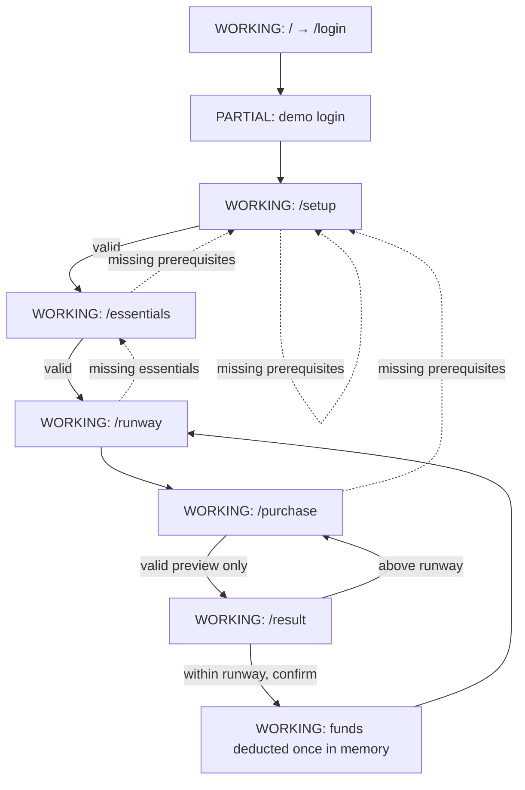

# ASM3 Pre-development Source and Functional Audit

> Project: Student Money Runway — BUS4012 Assignment 02
> Student: Thien Khuong Vu
> Phase: ASM3 pre-development audit
> Evidence date: 2026-10-11 (Australia/Sydney)
> Scope: Read-only source, configuration, existing evidence, lint and production-build audit. No application code was changed.

## 01. Executive Verdict

**ASM2 SOURCE BASELINE HEALTHY — with bounded ASM2 limitations.** The React-only calculation and purchase-preview flow is implemented, guarded against incomplete prerequisite data, and has both current static evidence and prior browser evidence. **ASM3 DEVELOPMENT READY — conditionally:** the baseline is suitable to extend, but there is no backend, persistence, authentication, database, deployment configuration, or Git history to demonstrate ASM3 requirements. This is not a reason to rewrite the frontend.

**OFFICIAL ASM3 BRIEF NOT DIRECTLY AVAILABLE IN WORKSPACE.** ASM3 requirements in this report are those supplied in the audit request, not independently verified rubric wording.

## 02. Repository Inventory

Relevant tree:

```text
src/
  App.tsx, main.tsx, index.css
  pages/ LoginPage, RunwaySetupPage, ProtectEssentialsPage,
         RunwayResultPage, PurchaseCheckPage, ResultPage
  components/layout/AppShell.tsx
  components/ui/FormSection.tsx, MoneyInput.tsx, SummaryRow.tsx, StatusActionButton.tsx
  types/runway.ts
  utils/moneyValidation.ts, runwayCalculations.ts
public/ favicon.svg, icons.svg
docs/ prompts/, implementation/, assessment/, evidence/, figma-reference/
tools/demo-recorder/ Playwright verifier and recorder scripts
package.json, package-lock.json, vite.config.ts, tailwind.config.js,
postcss.config.js, eslint.config.js, tsconfig*.json, .gitignore, README.md
```

Counts: 6 React page files; 5 component files (4 UI, 1 layout); 2 utilities; 0 custom hooks; 0 contexts/providers; 0 root automated-test files; 0 API service files; 0 Python files; 0 SQL/migrations; 0 Supabase configuration; 0 `vercel.json`; 0 `.github` workflow files. `tools/demo-recorder` contains an isolated Playwright verifier, not a root test dependency. Search found no backend or database directory.

`git status --short` shows the whole supplied baseline as untracked, including source and documentation. There is therefore no committed repository history to audit. No unused-module conclusion was made without a bundler report; both `public/icons.svg` and `public/favicon.svg` were not proven unused.

## 03. Existing Technology Stack

React 19.2.8, TypeScript 6, Vite 8, React Router DOM 6.30.6, Tailwind CSS 3, Framer Motion 13, ESLint 10 and Prettier are installed (`package.json`). `src/main.tsx:13-20` mounts a `BrowserRouter` under `StrictMode`. `vite.config.ts:1-7` configures only the React plugin. There is no Python runtime/package manifest, Supabase client package, API base URL, serverless-function folder, cloud configuration, or environment example.

## 04. Actual Screen and Route Inventory

| ID | Route | Component | Purpose/actions | Data source | Status/evidence |
|---|---|---|---|---|---|
| R0 | `/` | redirect | Replaces URL with `/login` | router | Working; `src/App.tsx:59` |
| R1 | `/login` | `LoginPage` | Validate email/password; Continue | local page state only | Partial demo login; `LoginPage.tsx:31-68` |
| R2 | `/setup` | `RunwaySetupPage` | available funds, date, safety buffer; Continue/Back | App in-memory state | Working; `RunwaySetupPage.tsx:30-59` |
| R3 | `/essentials` | `ProtectEssentialsPage` | fixed/flexible essentials; calculate/back | App in-memory state | Working with setup guard; `ProtectEssentialsPage.tsx:35-71` |
| R4 | `/runway` | `RunwayResultPage` | calculated dashboard, edit, purchase start | derived App state | Working with guards; `RunwayResultPage.tsx:34-53` |
| R5 | `/purchase` | `PurchaseCheckPage` | named, positive purchase preview | App in-memory state | Working with guards; `PurchaseCheckPage.tsx:36-82` |
| R6 | `/result` | `ResultPage` | preview, eligible confirmation, confirmed state | derived/mutated App state | Working with guards; `ResultPage.tsx:35-60` |
| R7 | `*` | redirect | invalid path → `/login` | router | Working; `App.tsx:96` |

The confirmed purchase view is a conditional state of R6, not a separate route. No loading, empty-plan retrieval, backend-error, session-expired, sign-up, logout or not-found UI exists.

## 05. Current Feature Inventory

| Feature | Implemented/works | Limitation / ASM3 change |
|---|---|---|
| Validated demo sign-in | Partial | Any syntactically valid email plus non-empty password enters a session; replace with real auth. |
| Setup and essentials forms | Yes | State is lost on refresh; persist a plan. |
| Protected total/runway/shortfall | Yes | Preserve pure calculation contract. |
| Non-mutating purchase preview | Yes | Persist preview only if product needs drafts; otherwise keep transient. |
| Eligible explicit confirmation | Yes in memory | Replace with authenticated, atomic server transaction. |
| Duplicate click guard | Yes in current React session | Server-side idempotency is still required. |
| Responsive app shell | Yes, prior browser evidence | Recheck after persistence/error UI changes. |
| Logout, saved plan, purchase history, network feedback | Missing | Required/strongly justified for ASM3 integration. |

## 06. Actual User Flow



`App.handleRunwayStateChange` (`src/App.tsx:25-27`) merges raw controlled input values. Setup and essentials submissions navigate without mutating calculated values. `PurchaseCheckPage.handleSubmit` (`:76-82`) only navigates. `App.handlePurchaseConfirmation` (`App.tsx:38-56`) validates again, rejects a repeated or over-runway confirmation, and then deducts once. Back/edit actions retain the current draft except “start/check another purchase”, which clears it (`App.tsx:29-36`). All App state resets on a browser refresh.

## 07. User Journey and Navigation Problems

| ID | Reproduction/evidence | Finding | Runtime-tested |
|---|---|---|---|
| F01 | Complete setup, refresh any application route. `useState(INITIAL_RUNWAY_STATE)` at `App.tsx:23`; no storage/effect/service search result. | All financial data and the apparent session disappear. This is expected ASM2 demo behaviour but blocks ASM3 persistence. | Static; historical fresh-route evidence supports reset/redirect behaviour. |
| F02 | Submit `a@b.co` and any non-empty password. `LoginPage.handleSubmit`, `:58-68`, does no credential call. | Login implies authentication but creates no identity/session. | Historical browser report L03. |
| F03 | Directly visit protected routes before entry. Guards redirect to setup/essentials rather than a meaningful auth/session state. | Safe enough for demo; must become auth-aware and data-loading-aware. | Historical report D01–D03. |
| F04 | Open `/purchase` after confirmation and press “Check another purchase.” `PurchaseCheckPage.tsx:97-104` clears draft but does not navigate. | Not broken: user is already on `/purchase`, but the button gives no explicit focus/success feedback. High-value UX improvement only. | Static. |
| F05 | Attempt logout/new session. No symbol, button or route exists. | Cannot clear persisted server session because none exists. | Static. |

## 08. Buttons and Actions Audit

| Screen | Action | Handler / actual behaviour | Status |
|---|---|---|---|
| Login | Continue | `handleSubmit`; errors or reset state then `/setup` | Partial: demo only |
| Setup | header/secondary Back | `navigate('/login')` | Working |
| Setup | Continue | validates then `/essentials` | Working |
| Essentials | both Back actions | `navigate('/setup')` | Working |
| Essentials | Calculate my runway | validates then `/runway` | Working |
| Runway | Review/Edit protected amounts | `navigate('/essentials')` | Working |
| Runway | Check a purchase | clears draft then `/purchase` | Working |
| AppShell | Runway / Check / Manage nav | `NavLink` to `/runway`, `/purchase`, `/essentials`; route guards apply | Working, prerequisite redirect can be abrupt |
| Purchase | Preview impact | validates then `/result`, no deduction | Working |
| Purchase | Back to runway | `Link` to `/runway` | Working |
| Result preview | Back without saving / Edit purchase | both navigate `/purchase`, no deduction | Working (duplicative labels) |
| Result preview | Mark as spent | `onConfirmPurchase`; validates, deduplicates, deducts | Working in memory |
| Result confirmed | View updated runway | `/runway` | Working |
| Result confirmed | Check another purchase | clear draft then `/purchase` | Working |
| Purchase confirmed state | Check another purchase | clear draft, remains route | Partial UX (F04) |

Native buttons and links support mouse and keyboard semantics. `StatusActionButton.tsx:59-82` disables only while its `processing` state is supplied, but R6 always supplies `idle`; protection instead comes from the synchronous state guard at `App.tsx:39-41`. There is no async/loading state because no async operation exists.

## 09. Business Rules and Calculation Verification

`src/utils/runwayCalculations.ts:12-39` implements the supplied contract exactly: protected total is addition; runway and shortfall are clamped with `Math.max(0, ...)`; preview remaining and excess are separately clamped. `moneyValidation.ts:11-29` accepts only non-negative decimal strings with at most two decimal places. Confirmation formats the deducted value to cents (`App.tsx:54`, `moneyValidation.ts:32-35`).

| Case | Expected | Actual | Evidence |
|---|---:|---:|---|
| B01 950,455,180,100 | total 735; runway 215 | 735; 215 | historical runtime R01; static utility |
| B02 650,total 734 | runway 0; shortfall 84 | 0; 84 | historical R02 |
| B03 215 − 160 | 55, no exceed, no mutation | 55; preview-only | historical P06/B01 |
| B04 215 − 215 | 0; confirmation eligible | 0; button present | historical P07 |
| B05 215 − 300 | excess 85; no confirmation | 85; button absent | historical P08 |
| B06 | funds 950 → 790; runway 55 | matches | historical C01 |
| B07 | repeat unchanged | matches in React session | historical C03 and `App.tsx:39-41` |
| B08 | second uses 55 | matches | historical C02 |
| B09/B10 | reject invalid/negative/3dp; stable cents | matches validation contract | historical S/P cases; static format check |

No automated unit test framework exists. The result calculation’s use of JavaScript `number` is acceptable for this bounded display workflow but server persistence should store AUD amounts as integer cents or a fixed-decimal database type (F06).

## 10. React Components and State Architecture

`App` owns one typed `RunwayState` object (`src/types/runway.ts:12-32`) and passes state plus patch callbacks to pages. Inputs are controlled through `MoneyInput` or page-local text fields. Calculations are derived at render time, not stored, in R4/R5/R6. This avoids duplicated derived financial state. No context, hook, effect, mutable object update, or API side effect was found.

| Component | Responsibility / use | Accessibility / ASM3 suitability |
|---|---|---|
| `FormSection` | titled layout; 4 use sites in setup/essentials/purchase | semantic section/header; reusable unchanged |
| `MoneyInput` | controlled AUD text control; 5 use sites | label, `aria-invalid`, linked help/error; reuse unchanged |
| `SummaryRow` | label/value presentation; 15+ use sites | readable flex wrapping; reuse unchanged |
| `StatusActionButton` | purchase action, R6 only | native disabled, `aria-busy`, polite status, reduced motion; source header says 21st.dev/Ruixen provenance (`StatusActionButton.tsx:1-10`) |
| `AppShell` | responsive navigation, R4–R6 | named navs; add signed-in/user/session controls later |

F06: State architecture is intentionally client-only; an ASM3 API integration should introduce a repository/API layer and an authenticated plan state, without moving pure financial formulas into components or persisting derived totals as authoritative values.

## 11. Forms, Validation and Accessibility

Required text fields validate on blur or submit; errors have `role="alert"`, labels, and `aria-describedby`/`aria-invalid` (`MoneyInput.tsx:43-92`; page fields follow the same pattern). Negative, malformed and over-two-decimal monetary entries are rejected; zero is valid for setup/essentials but not purchases. Whitespace-only purchase names are rejected. The native date field only checks presence, not whether the date is past/future/business-appropriate (`RunwaySetupPage.tsx:33-38`): **SUSPECTED — REQUIREMENTS VERIFICATION NEEDED** before adding a stricter date rule.

Known limitation: native HTML validation is disabled (`noValidate`) intentionally in all forms, so application validation is solely responsible. There is no huge-value limit; `Number` accepts very large finite values. F07: add sensible server-side upper bounds and canonical parsing before database writes; do not change the current business formula without a requirement.

## 12. Responsive/UI Audit

Static: Tailwind responsive grids and mobile fixed bottom navigation are implemented in `AppShell.tsx:67-103`; page layouts switch at `lg`. Historical browser evidence in `docs/evidence/runtime/final-runtime-test-report.md` records no document overflow at 390, 768, 1024 or 1280px and visual inspection of 1280×900/390×844 captures. This audit did not complete a new interactive browser run: the attempted verifier was interrupted before output. Any new loading/error/auth UI must be rechecked at those widths.

## 13. Missing Screens and UI States

| Candidate | Verdict | Minimum implementation |
|---|---|---|
| Real sign-in and sign-up/recovery entry | REQUIRED BY ASM3 if selected auth flow needs it | Existing login screen plus auth links/conditional state; not necessarily routes |
| Loading/error/empty saved plan | REQUIRED BY ASM3 | Inline/screen conditional states on setup/runway |
| Saved-plan retrieval/edit | REQUIRED BY ASM3 | Reuse setup/essentials; a plan selector only if multiple plans are in scope |
| Save success/failure | REQUIRED BY ASM3 | reusable inline status/toast |
| Purchase history/recorded feedback | HIGH-VALUE UX IMPROVEMENT | confirmed R6 plus a compact history section, not necessarily a route |
| Logout/session expired | REQUIRED BY ASM3 | AppShell control and redirect/notice |
| Not-found page | OPTIONAL | current safe redirect is sufficient for minimum scope |
| Peer-review feature | OUT OF SCOPE | assessment process, not product feature |

## 14. Missing Functions and Integration Gaps

ASM2 limitation: no persisted data or real identity (F01/F02). ASM3 missing functions: authenticated load/create/update plan; authenticated purchase creation with a single atomic balance update; fetch history; loading/error handling; environment configuration; deployment. No actual API service, Python function, database client, or migration exists. The current flow is otherwise complete for an in-memory demo.

## 15. Authentication and Session Readiness

`LoginPage.validateLogin` (`LoginPage.tsx:31-49`) checks only syntax/presence. `onStartSession` resets the App object (`App.tsx:62-64`) and no token, account identifier, protected resource request, logout, registration, password recovery or expiration handling exists. Never persist passwords in React state after migration. Use Supabase Auth on the client or through a deliberate backend flow; establish the user from verified server/auth context, not a client-provided user ID.

## 16. Backend and Supabase Readiness

Current state: **MISSING.** Proposed minimum: React calls a Python/FastAPI service over HTTPS; the service validates an authenticated Supabase JWT, applies server-side input validation/business calculations, and uses a server-held Supabase service credential only where necessary. Browser-visible Supabase anon credentials must be restricted by Row Level Security; service-role credentials must never be included in Vite variables or the client bundle. Vercel deployment needs explicit runtime/function packaging validation before selecting a layout.

## 17. Database and API Recommendations

Minimum normalized schema: `plans(id, user_id, planning_date, available_funds_cents, safety_buffer_cents, fixed_essentials_cents, flexible_essentials_cents, created_at, updated_at)` and `purchases(id, plan_id, user_id, name, amount_cents, idempotency_key, created_at)`. RLS must permit each authenticated user only their own rows. Avoid persisting runway/shortfall as source-of-truth; derive them.

Minimum endpoints: `GET /plans/current`, `PUT /plans/current`, `GET /plans/current/purchases`, `POST /plans/current/purchases`. The POST must validate plan ownership, amount, current balance and idempotency key, then insert purchase and decrement available funds atomically in one database transaction/RPC. Exact API paths are a recommendation, not an existing contract.

## 18. Purchase Integrity and Security Risks

F08 (ASM3 critical): client-only `purchaseConfirmed` prevents duplicate clicks only in one browser memory session; it cannot prevent concurrent tabs, retry replay or tampered requests. F09 (ASM3 critical): a client-calculated runway/amount is not authoritative. Mitigate F08/F09 with database transaction, user-scoped RLS, server recomputation, amount-in-cents, idempotency key and durable response. F10: no current secret is exposed because no integration exists; risk begins when keys are added. Keep `.env` ignored as already configured and publish only intentionally safe variables.

## 19. Code Health, Performance and Source Hygiene

`npm run lint` passed with no output. Production build passed after the sandbox’s process-spawn restriction was lifted; output contained 438 transformed modules and a 406.93 kB uncompressed JS asset (126.20 kB gzip). This is not a demonstrated performance defect. First sandbox build failure (`spawn EPERM` during Vite config loading) was environment-related, not source-related. Source headers consistently identify phase/responsibility, with some character-encoding garbling visible in shell output but valid Unicode source is present in inspected files. No Git history exists; all baseline files are untracked, which blocks a meaningful commit walkthrough.

## 20. GitHub and Vercel Deployment Readiness

Git is installed but `git status` shows no committed tracked files. GitHub repository connection/remote is **NOT VERIFIED**. No Vercel configuration, preview/production URL, deployment manifest, environment configuration or CI workflow was found. The Vite frontend can build, but live deployment and Python function packaging are **MISSING**.

## 21. Test Execution Report

| Check | Result | Evidence/limitation |
|---|---|---|
| `npm run lint` | PASS | Executed 2026-10-11; no output/errors. |
| `npm run build` | PASS | Executed 2026-10-11; Vite production build completed in 7.57s after environmental permission issue. |
| Root unit/integration tests | NOT AVAILABLE | No test script/framework. |
| Existing Playwright flow | Historical PASS | `docs/evidence/runtime/final-runtime-test-report.md` records all canonical, direct-route and responsive cases on 2026-09-17. |
| New browser verifier | NOT COMPLETED | Started, then audit turn was interrupted before any result; no pass claimed. |

## 22. ASM2 → ASM3 Requirement Traceability

| Supplied ASM3 direction | Current source | Gap |
|---|---|---|
| Functional React screens | six screens and routes | satisfied baseline |
| Python backend | no Python files | missing |
| Supabase save/retrieve | no client/schema/migration | missing |
| Real persistence | App `useState` only | missing |
| Secure credentials | `.env*` ignored | partial: no credential architecture yet |
| Live cloud URL | no deployment config/URL | missing |
| Committed GitHub repo | all files untracked | missing/not verified |
| Prompt history | `docs/prompts/` present | present; preserve |

## 23. Prioritised Defect and Functional Gap Register

| Priority | ID | Finding | Source evidence | Required action |
|---|---|---|---|---|
| P0 | F01 | state lost on refresh | `App.tsx:23`, `types/runway.ts:23-32` | durable per-user plan storage |
| P0 | F02 | demo authentication | `LoginPage.tsx:31-68` | real auth/session lifecycle |
| P0 | F08 | no server atomicity/idempotency | `App.tsx:38-56` | transactional purchase endpoint/RPC |
| P0 | F09 | client is financial authority | utilities and App confirmation | server recomputation/authorization |
| P1 | F06 | no API/data boundary | full tree search | introduce typed client/API layer |
| P1 | F10 | future credentials/deployment unprepared | no env config/backend | environment policy and cloud configuration |
| P1 | F07 | no maximum monetary bound | `moneyValidation.ts:11-29` | server cap/canonical cents validation |
| P2 | F04 | no feedback after in-place new-purchase reset | `PurchaseCheckPage.tsx:97-104` | focus/status polish |

## 24. Proposed Minimum Complete Feature Scope

**MUST HAVE:** Supabase Auth; one saved current plan per user; Python backend connected to Supabase; secure environment handling; authenticated retrieval/update; atomic, idempotent purchase confirmation; loading/saving/error feedback; deployed React/Python application; committed remote repository; retained prompt evidence.

**SHOULD HAVE:** purchase history, logout/session-expired messaging, focused success feedback, API integration tests.

**OPTIONAL:** multiple saved plans, charts, richer profile/settings, a dedicated not-found screen.

**OUT OF SCOPE:** peer-review workflow inside the product, budgeting advice/financial recommendations, banking integrations, changing the locked runway formulas, broad frontend redesign or framework replacement.

## 25. Recommended ASM3 Phase Roadmap

1. **Scope freeze and data contract:** retain route/UI/formula contract; define cents-based schema, ownership and API errors. Acceptance: reviewed schema/API contract and no source rewrite.
2. **Auth and secure configuration:** implement Supabase Auth/session guard and environment separation. Acceptance: unauthenticated users cannot access plans; no secret in client source.
3. **Python/Supabase plan persistence:** implement and test GET/PUT current plan, loading/empty/error states. Acceptance: refresh restores only the signed-in user’s saved plan.
4. **Atomic purchase persistence:** implement idempotent transaction and history. Acceptance: duplicate/retry/concurrent request cannot double-deduct; excess purchase rejected server-side.
5. **Integration, deployment and evidence:** connect UI, test responsive/errors, deploy, commit/push, capture demo/database/Git evidence. Acceptance: live URL and all required evidence operate end-to-end.

## 26. Estimated Change Impact

Likely frontend changes: `src/App.tsx`, `LoginPage.tsx`, `RunwaySetupPage.tsx`, `ProtectEssentialsPage.tsx`, `RunwayResultPage.tsx`, `PurchaseCheckPage.tsx`, `ResultPage.tsx`, `AppShell.tsx`, types and new API/auth modules. New backend/database/deployment files are required. Care areas: preserve raw controlled-input validation, keep preview non-mutating, retain exact boundary behaviour, ensure React state is reconciled after server responses, and do not place service credentials in frontend code. No time estimate is offered.

## 27. Final Go / No-Go Recommendation

**GO, with scope freeze.** Safest next task: create the ASM3 data/auth/API contract and Supabase schema/RLS plan before modifying the React UI. The current UI and pure calculation functions should be reused; implement persistence and server transaction boundaries first.
