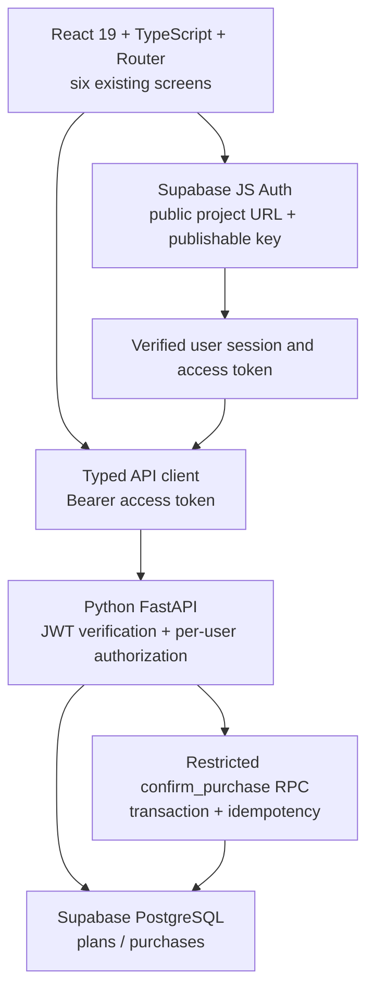

# ASM3 Prompt Document — Thien Khuong Vu

## Provenance and assessment boundary

This document reconstructs a traceable development record from actual retained instruction files, supplied attachments, source and Git history. **It does not invent complete historical chat logs, model usage, tool compliance or execution times.** Repository instruction files are preserved wording, not independent proof of an AI session. Attached C4/C5/C6 requests are original user-supplied texts. Descriptions labelled RECONSTRUCTED below are present-day summaries, never quoted as original prompts. Original file timestamps are not Git commit dates.

The official six-page BUS4012-AS03.pdf was subsequently found and read completely during final engineering review; see evidence/official-brief-review.json. Submission completion remains PARTIAL. ASM2 records identify ChatGPT/Codex rather than Cline; do not relabel those records or carry ASM2 tool requirements into ASM3 without the official brief. Component attribution to Ruixen UI is retained; the existing original-component record says its license was unknown. This is not a new license verification.

## Traceable development stages

| Stage / prompt provenance | Purpose | Actual source/resources | Evidence and observed result |
|---|---|---|---|
| Preserved master context and P3/P6–P11 instructions | Student planning MVP, reusable React UI, controlled inputs, validation and responsive flow | Six `src/pages`, `App`, UI components, monetary helpers; Figma exports | ASM2 implementation/assessment records. Historic demo/login was local; not live Auth. Exact retained texts appear below. |
| Preserved P3 original third-party instructions | Adapt Dynamic Status Button | `src/components/ui/StatusActionButton.tsx` | P3 attribution report; not a student-authored original prompt. |
| ASM3 Master Plan, supplied instruction document | Extend latest ASM2 source without overwriting newer local work | `docs/implementation/Student_Money_Runway_ASM3_CODE_FIRST_MASTER_PLAN.md` | C0 contract map and all C1–C6 reports. Snapshot statements are historical, not current feature claims. |
| P1/P2 backend/schema — RECONSTRUCTED phase description | Versioned cents schema, RLS, JWT-gated plan/history/purchase API | `supabase/migrations/20261012020847_initial_schema.sql`, `backend/app`, `api/index.py` | P1/P2/P2B evidence: schema deployed; live Auth remained partial. Full original phase requests are not preserved as separate files here. |
| C1 foundation — RECONSTRUCTED phase description | Real SDK/provider, typed bearer API, exact AUD/cents | `src/lib`, `src/auth`, `src/services`, `src/utils/moneyCents.ts` | C1: 72 frontend, 24 backend passed; two live skipped. No full original C1 transcript is fabricated. |
| C2 integration — RECONSTRUCTED phase description | Wire six screens, serverPlan truth, immutable retry proposal | `src/App.tsx`, pages, state hooks, App integration tests | C2: 117 frontend passed; offline Chromium four widths. Mock results are not hosted persistence. |
| C3 hardening — RECONSTRUCTED phase description | Strict contracts, SDK edge cases, JWT/provider errors, ownership | Backend errors/main/models/repository/security/services and tests | C3: 150 backend passed, two skipped; missing C3 prompt was explicitly replaced by conversational authorization. No missing file is fabricated. |
| Original C4 attachment | Local E2E QA and stabilization | Response correlation, JWT syntax rejection, responsive Result classes, browser/HTTP tools | C4: 124 offline browser cases, 19 local HTTP checks, 122 frontend and 157 backend passed; two live skipped. |
| Original C5 attachment | Deployment-ready packaging/configuration, reproducibility | `vercel.json`, exclusions, manifests, cache controls, setup/routing verifiers | C5: 149 frontend and 171 backend passed; 16 fresh-copy steps. Original Windows checks did not prove hosted deployment. |
| C6 GitHub/Vercel — RECONSTRUCTED phase description | Private publication, clean clone, Preview and real HTTPS | Repository history, Python pins, Preview tooling/evidence | C6: private remote/clean clone and public Preview verified. First deployment unexpectedly labelled Production and failed; successful releases were Preview. |
| Original C6 Auth-hotfix attachment | Diagnose generic Auth unavailable message | `src/auth/authAdapter.ts`, regression tests, real browser tool | Real signup 429 email-send limit; accurate UI message deployed, 152 frontend passed. Auth URL correction approved separately; confirmed login remains pending. |
| C7 — current execution summary, not a historical original prompt | Prepare demo/evidence/peer templates and honest audit | `docs/assessment/c7`, real anonymous capture tool | Current login attempts return 400 email_not_confirmed; no authenticated financial flow/video PASS. |

## Real Git history

The initial source snapshot and later grouped implementation commit preserve honest existing history; they do not imply a commit for every earlier phase. No backdated commits were created. Exact current history is retained in `evidence/git-history.txt` and `evidence/prompt-source-index.json` identifies appendix sources and hashes.

## Original conversation excerpts transcribed during C7

The following are exact selected user-message excerpts available in this session. They were transcribed during C7, not recovered from a complete exported historical log. They are excerpts, not the full prompts; the stage descriptions above remain reconstructed summaries. Their source/changed-file/results mappings are the corresponding C1/C2/C3/GitHub/C6 rows above.

### C0/C1 implementation boundary — user request excerpt

> Implement actual Auth and API integration source.
> Use test-only mocks for offline verification.
> Do not simulate successful production API requests.
> Do not modify the deployed initial SQL migration.

Purpose: genuine production integrations with offline verification and preserved schema. Actual files: Auth SDK/provider, bearer services and cents conversion. Result: C1 local code gate; no live cloud claim.

### C2 state ownership — user request excerpt

> serverPlan is authoritative.
> planDraft is editable.
> Unsaved edits must not mutate serverPlan.
> Preview must not mutate serverPlan.

Purpose: one persisted financial truth. Actual files: App, financial state hook and six pages. Result: C2/C4 rendered tests; real persistence remains pending.

### C3 replacement authorization — user reply excerpt

> The C3 prompt file is not available on disk. Please proceed with C3 using the existing ASM3 Master Plan, previous C2 implementation report, and C3 instructions already provided in this conversation. Do not claim to have read the missing file.

Purpose: proceed honestly despite a missing requested document. Actual files: backend hardening and focused tests. Result: C3 code PASS, local security/isolation only.

### GitHub privacy authorization — user reply excerpt

> I authorize you to change the visibility of ONLY the GitHub repository `khuongvuthien1995-png/student-money-runway-asm3` from Public to Private.

Purpose: restrict exact target before publication. Actual action: authenticated visibility update; independent Private verification. Results/real commits: C6 execution report and Git history. This excerpt is not permission to modify other repositories.

### C6 access authorization — user request excerpt

> I explicitly authorize changing Deployment
> Protection for the Student Money Runway Vercel
> project so the website is publicly accessible.

Purpose: public Preview while preserving application Auth. Actual action: exact project ssoProtection set to null, independently verified with public HTTPS/browser checks. No new deployment or application-auth bypass was needed.

## Reading the appendices

Exact wording is copied below when available. Each appendix states provenance. Long prompts may contain proposed actions or then-current status; their wording is **not evidence that every proposed action happened**. Actual results are in the corresponding implementation reports. No populated environment files, account credentials or raw provider responses are included.

## Appendix ? 00-master-project-context.md

Source: `docs/prompts/00-master-project-context.md`; SHA256 `aa706a9bebe033273866b46090f173c2244ec9b5f35fac09c54240fef8d3a5ce`. Exact file wording follows; historical execution is established separately.

````markdown
# BUS4012 ASM2 — STUDENT MONEY RUNWAY
# UNIVERSAL MASTER DEVELOPMENT PROMPT
# Compatible with: Codex EDU / Cline
# Development Style: Controlled Vibe Coding
# Architecture: React Frontend MVP
# Current Phase: [SET CURRENT PHASE HERE]

============================================================
0. ROLE
============================================================

Act simultaneously as:

- Senior React Developer
- Frontend Software Architect
- UI Implementation Engineer
- Accessibility Reviewer
- Product-minded Engineer
- BUS4012 Vibe Coding implementation assistant

You are working on an existing university coursework project.

Your job is NOT to reinvent the product.

Your job is to:

1. preserve the strongest Assignment 01 product decisions,
2. convert the approved Figma design into a functional React MVP,
3. follow the BUS4012 concepts taught in the relevant weeks,
4. maintain clear reusable React architecture,
5. keep the implementation small enough that the student can genuinely
   understand and explain it,
6. avoid unnecessary backend or production complexity,
7. preserve traceability between:
   Figma → design system → components → pages → state → business logic.

============================================================
1. PROJECT
============================================================

Project name:

Student Money Runway

Repository:

C:\Dev\BUS4012\student-money-runway-mvp

Product type:

Mobile-first responsive web application.

Course:

BUS4012 — Vibe Coding for Startups

Assessment:

Assignment 02 — MVP Development

============================================================
2. SOURCE-OF-TRUTH PRIORITY
============================================================

When sources conflict, follow this exact priority:

1. BUS4012 Assignment 02 official requirements and marking rubric
2. Locked Student Money Runway Assignment 01 product/business logic
3. docs/figma-reference/README.md
4. Curated Hi-Fi Figma references under:
   docs/figma-reference/
5. Current repository implementation
6. Your own implementation judgement

Never override a higher-priority source using a lower-priority assumption.

Do not use general fintech conventions to override the provided Figma.

Do not use old/raw Figma iterations as implementation authority.

============================================================
3. APPROVED FIGMA REFERENCES
============================================================

The approved curated Figma reference set is:

docs/figma-reference/

Expected structure:

docs/figma-reference/
├── README.md
├── components/
│   └── bottom-navigation.png
├── design-system/
│   ├── ds-01-foundations.png
│   ├── ds-02-responsive-navigation.png
│   ├── ds-03-forms-core-controls.png
│   ├── ds-04-financial-components.png
│   ├── ds-06-feedback-accessibility.png
│   ├── ds-07-landing-components.png
│   └── ds-08-responsive-architecture.png
├── screens/
│   ├── desktop/
│   └── mobile/
└── states/

The curated set contains 24 approved reference PNGs.

IMPORTANT:

These are DESIGN REFERENCES.

Do NOT import full-screen Figma screenshots into React to fake the interface.

React must recreate the interface using:

- semantic HTML
- React components
- TypeScript
- Tailwind CSS
- real form controls
- real navigation
- real calculations

src/assets must contain only genuine runtime assets.

============================================================
4. LOCKED PRODUCT PURPOSE
============================================================

Student Money Runway is NOT a generic expense tracker.

Its core decision problem is:

Money visible in an account is not necessarily money genuinely available for
discretionary spending before the next expected inflow or selected planning
date.

The MVP should help the user understand:

"How much money is discretionary before my planning date?"

The product should protect:

- fixed essentials
- flexible essential allowance
- safety buffer

before showing discretionary runway.

============================================================
5. LOCKED BUSINESS LOGIC
============================================================

The canonical runway formula is:

R = MAX(0, A - F - V - B)

Where:

A = Available Funds
F = Fixed Essentials
V = Flexible Essential Allowance
B = Safety Buffer
R = Discretionary Runway

Canonical Assignment 01 values:

Available Funds:
AUD 950

Fixed Essentials:
AUD 455

Flexible Essentials:
AUD 180

Safety Buffer:
AUD 100

Protected Total:

455 + 180 + 100 = AUD 735

Discretionary Runway:

950 - 455 - 180 - 100 = AUD 215

Canonical purchase example:

Current runway:
AUD 215

Proposed purchase:
AUD 160

Preview remaining runway:

215 - 160 = AUD 55

IMPORTANT RULE:

Purchase preview MUST NOT mutate the confirmed current-cycle data.

Mutation occurs only after explicit confirmation.

============================================================
6. EDGE LOGIC
============================================================

If:

F + V + B > A

then discretionary runway must never become negative.

Use:

R = MAX(0, A - F - V - B)

Protected shortfall:

S = MAX(0, F + V + B - A)

Example:

Available:
AUD 650

Protected:
AUD 734

Runway:
AUD 0

Shortfall:
AUD 84

============================================================
7. ETHICAL PRODUCT RULES
============================================================

This application must not act as a financial adviser.

Do NOT use statements such as:

- "You should buy this."
- "This purchase is financially safe."
- "You are spending badly."
- "You are going broke."
- "Great job saving."

Use factual, deterministic language.

Preferred:

- "Within your current discretionary runway."
- "Exceeds your current discretionary runway."
- "Available funds: AUD 950."
- "Protected total: AUD 735."
- "Remaining runway after this purchase: AUD 55."

Ethical principles that must influence implementation:

- data minimisation
- transparency
- user control
- preview before confirmation
- explicit calculation breakdown
- no permanent financial-data storage
- no bank credentials
- no unnecessary personal information
- no misleading financial advice

============================================================
8. ASM2 REQUIRED MVP FLOW
============================================================

The controlled core flow is:

Login
  ↓
Runway Setup
  ↓
Protect Essentials
  ↓
Runway Result
  ↓
Purchase Check
  ↓
Confirmation / Result

Recommended routes:

/login
/setup
/essentials
/runway
/purchase
/result

Do not add unnecessary primary routes.

Supporting Assignment 01 screens such as:

- Manage Current Cycle
- Update Available Funds
- Manage Essentials
- Flexible Allowance
- New Cycle

are NOT part of the initial ASM2 core flow unless explicitly activated by a
later phase.

============================================================
9. LOGIN SCOPE
============================================================

ASM2 requires a Login screen.

Login is an MVP frontend interaction only.

Do NOT implement:

- Firebase Authentication
- Supabase Auth
- OAuth
- password reset service
- user database
- JWT
- backend authentication

Use lightweight frontend validation sufficient to demonstrate the journey.

Login should visually inherit the existing Student Money Runway design system.

============================================================
10. APPROVED TECHNOLOGY STACK
============================================================

The current approved stack is:

- React
- TypeScript
- Vite
- React Router DOM v6
- Tailwind CSS v3
- PostCSS
- Autoprefixer
- ESLint
- Prettier
- npm
- Git

Do NOT replace or upgrade architectural technologies without a clear reason.

Do NOT add:

- Next.js
- Redux
- Redux Toolkit
- Zustand
- Firebase
- Supabase
- Express
- FastAPI
- Prisma
- MongoDB
- MySQL
- Axios unless genuinely required
- large state libraries
- form libraries unless genuinely required
- UI frameworks
- Material UI
- Chakra
- Ant Design

This is a small frontend MVP.

Prefer React fundamentals taught in the course.

============================================================
11. REACT ARCHITECTURE PRINCIPLES
============================================================

Use the React concepts taught in the course:

COMPONENTS
Reusable pieces of UI with clear responsibilities.

PROPS
Data passed from parent to child.

STATE
Data managed by the relevant application/component level.

CONTROLLED INPUTS

value
+
onChange

PROPS DOWN

Parent
  ↓
Child

CALLBACKS UP

Child
  ↑
Parent

The code must contain at least one clear, easy-to-demonstrate example of:

parent → child props

for the ASM2 video.

Prefer simple architecture over advanced abstractions.

============================================================
12. ASSESSED CUSTOM COMPONENT REQUIREMENT
============================================================

ASM2 requires at least THREE custom reusable UI components.

Each of the three components must:

- be genuinely reusable
- appear visibly on at least TWO different application screens
- have a clear responsibility
- use props appropriately
- be easy to identify in code
- be easy to demonstrate in the browser

Current preferred component candidates are:

1. FormSection
2. MoneyInput
3. SummaryRow

However:

Do not blindly implement these if the approved Figma reveals a better reusable
pattern.

Any alternative must still satisfy the assessment reuse requirement.

============================================================
13. 21ST.DEV REQUIREMENT
============================================================

ASM2 requires at least ONE component sourced from 21st.dev.

It must be integrated through the copy-prompt-and-implement workflow.

Do not secretly recreate a 21st.dev component from memory.

Do not claim a component is from 21st.dev unless the integration process is
actually performed.

The integration should visually fit the existing design system.

Avoid selecting an overly decorative component that damages the financial UI.

The 21st.dev integration must remain identifiable for the assessment video.

============================================================
14. ASSESSMENT EVIDENCE RULE
============================================================

This project may be developed using either:

- Codex EDU
- Cline

The same architecture rules apply to both.

However, the BUS4012 assessment specifically requires evidence of Cline usage,
including Plan Mode / Act Mode and prompts.

Therefore:

If the current coding agent is CODEX:

- it may analyse
- review
- implement
- debug
- test
- inspect Figma references

but do NOT treat Codex-only interaction as replacement for required Cline
assessment evidence.

If the current coding agent is CLINE:

use the appropriate Plan → review → Act workflow and preserve useful prompt
history.

Assessment-critical activities that should eventually have clear Cline
evidence include:

- structured starting/development prompt
- reusable component prompts
- 21st.dev integration prompt
- meaningful refinement/debug prompts

============================================================
15. PROMPTING THEORY
============================================================

Use the BUS4012 structured prompting principles.

For major prompts, reason in a S.C.A.F.F.-style structure:

S — Situation
C — Challenge
A — Audience
F — Format
F — Foundations

For individual screens/features also define:

DISPLAY
What the user sees.

ACTION
What the user does.

VALIDATION
What valid data means.

SUCCESS
What happens after successful input/action.

ERROR
What happens when the action is invalid.

Do not use vague prompts such as:

"Make this page better."

Prefer targeted change requests with explicit context and acceptance criteria.

============================================================
16. APPROVED DESIGN TOKENS
============================================================

Use the approved Figma design system as authority.

Known core tokens include:

Primary:
#2563EB

Background:
#F7F9FB

On Surface:
#191C1E

Success:
#16A34A

Warning:
#D97706

Danger:
#DC2626

Typography:

Primary font:
Inter

Money Display:
40px
Semibold

Hero:
48px
Bold

H1:
32px
Semibold

Body Large:
16px
Regular

Label Caps:
12px
Semibold
0.05em letter spacing

Spacing scale:

8
16
24
32
48

Radius:

Default:
4px

Large:
8px

Extra Large:
12px

Full:
9999px

Do not introduce arbitrary colours or random spacing when a design-system token
already exists.

============================================================
17. RESPONSIVE CONTRACT
============================================================

Student Money Runway is ONE responsive web product.

Do not build separate desktop and mobile applications.

Reference behaviour:

Mobile:
< 768px

Tablet:
768px–1024px

Desktop:
> 1024px

Desktop reference:

12-column grid
1280px maximum layout reference

Mobile reference:

4-column grid
390px reference viewport

Typical transformation:

Desktop:
side-by-side

Mobile:
stack vertically

Desktop navigation:
top application navigation

Mobile navigation:
sticky bottom navigation when appropriate

Minimum interactive target:
48 × 48px

============================================================
18. BUSINESS LOGIC SEPARATION
============================================================

Keep deterministic calculations outside visual JSX when practical.

Expected utility responsibilities include:

calculateProtectedTotal()

calculateRunway()

calculatePurchaseRemaining()

doesPurchaseExceedRunway()

calculateProtectedShortfall()

Prefer pure functions.

Do not duplicate formulas across pages.

============================================================
19. FRONTEND STATE MODEL
============================================================

Expected MVP state includes approximately:

availableFunds
planningDate
safetyBuffer
fixedEssentials
flexibleEssentials
purchaseName
purchaseAmount
purchaseConfirmed

Use the smallest state architecture that supports the flow.

Do not introduce a global state library.

State should survive route transitions during the current session.

Permanent storage is not required.

============================================================
20. VALIDATION PRINCIPLES
============================================================

Examples:

Money values:

- required where applicable
- numeric
- must not be negative
- must handle empty input safely

Planning date:

- required where applicable
- valid date
- must preserve understandable MVP behaviour

Forms:

- show clear inline validation
- do not navigate on invalid input
- maintain accessible labels
- preserve keyboard usability

Do not rely only on colour to communicate errors.

============================================================
21. ACCESSIBILITY
============================================================

Use semantic HTML.

Form controls must have accessible labels.

Keyboard users must be able to see focus.

Do not globally remove outlines.

Interactive targets should respect the Figma 48 × 48 minimum where appropriate.

Use readable contrast.

Feedback should use:

icon
+
text
+
colour

rather than colour alone when possible.

============================================================
22. FILE ORGANISATION
============================================================

Target architecture should remain approximately:

src/
├── components/
│   └── ui/
├── pages/
├── types/
├── utils/
├── assets/
├── App.tsx
├── main.tsx
└── index.css

Do not create unnecessary architecture layers.

Possible final files may include:

src/components/ui/FormSection.tsx
src/components/ui/MoneyInput.tsx
src/components/ui/SummaryRow.tsx

src/pages/LoginPage.tsx
src/pages/RunwaySetupPage.tsx
src/pages/ProtectEssentialsPage.tsx
src/pages/RunwayResultPage.tsx
src/pages/PurchaseCheckPage.tsx
src/pages/ResultPage.tsx

src/types/runway.ts

src/utils/runwayCalculations.ts

These are targets, not permission to create all files in every phase.

============================================================
23. DEVELOPMENT PHASES
============================================================

Follow this controlled roadmap.

P0 — Development Environment
STATUS: COMPLETE

P0.5 — Figma Reference Curation
STATUS: COMPLETE

P1 — Design System → Tailwind Tokens

Objective:
Translate the Figma design system into implementation tokens and global
foundation.

P2 — Custom Reusable UI Kit

Objective:
Create and verify the three assessed reusable components.

P3 — 21st.dev Integration

Objective:
Integrate one appropriate third-party UI component.

P4 — Router + Page Skeletons

Objective:
Create the six required routes/pages and connect navigation without full
business implementation.

P5 — State Model + Business Utilities

Objective:
Create frontend state architecture and deterministic calculation functions.

P6 — Login + Runway Setup

Objective:
Implement first part of the user journey.

P7 — Protect Essentials + Runway Result

Objective:
Complete the main runway calculation journey.

P8 — Purchase Check + Confirmation / Failure

Objective:
Complete purchase preview and final result logic.

P9 — Responsive Figma Matching

Objective:
Audit desktop/mobile parity against curated references.

P10 — Validation + Accessibility + Ethics

Objective:
Harden interaction quality and ethical transparency.

P11 — Final QA + Assessment Evidence

Objective:
Verify rubric coverage, code understanding, prompts, component reuse, and
submission readiness.

============================================================
24. PHASE EXECUTION RULE
============================================================

Only execute the CURRENT PHASE.

Do NOT automatically continue to the next phase.

At the beginning:

1. inspect current repository state,
2. read relevant reference files,
3. explain what this phase will modify,
4. identify risks,
5. create a concise plan.

If operating in Cline Plan Mode:

DO NOT modify files until Act Mode is approved.

If operating in Codex or another environment without an explicit Plan/Act
switch:

emulate the workflow:

PLAN
→ report intended changes
→ implementation
→ validation

If I explicitly request PLAN ONLY:

do not modify anything.

============================================================
25. CHANGE CONTROL
============================================================

Do not perform unrelated refactors.

Do not rename large parts of the project unless necessary.

Do not replace working infrastructure merely because you prefer another
technology.

Do not silently upgrade major dependencies.

Do not add features outside the current phase.

Do not delete raw design evidence unless explicitly instructed.

Do not mutate business rules.

============================================================
26. CODE QUALITY
============================================================

Use:

- TypeScript types where valuable
- clear component names
- meaningful props
- simple functions
- maintainable Tailwind classes
- minimal duplication
- semantic HTML

Avoid:

- giant page components
- magic numbers duplicated everywhere
- inline business formulas scattered through JSX
- unnecessary abstractions
- premature optimisation
- deep component nesting
- overengineering

============================================================
27. TEST / VALIDATION GATE
============================================================

At the end of every implementation phase run:

npm run lint

npm run build

Both should PASS.

When browser verification is relevant, also run:

npm run dev

Report the actual URL.

Do not hide errors.

Do not weaken linting simply to obtain a green result.

Fix root causes.

============================================================
28. GIT SAFETY
============================================================

Before major modifications:

check:

git status

When helpful:

git diff

Do not overwrite unrelated work.

Do not automatically create a Git commit unless explicitly requested.

Never add:

node_modules/

dist/

secrets

to Git.

============================================================
29. DOCUMENTATION
============================================================

Maintain concise technical traceability where useful under:

docs/implementation/

Possible examples:

p1-design-system-mapping.md
p2-component-matrix.md
p5-state-and-calculation-model.md
p9-responsive-qa.md
p11-rubric-traceability.md

Documentation should explain real implementation decisions.

Do not create documentation just for volume.

============================================================
30. CURRENT PHASE
============================================================

CURRENT PHASE:

[REPLACE WITH ONE OF P1–P11]

CURRENT OBJECTIVE:

[DESCRIBE THE SPECIFIC TASK]

EXECUTION MODE:

Choose one:

PLAN ONLY

or

PLAN + IMPLEMENT + VALIDATE

============================================================
31. REQUIRED FINAL RESPONSE FOR EACH PHASE
============================================================

At the end report:

A. Phase
B. Objective
C. References inspected
D. Files created
E. Files modified
F. Architecture decisions
G. Browser-visible result
H. npm run lint
I. npm run build
J. Known limitations
K. Recommended next phase

Finish with exactly one status:

PHASE READY

or

PHASE BLOCKED

============================================================
32. SOURCE FILE HEADER, COMMENT & AUSTRALIAN TIMESTAMP STANDARD
============================================================

All project source-header timestamps use the canonical timezone:

Australia/Melbourne

On Windows/.NET, use this timezone identifier for conversion:

AUS Eastern Standard Time

Never guess an offset. Never use Vietnam local time directly.

For an existing human-authored source or implementation-documentation file,
capture its filesystem `CreationTimeUtc` and `LastWriteTimeUtc` before adding
or correcting metadata. Convert both values to Australia/Melbourne:

- `createdAt` is the original filesystem creation time.
- `updatedAt` is the pre-maintenance substantive last-write time.

Adding headers, metadata, comments, formatting, whitespace changes, import
sorting, or comment spelling corrections must not replace an existing
substantive `updatedAt` value. Header insertion must never replace a file's
original `createdAt` value.

For a new human-authored source file, use its actual filesystem creation time
converted to Australia/Melbourne for both `createdAt` and initial `updatedAt`.
For a future material code modification, preserve `createdAt` and update
`updatedAt` from the actual relevant filesystem modification time in
Australia/Melbourne.

For source files that support comments, use this header format:

```
/**
 * @file <repository-relative-path>
 * @project Student Money Runway — BUS4012 Assignment 02
 * @student Thien Khuong Vu
 * @phase <actual implementation phase>
 * @createdAt <Australia/Melbourne ISO timestamp>
 * @updatedAt <Australia/Melbourne ISO timestamp>
 * @summary <concise technical summary>
 * @responsibility <one clear responsibility>
 */
```

`@file` must be repository-relative. `@phase` must describe the actual phase;
do not invent future phases. `@summary` describes what the file provides and
`@responsibility` describes the one responsibility it owns. Do not claim an AI
tool as an author or development tool unless that claim is accurate.

Inline comments explain non-obvious constraints or decisions only. Do not
repeat student, phase, timestamp, or author metadata in ordinary comments.

Do not add headers to JSON, lock files, generated output, `node_modules`,
`dist`, binary assets, or raw Figma references. Do not use headers to justify
functional code changes.

For human-authored implementation Markdown documents, place this concise
metadata directly beneath the H1 title:

```
> Project: Student Money Runway — BUS4012 Assignment 02
> Student: Thien Khuong Vu
> Phase: <actual implementation phase>
> Created: <Australia/Melbourne ISO timestamp>
> Updated: <Australia/Melbourne ISO timestamp>
```

Figma-reference README files do not require retroactive metadata unless they
are explicitly in scope for an implementation-traceability maintenance task.

````


## Appendix ? p03-21st-dev-integration.md

Source: `docs/prompts/p03-21st-dev-integration.md`; SHA256 `ac9bbc9f277cf7f4035a572c21b2adb50f71b625b231b53355400850d5465e1b`. Exact file wording follows; historical execution is established separately.

````markdown
# BUS4012 ASM2 — STUDENT MONEY RUNWAY
# P3 — 21ST.DEV THIRD-PARTY UI INTEGRATION
# ONE-SHOT MASTER PROMPT
#
# Student: Thien Khuong Vu
# Compatible with: Codex EDU / Cline
#
# EXECUTION MODE:
# INSPECT → SOURCE → PRESERVE → IMPLEMENT → ADAPT → VALIDATE → DOCUMENT → STOP
#
# IMPORTANT:
# Execute the complete P3 workflow in this single task.
# Do not ask me to run separate P3A/P3B/P3C phases unless external access
# genuinely prevents you from obtaining the real 21st.dev source/prompt.
#
# P3 must NOT continue to P4.

============================================================
0. ROLE
============================================================

Act simultaneously as:

- Senior React Developer
- Frontend Software Architect
- UI Integration Engineer
- Accessibility Reviewer
- Product-minded Engineer
- BUS4012 Vibe Coding implementation assistant

You are continuing an existing BUS4012 university coursework repository.

Your responsibility in P3 is to integrate exactly ONE genuine third-party UI
component sourced from 21st.dev.

You must preserve clear provenance and assessment evidence.

Do NOT fabricate third-party provenance.

============================================================
1. PROJECT
============================================================

Project:

Student Money Runway

Course:

BUS4012 — Vibe Coding for Startups

Assessment:

Assignment 02 — MVP Development

Repository:

C:\Dev\BUS4012\student-money-runway-mvp

Student:

Thien Khuong Vu

Current phase:

P3 — 21st.dev Integration

============================================================
2. COMPLETED BASELINE
============================================================

The following are COMPLETE:

P0
Development Environment

P0.5
Figma Reference Curation

P1
Design System Foundation

P2A
FormSection

P2B
MoneyInput

P2C
SummaryRow

P2
Custom Reusable UI Kit Gate

P1/P2
Header / Australian Timestamp Traceability

Do NOT redo these phases.

============================================================
3. READ ALL BINDING CONTEXT
============================================================

Before modifying anything, read:

docs/prompts/00-master-project-context.md

Then read:

docs/implementation/p1-design-system-mapping.md
docs/implementation/p2-component-matrix.md
docs/figma-reference/README.md

Inspect:

src/components/ui/FormSection.tsx
src/components/ui/MoneyInput.tsx
src/components/ui/SummaryRow.tsx

Inspect relevant approved Figma references under:

docs/figma-reference/design-system/
docs/figma-reference/screens/
docs/figma-reference/states/
docs/figma-reference/components/

Pay special attention to:

ds-03-forms-core-controls.png
ds-04-financial-components.png
ds-06-feedback-accessibility.png
ds-08-responsive-architecture.png

Before changing anything also run:

git status

Inspect:

package.json
package-lock.json

============================================================
4. SOURCE PRIORITY
============================================================

Follow this authority order:

1. BUS4012 ASM2 requirements
2. Locked ASM1 Student Money Runway business logic
3. docs/prompts/00-master-project-context.md
4. curated Hi-Fi Figma references
5. P1 design system
6. P2 custom components
7. genuine 21st.dev source component
8. implementation judgement

The external component must adapt to Student Money Runway.

Student Money Runway must NOT be redesigned around the external component.

============================================================
5. BUS4012 WEEK 5 THEORY
============================================================

This phase implements the Week 5 third-party UI workflow:

Existing UI Kit
        ↓
Select additional UI component
        ↓
Obtain component from 21st.dev
        ↓
Use copy-prompt-and-implement workflow
        ↓
Coding agent implements component
        ↓
Adapt it to project design system
        ↓
Validate reuse/integration

This third-party component is separate from the three custom components:

FormSection
MoneyInput
SummaryRow

Do not replace those components.

============================================================
6. LOCKED 21ST.DEV TARGET
============================================================

Use this genuine 21st.dev component as the primary source:

Component:

Dynamic Status Button

Author / library:

Ruixen UI

21st.dev URL:

https://21st.dev/@ruixen.ui/components/dynamic-status-button

Intended Student Money Runway usage:

Purchase confirmation action

Future user-facing action:

Mark as spent

The component should ultimately be capable of communicating interaction states
such as:

IDLE
Mark as spent

PROCESSING
Confirming...

SUCCESS
Marked as spent

IMPORTANT:

P3 must NOT implement the real purchase mutation business logic yet.

That belongs to P8.

In P3, use temporary/demo state only for component verification.

============================================================
7. REAL 21ST.DEV SOURCE RETRIEVAL
============================================================

Access the specified 21st.dev component page.

Verify:

- component exists
- component identity
- author/source
- available Copy Prompt / implementation instruction
- component implementation
- required dependencies

Obtain the REAL 21st.dev copied prompt/instruction from the source.

Do NOT generate your own fake 21st.dev prompt.

Do NOT claim provenance based only on the component name.

If the environment can access the component page and retrieve the actual
Copy Prompt/instruction:

continue automatically.

If the page is accessible but the Copy Prompt UI cannot be programmatically
retrieved, inspect the genuine 21st.dev component implementation and report this
limitation clearly.

Only if external access is genuinely impossible may you stop with:

P3 EXTERNAL SOURCE ACCESS BLOCKED

Do not stop merely because a placeholder is absent from this prompt.

There is intentionally NO placeholder requiring manual replacement.

============================================================
8. PRESERVE 21ST.DEV EVIDENCE
============================================================

Create:

docs/prompts/p03-21st-dev-original-prompt.md

Preserve the actual 21st.dev prompt/instruction VERBATIM when retrievable.

Use:

# P3 — Original 21st.dev Prompt

> Project: Student Money Runway — BUS4012 Assignment 02
> Student: Thien Khuong Vu
> Phase: P3 — 21st.dev Integration
> Source: 21st.dev
> Component: Dynamic Status Button
> Source URL: https://21st.dev/@ruixen.ui/components/dynamic-status-button
> Created: <actual Melbourne filesystem timestamp>
> Updated: <actual Melbourne filesystem timestamp>

## Original Prompt

<actual unmodified 21st.dev copied prompt/instruction>

## Local Integration Notes

Document project-specific adaptations separately.

Never mix local modifications into the Original Prompt section.

If the source page does not expose copy-prompt text to the coding environment,
document that limitation truthfully rather than fabricating text.

============================================================
9. PRESERVE THIS P3 MASTER PROMPT
============================================================

Ensure this P3 task specification is preserved at:

docs/prompts/p03-21st-dev-integration.md

If the file already exists:

do not overwrite meaningful user-authored content unnecessarily.

Ensure the final repository retains clear evidence of:

- project P3 integration instructions
- genuine 21st.dev source
- implementation documentation

============================================================
10. SOURCE COMPONENT ANALYSIS
============================================================

Before implementation, inspect the genuine component carefully.

Determine:

- component API
- internal state
- animation behaviour
- accessibility behaviour
- dependencies
- styling assumptions
- Tailwind assumptions
- React assumptions

Identify incompatibilities with the current project.

The current stack is:

React
TypeScript
Vite
Tailwind CSS v3
React Router DOM v6

Do NOT upgrade project infrastructure merely because the source component was
written for a different environment.

============================================================
11. DEPENDENCY CONTROL
============================================================

Inspect package.json first.

Install ONLY dependencies genuinely required by the selected 21st.dev component.

The source currently appears to use animation functionality.

Verify the real source before installation.

If the genuine component requires:

framer-motion

install the compatible required dependency.

Do not blindly install unrelated libraries.

If icon dependencies are required:

first evaluate whether the project can use existing semantic/simple assets.

If the genuine source requires an icon package for the component to work,
install only the actual required dependency and document it.

Do NOT install:

- full shadcn component library unless genuinely required
- Material UI
- Chakra
- Ant Design
- Redux
- Zustand
- backend packages
- Firebase
- Supabase
- unrelated animation libraries

Do not upgrade:

React
Vite
Tailwind
React Router

============================================================
12. COMPONENT IMPLEMENTATION
============================================================

Create an appropriately named component under:

src/components/ui/

Use a semantic name based on responsibility.

Preferred naming if consistent with the genuine source adaptation:

StatusActionButton.tsx

or retain:

DynamicStatusButton.tsx

if keeping the source component identity is clearer for provenance.

Do NOT name it:

TwentyFirstComponent.tsx

The implementation must remain clearly traceable to the genuine 21st.dev source.

============================================================
13. SOURCE HEADER STANDARD
============================================================

Any new human-authored/adapted source file must follow:

docs/prompts/00-master-project-context.md

Required header example structure:

/**
 * @file src/components/ui/<file>.tsx
 * @project Student Money Runway — BUS4012 Assignment 02
 * @student Thien Khuong Vu
 * @phase P3 — 21st.dev Integration
 * @source 21st.dev — Ruixen UI / Dynamic Status Button
 * @createdAt <actual Australia/Melbourne filesystem creation timestamp>
 * @updatedAt <actual Australia/Melbourne filesystem timestamp>
 * @summary <concise summary>
 * @responsibility <single responsibility>
 */

Use:

Australia/Melbourne

Windows equivalent:

AUS Eastern Standard Time

Do NOT use Vietnam time.

Do NOT manually assume +10 or +11.

Use actual filesystem timestamps converted through the correct timezone.

============================================================
14. DESIGN-SYSTEM ADAPTATION
============================================================

Adapt the component visually to the existing P1 system.

Use existing semantic Tailwind tokens.

Preserve project authority values such as:

Primary:
#2563EB

Background:
#F7F9FB

On Surface:
#191C1E

Success:
#16A34A

Warning:
#D97706

Danger:
#DC2626

Typography:
Inter

Minimum interactive target:
48px where applicable

Do not scatter arbitrary source hex colours through the adapted component when
existing semantic project tokens provide the appropriate meaning.

============================================================
15. STUDENT MONEY RUNWAY P3 VARIANTS
============================================================

Adapt the genuine status-button concept for the future purchase-confirmation
interaction.

The P3 preview may demonstrate states equivalent to:

IDLE

Label:
Mark as spent

Meaning:
Ready for explicit confirmation.

PROCESSING

Label:
Confirming...

Meaning:
Temporary UI processing demonstration only.

SUCCESS

Label:
Marked as spent

Meaning:
UI demonstration state only.

Do NOT mutate real financial state in P3.

Do NOT calculate purchase result in P3.

Do NOT implement P8 business behaviour early.

============================================================
16. ETHICAL COPY
============================================================

Keep copy factual.

Allowed:

Mark as spent
Confirming...
Marked as spent

Do not add:

Great choice!
Smart purchase!
Safe purchase!
Good spending!

The component must not provide financial judgement.

============================================================
17. ACCESSIBILITY
============================================================

Review and improve accessibility where necessary.

Required:

- semantic <button> where appropriate
- button type explicitly defined
- disabled state
- visible focus state
- persistent accessible name
- keyboard activation
- status change understandable without relying only on colour

For busy state, use an appropriate mechanism such as:

aria-busy

when semantically justified.

For status announcement, consider an appropriate accessible live region only
if necessary.

Avoid duplicate or noisy announcements.

============================================================
18. MOTION
============================================================

The genuine component may use animation.

Preserve modest useful animation where appropriate.

Add/support reduced-motion behaviour if the existing implementation does not
already handle it appropriately.

Users with:

prefers-reduced-motion

must not be forced through unnecessary motion.

Do not make animation critical to understanding state.

============================================================
19. RESPONSIVE BEHAVIOUR
============================================================

Verify:

mobile < 768px
tablet 768–1024px
desktop > 1024px

The button must:

- remain readable
- preserve minimum target size
- avoid horizontal overflow
- not produce layout shift that breaks parent UI
- remain usable on the 390px mobile reference width

============================================================
20. TEMPORARY PREVIEW ONLY
============================================================

The real Purchase Impact page is not built yet.

Therefore use the existing temporary App.tsx verification shell only as needed
to demonstrate:

- idle state
- processing state
- success state
- disabled behaviour
- keyboard/focus behaviour
- responsive layout

Do NOT turn App.tsx into the final Purchase Check page.

Document clearly that this is temporary P3 verification.

If App.tsx is materially changed:

preserve its existing createdAt

and update updatedAt according to the master timestamp standard.

============================================================
21. DO NOT START P4/P5/P6/P7/P8
============================================================

Do NOT create final:

LoginPage
RunwaySetupPage
ProtectEssentialsPage
RunwayResultPage
PurchaseCheckPage
ResultPage

Do NOT implement:

React Router changes
central financial state
runway calculations
purchase mutation
database
authentication
business flow

P3 is component integration only.

============================================================
22. IMPLEMENTATION DOCUMENTATION
============================================================

Create:

docs/implementation/p3-21st-dev-integration.md

Use Markdown metadata:

# P3 — 21st.dev Integration

> Project: Student Money Runway — BUS4012 Assignment 02
> Student: Thien Khuong Vu
> Phase: P3 — 21st.dev Integration
> Created: <actual Melbourne filesystem timestamp>
> Updated: <actual Melbourne filesystem timestamp>

Document:

1. Selected component
2. Source author/library
3. Source URL
4. Why selected
5. Why it does not duplicate P2 components
6. Original prompt evidence path
7. Implementation file
8. Dependency changes
9. Original component behaviour
10. Student Money Runway adaptations
11. Design-token adaptations
12. Accessibility adaptations
13. Motion/reduced-motion handling
14. Temporary browser preview
15. Planned final use:
    Purchase Impact Preview → Mark as spent
16. Known limitations
17. Assessment demonstration notes

============================================================
23. INLINE COMMENT RULE
============================================================

Follow the binding master comment standard.

Inline comments explain WHY only.

Good:

// Keep the success transition presentational in P3; real purchase mutation is
// introduced later in P8.

Bad:

// Set button state.

// Student made this.

// Change colour to blue.

Do not comment obvious JSX.

============================================================
24. VALIDATION
============================================================

After implementation run:

npm run lint

Then:

npm run build

Both must PASS.

If either fails:

fix root cause.

Do not weaken linting.

Do not suppress TypeScript errors.

============================================================
25. BROWSER VERIFICATION
============================================================

Run:

npm run dev

Verify the temporary P3 preview.

Test:

NORMAL / IDLE

Expected:
Mark as spent

PROCESSING

Expected:
Confirming...

SUCCESS

Expected:
Marked as spent

DISABLED
if supported

KEYBOARD

Tab reaches the button.

Enter/Space activates appropriately.

FOCUS

Visible focus treatment exists.

MOBILE

Test narrow viewport around 390px.

DESKTOP

Test desktop layout.

MOTION

Verify reduced-motion handling where applicable.

CONSOLE

No runtime errors.

============================================================
26. PACKAGE AUDIT
============================================================

After implementation inspect:

package.json
package-lock.json

Report:

- every package added
- exact version
- reason
- runtime/dev category

Confirm no unrelated packages were added.

============================================================
27. GIT REVIEW
============================================================

Run:

git status

Then inspect:

git diff

If a Git baseline exists, ensure P3 changes are limited to:

- genuine 21st.dev component integration
- required dependency changes
- temporary preview
- P3 prompt evidence
- P3 implementation documentation
- necessary timestamp/header updates

Do NOT automatically commit.

============================================================
28. P3 ACCEPTANCE GATE
============================================================

P3 can PASS only if ALL are true:

[ ] Genuine 21st.dev page/source verified

[ ] Dynamic Status Button provenance verified

[ ] Genuine prompt/instruction preserved if retrievable

[ ] No fabricated provenance

[ ] Exactly one intended 21st.dev component integrated

[ ] Existing P2 components remain intact

[ ] Appropriate semantic source header exists

[ ] Student name is correct:
    Thien Khuong Vu

[ ] Australian timestamp convention followed

[ ] Component adapted to P1 design system

[ ] Accessibility reviewed

[ ] Reduced motion reviewed

[ ] Mobile verified

[ ] Desktop verified

[ ] Browser-visible temporary preview works

[ ] Dependencies controlled

[ ] npm run lint PASS

[ ] npm run build PASS

[ ] No P4+ work started

============================================================
29. FINAL REPORT
============================================================

Return:

A. 21st.dev source verification

- Component
- Author/library
- Source URL
- Source accessible: YES/NO
- Copy-prompt retrievable: YES/NO

B. Original prompt evidence

- evidence file
- provenance status

C. Implementation

- source file
- component name
- responsibility

D. Header traceability

- student
- phase
- source
- createdAt
- updatedAt
- timezone

E. Dependencies

Table:

Package
Version
Purpose
Required by source?

F. Adaptations

- colour
- typography
- radius
- spacing
- interaction
- accessibility
- motion

G. Planned final usage

Expected:

Purchase Impact Preview
→ Mark as spent

H. Browser verification

- idle
- processing
- success
- disabled
- keyboard
- focus
- mobile
- desktop
- reduced motion
- console

I. Files created

J. Files modified

K. npm run lint

L. npm run build

M. Git/change assessment

N. Remaining risks

============================================================
30. HARD STOP
============================================================

Do not continue to P4.

If external 21st.dev source cannot genuinely be accessed, finish:

P3 EXTERNAL SOURCE ACCESS BLOCKED

If implementation fails:

P3 21ST.DEV INTEGRATION BLOCKED

If all P3 acceptance criteria pass:

P3 21ST.DEV INTEGRATION READY
````


## Appendix ? p03-21st-dev-original-prompt.md

Source: `docs/prompts/p03-21st-dev-original-prompt.md`; SHA256 `b46523d28bc2f446c91b63f51426bfd69e3d1e94ab800bd38e05efc98cd17cbc`. Exact file wording follows; historical execution is established separately.

````markdown
# P3 — Original 21st.dev Prompt

> Project: Student Money Runway — BUS4012 Assignment 02
> Student: Thien Khuong Vu
> Phase: P3 — 21st.dev Integration
> Source: 21st.dev
> Component: Dynamic Status Button
> Source URL: https://21st.dev/@ruixen.ui/components/dynamic-status-button
> Created: 2026-09-15T23:10:04+10:00
> Updated: 2026-09-15T23:13:16+10:00

## Original Prompt

# Dynamic Status Button

> The DynamicStatusButton component is a sleek and professional UI element built entirely with shadcn UI. It displays an icon and label that dynamically change based on context, such as theme, weather, or system status, while using plain, neutral colors for a clean and modern appearance. Each status has its own background and text color, chosen for clarity and readability, ensuring seamless integration into dashboards, apps, or any interface. The component is fully configurable, supports smooth animated transitions between statuses, and adapts gracefully to different button sizes, making it a versatile and elegant solution for context-aware interactive buttons.

- Author: [Ruixen](https://21st.dev/@ruixen.ui)
- Library: [Ruixen UI](https://21st.dev/@ruixen.ui/library/ruixen-ui)
- License: unknown
- npm dependencies: framer-motion
- Live preview: https://21st.dev/@ruixen.ui/components/dynamic-status-button

## Install

```bash
npx shadcn@latest add "https://21st.dev/r/ruixen.ui/dynamic-status-button?api_key=$API_KEY_21ST"
```

Requires a 21st API key (generate one at https://21st.dev/mcp) passed as `API_KEY_21ST`. Free accounts get a limited number of installs per day; unlimited on a paid plan — see https://21st.dev/pricing.

Full component directory: https://21st.dev/llms.txt

## Local Integration Notes

- The official 21st.dev Markdown instruction above was retrieved from `https://21st.dev/@ruixen.ui/components/dynamic-status-button.md` and is preserved verbatim in the **Original Prompt** section.
- The direct 21st.dev registry endpoint required an API key and returned HTTP 403 in this environment, so the source implementation was not retrieved or represented as copied source code.
- `StatusActionButton` is a documented local adaptation of the verified Dynamic Status Button concept: an icon and label change across idle, processing, and success states with modest `framer-motion` transitions.
- The local component uses the project’s P1 Tailwind tokens and the approved Purchase Impact action wording. It does not import shadcn UI or an icon package.

````


## Appendix ? p06-login-runway-setup.md

Source: `docs/prompts/p06-login-runway-setup.md`; SHA256 `acf23413d858b5dd1b482e808a26b5cdd7426ccc67ab679ccbe60edcde860050`. Exact file wording follows; historical execution is established separately.

````markdown
# BUS4012 ASM2 — STUDENT MONEY RUNWAY
# P6 — LOGIN + RUNWAY SETUP
# UNIVERSAL MASTER IMPLEMENTATION PROMPT
#
# Student: Thien Khuong Vu
# Recommended model: GPT-5.6 Terra — MEDIUM
#
# EXECUTION MODE:
# INSPECT → PLAN → IMPLEMENT → VALIDATE → DOCUMENT → STOP
#
# IMPORTANT:
# P6 implements ONLY:
#
# 1. Login screen behaviour
# 2. Runway Setup controlled form
# 3. Baseline field validation
# 4. Props-down / callbacks-up integration
# 5. Navigation:
#
#    /login → /setup → /essentials
#
# Do NOT continue to P7.
#
# Do NOT implement Protect Essentials final form.
# Do NOT implement Runway Result calculations in the UI.
# Do NOT implement Purchase Check.
# Do NOT implement purchase confirmation.
#
# P5 state ownership and calculation architecture are already approved.
# Preserve them.

============================================================
0. ROLE
============================================================

Act simultaneously as:

- Senior React Developer
- Frontend Software Architect
- TypeScript Engineer
- UI/UX Implementation Engineer
- Form Validation Reviewer
- Accessibility Reviewer
- Responsive Web Reviewer
- BUS4012 Vibe Coding implementation assistant

You are continuing an existing BUS4012 university coursework repository.

Your responsibility in P6 is to turn the existing Login and Runway Setup
skeleton pages into real interactive screens while preserving the approved
architecture from P1-P5.

The implementation must remain:

- simple
- explainable
- maintainable
- accessible
- responsive
- consistent with Figma
- aligned with BUS4012 course concepts

Do not overengineer.

============================================================
1. PROJECT
============================================================

Project:

Student Money Runway

Course:

BUS4012 — Vibe Coding for Startups

Assessment:

Assignment 02 — MVP Development

Repository:

C:\Dev\BUS4012\student-money-runway-mvp

Student:

Thien Khuong Vu

Current phase:

P6 — Login + Runway Setup

============================================================
2. COMPLETED BASELINE
============================================================

The following phases are COMPLETE:

P0
Development Environment

P0.5
Figma Reference Curation

P1
Design System Foundation

P2A
FormSection

P2B
MoneyInput

P2C
SummaryRow

P2
Custom Reusable UI Kit

P3
21st.dev Dynamic Status Button integration

P4
React Router + Page Skeletons

P5
State Model + Pure Business Logic

Do NOT rebuild or replace these foundations.

============================================================
3. READ BINDING CONTEXT FIRST
============================================================

Before modifying anything, read:

docs/prompts/00-master-project-context.md

Then read:

docs/implementation/p1-design-system-mapping.md
docs/implementation/p2-component-matrix.md
docs/implementation/p3-21st-dev-integration.md
docs/implementation/p4-route-map.md
docs/implementation/p5-state-and-calculation-model.md

Read:

docs/figma-reference/README.md

Inspect relevant Figma references under:

docs/figma-reference/screens/desktop/
docs/figma-reference/screens/mobile/
docs/figma-reference/design-system/
docs/figma-reference/components/

For P6 focus especially on:

- Landing / entry visual language
- Runway Setup desktop reference
- Runway Setup mobile reference
- DS-03 Forms & Core Controls
- DS-06 Feedback & Accessibility
- DS-08 Responsive Architecture

Inspect current source:

src/App.tsx
src/main.tsx

src/pages/LoginPage.tsx
src/pages/RunwaySetupPage.tsx
src/pages/ProtectEssentialsPage.tsx

src/components/ui/FormSection.tsx
src/components/ui/MoneyInput.tsx
src/components/ui/SummaryRow.tsx
src/components/ui/StatusActionButton.tsx

src/components/layout/AppShell.tsx

src/types/runway.ts
src/utils/runwayCalculations.ts

Inspect:

package.json
package-lock.json

============================================================
4. GIT SAFETY CHECK
============================================================

Before implementation run:

git status

If a baseline commit exists:

git diff

Do not overwrite unrelated user work.

If files are already modified before P6:

inspect them before editing.

Do NOT automatically commit.

============================================================
5. SOURCE PRIORITY
============================================================

When sources conflict follow:

1. BUS4012 ASM2 requirements
2. Locked Student Money Runway product/business rules
3. docs/prompts/00-master-project-context.md
4. approved implementation docs P1-P5
5. curated Hi-Fi Figma references
6. current repository implementation
7. implementation judgement

Do not silently invent product behaviour.

============================================================
6. BUS4012 THEORY BASIS
============================================================

P6 must demonstrate the React concepts expected by the course.

Use:

CONTROLLED INPUT

value
+
onChange

STATE OWNERSHIP

Shared application data remains in App.tsx.

PROPS DOWN

App
 ↓
RunwaySetupPage
 ↓
MoneyInput

CALLBACKS UP

MoneyInput
 ↑
RunwaySetupPage
 ↑
App

TOUCHED VALIDATION

Do not show all validation errors before the user interacts.

NAVIGATION

Use React Router v6:

useNavigate()

SEPARATION OF RESPONSIBILITIES

Page:
form interaction + page validation

Reusable component:
presentation + controlled input contract

App:
shared session state

Calculation utilities:
pure business calculations

Do not mix these layers unnecessarily.

============================================================
7. S — SITUATION
============================================================

P4 created real routes:

/login
/setup
/essentials
/runway
/purchase
/result

P5 created:

- RunwayState
- INITIAL_RUNWAY_STATE
- RunwayStatePatch
- central state ownership in App.tsx
- deterministic financial calculation utilities

P6 must now make:

/login

and:

/setup

real functional screens.

============================================================
8. C — CHALLENGE
============================================================

Implement a frontend-only Login flow followed by a controlled Runway Setup
form.

Required flow:

/login
   ↓ successful frontend form validation
/setup
   ↓ successful Runway Setup validation
/essentials

The shared financial state must remain owned by App.tsx.

Runway Setup must use the approved MoneyInput component rather than creating
page-specific monetary input components.

============================================================
9. A — AUDIENCE
============================================================

Primary product users:

International university students in Australia managing near-term living
expenses.

The experience should feel:

- calm
- clear
- transparent
- predictable
- non-judgmental
- easy to understand

Avoid:

- financial advice
- fear-based copy
- unnecessary jargon
- gamification
- excessive animation
- fake security claims

============================================================
10. F — FORMAT / EXISTING STACK
============================================================

Use only the existing stack:

React
TypeScript
Vite
React Router DOM v6
Tailwind CSS v3
Framer Motion only where already required by the P3 component

P6 should add:

NO NEW PACKAGES

Do not install:

React Hook Form
Formik
Zod
Yup
Redux
Zustand
Firebase
Supabase
authentication libraries
date libraries

P6 is simple enough without them.

============================================================
11. P6 FILE SCOPE
============================================================

Expected primary modifications:

src/pages/LoginPage.tsx

src/pages/RunwaySetupPage.tsx

src/App.tsx

Possibly:

src/index.css

ONLY if a genuine project-level style adjustment is required.

Possibly create a small utility only if there is a clear reuse case.

Do not create unnecessary abstractions.

Create documentation:

docs/implementation/p6-login-and-runway-setup.md

Ensure this master prompt exists at:

docs/prompts/p06-login-runway-setup.md

============================================================
12. LOCKED P5 STATE MODEL
============================================================

The shared P5 model contains source fields equivalent to:

availableFunds: string
planningDate: string
safetyBuffer: string

fixedEssentials: string
flexibleEssentials: string

purchaseName: string
purchaseAmount: string

purchaseConfirmed: boolean

Do NOT change monetary source-state fields to numbers.

Do NOT store parsed numeric duplicates in central state.

Do NOT add derived values such as:

runway
protectedTotal
shortfall

to mutable state.

P5 architecture is approved.

============================================================
13. WHY MONEY REMAINS STRING STATE
============================================================

MoneyInput uses:

value: string

onChange: (value: string) => void

Preserve this contract.

A controlled field must be able to represent:

""

"1"

"1."

"1.5"

during user interaction without immediately becoming NaN.

Do not force conversion inside MoneyInput.

Numeric conversion belongs after validation at the page/business boundary.

============================================================
14. LOGIN PAGE — PRODUCT BOUNDARY
============================================================

LoginPage is an ASM2 frontend MVP screen.

It is NOT real authentication.

Do NOT add:

Firebase Authentication
Supabase
OAuth
JWT
backend login APIs
credential storage
password hashes
session tokens
cookies
localStorage credentials

The Login screen exists to demonstrate the user journey.

============================================================
15. LOGIN FORM FIELDS
============================================================

Implement:

Email

Password

Use semantic input types:

type="email"

type="password"

Use proper:

label
id
name
autocomplete

Recommended:

email:
autoComplete="email"

password:
autoComplete="current-password"

Do not store password in:

App.tsx
RunwayState
localStorage
sessionStorage
URL/query parameters

Login form values should remain LOCAL to LoginPage.

============================================================
16. LOGIN VALIDATION
============================================================

Baseline login validation:

EMAIL

Required.

Must be syntactically email-like.

Do not attempt enterprise-grade RFC email validation.

Use a simple understandable validation rule.

PASSWORD

Required.

Do not invent complex password-strength rules.

Because this is not real account authentication, a non-empty password is
sufficient unless existing authority explicitly defines more.

Do NOT tell the user:

"Incorrect password"

because there is no backend account database.

Do NOT pretend to authenticate a real account.

============================================================
17. LOGIN ERROR UX
============================================================

Use touched/submission-aware validation.

Do NOT display errors immediately when the page first opens.

Errors should become visible when:

- field is blurred after interaction
OR
- user attempts submit

Use clear factual messages.

Examples:

"Enter your email."

"Enter a valid email address."

"Enter your password."

Avoid:

"Authentication failed."

"Account not found."

"Incorrect credentials."

Those claims would imply real authentication.

============================================================
18. LOGIN SUBMISSION
============================================================

On valid form submission:

1. prevent default browser submission
2. invoke the existing P5 session-start callback if appropriate
3. begin/reset the in-memory financial planning session as defined by current
   App architecture
4. navigate to:

/setup

Do not create fake loading delays.

Do not add setTimeout solely to simulate a server.

============================================================
19. LOGIN SESSION RESET
============================================================

Inspect the existing P5:

LoginPage.onStartSession()

or equivalent callback.

P5 report indicates it resets the empty in-memory planning session.

Preserve this intent.

Starting a new planning session may reset RunwayState to:

INITIAL_RUNWAY_STATE

Do not reset state merely because LoginPage re-rendered.

Reset only after explicit valid user submission / session start.

============================================================
20. LOGIN COPY
============================================================

Use product-appropriate copy.

Examples conceptually:

Student Money Runway

Plan what is actually available before your next commitment.

Sign in

Email

Password

Continue

If helpful, a subtle clarification may indicate this is an MVP/demo login.

Do NOT create legal/security claims unsupported by implementation.

Do not say:

"Bank-level secure"

"Your credentials are encrypted"

unless that is genuinely implemented and verified.

============================================================
21. LOGIN PAGE VISUAL DIRECTION
============================================================

ASM1 may not provide a direct dedicated Login screen.

Therefore derive visual language from:

- Landing reference
- DS-03 Forms & Core Controls
- DS-06 Feedback & Accessibility
- overall P1 design system

Do not invent a dramatically different visual system.

Use:

Inter
existing semantic colours
existing radius
existing spacing
existing focus styles

============================================================
22. LOGIN ACCESSIBILITY
============================================================

Login must support:

- semantic <form>
- one page h1
- real labels
- keyboard navigation
- visible focus
- Enter submits the form
- error text associated with fields
- password input with proper label
- no icon-only critical controls

If error IDs are used:

connect via:

aria-describedby

Use:

aria-invalid

when appropriate.

============================================================
23. RUNWAY SETUP PAGE PURPOSE
============================================================

Route:

/setup

Runway Setup collects the first shared planning inputs:

1. Available Funds
2. Planning Date
3. Safety Buffer

These values belong to shared:

RunwayState

owned by App.tsx.

============================================================
24. RUNWAY SETUP FIGMA AUTHORITY
============================================================

Use the curated Runway Setup desktop and mobile Hi-Fi references as visual
authority.

Match:

- content hierarchy
- page heading
- explanatory copy
- section layout
- control placement
- action placement
- responsive stacking
- spacing hierarchy

Do NOT redesign the screen from scratch.

Do not chase pixel perfection at the cost of maintainability.

P9 will perform final responsive/Figma parity audit.

============================================================
25. RUNWAY SETUP — AVAILABLE FUNDS
============================================================

Use:

MoneyInput

for Available Funds.

Controlled contract:

value={runwayState.availableFunds}

onChange={(value) => ...}

The page forwards a typed state patch to App.

Do NOT create local authoritative duplicate state for availableFunds.

Local touched state is allowed.

Shared field value belongs to App.

============================================================
26. RUNWAY SETUP — SAFETY BUFFER
============================================================

Use:

MoneyInput

for Safety Buffer.

Controlled contract:

value={runwayState.safetyBuffer}

onChange={(value) => ...}

Again:

no duplicate authoritative local monetary state.

============================================================
27. RUNWAY SETUP — PLANNING DATE
============================================================

Use a semantic date input:

input type="date"

unless the approved Figma/source clearly establishes another native-compatible
pattern.

Bind it to:

runwayState.planningDate

through props/callback.

Do NOT install a date-picker package.

Do NOT invent a complex calendar component.

============================================================
28. PLANNING DATE VALIDATION
============================================================

Planning Date must be:

- present
- syntactically valid as supplied by the native date control

Do NOT invent additional business restrictions such as:

- must be today
- must be future
- maximum 30 days
- minimum 7 days

unless an approved source explicitly defines them.

P6 should not create unsupported product rules.

============================================================
29. MONEY VALIDATION — PRINCIPLE
============================================================

Available Funds and Safety Buffer are raw strings in state.

Page-level validation determines whether each raw string is usable.

A valid submitted monetary value should represent:

- a finite numeric amount
- zero or greater
- normal decimal monetary input
- no negative sign

Do not silently convert an invalid value into zero.

Do not silently correct user data.

============================================================
30. MONEY VALIDATION — EMPTY
============================================================

Empty monetary inputs are invalid on submission.

Example errors:

Available Funds:

"Enter your available funds."

Safety Buffer:

"Enter a safety buffer."

Do not display:

NaN

or implementation language.

============================================================
31. MONEY VALIDATION — NEGATIVE VALUES
============================================================

Negative money is invalid.

Examples:

-1

-100

Do not silently clamp user-entered negatives to zero.

Instead show a factual validation message.

Example:

"Enter an amount of 0 or more."

============================================================
32. MONEY VALIDATION — DECIMAL VALUES
============================================================

Allow reasonable currency decimals.

Do not require integer-only money.

Accept examples such as:

950
950.5
950.50
0
0.00

Do not prematurely format the controlled string while typing.

Avoid cursor-jumping formatting logic.

Do not automatically insert commas while editing.

============================================================
33. MONEY VALIDATION — FINITE VALUE
============================================================

Submitted values must convert to finite numeric values.

Reject invalid input that would result in:

NaN
Infinity

Do not pass such values to financial calculation functions.

============================================================
34. VALIDATION OWNERSHIP
============================================================

P6 form validation belongs at page level.

MoneyInput remains reusable.

Do not teach MoneyInput:

what "Available Funds" means.

MoneyInput may display:

helperText
error
required

but the PAGE determines the actual error string.

This preserves reuse.

============================================================
35. TOUCHED STATE
============================================================

Use simple local touched state for:

LoginPage

and:

RunwaySetupPage

as appropriate.

Example concept:

const [touched, setTouched] = useState(...)

Do not add touched state to central RunwayState.

Touched UI state is page-specific.

Do not add:

availableFundsTouched

to App.tsx.

============================================================
36. SUBMISSION VALIDATION
============================================================

On Setup form submit:

validate all required fields.

If invalid:

- remain on /setup
- display relevant errors
- focus or expose errors appropriately
- do NOT navigate to /essentials

If valid:

navigate to:

/essentials

Do not calculate final runway yet.

============================================================
37. VALIDATION VS P10
============================================================

P6 implements baseline functional validation required for these two screens.

P10 later performs final:

- validation consistency audit
- accessibility audit
- ethics audit
- edge-case hardening

Do not intentionally leave obvious P6 validation broken because P10 exists.

But do not over-expand P6 into the complete P10 quality pass.

============================================================
38. PROPS-DOWN CONTRACT
============================================================

RunwaySetupPage should receive shared financial state via props.

Use a clear contract.

Conceptually:

interface RunwaySetupPageProps {
  runwayState: RunwayState
  onRunwayStateChange: (patch: RunwayStatePatch) => void
}

Refine naming only if current P5 code already established equivalent names.

Do not duplicate competing APIs.

============================================================
39. CALLBACK-UP CONTRACT
============================================================

When Available Funds changes:

MoneyInput
    ↓ onChange(rawValue)

RunwaySetupPage
    ↓ onRunwayStateChange({
         availableFunds: rawValue
       })

App.tsx
    ↓ merges typed patch

RunwayState updated

Same pattern:

Safety Buffer

Planning Date

This should be easy to explain in the BUS4012 video.

============================================================
40. ASSESSMENT CODE EXAMPLE
============================================================

P6 should make this exact real example demonstrable:

Parent page:

RunwaySetupPage

Reusable child:

MoneyInput

Props down:

id
label
value
helperText
error
required

Callback up:

onChange

Then page callback:

onRunwayStateChange(...)

Then App.tsx:

handleRunwayStateChange(patch)

Document this as the primary code-understanding example.

============================================================
41. FORMSECTION USAGE
============================================================

Use:

FormSection

when it naturally matches the approved Setup page structure.

Do not duplicate FormSection markup manually.

Do not force five FormSections if Figma visually uses fewer sections.

Use the component intentionally.

============================================================
42. MONEYINPUT REUSE
============================================================

Runway Setup must visibly use the existing:

MoneyInput

for at least:

Available Funds

Safety Buffer

Do NOT create:

AvailableFundsInput.tsx

SafetyBufferInput.tsx

Those would defeat the reusable component architecture.

============================================================
43. SUMMARYROW
============================================================

Do not force SummaryRow into P6 if the approved Runway Setup screen does not
need it.

SummaryRow will naturally appear later in P7/P8.

Assessment reuse should reflect real product use, not artificial placement.

============================================================
44. STATUSACTIONBUTTON
============================================================

Do NOT use the P3:

StatusActionButton

for ordinary Login or Setup navigation merely to display the 21st.dev component
everywhere.

Its intended semantic use remains:

future explicit purchase confirmation.

P8 owns that integration.

============================================================
45. RUNWAY SETUP ACTIONS
============================================================

Implement clear navigation actions consistent with Figma.

Likely actions include:

Back

Continue

Back:

navigate to /login

or the approved preceding journey location.

Continue:

validates the form.

Only valid form:

navigate to /essentials

Do not use:

window.location.href

Use:

useNavigate()

============================================================
46. ROUTER CONTRACT
============================================================

Preserve P4 routes:

/

/login
/setup
/essentials
/runway
/purchase
/result

P6 must not redesign routing.

Do not introduce:

/signin
/onboarding
/setup-money

or duplicate alternative routes.

============================================================
47. DIRECT ROUTE ACCESS
============================================================

P6 does not need a sophisticated route guard.

Do NOT implement authentication guards merely because `/setup` is directly
reachable.

The assignment requires a login journey, not a production authentication
security model.

Avoid unnecessary:

ProtectedRoute
AuthProvider
session token infrastructure

unless approved source specifically demands it.

============================================================
48. SHARED SESSION STATE
============================================================

RunwayState remains mounted at App level.

Verify this practical behaviour:

1. Start at Login
2. Submit valid Login
3. Enter Setup values
4. Navigate to Essentials
5. Navigate back to Setup
6. Previously entered Setup values remain

This is an important P6 test.

Do NOT use localStorage to achieve it.

App-level React state should provide this behaviour.

============================================================
49. LOGIN FORM STATE
============================================================

Login values do NOT belong in RunwayState.

Use local LoginPage state for:

email
password

Reason:

They are temporary form values and are unrelated to financial planning state.

Do not add:

email
password

to:

RunwayState

============================================================
50. PASSWORD HANDLING
============================================================

Never log password values.

Do not:

console.log(password)

Do not include password in:

URLs
documentation examples
debug panels
state dumps
localStorage

No browser-visible debug data after P6 completes.

============================================================
51. NO REAL USER ACCOUNT
============================================================

Do not create a fake fixed credential such as:

student@example.com / password123

unless approved source explicitly requires demo credentials.

Preferred frontend behaviour:

any syntactically valid email
+
non-empty password

can begin the demo session.

This avoids falsely representing a real account database.

============================================================
52. BUSINESS CALCULATIONS
============================================================

P5 utilities already exist.

P6 should NOT yet render the final financial calculation result.

Do NOT implement full:

calculateProtectedTotal

calculateRunway

calculateProtectedShortfall

purchase calculations

inside Runway Setup.

Those become visible later in P7/P8.

Do not duplicate formulas in P6 JSX.

============================================================
53. AVAILABLE FUNDS EXPLANATORY COPY
============================================================

Copy should reflect the product definition:

Available Funds means money currently available for the planning period.

Future expected income is NOT counted until actually received.

Do not add future income as a P6 field.

Do not add:

salary
scholarship payment
future pay date

unless already received.

============================================================
54. SAFETY BUFFER EXPLANATORY COPY
============================================================

Safety Buffer is an amount intentionally protected from discretionary spending.

Use factual language.

Do not say:

"This is the amount you must save."

Do not make financial-advice claims.

============================================================
55. ETHICAL LANGUAGE
============================================================

P6 copy must not judge spending behaviour.

Avoid:

good
bad
safe
unsafe
smart
irresponsible
you should
you shouldn't

when referring to financial decisions.

Use factual language such as:

Available Funds

Safety Buffer

Planning Date

Continue

============================================================
56. RESPONSIVE REQUIREMENT
============================================================

P6 is not the final P9 responsive audit.

However both screens must work correctly at:

390px mobile

and:

1280px desktop

Also avoid obvious issues around:

768px
1024px

Use one responsive component tree.

Do NOT create:

LoginPageMobile.tsx
LoginPageDesktop.tsx

or:

RunwaySetupMobile.tsx
RunwaySetupDesktop.tsx

============================================================
57. MOBILE FORM UX
============================================================

On narrow screens:

- fields should stack naturally
- labels remain readable
- buttons remain easy to tap
- no horizontal overflow
- minimum interactive targets preserved
- error text wraps safely
- keyboard/input layout remains usable

Do not shrink text excessively to fit.

============================================================
58. DESKTOP FORM UX
============================================================

At desktop width:

- respect approved content max width
- do not stretch forms across the entire screen
- preserve visual hierarchy
- preserve whitespace
- align with Runway Setup Figma reference

============================================================
59. NATIVE INPUT STYLING
============================================================

Use project semantic styles.

For normal text/password/date fields:

match the visual language already defined for P1 controls.

Do not introduce random border colours or radius values.

Use:

focus-visible

or equivalent existing focus treatment.

============================================================
60. ERROR STYLING
============================================================

Use semantic danger/error token from the design system.

Do not use colour as the only error indicator.

Provide textual error message.

Use:

aria-invalid

and:

aria-describedby

where appropriate.

============================================================
61. FORM SUBMIT BUTTONS
============================================================

Use semantic:

<button type="submit">

Do not attach form submission only to:

onClick

when semantic form submission is appropriate.

Back controls should normally be:

type="button"

if placed inside a form.

Prevent accidental submission.

============================================================
62. ENTER KEY
============================================================

Verify:

Login form can submit with Enter.

Runway Setup form can submit with Enter where browser behaviour is appropriate.

Do not break native form semantics.

============================================================
63. FIELD HELPER TEXT
============================================================

Use concise helper text only when it improves comprehension.

Avoid paragraphs under every field.

Potential Available Funds clarification:

"Money currently available for this planning period."

Potential Safety Buffer clarification:

"Amount you want to keep protected from discretionary spending."

Keep copy aligned with existing Figma where available.

============================================================
64. PLANNING DATE LABEL
============================================================

Use a clear label such as:

Planning date

or the exact Figma label.

Do not rename product concepts unnecessarily.

============================================================
65. ERROR PRIORITY
============================================================

For a field:

if required value is empty:

show the required error.

Do not additionally show:

invalid number

at the same time.

Return one useful field error at a time.

============================================================
66. VALIDATION IMPLEMENTATION STYLE
============================================================

Keep validation readable.

Acceptable:

small page-local validation functions

or:

a small shared helper only if genuine reuse justifies it.

Avoid:

large schema systems
generic validation engines
complex regex collections

The student must be able to explain the code.

============================================================
67. MONEY VALIDATION HELPER
============================================================

If implementing a helper, give it one clear responsibility.

Conceptually:

validateMoneyInput(rawValue)

may return:

string | undefined

But do not make it know field-specific wording unless intentionally designed.

Another valid approach is simple local functions.

Choose the smallest maintainable solution.

============================================================
68. DATE STATE
============================================================

planningDate remains a raw string from:

<input type="date">

Do not convert central state to a Date object.

Reasons:

- native controlled input expects YYYY-MM-DD string
- avoids timezone ambiguity
- easier to serialize/display later

Do not introduce timezone conversions for planningDate.

The Australia/Melbourne requirement applies to source-file metadata timestamps,
not to user planning-date conversion.

============================================================
69. AUSTRALIAN SOURCE TIMESTAMP STANDARD
============================================================

All new/modified source files must follow:

docs/prompts/00-master-project-context.md

Canonical timezone:

Australia/Melbourne

Windows/.NET mapping:

AUS Eastern Standard Time

Never use Vietnam local time directly.

Never guess timestamp offsets.

For NEW files:

use actual filesystem CreationTime / LastWriteTime converted to Melbourne.

For EXISTING materially modified files:

preserve original @createdAt.

Update @updatedAt according to the binding master convention.

Do NOT overwrite file history with the time header was inserted.

============================================================
70. SOURCE HEADER EXAMPLE
============================================================

RunwaySetupPage should have a truthful header equivalent to:

/**
 * @file src/pages/RunwaySetupPage.tsx
 * @project Student Money Runway — BUS4012 Assignment 02
 * @student Thien Khuong Vu
 * @phase P6 — Login + Runway Setup
 * @createdAt <preserved original Melbourne creation timestamp>
 * @updatedAt <actual material P6 update timestamp>
 * @summary Implements the controlled Runway Setup form.
 * @responsibility Collects and validates initial planning inputs and reports typed state changes to the application root.
 */

Do not blindly copy this wording if current code responsibility differs.

============================================================
71. APP.TSX HEADER
============================================================

App.tsx is already an existing file.

If materially changed in P6:

preserve:

@createdAt

Update:

@updatedAt

according to master convention.

Its responsibility remains application-level route/state ownership.

Do not falsely label App.tsx as:

Login Page

or:

Runway Setup Form

============================================================
72. INLINE COMMENT STANDARD
============================================================

Only comment non-obvious WHY.

Good:

// Login credentials remain page-local because the MVP does not authenticate
// against an account service and financial session state must not store them.

Good:

// Keep raw monetary text in shared state so MoneyInput can represent empty and
// partially entered values without creating NaN during editing.

Bad:

// Set email.

// Update money.

// Navigate next.

Do not comment obvious JSX.

============================================================
73. P6 DOCUMENTATION
============================================================

Create:

docs/implementation/p6-login-and-runway-setup.md

Use:

# P6 — Login and Runway Setup

> Project: Student Money Runway — BUS4012 Assignment 02
> Student: Thien Khuong Vu
> Phase: P6 — Login + Runway Setup
> Created: <actual Australia/Melbourne filesystem timestamp>
> Updated: <actual Australia/Melbourne filesystem timestamp>

Document:

1. P6 scope
2. Login architecture
3. Why login values are local state
4. Why login is frontend-only
5. Login validation rules
6. Login navigation
7. Runway Setup fields
8. Controlled-input architecture
9. Props-down path
10. Callback-up path
11. Money validation rules
12. Planning-date validation
13. Touched/submission validation approach
14. Shared-state preservation across routes
15. Figma references used
16. Responsive behaviour
17. Accessibility decisions
18. Ethical-language decisions
19. Browser verification
20. Scope deferred to P7

============================================================
74. REQUIRED DATA FLOW DOCUMENTATION
============================================================

Include a diagram equivalent to:

App.tsx
│
│ owns RunwayState
│
│ runwayState
│ onRunwayStateChange
│
▼
RunwaySetupPage
│
│ value
│ onChange
│
▼
MoneyInput

User types "950"
      │
      ▼
MoneyInput.onChange("950")
      │
      ▼
RunwaySetupPage
      │
      ▼
onRunwayStateChange({
  availableFunds: "950"
})
      │
      ▼
App.tsx
      │
      ▼
RunwayState updated

Explain:

Props down.

Callbacks up.

No business logic inside MoneyInput.

============================================================
75. REQUIRED ASSESSMENT VIDEO NOTE
============================================================

In P6 documentation identify:

RunwaySetupPage → MoneyInput

as the strongest current candidate for demonstrating:

- parent component
- child component
- props
- controlled input
- callback
- shared state update

Describe it in clear non-academic jargon that the student can explain in the
10-minute assessment video.

============================================================
76. LOGIN TEST MATRIX
============================================================

Browser-test at least:

CASE L1

Email:
empty

Password:
empty

Expected:

stay on /login

show required errors after submit.

------------------------------------------------------------

CASE L2

Email:
not-an-email

Password:
abc

Expected:

stay on /login

show email-format error.

------------------------------------------------------------

CASE L3

Email:
student@example.com

Password:
non-empty

Expected:

frontend validation succeeds

session-start callback invoked

navigate to /setup

Do NOT interpret this as real account authentication.

------------------------------------------------------------

CASE L4

Keyboard navigation

Expected:

email
→ password
→ submit

all keyboard accessible.

============================================================
77. RUNWAY SETUP TEST MATRIX
============================================================

CASE S1 — EMPTY

availableFunds:
""

planningDate:
""

safetyBuffer:
""

Expected:

remain /setup

required validation visible after submit.

------------------------------------------------------------

CASE S2 — NEGATIVE AVAILABLE FUNDS

availableFunds:
"-1"

valid planningDate

safetyBuffer:
"100"

Expected:

remain /setup

non-negative amount error.

------------------------------------------------------------

CASE S3 — NEGATIVE SAFETY BUFFER

availableFunds:
"950"

valid planningDate

safetyBuffer:
"-100"

Expected:

remain /setup

non-negative amount error.

------------------------------------------------------------

CASE S4 — VALID WHOLE NUMBERS

availableFunds:
"950"

planningDate:
valid native date

safetyBuffer:
"100"

Expected:

shared state updated

navigate to /essentials.

------------------------------------------------------------

CASE S5 — VALID DECIMALS

availableFunds:
"950.50"

planningDate:
valid native date

safetyBuffer:
"100.25"

Expected:

valid

values remain raw strings in RunwayState

navigate to /essentials.

------------------------------------------------------------

CASE S6 — ZERO BUFFER

availableFunds:
"950"

planningDate:
valid native date

safetyBuffer:
"0"

Expected:

valid.

Zero is not negative.

------------------------------------------------------------

CASE S7 — RETURN NAVIGATION

Enter valid Setup values.

Navigate:

/setup
→ /essentials
→ back to /setup

Expected:

availableFunds remains populated

planningDate remains populated

safetyBuffer remains populated

No localStorage required.

============================================================
78. NO CANONICAL DATA PREFILL
============================================================

Do not prefill Setup with:

950
100

merely because those are canonical business-test values.

Initial form remains empty.

The user explicitly enters values.

Canonical numbers remain business verification cases, not fake user defaults.

============================================================
79. NO PROTECT ESSENTIALS IMPLEMENTATION
============================================================

When valid Setup submits:

navigate to:

/essentials

Do NOT proceed to implement the final Essentials form.

ProtectEssentialsPage may remain the approved P4 skeleton.

Do not add:

Fixed Essentials MoneyInput

Flexible Essentials MoneyInput

during P6.

Those belong to P7.

============================================================
80. NO RUNWAY RESULT IMPLEMENTATION
============================================================

Do NOT connect final calculations to:

RunwayResultPage

during P6.

No final display of:

AUD 215

protected total

shortfall

yet.

P7 owns this.

============================================================
81. NO PURCHASE FLOW
============================================================

Do not modify:

PurchaseCheckPage

ResultPage

StatusActionButton

unless a blocking compile issue directly caused by P6 exists.

P8 owns purchase functionality.

============================================================
82. NO P7/P8 FEATURES
============================================================

Do not implement:

fixedEssentials form

flexibleEssentials form

runway breakdown

protected shortfall state UI

purchase name

purchase amount

purchase preview

Mark as spent

confirmation mutation

============================================================
83. DESIGN SYSTEM PRESERVATION
============================================================

Do not alter P1 design tokens unnecessarily.

Do not hardcode arbitrary values when semantic classes already exist.

Use:

existing primary
surface
background
border
danger
focus
radius
spacing

systems.

============================================================
84. P2 COMPONENT PRESERVATION
============================================================

Do not modify:

FormSection
MoneyInput
SummaryRow

unless a real defect prevents P6 implementation.

If such a defect exists:

STOP and explain it before materially changing their public API.

P6 should consume the approved P2 API.

============================================================
85. P3 COMPONENT PRESERVATION
============================================================

Do not change:

StatusActionButton

P6 has no reason to alter its API.

============================================================
86. APP SHELL
============================================================

Preserve the P4 AppShell navigation model unless Figma-based P6 implementation
reveals a genuine structural bug.

Do not redesign global navigation as part of form implementation.

============================================================
87. LOGIN APP SHELL DECISION
============================================================

Login may intentionally use a focused standalone layout rather than the normal
authenticated/planning AppShell if current P4/Figma architecture supports that.

Do not force bottom navigation onto Login.

Use the existing structural decision from P4 where possible.

============================================================
88. SETUP APP SHELL DECISION
============================================================

P4 documentation indicates Setup and Essentials use focused wizard navigation.

Preserve that decision.

Do not suddenly add full desktop navigation or mobile bottom navigation if the
approved Figma uses a focused setup journey.

============================================================
89. PERFORMANCE
============================================================

Do not add unnecessary:

useMemo
useCallback
memo

for tiny form handlers.

Use normal React handlers unless actual performance need exists.

Readability is more important.

============================================================
90. TYPESCRIPT QUALITY
============================================================

No:

any

unless absolutely unavoidable and justified.

Prefer explicit page props interfaces.

Keep handler types clear.

Do not duplicate RunwayState type definitions inside pages.

Import from:

src/types/runway.ts

============================================================
91. ERROR OBJECT TYPES
============================================================

If using local error objects:

type them clearly.

Example concept:

interface LoginErrors {
  email?: string
  password?: string
}

interface RunwaySetupErrors {
  availableFunds?: string
  planningDate?: string
  safetyBuffer?: string
}

Do not place these UI-only types into the central domain type file unless they
are genuinely shared.

============================================================
92. VALIDATION ORDER
============================================================

For Setup money fields:

1. required
2. numeric format
3. finite numeric conversion
4. non-negative rule

Do not calculate business results if validation fails.

============================================================
93. NO SILENT TRIMMING OF MONEY INTO STATE
============================================================

Do not mutate shared monetary values into reformatted representations during
typing.

Validation may inspect:

rawValue.trim()

but avoid surprising the user by rewriting:

"950.50"

into:

"950.5"

on every keystroke.

============================================================
94. LOGIN EMAIL NORMALISATION
============================================================

It is acceptable to trim surrounding whitespace for validation/submission.

Do not silently modify passwords.

Because no backend account exists, no account-normalisation architecture is
needed.

============================================================
95. PASSWORD VISIBILITY TOGGLE
============================================================

Do NOT add a password visibility component unless:

- Figma supports it
- implementation remains small
- accessibility is correct

It is not required for P6.

Avoid feature creep.

============================================================
96. LOADING STATES
============================================================

Login is frontend-only and synchronous.

Do not fake a spinner.

Setup navigation is synchronous.

Do not fake loading.

StatusActionButton belongs to P8 purchase confirmation, not P6.

============================================================
97. SUCCESS STATES
============================================================

Successful Login:

navigate to /setup.

Successful Setup:

navigate to /essentials.

Do not insert unnecessary toast notifications.

Navigation itself is sufficient.

============================================================
98. BROWSER VALIDATION
============================================================

After implementation run:

npm run dev

Use the actual local dev URL reported by Vite.

Verify:

/login

/setup

/essentials

Also verify root redirect still works.

Check:

desktop around 1280px

mobile around 390px

============================================================
99. CONSOLE CHECK
============================================================

Browser console must contain no new:

React errors

uncaught exceptions

controlled/uncontrolled input warnings

duplicate-key warnings

route errors

P4 previously had React Router future-flag warnings.

Do not claim they are P6 runtime errors if they are existing non-blocking
library warnings.

But do not introduce new warnings.

============================================================
100. CONTROLLED INPUT WARNING CHECK
============================================================

Specifically verify no warnings like:

"A component is changing an uncontrolled input to be controlled"

All controlled values must always receive strings.

Use:

value={...}

with initialized string state.

============================================================
101. LINT VALIDATION
============================================================

Run:

npm run lint

Expected:

PASS

Do not disable lint rules.

Do not add eslint-disable merely to hide avoidable issues.

============================================================
102. BUILD VALIDATION
============================================================

Run:

npm run build

Expected:

PASS

No TypeScript errors.

No missing imports.

============================================================
103. PACKAGE AUDIT
============================================================

Inspect:

package.json
package-lock.json

Expected P6 package additions:

NONE

If packages changed unexpectedly:

investigate.

Do not leave accidental dependency changes.

============================================================
104. GIT DIFF REVIEW
============================================================

After implementation run:

git status

git diff

If a baseline commit exists, ensure P6 changes are limited to appropriate files.

Expected changes approximately:

LoginPage.tsx

RunwaySetupPage.tsx

App.tsx if callback wiring requires it

P6 implementation documentation

P6 prompt preservation

possibly minor style/layout changes only if justified

No P7/P8 implementation.

============================================================
105. P6 FUNCTIONAL ACCEPTANCE — LOGIN
============================================================

Login passes only if:

[ ] real <form> exists

[ ] email field exists

[ ] password field exists

[ ] labels exist

[ ] email local state exists

[ ] password local state exists

[ ] credentials are NOT stored in RunwayState

[ ] required validation works

[ ] invalid email validation works

[ ] valid frontend submission navigates to /setup

[ ] password is never persisted

[ ] no fake backend/authentication exists

[ ] keyboard submission works

[ ] focus styles are visible

============================================================
106. P6 FUNCTIONAL ACCEPTANCE — SETUP
============================================================

Setup passes only if:

[ ] Available Funds uses MoneyInput

[ ] Safety Buffer uses MoneyInput

[ ] Planning Date is controlled

[ ] values come from App-owned RunwayState

[ ] updates travel through typed callbacks

[ ] touched/submission validation works

[ ] empty values are rejected

[ ] negative money is rejected

[ ] valid decimals are accepted

[ ] zero buffer is accepted

[ ] invalid form stays on /setup

[ ] valid form navigates to /essentials

[ ] values survive back navigation during active React session

[ ] no localStorage used

============================================================
107. ARCHITECTURE ACCEPTANCE
============================================================

[ ] App remains shared financial state owner

[ ] raw money remains string state

[ ] MoneyInput API unchanged

[ ] no duplicated financial state

[ ] no derived financial state stored

[ ] no calculation formula duplicated into page JSX

[ ] Login credentials remain page-local

[ ] props-down path exists

[ ] callbacks-up path exists

[ ] no state library added

============================================================
108. VISUAL ACCEPTANCE
============================================================

[ ] Login follows existing visual system

[ ] Setup follows curated Hi-Fi reference

[ ] desktop layout usable

[ ] 390px mobile layout usable

[ ] no horizontal overflow

[ ] error states visually clear

[ ] interactive controls maintain suitable target sizes

[ ] no arbitrary design-system divergence

============================================================
109. ACCESSIBILITY ACCEPTANCE
============================================================

[ ] semantic forms

[ ] one clear h1 per page

[ ] field labels

[ ] aria-invalid where applicable

[ ] error association where applicable

[ ] visible keyboard focus

[ ] Enter submission

[ ] error meaning not colour-only

[ ] touch targets reasonable

============================================================
110. SOURCE TRACEABILITY ACCEPTANCE
============================================================

[ ] Student name:
    Thien Khuong Vu

[ ] Phase:
    P6 — Login + Runway Setup

[ ] existing createdAt values preserved

[ ] material updatedAt values follow master convention

[ ] Australia/Melbourne timezone used

[ ] Vietnam time not used directly

[ ] responsibilities/summary updated truthfully

============================================================
111. REQUIRED FINAL REPORT
============================================================

Return a structured report containing:

A. References inspected

List master/implementation/Figma files used.

------------------------------------------------------------

B. Login implementation

Report:

- state location
- fields
- validation rules
- submission behaviour
- navigation
- authentication boundary

------------------------------------------------------------

C. Runway Setup implementation

Report:

- Available Funds
- Planning Date
- Safety Buffer
- component usage
- validation
- navigation

------------------------------------------------------------

D. Props-down flow

Show exact real path.

------------------------------------------------------------

E. Callback-up flow

Show exact real path.

------------------------------------------------------------

F. State ownership

Confirm:

App.tsx owns RunwayState.

Login credentials are local only.

------------------------------------------------------------

G. Validation test results

Table:

Case
Expected
Actual
PASS/FAIL

Include:

L1
L2
L3
L4

S1
S2
S3
S4
S5
S6
S7

------------------------------------------------------------

H. Responsive verification

Mobile ~390px:

PASS / FAIL

Desktop ~1280px:

PASS / FAIL

------------------------------------------------------------

I. Accessibility verification

- keyboard
- labels
- focus
- field errors
- semantic form

------------------------------------------------------------

J. Files created

------------------------------------------------------------

K. Files modified

------------------------------------------------------------

L. Source-header traceability

Table:

File
Phase
Created
Updated
Timezone

------------------------------------------------------------

M. Package changes

Expected:

NONE

------------------------------------------------------------

N. npm run lint

PASS / FAIL

------------------------------------------------------------

O. npm run build

PASS / FAIL

------------------------------------------------------------

P. Runtime/browser verification

Report actual Vite URL.

Report console status.

------------------------------------------------------------

Q. Git/change assessment

Confirm whether modifications remained within P6 scope.

------------------------------------------------------------

R. Deferred P7 work

Explicitly list:

- Protect Essentials final form
- Fixed Essentials
- Flexible Essentials
- protected-total UI
- Runway Result
- shortfall state
- actual derived financial display

============================================================
112. HARD STOP
============================================================

Do NOT continue to P7.

Do NOT implement Protect Essentials final functionality.

Do NOT implement Runway Result final functionality.

Do NOT implement Purchase Check.

Do NOT implement Result/Confirmation.

Do NOT implement Mark as spent.

Do NOT add database/authentication.

Do NOT add new packages.

If P6 is blocked, finish exactly:

P6 LOGIN AND RUNWAY SETUP BLOCKED

If all P6 acceptance criteria pass, finish exactly:

P6 LOGIN AND RUNWAY SETUP READY
````


## Appendix ? p07-protect-essentials-runway-result.md

Source: `docs/prompts/p07-protect-essentials-runway-result.md`; SHA256 `d1e294cccfe0d00457ee7d44d4cad69555f055159c8c9e59c5ec454b5f0e7e44`. Exact file wording follows; historical execution is established separately.

````markdown
# BUS4012 ASM2 — STUDENT MONEY RUNWAY
# P7 — PROTECT ESSENTIALS + RUNWAY RESULT
# UNIVERSAL MASTER IMPLEMENTATION PROMPT
#
# Student: Thien Khuong Vu
# Recommended model: GPT-5.6 Terra — HIGH
#
# EXECUTION MODE:
# INSPECT → RECONCILE → PLAN → IMPLEMENT → VERIFY → DOCUMENT → STOP
#
# IMPORTANT:
#
# P7 implements ONLY:
#
# 1. Protect Essentials final controlled form
# 2. Fixed Essentials input
# 3. Flexible Essentials input
# 4. Safety Buffer context
# 5. Protected Total derived UI
# 6. Runway Result final calculated screen
# 7. Protected Shortfall edge state
# 8. Navigation:
#
#    /setup
#       ↓
#    /essentials
#       ↓
#    /runway
#       ↓
#    /purchase
#
# P7 must use the already-approved P5 calculation utilities.
#
# Do NOT duplicate financial formulas inside page JSX.
#
# Do NOT continue to P8.
#
# Do NOT implement:
#
# - Purchase Check final form
# - Purchase Impact Preview
# - Mark as spent
# - purchase mutation
# - final Result/Confirmation behaviour

============================================================
0. ROLE
============================================================

Act simultaneously as:

- Senior React Developer
- Frontend Software Architect
- TypeScript Engineer
- Financial Business Logic Reviewer
- UI/UX Implementation Engineer
- Accessibility Reviewer
- Responsive Web Reviewer
- Maintainability Reviewer
- BUS4012 Vibe Coding implementation assistant

You are continuing an existing BUS4012 coursework repository.

Your responsibility in P7 is to connect the approved shared React state from P5
to the real Protect Essentials form and then render the deterministic Runway
Result using the existing pure calculation layer.

This is the first phase where the Student Money Runway core financial concept
becomes fully visible in the user interface.

The implementation must remain:

- deterministic
- transparent
- factual
- explainable
- accessible
- responsive
- consistent with Figma
- easy for the student to explain in the assessment video

Do not overengineer.

============================================================
1. PROJECT
============================================================

Project:

Student Money Runway

Course:

BUS4012 — Vibe Coding for Startups

Assessment:

Assignment 02 — MVP Development

Repository:

C:\Dev\BUS4012\student-money-runway-mvp

Student:

Thien Khuong Vu

Current phase:

P7 — Protect Essentials + Runway Result

============================================================
2. COMPLETED BASELINE
============================================================

The following are COMPLETE:

P0
Development Environment

P0.5
Figma Reference Curation

P1
Design System Foundation

P2
Reusable UI Kit

P2A
FormSection

P2B
MoneyInput

P2C
SummaryRow

P3
21st.dev integration

P4
React Router + Page Skeletons

P5
State Model + Pure Financial Logic

P6
Login + Runway Setup

Do NOT redo these phases.

============================================================
3. APPROVED CURRENT ARCHITECTURE
============================================================

The application already has:

App.tsx

owning:

RunwayState

using:

useState(INITIAL_RUNWAY_STATE)

Approved source-state fields include:

availableFunds: string
planningDate: string
safetyBuffer: string
fixedEssentials: string
flexibleEssentials: string
purchaseName: string
purchaseAmount: string
purchaseConfirmed: boolean

Monetary values remain raw strings in React form/session state.

Derived values are NOT stored as mutable state.

This architecture is LOCKED unless a genuine defect is discovered.

============================================================
4. READ BINDING SOURCES FIRST
============================================================

Before changing anything, read:

docs/prompts/00-master-project-context.md

Then read:

docs/implementation/p1-design-system-mapping.md
docs/implementation/p2-component-matrix.md
docs/implementation/p3-21st-dev-integration.md
docs/implementation/p4-route-map.md
docs/implementation/p5-state-and-calculation-model.md
docs/implementation/p6-login-and-runway-setup.md

Read:

docs/figma-reference/README.md

Inspect the P7 master prompt itself if already saved:

docs/prompts/p07-protect-essentials-runway-result.md

============================================================
5. INSPECT CURRENT SOURCE
============================================================

Inspect before modifying:

src/App.tsx

src/pages/RunwaySetupPage.tsx
src/pages/ProtectEssentialsPage.tsx
src/pages/RunwayResultPage.tsx
src/pages/PurchaseCheckPage.tsx

src/components/ui/FormSection.tsx
src/components/ui/MoneyInput.tsx
src/components/ui/SummaryRow.tsx
src/components/ui/StatusActionButton.tsx

src/components/layout/AppShell.tsx

src/types/runway.ts

src/utils/runwayCalculations.ts

Also inspect any validation/helper utilities that already exist after P6.

Do not assume P6 validation remains page-local.

Discover the actual source.

============================================================
6. FIGMA REFERENCES
============================================================

Inspect the approved curated Figma references for:

Protect Essentials

Desktop P3

Mobile M-P3

Runway Result / Dashboard

Desktop P4

Mobile M-P4

Also inspect:

DS-03 — Forms & Core Controls

DS-04 — Financial Components

DS-06 — Feedback & Accessibility

DS-08 — Responsive Architecture

Shortfall state references under:

docs/figma-reference/states/

Use the actual curated file names from the repository.

Do not invent visual patterns that contradict the approved references.

============================================================
7. GIT SAFETY
============================================================

Before implementation run:

git status

If a Git baseline commit exists:

git diff

Do not overwrite unrelated changes.

Do NOT automatically commit.

============================================================
8. SOURCE PRIORITY
============================================================

When sources conflict follow:

1. BUS4012 ASM2 official requirements
2. Locked Student Money Runway ASM1 business logic
3. docs/prompts/00-master-project-context.md
4. approved P1-P6 implementation documentation
5. curated Hi-Fi Figma references
6. current source implementation
7. implementation judgement

Do not silently alter financial definitions.

============================================================
9. BUS4012 THEORY BASIS
============================================================

P7 must visibly demonstrate:

CONTROLLED INPUTS

value
+
onChange

PROPS DOWN

App
 ↓
ProtectEssentialsPage
 ↓
MoneyInput

CALLBACKS UP

MoneyInput
 ↑
ProtectEssentialsPage
 ↑
App

DERIVED DATA

Source state
 ↓
pure functions
 ↓
calculated UI

REUSABLE COMPONENTS

FormSection

MoneyInput

SummaryRow

SEPARATION OF CONCERNS

UI components:
rendering

Pages:
interaction + validation

App:
shared state

Utility functions:
financial calculations

Do not collapse these responsibilities.

============================================================
10. S — SITUATION
============================================================

P6 now collects:

Available Funds

Planning Date

Safety Buffer

and stores them in App-owned RunwayState.

P7 must collect:

Fixed Essentials

Flexible Essentials

Then derive and display:

Protected Total

Discretionary Runway

Protected Shortfall

using P5 pure functions.

============================================================
11. C — CHALLENGE
============================================================

Complete the core Student Money Runway journey:

Runway Setup
      ↓
Protect Essentials
      ↓
Runway Result

without introducing duplicate state or duplicate formulas.

The user must be able to understand:

1. What money is currently available
2. What amount is protected
3. What remains discretionary
4. Whether protected commitments exceed available funds

The UI must present facts, not financial advice.

============================================================
12. A — AUDIENCE
============================================================

Primary audience:

International university students in Australia managing near-term expenses.

The experience should feel:

- calm
- understandable
- factual
- transparent
- reversible
- non-judgmental

Avoid alarmist language.

============================================================
13. F — FORMAT / STACK
============================================================

Use existing:

React
TypeScript
Vite
React Router DOM v6
Tailwind CSS v3

P7 must add:

NO NEW PACKAGES

Do not install:

validation libraries
state libraries
currency libraries
date libraries
chart libraries
UI frameworks

Use existing code and platform features.

============================================================
14. LOCKED BUSINESS FORMULA
============================================================

The Student Money Runway formula is:

R = MAX(0, A - F - V - B)

Where:

A = Available Funds

F = Fixed Essentials

V = Flexible Essential Allowance

B = Safety Buffer

R = Discretionary Runway

Do not alter this formula.

============================================================
15. PROTECTED TOTAL
============================================================

Protected Total is:

F + V + B

Use the existing P5 function:

calculateProtectedTotal(...)

Do NOT duplicate:

fixed + flexible + buffer

directly across JSX.

============================================================
16. PROTECTED SHORTFALL
============================================================

Protected Shortfall is:

S = MAX(0, F + V + B - A)

Use:

calculateProtectedShortfall(...)

Runway must NEVER become negative.

When protected commitments exceed available funds:

Runway = 0

Shortfall > 0

============================================================
17. APPROVED P5 FUNCTIONS
============================================================

Inspect and reuse the actual exports from:

src/utils/runwayCalculations.ts

Expected functions include:

calculateProtectedTotal

calculateRunway

calculateProtectedShortfall

calculatePurchaseRemaining

doesPurchaseExceedRunway

calculatePurchaseExcess

P7 should use only the relevant functions:

calculateProtectedTotal

calculateRunway

calculateProtectedShortfall

Do NOT rewrite them inside page components.

============================================================
18. CANONICAL CORE CASE
============================================================

Required verification:

Available Funds:

950

Fixed Essentials:

455

Flexible Essentials:

180

Safety Buffer:

100

Protected Total:

455 + 180 + 100

= 735

Discretionary Runway:

950 - 455 - 180 - 100

= 215

P7 must render the equivalent correct values.

============================================================
19. SHORTFALL CASE
============================================================

Required verification:

Available Funds:

650

Protected Total:

734

Expected:

Runway:

0

Protected Shortfall:

84

If the approved Figma/state reference supplies exact:

Fixed Essentials
Flexible Essentials
Safety Buffer

values for this scenario:

use those exact values.

If not:

use a simple test-only combination whose protected total equals 734.

Clearly document that component values were selected only to verify the locked
734 total if they are not source-defined.

Do not treat test-only values as product defaults.

============================================================
20. PROTECT ESSENTIALS PAGE
============================================================

Route:

/essentials

Turn the existing P4 skeleton into the final P7 Protect Essentials form.

The page must collect:

Fixed Essentials

Flexible Essentials

It should also show Safety Buffer context from P6 where supported by the
approved Figma.

============================================================
21. FIXED ESSENTIALS
============================================================

Use:

MoneyInput

Bind:

value={runwayState.fixedEssentials}

Report changes through the existing typed App callback.

Do NOT create authoritative local monetary state.

Local touched/error state is allowed.

============================================================
22. FLEXIBLE ESSENTIALS
============================================================

Use:

MoneyInput

Bind:

value={runwayState.flexibleEssentials}

Report changes through the existing typed App callback.

Do NOT create:

FlexibleEssentialsInput.tsx

or other page-specific duplicates.

============================================================
23. SAFETY BUFFER ON ESSENTIALS
============================================================

Safety Buffer was collected during P6.

On Protect Essentials:

do NOT create a second authoritative Safety Buffer input unless the approved
Figma explicitly requires editing it there.

Prefer showing it as protected context / summary.

If the user needs to change it:

Back should return to /setup.

Avoid duplicate editing ownership.

============================================================
24. FORMSECTION REUSE
============================================================

Use the existing:

FormSection

naturally on Protect Essentials.

This creates genuine visible reuse:

Runway Setup
+
Protect Essentials

Do NOT create a second section-wrapper component.

============================================================
25. MONEYINPUT REUSE
============================================================

Use the same approved:

MoneyInput

for:

Fixed Essentials

Flexible Essentials

This creates genuine visible reuse across:

Runway Setup
+
Protect Essentials

Do not alter MoneyInput's business responsibility.

============================================================
26. SUMMARYROW REUSE ON ESSENTIALS
============================================================

Use:

SummaryRow

for meaningful financial summary information where it matches Figma.

Appropriate rows may include:

Safety Buffer

Protected Total

or other approved values.

Do not artificially add rows just to increase reuse.

============================================================
27. PROTECTED TOTAL LIVE DERIVATION
============================================================

Protected Total is derived.

Do NOT store it in RunwayState.

If both fixed/flexible inputs and Safety Buffer are valid:

derive:

calculateProtectedTotal(...)

and show it where the approved Figma calls for a summary.

If inputs are incomplete/invalid:

do not display a misleading calculated value such as:

AUD 0

unless zero is genuinely the entered valid amount.

Prefer:

placeholder
neutral unavailable state
or omit the derived total

according to Figma.

Never convert invalid fields to zero silently.

============================================================
28. P6 MONEY VALIDATION RECONCILIATION
============================================================

Inspect the exact money validation implemented in P6.

P7 must preserve the same monetary-input contract.

Do not create inconsistent rules between:

Available Funds
Safety Buffer
Fixed Essentials
Flexible Essentials

If P6 already created a reusable money-validation helper:

reuse it.

If P6 validation is page-local and P7 would otherwise duplicate identical
logic:

you MAY extract the identical rule into a small shared utility.

Only do this if:

- behaviour remains unchanged
- the extraction clearly reduces duplication
- the utility has one simple responsibility
- P6 continues to pass

A reasonable path could be:

src/utils/moneyValidation.ts

but create it only if justified by actual source.

Do not introduce a validation framework.

============================================================
29. MONEY VALIDATION RULES
============================================================

Preserve the P6 approved monetary contract.

At minimum:

- required
- valid decimal money syntax
- finite numeric conversion
- zero allowed
- negative values rejected

If P6 already established a maximum decimal precision rule:

preserve that rule consistently.

Do NOT invent a new precision limit in P7.

============================================================
30. FIXED ESSENTIALS VALIDATION
============================================================

Required.

Examples of factual errors:

"Enter your fixed essentials."

"Enter a valid amount."

"Enter an amount of 0 or more."

Use existing P6 wording/pattern where applicable.

============================================================
31. FLEXIBLE ESSENTIALS VALIDATION
============================================================

Required.

Use the same validation contract.

Zero must be allowed.

For example:

fixed = 455

flexible = 0

is valid.

Do not require a positive flexible allowance.

============================================================
32. TOUCHED VALIDATION
============================================================

Use page-local touched/submission-aware state.

Do NOT add:

fixedEssentialsTouched

or:

flexibleEssentialsTouched

to App.tsx.

UI interaction state belongs to the page.

============================================================
33. ESSENTIALS SUBMIT
============================================================

On submit:

validate:

Fixed Essentials

Flexible Essentials

Also ensure prerequisite P6 values needed for calculations are usable.

If invalid:

remain:

/essentials

Do NOT navigate.

If valid:

navigate to:

/runway

============================================================
34. ESSENTIALS BACK ACTION
============================================================

Back should return to:

/setup

Preserve shared state.

Expected:

Setup values remain populated.

Essentials values should also remain in App state if the user returns again.

Do not clear state on Back.

============================================================
35. STATE PRESERVATION TEST
============================================================

Verify:

1. Enter valid Setup values
2. Continue to Essentials
3. Enter Essentials values
4. Back to Setup
5. Continue again to Essentials

Expected:

fixedEssentials remains populated

flexibleEssentials remains populated

No localStorage required.

App-level state remains the source of truth.

============================================================
36. RUNWAY RESULT PAGE
============================================================

Route:

/runway

Turn the P4 skeleton into the final calculated Runway Result screen.

Use the approved P4 desktop/mobile Figma references.

This page should present derived financial information.

It should NOT own mutable duplicate financial results.

============================================================
37. RUNWAY RESULT INPUTS
============================================================

The result is derived from:

runwayState.availableFunds

runwayState.fixedEssentials

runwayState.flexibleEssentials

runwayState.safetyBuffer

These are strings at React state level.

Before calling P5 calculations:

validate/convert them into finite numbers through a clearly defined page/domain
boundary.

Do NOT modify the stored strings.

============================================================
38. DO NOT PARSE INSIDE BUSINESS FUNCTIONS
============================================================

P5 calculation functions accept numeric domain values.

Do NOT change them to accept strings.

Bad:

calculateRunway(runwayState)

Good conceptual pattern:

const availableFunds = validated conversion

const runway = calculateRunway(
  availableFunds,
  fixedEssentials,
  flexibleEssentials,
  safetyBuffer
)

============================================================
39. SAFE CONVERSION BOUNDARY
============================================================

Do not use patterns that silently turn invalid input into zero.

Avoid:

Number(value) || 0

because:

invalid input
and
valid zero

become indistinguishable.

Use explicit validity checks.

If source data is invalid:

do not calculate.

============================================================
40. DIRECT ROUTE ACCESS SAFETY
============================================================

A user can directly enter:

/runway

in the browser.

P7 must never produce:

NaN
Infinity
broken currency
React errors

when prerequisite state is missing.

Implement the smallest deterministic prerequisite handling.

Preferred behaviour:

If Setup values are incomplete:

guide/redirect user to:

/setup

If Setup is valid but Essentials values are incomplete:

guide/redirect user to:

/essentials

Use the simplest React Router-compatible approach.

Do NOT build an authentication/route-guard framework.

Document the decision.

============================================================
41. DERIVED VALUES
============================================================

On valid result state derive:

protectedTotal

runway

shortfall

Do not store them using useState.

Do not create:

setRunway()

setProtectedTotal()

setShortfall()

These are deterministic results.

============================================================
42. RUNWAY RESULT MAIN VALUE
============================================================

The primary value should be:

Discretionary Runway

Use:

calculateRunway(...)

For canonical case:

215

The result page must make this number visually clear according to Figma.

Use existing:

money-display typography

and semantic design tokens.

============================================================
43. RESULT BREAKDOWN
============================================================

Use:

SummaryRow

to render meaningful breakdown values.

Expected concepts include:

Available Funds

Fixed Essentials

Flexible Essentials

Safety Buffer

Protected Total

Discretionary Runway

Do not blindly render every row if Figma uses a more concise structure.

Preserve the approved information hierarchy.

============================================================
44. SUMMARYROW REUSE EVIDENCE
============================================================

P7 should result in meaningful SummaryRow reuse across at least:

Protect Essentials

Runway Result

This is valuable BUS4012 assessment evidence.

Do not alter SummaryRow solely for P7 unless a genuine limitation is found.

============================================================
45. NORMAL RUNWAY STATE
============================================================

If:

shortfall === 0

and runway is positive or zero:

show the standard Runway Result layout.

Use factual language.

Example:

"Discretionary runway"

Do not say:

"You can safely spend AUD 215."

Do not say:

"You should spend AUD 215."

============================================================
46. ZERO RUNWAY WITHOUT SHORTFALL
============================================================

Boundary case:

Available Funds exactly equals Protected Total.

Example:

Available = 735
Protected = 735

Expected:

Runway = 0
Shortfall = 0

This is NOT a protected shortfall.

Do not incorrectly display shortfall messaging.

The factual state is simply:

Discretionary Runway = 0

============================================================
47. SHORTFALL STATE
============================================================

If:

protectedShortfall > 0

show the approved shortfall state.

Required facts:

Discretionary Runway:

0

Protected Shortfall:

calculated amount

Explain factually that currently entered protected amounts exceed currently
available funds by the calculated difference.

Avoid:

"You are in danger."

"You cannot afford your essentials."

"Your finances are bad."

============================================================
48. SHORTFALL COPY
============================================================

Suitable concept:

"Your currently entered protected amounts exceed your available funds by
AUD X."

or follow the exact Figma copy if provided.

Do not issue financial advice.

Provide a clear action to review inputs.

Likely action:

Review protected amounts

or:

Back to Protect Essentials

as supported by Figma.

============================================================
49. FUTURE INCOME RULE
============================================================

Do not include expected future income in calculations.

The product uses funds currently available.

If explanatory copy is required:

future income is excluded until received.

Do NOT add a future-income field.

============================================================
50. PLANNING DATE ON RESULT
============================================================

If the Figma Result screen displays the planning date/horizon:

use:

runwayState.planningDate

Do not convert a YYYY-MM-DD value through:

new Date("YYYY-MM-DD")

if doing so could introduce UTC/local-day shifting.

If display formatting is required:

prefer a small deterministic date-only formatter that treats the value as a
calendar date, not a timestamp.

Do not add a date library.

If Figma simply displays the raw/native date representation appropriately:

keep it simple.

============================================================
51. CURRENCY PRESENTATION
============================================================

Inspect the existing Figma and current code for established AUD formatting.

Do not introduce a different currency convention arbitrarily.

If a shared formatter already exists:

reuse it.

If repeated formatting now genuinely requires a helper:

you MAY create one small presentation utility.

Example responsibility:

format a validated numeric amount according to the approved Student Money
Runway AUD display convention.

Do not mix formatting into financial calculation utilities.

============================================================
52. CALCULATION VS PRESENTATION
============================================================

Keep:

runwayCalculations.ts

for arithmetic only.

If creating currency/date presentation helpers:

keep them separate.

Do not turn calculation functions into UI formatters.

============================================================
53. RUNWAY RESULT CTA
============================================================

Normal result state should expose the next user action:

Check a Purchase

Navigate to:

/purchase

using:

useNavigate()

or an existing semantic Router link.

Do NOT implement the Purchase Check form.

P8 owns that screen.

============================================================
54. RESULT BACK ACTION
============================================================

Provide appropriate Back/Edit navigation according to Figma.

Likely:

/essentials

Do not clear shared state.

============================================================
55. P8 BOUNDARY
============================================================

Do NOT implement:

purchaseName UI

purchaseAmount UI

purchase preview calculation UI

purchase success/failure

Mark as spent

StatusActionButton final use

purchaseConfirmed mutation

Those belong to P8.

============================================================
56. STATUSACTIONBUTTON
============================================================

Do not use:

StatusActionButton

for Runway Result's ordinary:

Check a Purchase

action merely to surface the P3 component.

Its semantic target remains explicit purchase confirmation in P8.

============================================================
57. APP STATE OWNERSHIP
============================================================

App.tsx remains the owner of:

RunwayState

P7 should not create a second provider/store.

Do not move financial state into:

ProtectEssentialsPage

or:

RunwayResultPage

============================================================
58. PROPS CONTRACT — ESSENTIALS
============================================================

Use the existing P5/P6 update contract.

Conceptually:

interface ProtectEssentialsPageProps {
  runwayState: RunwayState
  onRunwayStateChange: (patch: RunwayStatePatch) => void
}

Use actual established names from the repository.

Do not create a competing state API.

============================================================
59. PROPS CONTRACT — RESULT
============================================================

RunwayResultPage needs access to source state needed for derived calculations.

Prefer passing the approved:

runwayState

rather than several disconnected copies if that remains clear and consistent
with P5.

Do NOT allow RunwayResultPage to mutate financial source state unless a clearly
defined edit interaction requires navigation back to the relevant form.

Result page should primarily derive/render.

============================================================
60. ASSESSMENT COMPONENT REUSE
============================================================

By the end of P7 verify visible reuse:

FORMSECTION

Runway Setup
Protect Essentials

MONEYINPUT

Runway Setup
Protect Essentials

SUMMARYROW

Protect Essentials
Runway Result

Document this explicitly.

This is strong evidence for the BUS4012 reusable-component criterion.

============================================================
61. DO NOT MODIFY COMPONENT APIS CASUALLY
============================================================

Do not modify:

FormSection

MoneyInput

SummaryRow

unless a real P7 limitation exists.

If modification is necessary:

- preserve backwards compatibility where practical
- explain why
- verify P6 still works
- update source headers correctly

Do not add props solely because they "might be useful later."

============================================================
62. ACCESSIBILITY — ESSENTIALS
============================================================

Protect Essentials must have:

- semantic <form>
- one clear h1
- real field labels
- required/error relationships
- aria-invalid where appropriate
- aria-describedby where appropriate
- visible focus
- keyboard-submit support
- button types correctly specified

============================================================
63. ACCESSIBILITY — RESULT
============================================================

Runway Result must:

- have one clear h1
- preserve logical heading hierarchy
- expose calculated values as readable text
- not communicate shortfall only through colour
- provide meaningful action labels
- support keyboard navigation

Do not overuse ARIA where native semantics already work.

============================================================
64. LIVE CALCULATION ACCESSIBILITY
============================================================

If Protected Total updates while typing:

do NOT create an aggressive aria-live announcement on every keystroke.

This could become noisy.

A normal visible summary is sufficient unless the approved interaction
specifically requires announcement.

============================================================
65. RESPONSIVE — ESSENTIALS
============================================================

Verify around:

390px mobile

1280px desktop

Also avoid obvious breakage near:

768px
1024px

On mobile:

- inputs stack
- summary remains readable
- actions remain touch-friendly
- no horizontal overflow
- errors wrap correctly

============================================================
66. RESPONSIVE — RESULT
============================================================

At mobile width:

- main Runway figure remains prominent
- breakdown stacks cleanly
- shortfall message remains readable
- CTA is easy to tap
- no horizontal clipping

At desktop:

match the P4 Hi-Fi layout hierarchy.

P9 will perform final pixel/responsive audit later.

============================================================
67. ETHICAL LANGUAGE
============================================================

Search all newly changed P7 copy for financial judgement.

Avoid:

safe
unsafe
good
bad
smart
poor choice
you should spend
you should not spend
you can afford

unless the word appears in an unrelated technical meaning.

Preferred:

Discretionary Runway

Protected Total

Protected Shortfall

Available Funds

Review inputs

Check a Purchase

============================================================
68. NO FINANCIAL ADVICE
============================================================

The app reports deterministic calculations based on user inputs.

It does not recommend:

spending
saving
investing
borrowing
lending

Do not add advice text in P7.

============================================================
69. SOURCE HEADER STANDARD
============================================================

All files must follow:

docs/prompts/00-master-project-context.md

Student:

Thien Khuong Vu

Phase:

P7 — Protect Essentials + Runway Result

Canonical timezone:

Australia/Melbourne

Windows/.NET:

AUS Eastern Standard Time

Never use Vietnam local time.

Never guess timestamps.

============================================================
70. EXISTING FILE TIMESTAMPS
============================================================

ProtectEssentialsPage.tsx

and:

RunwayResultPage.tsx

already exist from P4.

Preserve their original:

@createdAt

When materially modified in P7:

update:

@updatedAt

using the binding master timestamp method.

Do not replace creation time with P7 time.

============================================================
71. NEW FILE TIMESTAMPS
============================================================

If P7 legitimately creates a new helper or documentation file:

capture its actual filesystem timestamp.

Convert to:

Australia/Melbourne

Use correct AEST/AEDT offset automatically.

============================================================
72. SOURCE HEADER RESPONSIBILITIES
============================================================

ProtectEssentialsPage summary/responsibility should truthfully indicate that it:

- collects protected essential amounts
- validates them
- reports source-state changes upward
- derives relevant protected summary values

RunwayResultPage should truthfully indicate that it:

- derives
- presents

the runway/shortfall result from validated shared source state.

Do not claim that ResultPage owns calculations if arithmetic remains in P5
utilities.

============================================================
73. INLINE COMMENT STANDARD
============================================================

Comment WHY, not WHAT.

Good:

// Protected Total is derived rather than persisted so the UI cannot drift from
// the three source amounts.

Good:

// Treat missing prerequisite state separately from a valid zero amount to avoid
// presenting an incomplete direct-route visit as AUD 0.

Bad:

// Calculate total.

// Navigate next.

// Set fixed essentials.

============================================================
74. IMPLEMENTATION DOCUMENTATION
============================================================

Create:

docs/implementation/p7-protect-essentials-runway-result.md

Use:

# P7 — Protect Essentials and Runway Result

> Project: Student Money Runway — BUS4012 Assignment 02
> Student: Thien Khuong Vu
> Phase: P7 — Protect Essentials + Runway Result
> Created: <actual Melbourne filesystem timestamp>
> Updated: <actual Melbourne filesystem timestamp>

Document:

1. P7 scope
2. Protect Essentials field model
3. State ownership
4. Money validation strategy
5. Props-down flow
6. Callback-up flow
7. Protected Total derivation
8. Runway derivation
9. Shortfall derivation
10. Source-state vs derived-data rule
11. Canonical result
12. Shortfall result
13. Direct-route prerequisite handling
14. Normal Runway Result state
15. Zero-runway/no-shortfall boundary
16. Shortfall state
17. Component reuse matrix
18. Figma references
19. Responsive verification
20. Accessibility decisions
21. Ethical-language decisions
22. P8 boundary

============================================================
75. REQUIRED P7 DATA FLOW DIAGRAM
============================================================

Include a diagram equivalent to:

App.tsx
│
│ owns RunwayState
│
├───────────────┐
│               │
▼               │
ProtectEssentialsPage
│
├── MoneyInput — Fixed Essentials
│      ↑
│      └── onChange(rawValue)
│
├── MoneyInput — Flexible Essentials
│      ↑
│      └── onChange(rawValue)
│
└── SummaryRow — derived Protected Total
        │
        │ valid submit
        ▼
     /runway
        │
        ▼
RunwayResultPage
        │
        ├── calculateProtectedTotal(...)
        ├── calculateRunway(...)
        └── calculateProtectedShortfall(...)
                │
                ▼
            SummaryRow UI

Explain:

Source values are stored.

Results are derived.

============================================================
76. COMPONENT REUSE MATRIX
============================================================

Update/document a P7 reuse matrix equivalent to:

| Component | Screen 1 | Screen 2 | Role |
| FormSection | Runway Setup | Protect Essentials | Section structure |
| MoneyInput | Runway Setup | Protect Essentials | Monetary controlled input |
| SummaryRow | Protect Essentials | Runway Result | Financial summary display |

Do not alter P2 component matrix history unnecessarily.

P7 documentation may reference the original P2 matrix and record actual realised
reuse.

============================================================
77. PROTECT ESSENTIALS TEST — E1
============================================================

EMPTY

Fixed Essentials:
""

Flexible Essentials:
""

Expected:

remain /essentials

required errors after submission

No NaN output.

============================================================
78. PROTECT ESSENTIALS TEST — E2
============================================================

NEGATIVE FIXED

Fixed Essentials:
"-1"

Flexible Essentials:
"180"

Expected:

invalid

remain /essentials.

============================================================
79. PROTECT ESSENTIALS TEST — E3
============================================================

NEGATIVE FLEXIBLE

Fixed Essentials:
"455"

Flexible Essentials:
"-1"

Expected:

invalid.

============================================================
80. PROTECT ESSENTIALS TEST — E4
============================================================

ZERO VALUES

Fixed Essentials:
"0"

Flexible Essentials:
"0"

Valid P6 Setup values.

Expected:

valid.

Protected Total should reflect:

Safety Buffer only.

Zero is valid.

============================================================
81. PROTECT ESSENTIALS TEST — E5
============================================================

DECIMAL VALUES

Fixed Essentials:
"455.50"

Flexible Essentials:
"180.25"

Expected:

valid if compliant with the approved P6 money-format contract.

Do not round raw source state during typing.

============================================================
82. PROTECT ESSENTIALS TEST — E6
============================================================

CANONICAL

Available:
950

Safety Buffer:
100

Fixed:
455

Flexible:
180

Expected Protected Total:

735

Valid submit:

navigate /runway.

============================================================
83. RESULT TEST — R1 CANONICAL
============================================================

Inputs:

A = 950
F = 455
V = 180
B = 100

Expected:

Protected Total = 735

Discretionary Runway = 215

Protected Shortfall = 0

Normal result state.

============================================================
84. RESULT TEST — R2 EXACT PROTECTION
============================================================

Use inputs where:

Available Funds = Protected Total

Expected:

Runway = 0

Shortfall = 0

Do NOT show a shortfall state.

============================================================
85. RESULT TEST — R3 SHORTFALL
============================================================

Available:

650

Protected Total:

734

Expected:

Runway = 0

Shortfall = 84

Shortfall UI visible.

No negative Runway shown.

============================================================
86. RESULT TEST — R4 DIRECT ACCESS
============================================================

Start a fresh application session.

Directly visit:

/runway

with incomplete source state.

Expected:

No:

NaN
Infinity
broken currency
runtime error

User is deterministically guided to complete required earlier inputs.

============================================================
87. RESULT TEST — R5 BACK NAVIGATION
============================================================

Enter canonical values.

Reach:

/runway

Navigate back:

/essentials

Expected:

fixedEssentials = "455"

flexibleEssentials = "180"

remain populated.

============================================================
88. RESULT TEST — R6 NEXT NAVIGATION
============================================================

With a valid normal result:

activate:

Check a Purchase

Expected:

navigate to:

/purchase

PurchaseCheckPage may remain its current P4 skeleton.

Do NOT implement P8 form.

============================================================
89. CALCULATION CROSS-CHECK
============================================================

Explicitly verify function outputs independently of visual rendering.

Expected:

calculateProtectedTotal(
  455,
  180,
  100
)

= 735

calculateRunway(
  950,
  455,
  180,
  100
)

= 215

calculateProtectedShortfall(
  950,
  455,
  180,
  100
)

= 0

And shortfall scenario:

Protected Total:

734

Available:

650

Expected:

Runway = 0

Shortfall = 84

============================================================
90. DO NOT MODIFY P5 FORMULAS UNLESS DEFECTIVE
============================================================

P5 calculation functions already passed canonical verification.

Do not rewrite them merely while integrating P7.

If an actual defect is discovered:

- stop
- identify the defect
- explain the discrepancy
- make the minimum correction
- rerun all P5 canonical cases
- document it

Do not silently change locked arithmetic.

============================================================
91. NO DERIVED STATE
============================================================

Reject architecture like:

const [protectedTotal, setProtectedTotal] = useState(...)
const [runway, setRunway] = useState(...)
const [shortfall, setShortfall] = useState(...)

for deterministic values.

Use derivation from source state.

============================================================
92. NO EFFECT-BASED CALCULATION SYNCHRONISATION
============================================================

Avoid:

useEffect(() => {
  setRunway(...)
}, [...])

for deterministic arithmetic.

This creates redundant state and synchronisation risk.

Calculate directly from validated inputs.

============================================================
93. NO PREMATURE PERFORMANCE OPTIMISATION
============================================================

Do not add useMemo merely because calculations exist.

These calculations are trivial.

Use direct derived computation unless profiling demonstrates an actual issue.

============================================================
94. NO PACKAGE CHANGES
============================================================

Expected:

package.json unchanged

package-lock.json unchanged

Do not install packages.

============================================================
95. EXPECTED FILE SCOPE
============================================================

Primary expected modifications:

src/pages/ProtectEssentialsPage.tsx

src/pages/RunwayResultPage.tsx

src/App.tsx

ONLY if P7 prop wiring requires it.

Possible justified modification:

src/pages/RunwaySetupPage.tsx

ONLY if extracting shared money validation without changing P6 behaviour.

Possible new helper:

src/utils/moneyValidation.ts

ONLY if actual P6/P7 duplication clearly justifies extraction.

Possible presentation helper:

src/utils/<currency-or-date-helper>.ts

ONLY if repeated formatting genuinely requires it.

Create:

docs/implementation/p7-protect-essentials-runway-result.md

Preserve:

docs/prompts/p07-protect-essentials-runway-result.md

============================================================
96. DO NOT MODIFY
============================================================

Avoid modifying:

LoginPage.tsx

PurchaseCheckPage.tsx

ResultPage.tsx

StatusActionButton.tsx

runwayCalculations.ts

P1 design tokens

unless required by a concrete P7 defect.

============================================================
97. IMPLEMENTATION SEQUENCE
============================================================

Follow this sequence:

STEP 1

Read master/context docs.

STEP 2

Inspect actual P5/P6 source.

STEP 3

Inspect Figma Protect Essentials + Runway Result.

STEP 4

Reconcile P6 money-validation contract.

STEP 5

Plan P7 data flow before coding.

STEP 6

Implement Protect Essentials controlled form.

STEP 7

Implement derived Protected Total.

STEP 8

Validate Essentials navigation/state retention.

STEP 9

Implement Runway Result using P5 functions.

STEP 10

Implement normal / zero / shortfall presentation branches.

STEP 11

Implement minimal direct-route prerequisite safety.

STEP 12

Validate component reuse.

STEP 13

Run calculation test cases.

STEP 14

Run browser/mobile/desktop verification.

STEP 15

Create P7 documentation.

STEP 16

Run lint/build.

STEP 17

Inspect Git diff.

STOP.

============================================================
98. BROWSER VERIFICATION
============================================================

Run:

npm run dev

Verify actual Vite URL.

Test:

/essentials

/runway

Also ensure:

/login

/setup

still function after P7.

Verify no route regression.

============================================================
99. DESKTOP VERIFICATION
============================================================

At approximately:

1280px

Check:

Protect Essentials hierarchy

MoneyInput layout

Protected Total

Runway main result

SummaryRows

shortfall state

CTA placement

No obvious divergence from Figma.

============================================================
100. MOBILE VERIFICATION
============================================================

At approximately:

390px

Check:

no horizontal overflow

inputs stack

errors wrap

SummaryRow remains readable

Runway figure is not clipped

shortfall copy wraps

buttons remain usable

============================================================
101. CONSOLE VERIFICATION
============================================================

No new:

React errors

controlled/uncontrolled warnings

NaN rendering

Infinity rendering

uncaught exceptions

route errors

Existing non-blocking React Router future-flag warnings may remain.

Do not misclassify those as P7 failures if unchanged.

============================================================
102. LINT
============================================================

Run:

npm run lint

Required:

PASS

Do not suppress errors.

============================================================
103. BUILD
============================================================

Run:

npm run build

Required:

PASS

Do not weaken TypeScript.

============================================================
104. PACKAGE AUDIT
============================================================

Check:

package.json

package-lock.json

P7 expected package additions:

NONE

============================================================
105. GIT REVIEW
============================================================

Run:

git status

git diff

If a baseline exists:

review every changed file.

Confirm no P8 implementation entered the diff.

Do not automatically commit.

============================================================
106. P7 ACCEPTANCE — ESSENTIALS
============================================================

P7 Protect Essentials passes only if:

[ ] page uses real form

[ ] Fixed Essentials uses MoneyInput

[ ] Flexible Essentials uses MoneyInput

[ ] source values remain strings

[ ] values are owned by App

[ ] typed callback-up path works

[ ] FormSection is reused

[ ] SummaryRow is used meaningfully where Figma supports it

[ ] Safety Buffer context is shown appropriately

[ ] validation is consistent with P6

[ ] empty input rejected

[ ] negative input rejected

[ ] zero accepted

[ ] valid decimals accepted according to P6 contract

[ ] invalid submit remains /essentials

[ ] valid submit goes /runway

[ ] Back goes /setup

[ ] state survives Back/Forward route navigation

============================================================
107. P7 ACCEPTANCE — RESULT
============================================================

Runway Result passes only if:

[ ] result uses P5 pure calculation functions

[ ] no duplicate formula exists in JSX

[ ] Protected Total derived

[ ] Runway derived

[ ] Shortfall derived

[ ] derived values not stored in mutable state

[ ] canonical total = 735

[ ] canonical runway = 215

[ ] shortfall case = 84

[ ] runway never rendered negative

[ ] zero-runway/no-shortfall boundary handled correctly

[ ] shortfall state uses factual language

[ ] direct route cannot render NaN/Infinity

[ ] Check a Purchase navigates /purchase

[ ] no P8 Purchase form implemented

============================================================
108. COMPONENT REUSE ACCEPTANCE
============================================================

Verify visible reuse after P7:

FormSection:

at least:
Runway Setup
Protect Essentials

MoneyInput:

at least:
Runway Setup
Protect Essentials

SummaryRow:

at least:
Protect Essentials
Runway Result

Document actual evidence.

Do not claim reuse where component is not actually rendered.

============================================================
109. ARCHITECTURE ACCEPTANCE
============================================================

[ ] App remains RunwayState owner

[ ] no Redux/Zustand/context system added

[ ] no localStorage/sessionStorage

[ ] no derived financial state

[ ] no useEffect calculation synchronization

[ ] calculation utilities remain pure

[ ] validation and calculations remain separate

[ ] no new dependencies

============================================================
110. ETHICS ACCEPTANCE
============================================================

[ ] no financial advice

[ ] no "safe/unsafe purchase" framing

[ ] no judgemental language

[ ] shortfall stated factually

[ ] future income excluded until received

[ ] calculations remain transparent

============================================================
111. ACCESSIBILITY ACCEPTANCE
============================================================

[ ] semantic Essentials form

[ ] one h1 per page

[ ] input labels

[ ] visible focus

[ ] errors not colour-only

[ ] keyboard submit works

[ ] result values readable as text

[ ] shortfall not colour-only

[ ] actions have descriptive accessible labels

============================================================
112. SOURCE TRACEABILITY ACCEPTANCE
============================================================

[ ] Student:
    Thien Khuong Vu

[ ] Phase:
    P7 — Protect Essentials + Runway Result

[ ] existing createdAt preserved

[ ] material updatedAt correct

[ ] Australia/Melbourne timezone

[ ] no guessed timestamps

[ ] summary/responsibility truthful

============================================================
113. FINAL REPORT
============================================================

Return:

A. References inspected

List:

- master context
- implementation docs
- Figma references
- source files

------------------------------------------------------------

B. Protect Essentials implementation

Report:

- Fixed Essentials
- Flexible Essentials
- Safety Buffer context
- validation strategy
- state ownership
- navigation

------------------------------------------------------------

C. Runway Result implementation

Report:

- Protected Total
- Runway
- Shortfall
- normal branch
- zero/no-shortfall branch
- shortfall branch
- direct-route handling

------------------------------------------------------------

D. Calculation verification

Table:

Case
Expected
Actual
PASS / FAIL

Must include:

Protected Total 735

Runway 215

Shortfall 84

Exact-protection boundary

------------------------------------------------------------

E. Source state vs derived values

Show clearly.

------------------------------------------------------------

F. Props-down path

Show exact real path.

------------------------------------------------------------

G. Callback-up path

Show exact real path.

------------------------------------------------------------

H. Reusable component evidence

Table:

Component
Screen 1
Screen 2
PASS / FAIL

For:

FormSection
MoneyInput
SummaryRow

------------------------------------------------------------

I. Validation test matrix

Report:

E1
E2
E3
E4
E5
E6

------------------------------------------------------------

J. Result test matrix

Report:

R1
R2
R3
R4
R5
R6

------------------------------------------------------------

K. Responsive verification

Mobile ~390px

Desktop ~1280px

------------------------------------------------------------

L. Accessibility verification

------------------------------------------------------------

M. Ethical-language review

------------------------------------------------------------

N. Files created

------------------------------------------------------------

O. Files modified

------------------------------------------------------------

P. Source-header traceability

Table:

File
Phase
Created
Updated
Timezone

------------------------------------------------------------

Q. Packages added

Expected:

NONE

------------------------------------------------------------

R. npm run lint

PASS / FAIL

------------------------------------------------------------

S. npm run build

PASS / FAIL

------------------------------------------------------------

T. Browser/runtime verification

Report Vite URL.

Report console status.

------------------------------------------------------------

U. Git/change assessment

------------------------------------------------------------

V. Deferred work for P8

Explicitly list:

- Purchase Check controlled form
- purchase name
- purchase amount
- purchase-impact preview
- within-runway branch
- exceeds-runway branch
- Back Without Saving
- StatusActionButton final integration
- Mark as spent confirmation
- confirmed mutation

============================================================
114. HARD STOP
============================================================

Do NOT continue to P8.

Do NOT implement Purchase Check final form.

Do NOT implement Purchase Impact Preview.

Do NOT implement:

purchaseAmount behaviour

purchaseName behaviour

purchase remaining UI

purchase excess UI

Mark as spent

purchaseConfirmed mutation

Do NOT modify StatusActionButton for its final business action.

If blocked finish exactly:

P7 PROTECT ESSENTIALS AND RUNWAY RESULT BLOCKED

If every P7 acceptance condition passes finish exactly:

P7 PROTECT ESSENTIALS AND RUNWAY RESULT READY
````


## Appendix ? p08-purchase-check-result-confirmation.md

Source: `docs/prompts/p08-purchase-check-result-confirmation.md`; SHA256 `124e923fdacc078ff42f54cfed1161e4c69978abca9f2ceac7342d2bdc2f9a1a`. Exact file wording follows; historical execution is established separately.

````markdown
# BUS4012 ASM2 — STUDENT MONEY RUNWAY
# P8 — PURCHASE CHECK + RESULT + EXPLICIT CONFIRMATION
# UNIVERSAL MASTER IMPLEMENTATION PROMPT
#
# Student: Thien Khuong Vu
# Recommended model: GPT-5.6 Terra — HIGH
#
# EXECUTION MODE:
# INSPECT → RECONCILE → PLAN → IMPLEMENT → VERIFY → DOCUMENT → STOP
#
# ============================================================
# CRITICAL P8 PRODUCT BOUNDARY
# ============================================================
#
# Purchase preview MUST NOT mutate recorded financial state.
#
# Only an explicit successful confirmation action:
#
# "Mark as spent"
#
# may mutate the recorded financial state.
#
# This is a HARD invariant.
#
# P8 completes:
#
# /runway
#    ↓
# /purchase
#    ↓
# /result
#
# P8 implements:
#
# 1. Purchase Check controlled form
# 2. Purchase name
# 3. Purchase amount
# 4. Purchase validation
# 5. Purchase Impact Preview
# 6. Within-runway result branch
# 7. Exceeds-runway result branch
# 8. Back Without Saving
# 9. Real StatusActionButton integration
# 10. Explicit "Mark as spent" mutation
# 11. Confirmed-success state
# 12. Updated runway after confirmation
#
# Do NOT continue to P9.
#
# Do NOT perform the final responsive parity audit.
# Do NOT perform the full P10 accessibility/ethics hardening pass.
# Do NOT perform P11 assessment packaging.
#
# ============================================================
# 0. ROLE
# ============================================================
#
# Act simultaneously as:
#
# - Senior React Developer
# - Frontend Software Architect
# - TypeScript Engineer
# - State Mutation Reviewer
# - Financial Business Logic Reviewer
# - UI/UX Implementation Engineer
# - Accessibility Reviewer
# - Security/Privacy Reviewer
# - BUS4012 Vibe Coding implementation assistant
#
# You are continuing an existing BUS4012 university coursework repository.
#
# Your responsibility in P8 is to complete the Student Money Runway core MVP
# purchase-check workflow without violating the already-approved P5-P7
# architecture.
#
# The most important architectural distinction in this phase is:
#
# PREVIEW
# !=
# CONFIRMATION
#
# A preview is derived information only.
#
# Confirmation is the only operation allowed to record the purchase into the
# current financial session.
#
# ============================================================
# 1. PROJECT
# ============================================================
#
# Project:
#
# Student Money Runway
#
# Course:
#
# BUS4012 — Vibe Coding for Startups
#
# Assessment:
#
# Assignment 02 — MVP Development
#
# Repository:
#
# C:\Dev\BUS4012\student-money-runway-mvp
#
# Student:
#
# Thien Khuong Vu
#
# Current phase:
#
# P8 — Purchase Check + Result + Explicit Confirmation
#
# ============================================================
# 2. COMPLETED BASELINE
# ============================================================
#
# The following phases are COMPLETE:
#
# P0
# Development Environment
#
# P0.5
# Figma Reference Curation
#
# P1
# Design System
#
# P2
# Reusable UI Kit
#
# P2A
# FormSection
#
# P2B
# MoneyInput
#
# P2C
# SummaryRow
#
# P3
# 21st.dev StatusActionButton integration
#
# P4
# Router + Page Skeletons
#
# P5
# State Model + Pure Business Logic
#
# P6
# Login + Runway Setup
#
# P7
# Protect Essentials + Runway Result
#
# P7 FINAL GATE:
#
# PASS
#
# Verified:
#
# Protected Total = 735
# Runway = 215
# Shortfall = 84
#
# No mutable derived financial state exists.
#
# Do NOT rebuild or replace the P0-P7 architecture.
#
# ============================================================
# 3. READ BINDING CONTEXT FIRST
# ============================================================
#
# Before modifying anything, read:
#
# docs/prompts/00-master-project-context.md
#
# Then read:
#
# docs/implementation/p1-design-system-mapping.md
# docs/implementation/p2-component-matrix.md
# docs/implementation/p3-21st-dev-integration.md
# docs/implementation/p4-route-map.md
# docs/implementation/p5-state-and-calculation-model.md
# docs/implementation/p6-login-and-runway-setup.md
# docs/implementation/p7-protect-essentials-runway-result.md
#
# Read:
#
# docs/figma-reference/README.md
#
# Inspect this P8 prompt if already saved:
#
# docs/prompts/p08-purchase-check-result-confirmation.md
#
# ============================================================
# 4. INSPECT CURRENT SOURCE
# ============================================================
#
# Inspect before changing:
#
# src/App.tsx
#
# src/pages/RunwayResultPage.tsx
# src/pages/PurchaseCheckPage.tsx
# src/pages/ResultPage.tsx
#
# src/components/ui/FormSection.tsx
# src/components/ui/MoneyInput.tsx
# src/components/ui/SummaryRow.tsx
# src/components/ui/StatusActionButton.tsx
#
# src/components/layout/AppShell.tsx
#
# src/types/runway.ts
#
# src/utils/runwayCalculations.ts
# src/utils/moneyValidation.ts
#
# Inspect any currency/date/display helper introduced during P7.
#
# Do not assume APIs.
#
# Read the actual current source first.
#
# ============================================================
# 5. FIGMA REFERENCES
# ============================================================
#
# Inspect the approved curated Figma references for:
#
# P5 — Purchase Check desktop
#
# M-P5 — Purchase Check mobile
#
# P6 — Purchase Impact Preview desktop
#
# M-P6 — Purchase Impact Preview mobile
#
# Also inspect:
#
# updated success state references
#
# E1 / failure or exceeds-runway visual language
#
# DS-03 — Forms & Core Controls
#
# DS-04 — Financial Components
#
# DS-06 — Feedback & Accessibility
#
# DS-08 — Responsive Architecture
#
# Use actual repository file names.
#
# Do not invent visual behaviour that contradicts curated sources.
#
# ============================================================
# 6. GIT SAFETY
# ============================================================
#
# Before implementation run:
#
# git status
#
# If a Git baseline exists:
#
# git diff
#
# Do not overwrite unrelated user work.
#
# Do not automatically commit.
#
# ============================================================
# 7. SOURCE PRIORITY
# ============================================================
#
# Follow:
#
# 1. BUS4012 ASM2 official requirements
# 2. Locked Student Money Runway ASM1 business logic
# 3. docs/prompts/00-master-project-context.md
# 4. approved P1-P7 implementation documentation
# 5. curated Hi-Fi Figma references
# 6. current repository source
# 7. implementation judgement
#
# Do not silently alter product semantics.
#
# ============================================================
# 8. BUS4012 THEORY BASIS
# ============================================================
#
# P8 must continue demonstrating:
#
# CONTROLLED INPUT
#
# value
# +
# onChange
#
# PROPS DOWN
#
# App
#  ↓
# PurchaseCheckPage
#  ↓
# MoneyInput
#
# CALLBACKS UP
#
# MoneyInput
#  ↑
# PurchaseCheckPage
#  ↑
# App
#
# PURE BUSINESS LOGIC
#
# source state
#   ↓
# validated number boundary
#   ↓
# pure calculation utilities
#   ↓
# preview
#
# EXPLICIT MUTATION
#
# user confirms
#   ↓
# application source state changes
#
# Do not merge preview and mutation.
#
# ============================================================
# 9. S — SITUATION
# ============================================================
#
# P7 now produces a valid current discretionary runway from:
#
# Available Funds
# Fixed Essentials
# Flexible Essentials
# Safety Buffer
#
# Example:
#
# Available Funds = 950
# Protected Total = 735
# Current Runway = 215
#
# P8 allows the user to enter a proposed purchase and see its impact BEFORE
# recording it.
#
# ============================================================
# 10. C — CHALLENGE
# ============================================================
#
# Complete:
#
# Runway Result
#       ↓
# Purchase Check
#       ↓
# Purchase Impact Preview
#
# without changing current recorded financial state during preview.
#
# Only:
#
# Mark as spent
#
# may record an eligible purchase.
#
# ============================================================
# 11. A — AUDIENCE
# ============================================================
#
# Primary audience:
#
# International university students in Australia managing short-horizon living
# expenses.
#
# Copy must remain:
#
# factual
# calm
# transparent
# non-judgmental
#
# The system calculates.
#
# It does NOT recommend purchases.
#
# ============================================================
# 12. F — FORMAT / STACK
# ============================================================
#
# Use existing:
#
# React
# TypeScript
# Vite
# React Router DOM v6
# Tailwind CSS v3
# Framer Motion already installed for P3
#
# Add:
#
# NO NEW PACKAGES
#
# Do NOT install:
#
# state frameworks
# validation frameworks
# currency libraries
# toast libraries
# modal libraries
# backend packages
#
# ============================================================
# 13. LOCKED P5 SOURCE STATE
# ============================================================
#
# Existing RunwayState source fields include:
#
# availableFunds: string
# planningDate: string
# safetyBuffer: string
# fixedEssentials: string
# flexibleEssentials: string
# purchaseName: string
# purchaseAmount: string
# purchaseConfirmed: boolean
#
# Preserve this architecture unless an actual defect is discovered.
#
# Do NOT create mutable:
#
# purchaseRemaining
# purchaseExcess
# purchaseExceedsRunway
# runwayBeforePurchase
#
# These are derived values.
#
# ============================================================
# 14. PURCHASE CHECK PAGE
# ============================================================
#
# Route:
#
# /purchase
#
# Turn the existing P4 skeleton into the final controlled Purchase Check form.
#
# Required user inputs:
#
# Purchase Name
#
# Purchase Amount
#
# Also show current discretionary runway as context.
#
# ============================================================
# 15. PURCHASE NAME
# ============================================================
#
# Use a semantic text input.
#
# Bind it to:
#
# runwayState.purchaseName
#
# through the existing App-owned state callback architecture.
#
# Do NOT create a second authoritative local purchase-name state.
#
# Local:
#
# touched
# errors
#
# are allowed.
#
# ============================================================
# 16. PURCHASE NAME VALIDATION
# ============================================================
#
# Purchase Name is required.
#
# A whitespace-only value is invalid.
#
# Example factual error:
#
# "Enter a purchase name."
#
# Do not invent unnecessary category classification.
#
# Do not add merchant/database functionality.
#
# ============================================================
# 17. PURCHASE AMOUNT
# ============================================================
#
# Use the existing:
#
# MoneyInput
#
# Bind:
#
# value={runwayState.purchaseAmount}
#
# Send updates through:
#
# onRunwayStateChange(...)
#
# Do NOT create a page-specific PurchaseAmountInput.
#
# ============================================================
# 18. PURCHASE MONEY VALIDATION
# ============================================================
#
# Reuse the approved P6/P7 monetary-input validation contract wherever possible.
#
# But Purchase Amount has one additional business rule:
#
# Purchase Amount MUST be greater than 0.
#
# Unlike:
#
# Safety Buffer
# Fixed Essentials
# Flexible Essentials
#
# where zero may be valid,
#
# a proposed purchase of:
#
# 0
#
# is not a meaningful purchase preview.
#
# Therefore:
#
# purchaseAmount > 0
#
# is required.
#
# ============================================================
# 19. PURCHASE AMOUNT INVALID CASES
# ============================================================
#
# Reject:
#
# empty
#
# malformed number
#
# negative
#
# zero
#
# non-finite
#
# unsupported precision according to the already-established money-input
# contract
#
# Do NOT silently convert invalid values to zero.
#
# ============================================================
# 20. PURCHASE FORM VALID SUBMISSION
# ============================================================
#
# On valid submission:
#
# navigate:
#
# /purchase
#    ↓
# /result
#
# IMPORTANT:
#
# This action MUST NOT alter:
#
# availableFunds
#
# fixedEssentials
#
# flexibleEssentials
#
# safetyBuffer
#
# It MUST NOT record spending.
#
# It is PREVIEW ONLY.
#
# ============================================================
# 21. PREVIEW INVARIANT
# ============================================================
#
# Before and after navigating:
#
# /purchase
# → /result
#
# current recorded Available Funds must remain identical.
#
# Example:
#
# Before preview:
#
# availableFunds = "950"
#
# Purchase:
#
# 160
#
# After preview:
#
# availableFunds must STILL be:
#
# "950"
#
# until explicit confirmation.
#
# ============================================================
# 22. EXISTING PURCHASE CALCULATION FUNCTIONS
# ============================================================
#
# Inspect:
#
# src/utils/runwayCalculations.ts
#
# Reuse:
#
# calculatePurchaseRemaining
#
# doesPurchaseExceedRunway
#
# calculatePurchaseExcess
#
# if calculatePurchaseExcess exists from P5.
#
# Do not duplicate purchase arithmetic in page JSX.
#
# ============================================================
# 23. PURCHASE PREVIEW FORMULAS
# ============================================================
#
# Current Runway:
#
# R
#
# Proposed Purchase:
#
# P
#
# Remaining Runway:
#
# MAX(0, R - P)
#
# Purchase Exceeds:
#
# P > R
#
# Excess:
#
# MAX(0, P - R)
#
# Use approved utility functions.
#
# ============================================================
# 24. CANONICAL WITHIN-RUNWAY CASE
# ============================================================
#
# Current Runway:
#
# 215
#
# Purchase:
#
# 160
#
# Expected:
#
# Remaining Runway:
#
# 55
#
# Exceeds:
#
# false
#
# Purchase Excess:
#
# 0
#
# ============================================================
# 25. EXACT-RUNWAY CASE
# ============================================================
#
# Current Runway:
#
# 215
#
# Purchase:
#
# 215
#
# Expected:
#
# Remaining:
#
# 0
#
# Exceeds:
#
# false
#
# This is still within the current discretionary runway.
#
# Confirmation is allowed.
#
# ============================================================
# 26. EXCEEDS-RUNWAY CASE
# ============================================================
#
# Current Runway:
#
# 215
#
# Purchase:
#
# 300
#
# Expected:
#
# Remaining:
#
# 0
#
# Exceeds:
#
# true
#
# Excess:
#
# 85
#
# Confirmation MUST NOT be offered for this branch.
#
# ============================================================
# 27. RESULT PAGE
# ============================================================
#
# Route:
#
# /result
#
# Turn the existing skeleton into the Purchase Impact Preview / Confirmation
# screen.
#
# The page must distinguish:
#
# A. Preview within runway
#
# B. Preview exceeds runway
#
# C. Confirmed purchase success state
#
# These are separate semantic states.
#
# ============================================================
# 28. RESULT PREREQUISITES
# ============================================================
#
# ResultPage must not render invalid output on direct access.
#
# Validate prerequisites.
#
# If earlier financial state is incomplete:
#
# redirect appropriately to:
#
# /setup
#
# or:
#
# /essentials
#
# If purchase draft is incomplete/invalid:
#
# redirect to:
#
# /purchase
#
# Do NOT render:
#
# NaN
# Infinity
# broken currency
# empty purchase result
#
# ============================================================
# 29. RUNWAY BEFORE PURCHASE
# ============================================================
#
# Before confirmation, derive Current Runway from the existing financial source
# state using:
#
# calculateRunway(...)
#
# Do NOT store a mutable runwayBeforePurchase snapshot unless absolutely
# required.
#
# Before confirmation, current source state itself still represents the
# pre-purchase financial state.
#
# Therefore it is sufficient for preview calculations.
#
# ============================================================
# 30. WITHIN-RUNWAY PREVIEW BRANCH
# ============================================================
#
# If:
#
# purchaseAmount <= currentRunway
#
# show factual status:
#
# "Within your current discretionary runway"
#
# or use exact approved Figma wording.
#
# Show meaningful values such as:
#
# Runway Before
#
# Purchase Amount
#
# Remaining Runway
#
# Use:
#
# SummaryRow
#
# where appropriate.
#
# ============================================================
# 31. WITHIN-RUNWAY LANGUAGE
# ============================================================
#
# Do NOT say:
#
# Safe to buy
#
# Good purchase
#
# You can afford this
#
# Smart choice
#
# Recommended
#
# Use factual language only.
#
# ============================================================
# 32. EXCEEDS-RUNWAY PREVIEW BRANCH
# ============================================================
#
# If:
#
# purchaseAmount > currentRunway
#
# show factual status:
#
# "Exceeds your current discretionary runway"
#
# or exact approved Figma wording.
#
# Show:
#
# Current Runway
#
# Purchase Amount
#
# Amount Above Runway
#
# For canonical:
#
# 215
# 300
# 85
#
# ============================================================
# 33. EXCEEDS BRANCH CONFIRMATION RULE
# ============================================================
#
# DO NOT render an enabled:
#
# Mark as spent
#
# confirmation action for a purchase exceeding current runway.
#
# This product flow does not record the purchase through this preview branch.
#
# Provide:
#
# Edit Purchase
#
# and/or:
#
# Back
#
# according to approved Figma.
#
# Do not provide financial advice.
#
# ============================================================
# 34. BACK WITHOUT SAVING
# ============================================================
#
# Within the eligible preview branch provide the approved:
#
# Back Without Saving
#
# interaction.
#
# It must navigate away WITHOUT mutating recorded financial state.
#
# In particular:
#
# availableFunds must remain unchanged.
#
# purchaseConfirmed must remain false.
#
# No purchase transaction is recorded.
#
# ============================================================
# 35. DRAFT PURCHASE STATE ON BACK
# ============================================================
#
# Do not introduce unnecessary state mutation merely for Back Without Saving.
#
# Preferred behaviour:
#
# preserve purchaseName and purchaseAmount as the user's current draft values
# unless Figma or existing product authority explicitly says to clear them.
#
# The critical invariant is:
#
# recorded financial state remains unchanged.
#
# ============================================================
# 36. STATUSACTIONBUTTON — REAL P8 INTEGRATION
# ============================================================
#
# Inspect:
#
# src/components/ui/StatusActionButton.tsx
#
# This component was sourced/adapted in P3 from:
#
# 21st.dev — Ruixen UI Dynamic Status Button
#
# P8 is its intended real product use.
#
# Integrate it into the eligible within-runway confirmation branch.
#
# User-facing action:
#
# Mark as spent
#
# ============================================================
# 37. STATUSACTIONBUTTON SEMANTICS
# ============================================================
#
# Desired semantic statuses are conceptually:
#
# IDLE
#
# Mark as spent
#
# CONFIRMED / SUCCESS
#
# Marked as spent
#
# A PROCESSING state may exist if required by the component API, but:
#
# do NOT create an artificial network delay.
#
# do NOT add setTimeout merely to show animation.
#
# Business mutation is local and synchronous.
#
# The component must not imply a remote backend operation.
#
# ============================================================
# 38. DO NOT FAKE ASYNC
# ============================================================
#
# Do NOT write:
#
# setTimeout(...)
#
# only to keep:
#
# Confirming...
#
# visible.
#
# Do not create fake loading.
#
# If StatusActionButton supports a success state without fake delay:
#
# use it.
#
# If its current API needs a minimal adaptation to support a controlled success
# state:
#
# make the smallest backwards-compatible change possible.
#
# Preserve 21st.dev provenance.
#
# Document the adaptation.
#
# ============================================================
# 39. EXPLICIT CONFIRMATION MUTATION
# ============================================================
#
# Only when:
#
# purchase is valid
#
# AND:
#
# purchaseAmount <= currentRunway
#
# AND:
#
# user explicitly activates:
#
# Mark as spent
#
# may App-owned source state mutate.
#
# The confirmed purchase must reduce currently available funds.
#
# Conceptually:
#
# newAvailableFunds
# =
# availableFunds
# -
# purchaseAmount
#
# Protected values remain unchanged.
#
# ============================================================
# 40. WHY AVAILABLE FUNDS MUTATES
# ============================================================
#
# The confirmed purchase is discretionary spending already made/recorded in the
# current session.
#
# Therefore reducing Available Funds causes the existing locked formula to
# naturally derive the new Runway.
#
# Example:
#
# Before confirmation:
#
# Available Funds = 950
#
# Protected Total = 735
#
# Runway = 215
#
# Purchase = 160
#
# After confirmation:
#
# Available Funds = 790
#
# Protected Total = 735
#
# Updated Runway = 55
#
# Do NOT directly mutate:
#
# runway = 55
#
# because Runway is derived, not source state.
#
# ============================================================
# 41. CONFIRMATION MUST NOT MUTATE DERIVED STATE
# ============================================================
#
# NEVER add:
#
# setRunway(55)
#
# setPurchaseRemaining(55)
#
# setProtectedTotal(...)
#
# The mutation is to source state only.
#
# Derived values update naturally.
#
# ============================================================
# 42. AVAILABLE FUNDS MONEY PRECISION
# ============================================================
#
# P6/P7 already established a monetary-input precision contract.
#
# When generating the new system-calculated Available Funds value after
# confirmation:
#
# preserve financial precision correctly.
#
# Do not expose binary floating-point artifacts such as:
#
# 789.9999999997
#
# Reconcile with the existing approved money format contract.
#
# Do not install a decimal library.
#
# Use a simple cents-safe or appropriately rounded strategy consistent with
# maximum supported money precision.
#
# Document it.
#
# ============================================================
# 43. CONFIRMED FLAG
# ============================================================
#
# On successful explicit confirmation:
#
# purchaseConfirmed
#
# becomes:
#
# true
#
# This field indicates that the current purchase draft has been explicitly
# recorded.
#
# Do not set it during preview.
#
# ============================================================
# 44. DOUBLE-SUBTRACTION PROTECTION — CRITICAL
# ============================================================
#
# After confirmation:
#
# availableFunds has already been reduced.
#
# Therefore ResultPage MUST NOT take the updated Runway and subtract the same
# purchase a second time.
#
# Example:
#
# Before:
#
# Available = 950
# Runway = 215
# Purchase = 160
#
# Confirm:
#
# Available becomes 790
#
# New derived Runway becomes 55
#
# WRONG:
#
# 55 - 160
#
# RIGHT:
#
# confirmed-success branch treats:
#
# 55
#
# as the already-updated discretionary runway.
#
# This is a HARD P8 invariant.
#
# ============================================================
# 45. RESULT STATE MACHINE
# ============================================================
#
# Implement a simple conceptual state distinction:
#
# purchaseConfirmed === false
#      │
#      ├── purchase <= runway
#      │       ↓
#      │   WITHIN PREVIEW
#      │
#      └── purchase > runway
#              ↓
#          EXCEEDS PREVIEW
#
# purchaseConfirmed === true
#      │
#      ↓
# CONFIRMED SUCCESS
#
# Do not recompute pre-confirm purchase preview arithmetic inside the confirmed
# success branch.
#
# ============================================================
# 46. CONFIRMED SUCCESS BRANCH
# ============================================================
#
# After successful confirmation:
#
# render a clear confirmed state using the updated financial source state.
#
# Suitable factual concepts:
#
# Purchase recorded
#
# Purchase:
# AUD 160
#
# Updated discretionary runway:
# AUD 55
#
# Use exact approved Figma success wording if available.
#
# Do not say:
#
# Great choice!
#
# Smart spending!
#
# ============================================================
# 47. KEEP PURCHASE NAME / AMOUNT FOR CONFIRMATION DISPLAY
# ============================================================
#
# It is acceptable to preserve:
#
# purchaseName
# purchaseAmount
#
# after confirmation so the success state can identify what was recorded.
#
# Do NOT use them to subtract again.
#
# They become descriptive information for the current confirmed action.
#
# ============================================================
# 48. CHECK ANOTHER PURCHASE
# ============================================================
#
# If the approved Figma/product flow provides a clear next action after
# confirmation, a small:
#
# Check another purchase
#
# action may:
#
# reset:
#
# purchaseName = ""
# purchaseAmount = ""
# purchaseConfirmed = false
#
# and navigate:
#
# /purchase
#
# Implement this only if it fits the approved success flow.
#
# Do not reset:
#
# availableFunds
# fixedEssentials
# flexibleEssentials
# safetyBuffer
#
# The confirmed financial mutation must remain recorded.
#
# ============================================================
# 49. RETURN TO RUNWAY
# ============================================================
#
# A confirmed-success action may also allow:
#
# View updated runway
#
# or equivalent Figma-supported navigation to:
#
# /runway
#
# Since availableFunds is now reduced, RunwayResultPage should automatically
# derive the updated Runway.
#
# Canonical:
#
# 55
#
# ============================================================
# 50. NEW PURCHASE AFTER CONFIRMATION
# ============================================================
#
# Ensure a future purchase preview starts with:
#
# purchaseConfirmed = false
#
# before evaluating a new draft.
#
# Do not let a prior confirmed flag cause all future ResultPage visits to show
# success.
#
# Use the smallest explicit reset point.
#
# A reasonable location is:
#
# "Check another purchase"
#
# or when intentionally starting a fresh purchase flow.
#
# Do NOT reset confirmed status during ordinary render.
#
# ============================================================
# 51. DO NOT RESET ON COMPONENT MOUNT
# ============================================================
#
# Avoid:
#
# useEffect(() => {
#   resetPurchase()
# }, [])
#
# merely because a page mounted.
#
# This can destroy state during navigation and StrictMode behaviour.
#
# State resets must follow explicit user actions.
#
# ============================================================
# 52. PURCHASE CHECK CURRENT RUNWAY CONTEXT
# ============================================================
#
# PurchaseCheckPage should derive and display the current discretionary runway.
#
# Use P5:
#
# calculateRunway(...)
#
# from valid source financial state.
#
# Do not store a copy in purchase form state.
#
# ============================================================
# 53. PURCHASE PAGE DIRECT ACCESS
# ============================================================
#
# If a fresh session directly visits:
#
# /purchase
#
# and required prior financial values are missing:
#
# redirect deterministically:
#
# missing Setup
# → /setup
#
# missing Essentials
# → /essentials
#
# Do not render fake:
#
# AUD 0
#
# for incomplete prerequisites.
#
# ============================================================
# 54. RESULT PAGE DIRECT ACCESS
# ============================================================
#
# If:
#
# /result
#
# is visited without a valid purchase draft:
#
# redirect:
#
# /purchase
#
# if financial prerequisites are valid.
#
# If financial prerequisites are also missing:
#
# redirect to the earliest required step.
#
# Do not create a complex guard framework.
#
# ============================================================
# 55. MONEYINPUT REUSE
# ============================================================
#
# Purchase Amount must use:
#
# MoneyInput
#
# This gives real visible reuse across:
#
# Runway Setup
#
# Protect Essentials
#
# Purchase Check
#
# Do not create another money component.
#
# ============================================================
# 56. FORMSECTION REUSE
# ============================================================
#
# Use:
#
# FormSection
#
# on Purchase Check if it naturally matches approved Figma.
#
# Do not force it if the Figma uses one consolidated surface and FormSection
# would distort the design.
#
# Preserve truthful component reuse.
#
# ============================================================
# 57. SUMMARYROW REUSE
# ============================================================
#
# Use:
#
# SummaryRow
#
# where appropriate on:
#
# Purchase Check
#
# and/or:
#
# Result
#
# to display:
#
# Current Runway
#
# Purchase Amount
#
# Remaining Runway
#
# Amount Above Runway
#
# Do not create parallel summary-row markup manually.
#
# ============================================================
# 58. ASSESSMENT COMPONENT REUSE
# ============================================================
#
# By P8, verify actual rendered reuse:
#
# FormSection:
#
# Runway Setup
# Protect Essentials
# possibly Purchase Check where appropriate
#
# MoneyInput:
#
# Runway Setup
# Protect Essentials
# Purchase Check
#
# SummaryRow:
#
# Protect Essentials
# Runway Result
# Purchase Result
#
# StatusActionButton:
#
# real final use:
# Purchase Result confirmation
#
# Document actual evidence only.
#
# ============================================================
# 59. P3 COMPONENT PROVENANCE
# ============================================================
#
# Do not remove or obscure:
#
# 21st.dev provenance
#
# from StatusActionButton source/documentation.
#
# If materially modifying it:
#
# preserve:
#
# @source
#
# and original createdAt.
#
# Update updatedAt according to project convention.
#
# Document exactly what P8 changed.
#
# ============================================================
# 60. STATUSACTIONBUTTON API CHANGES
# ============================================================
#
# Prefer consuming the current approved P3 API.
#
# If the current API cannot support real controlled confirmation semantics:
#
# make the smallest justified change.
#
# Any API change must:
#
# remain reusable
#
# remain accessible
#
# not embed Student Money Runway financial calculations inside the button
#
# preserve source provenance
#
# The button must not know:
#
# availableFunds
#
# purchaseAmount
#
# runway formula
#
# It receives state/actions through props.
#
# ============================================================
# 61. BUTTON RESPONSIBILITY
# ============================================================
#
# StatusActionButton may own:
#
# rendering
#
# interaction visuals
#
# status presentation
#
# It must NOT own:
#
# purchase business logic
#
# financial mutation
#
# purchase eligibility calculation
#
# App/page determines whether confirmation is allowed.
#
# ============================================================
# 62. PURCHASE CONFIRMATION CALLBACK FLOW
# ============================================================
#
# Preferred conceptual flow:
#
# ResultPage
#     │
#     │ user presses
#     │ "Mark as spent"
#     ▼
# onConfirmPurchase()
#     │
#     ▼
# App.tsx
#     │
#     ├── validates current purchase eligibility defensively
#     │
#     ├── reduces availableFunds
#     │
#     └── sets purchaseConfirmed = true
#             │
#             ▼
# ResultPage re-renders
#             │
#             ▼
# CONFIRMED SUCCESS
#
# The exact callback naming may follow current architecture.
#
# Keep it typed and simple.
#
# ============================================================
# 63. DEFENSIVE CONFIRMATION
# ============================================================
#
# UI eligibility alone must not be the only protection against invalid
# confirmation.
#
# The confirmation callback should defensively ensure:
#
# purchase amount is valid
#
# financial prerequisites are valid
#
# purchase does not exceed current runway
#
# before mutating availableFunds.
#
# Do not assume button visibility alone guarantees valid state.
#
# ============================================================
# 64. IDEMPOTENCY / DOUBLE CLICK
# ============================================================
#
# Explicitly prevent accidental double subtraction.
#
# Once:
#
# purchaseConfirmed === true
#
# the same purchase must not be confirmable again.
#
# Rapid double-click / repeated activation must not subtract purchase twice.
#
# Use the simplest reliable state guard.
#
# Do not build distributed-lock infrastructure.
#
# ============================================================
# 65. CONFIRM BUTTON DISABLED STATE
# ============================================================
#
# After confirmation:
#
# do not leave an active:
#
# Mark as spent
#
# button capable of firing again.
#
# Confirmed branch should replace or disable the confirmation interaction.
#
# ============================================================
# 66. ETHICAL LANGUAGE
# ============================================================
#
# Search P8 copy for:
#
# safe
# unsafe
# good purchase
# bad purchase
# smart purchase
# can afford
# should buy
# should not buy
# recommended
#
# Replace financial judgement with factual statements.
#
# Approved conceptual language:
#
# Within your current discretionary runway
#
# Exceeds your current discretionary runway
#
# Remaining runway
#
# Amount above runway
#
# Purchase recorded
#
# ============================================================
# 67. NO FINANCIAL ADVICE
# ============================================================
#
# The app may report:
#
# purchase amount
# current runway
# remaining runway
# excess
#
# It must not recommend what the user should do.
#
# ============================================================
# 68. ACCESSIBILITY — PURCHASE FORM
# ============================================================
#
# PurchaseCheckPage requires:
#
# semantic <form>
#
# one h1
#
# real label for Purchase Name
#
# MoneyInput label for Purchase Amount
#
# touched/submission-aware errors
#
# aria-invalid where appropriate
#
# associated error text
#
# visible focus
#
# keyboard submission
#
# correct button types
#
# ============================================================
# 69. ACCESSIBILITY — RESULT
# ============================================================
#
# ResultPage must:
#
# communicate status in text
#
# not rely only on:
#
# green
# orange
# red
#
# make numerical relationships readable
#
# provide keyboard-accessible actions
#
# provide descriptive action labels
#
# ============================================================
# 70. ACCESSIBILITY — STATUS BUTTON
# ============================================================
#
# Ensure StatusActionButton retains:
#
# semantic button behaviour
#
# keyboard activation
#
# accessible label
#
# visible focus
#
# disabled semantics
#
# reduced-motion handling
#
# If status text changes:
#
# avoid noisy duplicated announcements.
#
# ============================================================
# 71. REDUCED MOTION
# ============================================================
#
# Preserve the P3 reduced-motion handling.
#
# Do not reintroduce unnecessary spinner/motion when:
#
# prefers-reduced-motion
#
# is enabled.
#
# ============================================================
# 72. RESPONSIVE — PURCHASE
# ============================================================
#
# P8 is not P9.
#
# But the completed purchase flow must be usable around:
#
# 390px mobile
#
# 1280px desktop
#
# Avoid obvious breakage around:
#
# 768px
# 1024px
#
# No separate mobile/desktop React pages.
#
# ============================================================
# 73. RESPONSIVE — RESULT
# ============================================================
#
# At mobile width:
#
# status remains readable
#
# summary values do not clip
#
# large money values wrap/scale appropriately
#
# actions stack appropriately
#
# 48px interaction targets remain
#
# no horizontal overflow
#
# At desktop:
#
# preserve approved P6 visual hierarchy.
#
# ============================================================
# 74. SOURCE HEADER STANDARD
# ============================================================
#
# Follow:
#
# docs/prompts/00-master-project-context.md
#
# Student:
#
# Thien Khuong Vu
#
# Phase:
#
# P8 — Purchase Check + Result + Explicit Confirmation
#
# Canonical timezone:
#
# Australia/Melbourne
#
# Windows/.NET:
#
# AUS Eastern Standard Time
#
# Never use Vietnam local time directly.
#
# Never guess timestamp offsets.
#
# ============================================================
# 75. EXISTING FILE TIMESTAMPS
# ============================================================
#
# PurchaseCheckPage.tsx
#
# ResultPage.tsx
#
# App.tsx
#
# StatusActionButton.tsx
#
# are existing files.
#
# If materially modified:
#
# preserve original @createdAt
#
# update @updatedAt using the binding Melbourne timestamp convention.
#
# ============================================================
# 76. NEW FILE TIMESTAMPS
# ============================================================
#
# If a new P8 helper is genuinely required:
#
# use actual filesystem timestamps.
#
# Convert to:
#
# Australia/Melbourne
#
# Do not invent timestamps.
#
# ============================================================
# 77. INLINE COMMENT STANDARD
# ============================================================
#
# Comment non-obvious WHY.
#
# GOOD:
#
# // Preview calculations stay derived from the current source state; only the
# // explicit confirmation callback is allowed to reduce available funds.
#
# GOOD:
#
# // Once confirmed, the current runway already reflects the purchase, so the
# // result branch must not subtract the draft amount again.
#
# BAD:
#
# // Calculate purchase.
#
# // Set status.
#
# // Navigate back.
#
# ============================================================
# 78. APP.TSX RESPONSIBILITY
# ============================================================
#
# App.tsx remains:
#
# application route composition
#
# +
#
# shared RunwayState owner
#
# P8 may add typed purchase confirmation callbacks here.
#
# Do not turn App.tsx into a giant financial UI component.
#
# Keep arithmetic delegated to utilities.
#
# ============================================================
# 79. NO MUTATION INSIDE RESULT RENDER
# ============================================================
#
# Never mutate state during render.
#
# Mutation must occur only in explicit event handlers.
#
# Do not write logic equivalent to:
#
# if (purchaseConfirmed) {
#   setAvailableFunds(...)
# }
#
# inside render.
#
# ============================================================
# 80. NO CALCULATION USEEFFECT MUTATION
# ============================================================
#
# Do not use:
#
# useEffect
#
# to automatically record a purchase because a preview became valid.
#
# Preview eligibility is not consent.
#
# Explicit user action is mandatory.
#
# ============================================================
# 81. NO AUTOMATIC CONFIRMATION
# ============================================================
#
# Navigating to:
#
# /result
#
# must never auto-confirm a purchase.
#
# Reloading:
#
# /result
#
# must never auto-confirm.
#
# A valid within-runway preview is still only a preview.
#
# ============================================================
# 82. NO PERMANENT STORAGE
# ============================================================
#
# Do not add:
#
# localStorage
#
# sessionStorage
#
# IndexedDB
#
# database
#
# backend
#
# Purchase recording exists only in the current in-memory React session.
#
# ============================================================
# 83. REFRESH LIMITATION
# ============================================================
#
# Because permanent storage is intentionally excluded:
#
# browser refresh may reset application state according to current architecture.
#
# Do not add persistence solely to avoid this.
#
# Document as an MVP limitation if relevant.
#
# ============================================================
# 84. DOCUMENTATION
# ============================================================
#
# Create:
#
# docs/implementation/p8-purchase-check-result-confirmation.md
#
# Use:
#
# # P8 — Purchase Check, Result and Confirmation
#
# > Project: Student Money Runway — BUS4012 Assignment 02
# > Student: Thien Khuong Vu
# > Phase: P8 — Purchase Check + Result + Explicit Confirmation
# > Created: <actual Melbourne filesystem timestamp>
# > Updated: <actual Melbourne filesystem timestamp>
#
# Document:
#
# 1. P8 scope
# 2. Purchase Check fields
# 3. Purchase validation rules
# 4. Props-down flow
# 5. Callback-up flow
# 6. Current Runway derivation
# 7. Preview architecture
# 8. Preview-is-not-mutation invariant
# 9. Within-runway branch
# 10. Exact-runway boundary
# 11. Exceeds-runway branch
# 12. Purchase Excess calculation
# 13. Back Without Saving behaviour
# 14. StatusActionButton final integration
# 15. Explicit confirmation callback
# 16. Available Funds mutation
# 17. Why Runway itself is not mutated
# 18. Double-subtraction protection
# 19. Double-confirmation protection
# 20. Confirmed-success branch
# 21. Component reuse
# 22. Figma references
# 23. Accessibility
# 24. Ethical language
# 25. Responsive verification
# 26. P9 boundary
#
# ============================================================
# 85. REQUIRED P8 DATA FLOW DIAGRAM
# ============================================================
#
# Include an ASCII diagram equivalent to:
#
# App.tsx
# │
# │ owns RunwayState
# │
# ▼
# PurchaseCheckPage
# │
# ├── Purchase Name
# │
# └── MoneyInput — Purchase Amount
#         │
#         │ callback up
#         ▼
#      App.tsx
#         │
#         │ valid submit
#         ▼
#      /result
#         │
#         ▼
# ResultPage
# │
# ├── calculateRunway(...)
# ├── calculatePurchaseRemaining(...)
# ├── doesPurchaseExceedRunway(...)
# └── calculatePurchaseExcess(...)
#         │
#         ▼
#       PREVIEW
#         │
#         ├── exceeds → Edit Purchase
#         │
#         └── within
#               │
#               ▼
#       StatusActionButton
#       "Mark as spent"
#               │
#               │ explicit user action
#               ▼
#       onConfirmPurchase()
#               │
#               ▼
#            App.tsx
#               │
#               ├── availableFunds -= purchaseAmount
#               └── purchaseConfirmed = true
#                       │
#                       ▼
#                CONFIRMED SUCCESS
#                       │
#                       ▼
#              updated Runway derived
#
# ============================================================
# 86. TEST P1 — EMPTY PURCHASE FORM
# ============================================================
#
# Purchase Name:
#
# ""
#
# Purchase Amount:
#
# ""
#
# Expected:
#
# remain /purchase
#
# required errors visible after submit
#
# no navigation
#
# no mutation
#
# ============================================================
# 87. TEST P2 — WHITESPACE NAME
# ============================================================
#
# Purchase Name:
#
# "   "
#
# Purchase Amount:
#
# "160"
#
# Expected:
#
# invalid name
#
# remain /purchase.
#
# ============================================================
# 88. TEST P3 — ZERO PURCHASE
# ============================================================
#
# Purchase Name:
#
# "Groceries"
#
# Purchase Amount:
#
# "0"
#
# Expected:
#
# invalid
#
# purchase must be greater than zero.
#
# ============================================================
# 89. TEST P4 — NEGATIVE PURCHASE
# ============================================================
#
# Purchase:
#
# "-1"
#
# Expected:
#
# invalid.
#
# ============================================================
# 90. TEST P5 — DECIMAL PURCHASE
# ============================================================
#
# Purchase:
#
# "160.50"
#
# Expected:
#
# valid if compatible with established money precision.
#
# Raw purchase state remains string.
#
# ============================================================
# 91. TEST P6 — CANONICAL PREVIEW
# ============================================================
#
# Source:
#
# Available = 950
# Fixed = 455
# Flexible = 180
# Buffer = 100
#
# Current Runway:
#
# 215
#
# Purchase:
#
# 160
#
# Before preview:
#
# availableFunds = 950
#
# Expected preview:
#
# Remaining = 55
#
# Exceeds = false
#
# After preview but BEFORE confirmation:
#
# availableFunds MUST STILL equal:
#
# 950
#
# purchaseConfirmed:
#
# false
#
# ============================================================
# 92. TEST P7 — BACK WITHOUT SAVING
# ============================================================
#
# From canonical within-runway preview:
#
# activate:
#
# Back Without Saving
#
# Expected:
#
# navigate away according to approved flow
#
# availableFunds remains:
#
# 950
#
# Runway remains:
#
# 215
#
# purchaseConfirmed:
#
# false
#
# ============================================================
# 93. TEST P8 — CANONICAL CONFIRMATION
# ============================================================
#
# Starting:
#
# Available = 950
#
# Protected = 735
#
# Runway = 215
#
# Purchase = 160
#
# Explicitly activate:
#
# Mark as spent
#
# Expected source mutation:
#
# Available Funds:
#
# 790
#
# purchaseConfirmed:
#
# true
#
# Expected newly derived Runway:
#
# 55
#
# Do NOT mutate protected values.
#
# Do NOT subtract purchase twice.
#
# ============================================================
# 94. TEST P9 — EXACT RUNWAY
# ============================================================
#
# Current Runway:
#
# 215
#
# Purchase:
#
# 215
#
# Expected preview:
#
# Remaining = 0
#
# Exceeds = false
#
# Confirmation allowed.
#
# After explicit confirmation:
#
# Updated Runway:
#
# 0
#
# ============================================================
# 95. TEST P10 — EXCEEDS
# ============================================================
#
# Current Runway:
#
# 215
#
# Purchase:
#
# 300
#
# Expected:
#
# Remaining = 0
#
# Exceeds = true
#
# Excess = 85
#
# "Mark as spent" not available/enabled.
#
# No source financial mutation.
#
# ============================================================
# 96. TEST P11 — DOUBLE CONFIRM
# ============================================================
#
# Confirm canonical purchase once.
#
# Then attempt repeated activation / double click.
#
# Expected:
#
# availableFunds becomes:
#
# 790
#
# NOT:
#
# 630
#
# Purchase is applied once only.
#
# ============================================================
# 97. TEST P12 — CONFIRMED RESULT
# ============================================================
#
# After canonical confirmation:
#
# ResultPage must show confirmed-success state.
#
# Updated Runway:
#
# 55
#
# It must NOT compute:
#
# 55 - 160
#
# It must NOT switch incorrectly to the exceeds branch.
#
# ============================================================
# 98. TEST P13 — CHECK ANOTHER PURCHASE
# ============================================================
#
# If this action is implemented:
#
# after confirmed canonical purchase:
#
# new Available Funds stays:
#
# 790
#
# purchaseName clears
#
# purchaseAmount clears
#
# purchaseConfirmed becomes:
#
# false
#
# navigate:
#
# /purchase
#
# Current Runway for the next purchase:
#
# 55
#
# ============================================================
# 99. TEST P14 — EXCEEDS HAS NO MUTATION
# ============================================================
#
# Starting:
#
# Available = 950
#
# Purchase:
#
# 300
#
# Current Runway:
#
# 215
#
# Visit preview.
#
# Expected:
#
# availableFunds remains 950
#
# purchaseConfirmed false
#
# no confirmation mutation available.
#
# ============================================================
# 100. TEST P15 — DIRECT /RESULT
# ============================================================
#
# Fresh session:
#
# direct:
#
# /result
#
# Expected:
#
# deterministic redirect to the appropriate earlier screen.
#
# No:
#
# NaN
#
# Infinity
#
# runtime error.
#
# ============================================================
# 101. TEST P16 — STATE RETENTION
# ============================================================
#
# Enter valid purchase:
#
# Coffee machine
#
# 160
#
# Navigate:
#
# /purchase
# → /result
# → Edit Purchase
#
# Expected:
#
# draft Purchase Name and Amount remain available unless explicit reset action
# occurred.
#
# ============================================================
# 102. CALCULATION CROSS-CHECK
# ============================================================
#
# Explicitly verify:
#
# calculatePurchaseRemaining(
#   215,
#   160
# )
#
# = 55
#
# doesPurchaseExceedRunway(
#   215,
#   160
# )
#
# = false
#
# calculatePurchaseRemaining(
#   215,
#   215
# )
#
# = 0
#
# doesPurchaseExceedRunway(
#   215,
#   215
# )
#
# = false
#
# calculatePurchaseRemaining(
#   215,
#   300
# )
#
# = 0
#
# doesPurchaseExceedRunway(
#   215,
#   300
# )
#
# = true
#
# calculatePurchaseExcess(
#   215,
#   300
# )
#
# = 85
#
# if that helper exists.
#
# ============================================================
# 103. NO BUSINESS FORMULA DUPLICATION
# ============================================================
#
# Do not write:
#
# Math.max(0, runway - purchase)
#
# repeatedly in page JSX if a P5 utility already owns that rule.
#
# Keep one source of truth.
#
# ============================================================
# 104. NO NEW DERIVED REACT STATE
# ============================================================
#
# Do NOT introduce:
#
# useState(currentRunway)
#
# useState(purchaseRemaining)
#
# useState(purchaseExcess)
#
# useState(purchaseExceeds)
#
# These are derived.
#
# ============================================================
# 105. NO USEEFFECT CALCULATION SYNC
# ============================================================
#
# Do not use useEffect to keep purchase results synchronized.
#
# Derive directly from current valid source state.
#
# ============================================================
# 106. EXPECTED FILE SCOPE
# ============================================================
#
# Expected modifications:
#
# src/pages/PurchaseCheckPage.tsx
#
# src/pages/ResultPage.tsx
#
# src/App.tsx
#
# Possibly:
#
# src/components/ui/StatusActionButton.tsx
#
# ONLY if required for real P8 integration.
#
# Possible:
#
# src/utils/moneyValidation.ts
#
# ONLY if purchase-specific validation can reuse/extend the existing general
# contract cleanly.
#
# Possible small presentation/money helper:
#
# ONLY if required for safe confirmed mutation formatting.
#
# Create:
#
# docs/implementation/p8-purchase-check-result-confirmation.md
#
# Preserve:
#
# docs/prompts/p08-purchase-check-result-confirmation.md
#
# ============================================================
# 107. DO NOT MODIFY
# ============================================================
#
# Avoid unnecessary modifications to:
#
# LoginPage.tsx
#
# RunwaySetupPage.tsx
#
# ProtectEssentialsPage.tsx
#
# RunwayResultPage.tsx
#
# FormSection.tsx
#
# MoneyInput.tsx
#
# SummaryRow.tsx
#
# runwayCalculations.ts
#
# design tokens
#
# unless a concrete P8 defect requires correction.
#
# ============================================================
# 108. IMPLEMENTATION SEQUENCE
# ============================================================
#
# Follow:
#
# STEP 1
#
# Read master + P1-P7 implementation docs.
#
# STEP 2
#
# Inspect P5 state and calculation utilities.
#
# STEP 3
#
# Inspect P3 StatusActionButton real current API.
#
# STEP 4
#
# Inspect Purchase Check / Result Figma.
#
# STEP 5
#
# Reconcile current money validation.
#
# STEP 6
#
# Plan preview-vs-confirmation state transition before coding.
#
# STEP 7
#
# Implement PurchaseCheckPage controlled form.
#
# STEP 8
#
# Implement prerequisite handling.
#
# STEP 9
#
# Implement ResultPage preview derivation.
#
# STEP 10
#
# Implement within-runway branch.
#
# STEP 11
#
# Implement exceeds-runway branch.
#
# STEP 12
#
# Integrate StatusActionButton.
#
# STEP 13
#
# Implement explicit App-owned confirmation mutation.
#
# STEP 14
#
# Implement confirmed-success branch.
#
# STEP 15
#
# Protect against double confirmation.
#
# STEP 16
#
# Verify canonical / exact / exceeds cases.
#
# STEP 17
#
# Verify Back Without Saving.
#
# STEP 18
#
# Verify direct-route behaviour.
#
# STEP 19
#
# Verify responsive/accessibility baseline.
#
# STEP 20
#
# Create P8 documentation.
#
# STEP 21
#
# Run lint/build.
#
# STEP 22
#
# Inspect Git diff.
#
# STOP.
#
# ============================================================
# 109. BROWSER VERIFICATION
# ============================================================
#
# Run:
#
# npm run dev
#
# Record actual Vite URL.
#
# Verify:
#
# /runway
#
# /purchase
#
# /result
#
# Also regression-check:
#
# /login
#
# /setup
#
# /essentials
#
# ============================================================
# 110. DESKTOP VERIFICATION
# ============================================================
#
# Around:
#
# 1280px
#
# verify:
#
# Purchase Check hierarchy
#
# current runway context
#
# purchase form
#
# within preview
#
# exceeds preview
#
# confirmed success
#
# actions
#
# StatusActionButton
#
# ============================================================
# 111. MOBILE VERIFICATION
# ============================================================
#
# Around:
#
# 390px
#
# verify:
#
# no horizontal overflow
#
# input usable
#
# status text wraps
#
# money values readable
#
# actions remain touch-friendly
#
# StatusActionButton remains usable
#
# ============================================================
# 112. CONSOLE VERIFICATION
# ============================================================
#
# No new:
#
# React errors
#
# controlled/uncontrolled warnings
#
# NaN
#
# Infinity
#
# repeated state-update warnings
#
# route errors
#
# Existing React Router future-flag warnings may remain if unchanged.
#
# ============================================================
# 113. LINT
# ============================================================
#
# Run:
#
# npm run lint
#
# Required:
#
# PASS
#
# Do not suppress errors.
#
# ============================================================
# 114. BUILD
# ============================================================
#
# Run:
#
# npm run build
#
# Required:
#
# PASS
#
# ============================================================
# 115. PACKAGE AUDIT
# ============================================================
#
# Inspect:
#
# package.json
#
# package-lock.json
#
# Expected P8 new packages:
#
# NONE
#
# Existing:
#
# framer-motion
#
# remains from P3.
#
# ============================================================
# 116. GIT REVIEW
# ============================================================
#
# Run:
#
# git status
#
# git diff
#
# If baseline exists:
#
# inspect all P8 changes.
#
# Confirm:
#
# no P9 implementation
#
# no P10 broad hardening
#
# no backend
#
# no database
#
# no persistence
#
# Do not automatically commit.
#
# ============================================================
# 117. P8 ACCEPTANCE — PURCHASE CHECK
# ============================================================
#
# P8 Purchase Check passes only if:
#
# [ ] Purchase Name implemented
#
# [ ] Purchase Amount uses MoneyInput
#
# [ ] fields controlled by App-owned state
#
# [ ] Purchase Name required
#
# [ ] whitespace-only name rejected
#
# [ ] Purchase Amount required
#
# [ ] zero purchase rejected
#
# [ ] negative purchase rejected
#
# [ ] valid decimal accepted according to established contract
#
# [ ] current Runway shown as derived context
#
# [ ] invalid form remains /purchase
#
# [ ] valid form navigates /result
#
# [ ] navigation to /result does NOT mutate availableFunds
#
# ============================================================
# 118. P8 ACCEPTANCE — PREVIEW
# ============================================================
#
# [ ] Result uses P5 purchase utilities
#
# [ ] no duplicated formula in JSX
#
# [ ] purchase remaining is derived
#
# [ ] purchase exceeds is derived
#
# [ ] purchase excess is derived
#
# [ ] 160 vs 215 = 55 / false
#
# [ ] 215 vs 215 = 0 / false
#
# [ ] 300 vs 215 = 0 / true / excess 85
#
# [ ] preview never mutates recorded financial state
#
# [ ] Back Without Saving never records purchase
#
# ============================================================
# 119. P8 ACCEPTANCE — CONFIRMATION
# ============================================================
#
# [ ] Mark as spent appears only for eligible within-runway preview
#
# [ ] StatusActionButton is used for its real final purpose
#
# [ ] explicit user action required
#
# [ ] no automatic confirmation
#
# [ ] no fake async delay
#
# [ ] canonical confirmation reduces Available Funds 950 → 790
#
# [ ] purchaseConfirmed becomes true
#
# [ ] protected financial values remain unchanged
#
# [ ] updated derived Runway = 55
#
# [ ] no double subtraction
#
# [ ] no double confirmation
#
# [ ] confirmed branch clearly rendered
#
# ============================================================
# 120. P8 ACCEPTANCE — EXCEEDS
# ============================================================
#
# [ ] factual exceeds message
#
# [ ] amount above runway shown
#
# [ ] canonical excess = 85
#
# [ ] no Mark as spent confirmation offered
#
# [ ] no financial source mutation occurs
#
# [ ] edit/back action available
#
# ============================================================
# 121. ARCHITECTURE ACCEPTANCE
# ============================================================
#
# [ ] App remains RunwayState owner
#
# [ ] raw monetary input remains string
#
# [ ] calculations receive validated numbers
#
# [ ] derived values remain derived
#
# [ ] no useEffect calculation synchronization
#
# [ ] no localStorage/sessionStorage
#
# [ ] no new state library
#
# [ ] no new packages
#
# [ ] explicit confirmation callback is typed
#
# ============================================================
# 122. COMPONENT ACCEPTANCE
# ============================================================
#
# [ ] MoneyInput reused on Purchase Check
#
# [ ] SummaryRow reused on Purchase Result
#
# [ ] StatusActionButton integrated
#
# [ ] 21st.dev provenance preserved
#
# [ ] no custom component replaced unnecessarily
#
# ============================================================
# 123. ETHICS ACCEPTANCE
# ============================================================
#
# [ ] no "safe purchase"
#
# [ ] no "unsafe purchase"
#
# [ ] no "can afford"
#
# [ ] no recommendation language
#
# [ ] within/exceeds states are factual
#
# [ ] confirmation is explicit
#
# [ ] preview is reversible/non-mutating
#
# ============================================================
# 124. ACCESSIBILITY ACCEPTANCE
# ============================================================
#
# [ ] Purchase Check semantic form
#
# [ ] labels
#
# [ ] visible focus
#
# [ ] keyboard submit
#
# [ ] text errors
#
# [ ] Result state communicated by text
#
# [ ] StatusActionButton keyboard accessible
#
# [ ] disabled state correct
#
# [ ] reduced motion preserved
#
# ============================================================
# 125. SOURCE TRACEABILITY ACCEPTANCE
# ============================================================
#
# [ ] Student:
#     Thien Khuong Vu
#
# [ ] Phase:
#     P8 — Purchase Check + Result + Explicit Confirmation
#
# [ ] existing createdAt preserved
#
# [ ] updatedAt follows Australia/Melbourne convention
#
# [ ] 21st.dev source attribution retained where applicable
#
# [ ] no guessed timestamps
#
# ============================================================
# 126. FINAL REPORT
# ============================================================
#
# Return:
#
# A. References inspected
#
# ------------------------------------------------------------
#
# B. Purchase Check implementation
#
# Report:
#
# - Purchase Name
# - Purchase Amount
# - validation
# - state ownership
# - current Runway context
# - submit navigation
#
# ------------------------------------------------------------
#
# C. Preview architecture
#
# Explain exactly why:
#
# /purchase → /result
#
# does NOT mutate financial source state.
#
# ------------------------------------------------------------
#
# D. Within-runway branch
#
# Show canonical:
#
# Runway 215
#
# Purchase 160
#
# Remaining 55
#
# ------------------------------------------------------------
#
# E. Exact-runway branch
#
# Show:
#
# 215 / 215
#
# Remaining 0
#
# Exceeds false
#
# ------------------------------------------------------------
#
# F. Exceeds-runway branch
#
# Show:
#
# Runway 215
#
# Purchase 300
#
# Excess 85
#
# ------------------------------------------------------------
#
# G. Explicit confirmation architecture
#
# Show exact callback flow:
#
# ResultPage
# → StatusActionButton
# → callback
# → App
# → source-state mutation
#
# ------------------------------------------------------------
#
# H. Canonical confirmed mutation
#
# Table:
#
# Value | Before | After
#
# Available Funds | 950 | 790
#
# Protected Total | 735 | 735
#
# Runway | 215 | 55
#
# purchaseConfirmed | false | true
#
# ------------------------------------------------------------
#
# I. Double-subtraction protection
#
# Explain how confirmed ResultPage avoids:
#
# 55 - 160
#
# ------------------------------------------------------------
#
# J. Double-confirmation protection
#
# Report actual mechanism.
#
# ------------------------------------------------------------
#
# K. Back Without Saving verification
#
# Confirm:
#
# availableFunds unchanged
#
# purchaseConfirmed false
#
# ------------------------------------------------------------
#
# L. StatusActionButton integration
#
# Report:
#
# API used
#
# any P8 modification
#
# 21st.dev provenance
#
# accessibility
#
# motion handling
#
# ------------------------------------------------------------
#
# M. Component reuse evidence
#
# Table:
#
# Component
# Screens actually rendered
#
# Include:
#
# FormSection
# MoneyInput
# SummaryRow
# StatusActionButton
#
# ------------------------------------------------------------
#
# N. Test matrix
#
# Report:
#
# P1
# P2
# P3
# P4
# P5
# P6
# P7
# P8
# P9
# P10
# P11
# P12
# P13 if implemented
# P14
# P15
# P16
#
# With:
#
# Expected
# Actual
# PASS / FAIL
#
# ------------------------------------------------------------
#
# O. Responsive verification
#
# Mobile ~390px
#
# Desktop ~1280px
#
# ------------------------------------------------------------
#
# P. Accessibility verification
#
# ------------------------------------------------------------
#
# Q. Ethical-language review
#
# ------------------------------------------------------------
#
# R. Files created
#
# ------------------------------------------------------------
#
# S. Files modified
#
# ------------------------------------------------------------
#
# T. Source-header traceability
#
# Table:
#
# File
# Phase
# Created
# Updated
# Timezone
# Source if applicable
#
# ------------------------------------------------------------
#
# U. Package changes
#
# Expected:
#
# NONE
#
# ------------------------------------------------------------
#
# V. npm run lint
#
# PASS / FAIL
#
# ------------------------------------------------------------
#
# W. npm run build
#
# PASS / FAIL
#
# ------------------------------------------------------------
#
# X. Browser/runtime verification
#
# Report Vite URL.
#
# Report console status.
#
# ------------------------------------------------------------
#
# Y. Git/change assessment
#
# ------------------------------------------------------------
#
# Z. Deferred P9 work
#
# Explicitly state:
#
# final cross-screen responsive/Figma parity audit
#
# spacing polish
#
# typography parity
#
# navigation parity
#
# overflow checks
#
# breakpoint consistency
#
# ============================================================
# 127. HARD STOP
# ============================================================
#
# Do NOT continue to P9.
#
# Do NOT begin final responsive parity auditing.
#
# Do NOT begin P10 broad accessibility/ethics hardening.
#
# Do NOT begin P11 submission/evidence packaging.
#
# Do NOT add backend/database/persistence.
#
# If blocked finish exactly:
#
# P8 PURCHASE FLOW BLOCKED
#
# If all P8 acceptance criteria pass finish exactly:
#
# P8 PURCHASE FLOW READY
````


## Appendix ? p09-responsive-figma-matching.md

Source: `docs/prompts/p09-responsive-figma-matching.md`; SHA256 `06dff3f7cc2b52515a58dc430d62e5aaa7608304146daa0411d39808a98e70c3`. Exact file wording follows; historical execution is established separately.

````markdown
# BUS4012 ASM2 — STUDENT MONEY RUNWAY
# P9 — RESPONSIVE + FIGMA MATCHING
# UNIVERSAL MASTER IMPLEMENTATION PROMPT
#
# Student: Thien Khuong Vu
# Recommended model: GPT-5.6 Terra — MEDIUM
#
# EXECUTION MODE:
# INSPECT → COMPARE → AUDIT → FIX → VERIFY → DOCUMENT → STOP
#
# ============================================================
# CRITICAL P9 BOUNDARY
# ============================================================
#
# P9 is a VISUAL / RESPONSIVE / LAYOUT QUALITY phase.
#
# Do NOT change business logic.
# Do NOT change calculation formulas.
# Do NOT change purchase-confirmation semantics.
# Do NOT change state ownership.
# Do NOT add new product features.
#
# P9 must preserve all approved P5-P8 behaviour.
#
# The objective is:
#
# Make the completed Student Money Runway MVP visually consistent with the
# approved desktop/mobile Figma references across the supported responsive
# breakpoints.
#
# Do NOT continue to P10.

============================================================
0. ROLE
============================================================

Act simultaneously as:

- Senior Frontend Engineer
- Responsive Web Specialist
- UI Implementation Engineer
- Figma-to-React Reviewer
- Design-System Reviewer
- Accessibility-aware UI Reviewer
- Performance-conscious CSS Reviewer
- BUS4012 Vibe Coding implementation assistant

You are continuing an already-functional React MVP.

P0-P8 have passed their implementation gates.

Your job is NOT to change how the product works.

Your job is to make the implemented product:

- visually coherent
- responsive
- consistent with Figma
- consistent with the design system
- stable across viewport sizes
- free from obvious overflow/layout defects

============================================================
1. PROJECT
============================================================

Project:

Student Money Runway

Course:

BUS4012 — Vibe Coding for Startups

Assessment:

Assignment 02 — MVP Development

Repository:

C:\Dev\BUS4012\student-money-runway-mvp

Student:

Thien Khuong Vu

Current phase:

P9 — Responsive + Figma Matching

============================================================
2. COMPLETED BASELINE
============================================================

The following phases are COMPLETE and must be preserved:

P0
Development Environment

P0.5
Figma Reference Curation

P1
Design System Foundation

P2
Reusable UI Kit

P3
21st.dev StatusActionButton Integration

P4
Router + Page Skeletons

P5
State Model + Pure Business Logic

P6
Login + Runway Setup

P7
Protect Essentials + Runway Result

P8
Purchase Check + Result + Explicit Confirmation

P7 FINAL GATE:
PASS

P8 FINAL GATE:
PASS

Do not reopen these phases unless P9 exposes a purely visual defect.

============================================================
3. BINDING CONTEXT TO READ FIRST
============================================================

Before changing anything, read:

docs/prompts/00-master-project-context.md

Then read:

docs/implementation/p1-design-system-mapping.md
docs/implementation/p2-component-matrix.md
docs/implementation/p3-21st-dev-integration.md
docs/implementation/p4-route-map.md
docs/implementation/p5-state-and-calculation-model.md
docs/implementation/p6-login-and-runway-setup.md
docs/implementation/p7-protect-essentials-runway-result.md
docs/implementation/p8-purchase-check-result-confirmation.md

Read:

docs/figma-reference/README.md

Inspect this prompt if already saved:

docs/prompts/p09-responsive-figma-matching.md

============================================================
4. INSPECT ALL CURRENT UI SOURCE
============================================================

Inspect before changing:

src/App.tsx
src/main.tsx
src/index.css

src/components/layout/AppShell.tsx

src/components/ui/FormSection.tsx
src/components/ui/MoneyInput.tsx
src/components/ui/SummaryRow.tsx
src/components/ui/StatusActionButton.tsx

src/pages/LoginPage.tsx
src/pages/RunwaySetupPage.tsx
src/pages/ProtectEssentialsPage.tsx
src/pages/RunwayResultPage.tsx
src/pages/PurchaseCheckPage.tsx
src/pages/ResultPage.tsx

Inspect any presentation helper used for:

currency
dates
status display

Do not assume visual structure.

Read actual source.

============================================================
5. FIGMA AUTHORITY
============================================================

Inspect ALL curated approved references under:

docs/figma-reference/

including:

design-system/
screens/desktop/
screens/mobile/
states/
components/

Use the actual curated manifest.

Focus especially on:

DESKTOP

P1 Landing / entry visual language
P2 Runway Setup
P3 Protect Essentials
P4 Runway Dashboard
P5 Purchase Check
P6 Purchase Impact Preview

MOBILE

M-P1
M-P2
M-P3
M-P4
M-P5
M-P6

STATES

Updated success dashboard
Protected shortfall

DESIGN SYSTEM

DS-01 Foundations
DS-02 Responsive Navigation
DS-03 Forms & Core Controls
DS-04 Financial Components
DS-06 Feedback & Accessibility
DS-07 Landing Components
DS-08 Responsive Architecture

BOTTOM NAVIGATION

Use the curated Bottom Navigation reference where applicable.

============================================================
6. SOURCE PRIORITY
============================================================

When visual sources conflict follow:

1. approved current Figma references
2. P1 design system
3. approved P4-P8 product architecture
4. master context
5. current implementation
6. implementation judgement

When visual preference conflicts with product logic:

product logic wins.

Do not visually "fix" something by breaking business behaviour.

============================================================
7. P9 PRIMARY OBJECTIVE
============================================================

Audit and improve every completed route:

/login
/setup
/essentials
/runway
/purchase
/result

Across:

mobile
tablet
desktop

without changing product behaviour.

============================================================
8. RESPONSIVE BREAKPOINT CONTRACT
============================================================

Use the approved responsive contract:

Mobile:

< 768px

Tablet:

768px–1024px

Desktop:

> 1024px

Approved desktop content reference:

max width approximately 1280px

Approved mobile reference:

approximately 390px wide

Do not create independent mobile/desktop applications.

Use one responsive component tree.

============================================================
9. REQUIRED VIEWPORT AUDIT
============================================================

At minimum verify each relevant route at approximately:

390px

768px

1024px

1280px

Also inspect:

320px

for minimum-width safety if practical.

The app must remain usable without horizontal scrolling at minimum supported
width.

============================================================
10. P9 HARD INVARIANT — NO BUSINESS CHANGES
============================================================

Do NOT modify:

R = MAX(0, A - F - V - B)

Protected Total rules

Protected Shortfall rules

Purchase preview calculations

Purchase confirmation behaviour

Available Funds mutation semantics

Double-confirmation guard

Preview non-mutation invariant

Do NOT change P5-P8 functionality while styling.

============================================================
11. P9 HARD INVARIANT — NO STATE ARCHITECTURE CHANGES
============================================================

Do NOT move state ownership.

App.tsx remains the RunwayState owner.

Do NOT introduce:

Redux
Zustand
Context architecture
new reducers
persistent state
localStorage
sessionStorage

P9 is not an architecture refactor.

============================================================
12. P9 HARD INVARIANT — NO NEW FEATURES
============================================================

Do NOT add:

animations merely for polish
charts
progress graphs
new onboarding
new screens
tooltips unless necessary for existing accessibility
new financial fields
new nav destinations
new modals
new backend behaviour

Only implement what is required to achieve approved visual/responsive parity.

============================================================
13. DESIGN SYSTEM LOCK
============================================================

Prefer existing semantic tokens.

Known approved values include:

Primary:
#2563EB

Background:
#F7F9FB

On Surface:
#191C1E

Success:
#16A34A

Warning:
#D97706

Danger:
#DC2626

Typography:
Inter

Money Display:
40px semibold

Hero:
48px bold

H1:
32px semibold

Body Large:
16px regular

Label Caps:
12px semibold
letter spacing approximately 0.05em

Spacing:
8
16
24
32
48

Radii:
4
8
12
pill

Minimum touch target:
48×48px where appropriate

Do not invent random visual values if existing tokens already cover the need.

============================================================
14. AUDIT CSS/TOKEN USAGE FIRST
============================================================

Before editing pages, inspect:

tailwind.config.js

src/index.css

Confirm:

- semantic colours
- typography utilities
- spacing
- radii
- max widths
- breakpoints
- focus styles

Do not duplicate global styles inside pages if the design system already owns
them.

============================================================
15. TYPOGRAPHY AUDIT
============================================================

Across every route inspect:

font family

page h1

section headings

body text

money values

labels

supporting copy

buttons

status text

Ensure consistent hierarchy.

Do not make every screen use different arbitrary text sizes.

============================================================
16. SPACING AUDIT
============================================================

Inspect:

page top spacing

section spacing

field spacing

card padding

row gaps

action spacing

mobile gutters

desktop gutters

Avoid:

random gap-5/gap-7/gap-11 combinations

unless they intentionally map to approved spacing rhythm.

Prefer the approved 8-point-like spacing hierarchy.

============================================================
17. SURFACE / CARD AUDIT
============================================================

Ensure cards/surfaces consistently use:

approved background

border

radius

shadow if approved

padding hierarchy

Do not add strong shadows if Figma uses quiet surfaces.

Student Money Runway should remain calm and practical.

============================================================
18. INPUT AUDIT
============================================================

Audit:

Email
Password
Planning Date
all MoneyInput usages
Purchase Name

Check:

height

border

radius

label spacing

helper/error spacing

focus

disabled state

mobile width

desktop width

No field should visually look like a different design system.

============================================================
19. BUTTON AUDIT
============================================================

Audit:

primary buttons

secondary/back buttons

text actions

StatusActionButton

Ensure consistent:

height
radius
typography
focus
spacing
responsive width

Do not make every desktop button full-width if Figma does not.

On mobile, full-width actions may be appropriate if supported by Figma.

============================================================
20. LOGIN RESPONSIVE AUDIT
============================================================

Route:

/login

Inspect against entry/landing design language.

Verify:

brand/title hierarchy

form width

vertical centering/layout

responsive gutters

input widths

button width

error states

No excessive empty space on mobile.

No giant stretched form on desktop.

============================================================
21. RUNWAY SETUP RESPONSIVE AUDIT
============================================================

Route:

/setup

Compare directly with:

desktop P2
mobile M-P2

Verify:

page title

explanatory text

FormSection positioning

Available Funds

Planning Date

Safety Buffer

actions

wizard/focused navigation

desktop vs mobile stacking

============================================================
22. PROTECT ESSENTIALS RESPONSIVE AUDIT
============================================================

Route:

/essentials

Compare:

desktop P3
mobile M-P3

Verify:

Fixed Essentials

Flexible Essentials

Safety Buffer context

Protected Total

SummaryRows

form section layout

buttons

mobile stacking

desktop balance

============================================================
23. RUNWAY RESULT RESPONSIVE AUDIT
============================================================

Route:

/runway

Compare:

desktop P4
mobile M-P4

Verify:

primary discretionary runway value

money-display typography

supporting explanation

breakdown hierarchy

SummaryRows

normal branch

zero-runway branch

shortfall branch

Check a Purchase CTA

updated confirmed-runway state

============================================================
24. PURCHASE CHECK RESPONSIVE AUDIT
============================================================

Route:

/purchase

Compare:

desktop P5
mobile M-P5

Verify:

Current Runway context

Purchase Name

Purchase Amount

FormSection if used

summary context

action hierarchy

mobile input stack

desktop content width

============================================================
25. RESULT RESPONSIVE AUDIT
============================================================

Route:

/result

Compare:

desktop P6
mobile M-P6

Audit all actual P8 states:

A. within-runway preview

B. exact-runway preview

C. exceeds-runway preview

D. confirmed success

Verify:

status hierarchy

Runway Before

Purchase Amount

Remaining Runway

Amount Above Runway

Back Without Saving

Edit Purchase

StatusActionButton

success actions

============================================================
26. SHORTFALL STATE AUDIT
============================================================

Test the P7 shortfall state visually.

Ensure:

Discretionary Runway = 0

Protected Shortfall visible

factual explanation readable

status not conveyed only through colour

action to review inputs clear

mobile layout does not overflow

============================================================
27. LARGE MONEY VALUE AUDIT
============================================================

Test visual resilience with larger but plausible display values.

Examples:

AUD 9,999.99

AUD 99,999.99

Do not change financial validation rules merely for this test.

Ensure large values:

do not clip

do not overlap

wrap/scale responsibly

preserve hierarchy

Avoid overly aggressive fixed widths.

============================================================
28. LONG TEXT AUDIT
============================================================

Test layout resilience with a longer Purchase Name.

Example:

"Monthly public transport pass"

Ensure:

no overflow

summary/value layout remains understandable

text truncation only where appropriate

Do not truncate essential financial status text unnecessarily.

============================================================
29. ERROR STATE RESPONSIVENESS
============================================================

Test validation errors at mobile width.

Ensure:

error text wraps

field height/layout remains stable enough

no overlapping controls

buttons remain reachable

No horizontal scroll caused by long error copy.

============================================================
30. MOBILE NAVIGATION AUDIT
============================================================

Inspect approved DS-02 / Bottom Navigation.

Where mobile bottom navigation is intentionally used:

ensure:

fixed/sticky behaviour is correct

page content includes sufficient bottom padding

last controls are not hidden behind nav

icons/text remain readable

touch targets meet minimum size

active state is clear

Do not use bottom nav on focused setup screens if Figma does not.

============================================================
31. DESKTOP NAVIGATION AUDIT
============================================================

Where desktop top navigation is used:

verify:

alignment

content max width

active location indication

spacing

brand placement

no excessive nav density

Focused wizard screens should remain focused if approved by Figma.

============================================================
32. APPSHELL AUDIT
============================================================

Inspect:

src/components/layout/AppShell.tsx

Determine whether its responsive shell matches approved navigation patterns.

Allowed P9 changes:

spacing
layout classes
responsive visibility
padding
max width
navigation positioning

Do NOT embed page-specific business content into AppShell.

============================================================
33. BOTTOM PADDING / FIXED NAV
============================================================

If mobile bottom navigation is fixed:

verify page main content has sufficient:

padding-bottom

so that:

buttons
error text
last SummaryRow

are not obscured.

This must be checked on every page that uses the bottom nav.

============================================================
34. VIEWPORT HEIGHT AUDIT
============================================================

Avoid layouts that rely on a fixed desktop viewport height and break on mobile.

Be careful with:

h-screen

100vh

fixed vertical centering

Mobile browser chrome may change viewport height.

Prefer:

min-height

and natural document flow where appropriate.

============================================================
35. WIDTH AUDIT
============================================================

Avoid arbitrary hard-coded widths such as:

w-[900px]

if responsive max-width containers are more appropriate.

Prefer:

w-full

+
max-width

+
responsive grids

where aligned with Figma.

============================================================
36. GRID / FLEX AUDIT
============================================================

Use flex/grid deliberately.

Desktop side-by-side patterns should stack vertically on mobile according to
DS-08.

Do not preserve two-column layouts below the width where they become cramped.

============================================================
37. TABLE-LIKE SUMMARY ROW AUDIT
============================================================

SummaryRow values must remain readable when:

labels are longer

amounts are larger

viewport narrows

Use wrapping/alignment responsibly.

Do not allow label/value overlap.

============================================================
38. RESPONSIVE FORM ACTIONS
============================================================

Audit Back/Continue action groups.

Desktop may use:

horizontal alignment

Mobile may use:

stacked or appropriately full-width actions

Follow Figma.

Ensure tab order remains logical.

============================================================
39. STATUSACTIONBUTTON VISUAL INTEGRATION
============================================================

Audit P3/P8 StatusActionButton in the final Result page.

Ensure:

looks intentional inside the P1 design system

does not visually appear from a completely different component library

focus remains visible

success state fits Figma

reduced-motion handling remains intact

Do not remove 21st.dev provenance.

============================================================
40. MOTION AUDIT
============================================================

P9 must not add unnecessary motion.

For existing StatusActionButton motion:

verify no layout shift breaks ResultPage

verify reduced motion remains supported

Do not introduce page transitions unless already approved.

============================================================
41. COLOUR AUDIT
============================================================

Ensure status colours are consistent:

primary
success
warning
danger

Do not use arbitrary Tailwind colour families such as:

blue-500
emerald-400
red-600

if semantic tokens exist.

Replace obvious visual drift with approved semantic tokens.

============================================================
42. CONTRAST BASELINE
============================================================

P10 will perform final accessibility hardening.

P9 should still avoid obvious contrast problems.

Ensure:

muted text remains readable

error text readable

button text readable

status backgrounds/text have sensible contrast

Do not weaken visual contrast merely to match an inaccurate interpretation.

============================================================
43. FOCUS STYLE VISUAL AUDIT
============================================================

Verify visible focus does not:

clip
overflow incorrectly
disappear behind container overflow

on:

inputs
links
buttons
bottom navigation
StatusActionButton

Do not remove outlines without an accessible replacement.

============================================================
44. NO HIDDEN OVERFLOW HACKS
============================================================

Do not fix layout defects by applying:

overflow-hidden

globally.

This can clip:

focus rings
error text
dropdown/native controls

Use overflow rules only when semantically justified.

============================================================
45. MOBILE SAFE AREA
============================================================

If the bottom nav or fixed mobile action area reaches device edges:

consider existing safe-area strategy if present.

Do not introduce elaborate device-specific code.

If useful and simple, ensure layout is not obviously broken by bottom inset.

============================================================
46. LOGIN / FORM AUTOFILL
============================================================

Check that browser autofill does not obviously break input styling.

Do not disable useful native autofill just for visuals.

============================================================
47. NATIVE DATE INPUT
============================================================

Planning Date remains a native:

input type="date"

Do not replace it with a custom calendar in P9.

Style it consistently without breaking platform usability.

============================================================
48. CONTENT ORDER
============================================================

Responsive CSS should not create confusing semantic reading order.

Avoid heavy use of:

order-*

that causes visual order to conflict with DOM/keyboard order.

If Figma requires reordering:

prefer component structure that preserves logical reading order.

============================================================
49. MOBILE-FIRST IMPLEMENTATION
============================================================

Where practical, keep responsive classes understandable.

Prefer:

base mobile styles
→ md adjustments
→ lg adjustments

Avoid extremely complex breakpoint combinations.

The code must remain explainable.

============================================================
50. NO DUPLICATE MOBILE COMPONENT TREES
============================================================

Do NOT implement:

{isMobile ? <MobilePage /> : <DesktopPage />}

for the main pages merely to match Figma.

Use responsive styling.

Do not duplicate business/validation behaviour.

============================================================
51. NO WINDOW WIDTH STATE
============================================================

Do not introduce:

window.innerWidth
resize listeners
React state for viewport width

just for normal responsive layout.

Use CSS/Tailwind media breakpoints.

Only use JavaScript viewport logic if a real non-CSS interaction demands it,
which is not expected in P9.

============================================================
52. PERFORMANCE
============================================================

Do not add:

unnecessary effects
layout measurement code
runtime responsive listeners

CSS should perform the layout work.

Keep bundle changes minimal.

============================================================
53. PAGE HIERARCHY CONSISTENCY
============================================================

Each route should have:

one primary h1

consistent intro copy spacing

clear main content surface

clear action hierarchy

Do not visually demote essential result values below secondary content.

============================================================
54. MONEY TYPOGRAPHY
============================================================

Money values are core product information.

Where Figma uses primary financial display:

use approved money-display hierarchy.

Do not apply 40px money typography to every minor SummaryRow value.

Use hierarchy intentionally.

============================================================
55. LABEL CAPS
============================================================

If Figma uses label caps:

apply the approved:

12px semibold
0.05em tracking

only where appropriate.

Do not uppercase every label globally.

============================================================
56. EMPTY SPACE AUDIT
============================================================

Desktop should not look:

cramped

or:

vastly empty

Match approved container/grid rhythm.

Use max widths rather than stretching all content to viewport edges.

============================================================
57. MOBILE GUTTER AUDIT
============================================================

Ensure consistent mobile horizontal gutters across:

Login
Setup
Essentials
Runway
Purchase
Result

Avoid one page using 16px and another appearing at 32px unless Figma supports
that difference.

============================================================
58. P9 REFACTOR BOUNDARY
============================================================

Small layout refactors are allowed.

Examples:

shared page container class

shared action-row utility

minor AppShell cleanup

But do NOT perform a broad component architecture rewrite.

P9 is parity/polish, not component-system redesign.

============================================================
59. REUSABLE COMPONENT PRESERVATION
============================================================

Do not duplicate:

FormSection
MoneyInput
SummaryRow
StatusActionButton

merely to achieve slightly different layout.

Use wrapper/layout classes around existing components first.

Only alter component internals if the visual problem genuinely belongs inside
that component.

============================================================
60. COMPONENT API CHANGES
============================================================

Avoid public API changes.

If one is genuinely required for visual flexibility:

make it:

small
optional
backwards-compatible
clearly justified

Then regression-test every current usage.

Do not add speculative props.

============================================================
61. BUSINESS COPY PRESERVATION
============================================================

Do not rewrite product copy broadly in P9.

P10 handles ethical-language final audit.

P9 may only adjust copy where Figma parity or visual hierarchy clearly requires
the approved text.

Do not alter meaning.

============================================================
62. ROUTES MUST REMAIN IDENTICAL
============================================================

Preserve:

/

/login

/setup

/essentials

/runway

/purchase

/result

No route additions or renaming.

============================================================
63. DIRECT-ROUTE BEHAVIOUR PRESERVATION
============================================================

Do not break P7/P8 prerequisite redirects.

After P9 verify direct visits still behave correctly.

Styling changes must not alter navigation/business guard logic.

============================================================
64. PREVIEW / CONFIRMATION INVARIANT
============================================================

After P9 verify:

Preview does not mutate.

Back Without Saving does not mutate.

Explicit Mark as spent is the only confirmation mutation.

Do not touch this architecture for visual reasons.

============================================================
65. EXACT / EXCEEDS BRANCH PRESERVATION
============================================================

After visual changes verify:

215 vs 215

still shows:

Remaining 0
Exceeds false

215 vs 300

still shows:

Excess 85
no confirmation action

============================================================
66. SHORTFALL BRANCH PRESERVATION
============================================================

After visual changes verify:

Available 650
Protected 734

still results:

Runway 0
Shortfall 84

Do not hide/obscure the shortfall state.

============================================================
67. SOURCE HEADER STANDARD
============================================================

Follow:

docs/prompts/00-master-project-context.md

Student:

Thien Khuong Vu

Phase:

P9 — Responsive + Figma Matching

Canonical timezone:

Australia/Melbourne

Windows/.NET mapping:

AUS Eastern Standard Time

For existing files:

preserve original @createdAt

Update @updatedAt only when materially changed.

Do not use Vietnam time directly.

Do not guess timestamps.

============================================================
68. HEADER RESPONSIBILITY
============================================================

Do NOT change a file's responsibility header merely because layout classes were
updated unless its actual responsibility changed.

Phase/updatedAt may reflect P9 material updates.

Keep summaries truthful.

============================================================
69. INLINE COMMENT STANDARD
============================================================

Do not add comments for obvious Tailwind layout.

Useful:

// Reserve mobile bottom space so fixed navigation never covers the final form
// action.

Not useful:

// Add padding.

// Mobile layout.

Keep comments minimal.

============================================================
70. P9 DOCUMENTATION
============================================================

Create:

docs/implementation/p9-responsive-figma-qa.md

Use:

# P9 — Responsive and Figma QA

> Project: Student Money Runway — BUS4012 Assignment 02
> Student: Thien Khuong Vu
> Phase: P9 — Responsive + Figma Matching
> Created: <actual Melbourne filesystem timestamp>
> Updated: <actual Melbourne filesystem timestamp>

Document:

1. P9 scope
2. Source/Figma references inspected
3. Breakpoint contract
4. Design-system consistency audit
5. Route-by-route findings
6. Desktop corrections
7. Mobile corrections
8. Tablet corrections
9. Navigation corrections
10. Typography corrections
11. Spacing corrections
12. Form-control corrections
13. Financial-result corrections
14. Result-state corrections
15. Shortfall-state corrections
16. Overflow audit
17. Large-value audit
18. Component-level changes
19. Responsive test matrix
20. Business-regression verification
21. Scope intentionally deferred to P10

============================================================
71. REQUIRED ROUTE QA MATRIX
============================================================

In documentation include:

| Route | 390px | 768px | 1024px | 1280px |
|---|---|---|---|---|
| /login | PASS/FAIL | PASS/FAIL | PASS/FAIL | PASS/FAIL |
| /setup | PASS/FAIL | PASS/FAIL | PASS/FAIL | PASS/FAIL |
| /essentials | PASS/FAIL | PASS/FAIL | PASS/FAIL | PASS/FAIL |
| /runway | PASS/FAIL | PASS/FAIL | PASS/FAIL | PASS/FAIL |
| /purchase | PASS/FAIL | PASS/FAIL | PASS/FAIL | PASS/FAIL |
| /result | PASS/FAIL | PASS/FAIL | PASS/FAIL | PASS/FAIL |

Do not claim PASS unless actually reviewed.

============================================================
72. REQUIRED VISUAL AUDIT DIMENSIONS
============================================================

For every route inspect:

Page width

Horizontal gutter

Content max width

H1

Section heading

Body text

Field width

Button size

Surface padding

Card radius

Summary rows

Primary result value

Navigation

Overflow

Focus visibility

Mobile stacking

============================================================
73. LOGIN TEST
============================================================

At 390px:

form fits viewport

no horizontal overflow

button/input touch size adequate

errors wrap

At 1280px:

form has reasonable max width

does not stretch edge-to-edge

visual hierarchy matches design system.

============================================================
74. SETUP TEST
============================================================

At 390px:

Available Funds
Planning Date
Safety Buffer

stack clearly.

Actions usable.

At desktop:

form and surrounding content follow P2 layout hierarchy.

============================================================
75. ESSENTIALS TEST
============================================================

At 390px:

Fixed/Flexible fields stack

Protected Total remains readable

Back/Continue actions usable

At desktop:

form/summary hierarchy matches P3.

============================================================
76. RUNWAY NORMAL TEST
============================================================

Canonical:

Available 950
Fixed 455
Flexible 180
Buffer 100

At mobile and desktop:

AUD 215 remains visually prominent.

Breakdown remains readable.

Check a Purchase CTA visible.

============================================================
77. RUNWAY SHORTFALL TEST
============================================================

Available 650
Protected 734

At mobile/desktop:

Runway 0

Shortfall 84

factual explanatory text

review action

must fit without overflow.

============================================================
78. PURCHASE TEST
============================================================

Canonical current runway 215.

At mobile/desktop:

Purchase Name field

Purchase Amount

Current Runway context

form actions

match P5 layout direction.

============================================================
79. RESULT WITHIN TEST
============================================================

Runway:

215

Purchase:

160

Verify at 390/1280:

status

55 remaining

SummaryRows

Back Without Saving

Mark as spent

fit correctly.

============================================================
80. RESULT EXACT TEST
============================================================

Runway:

215

Purchase:

215

Verify:

remaining 0

within branch remains visually coherent.

No layout assumption that remaining is always positive.

============================================================
81. RESULT EXCEEDS TEST
============================================================

Runway:

215

Purchase:

300

Verify at mobile/desktop:

Exceeds state

Amount Above Runway 85

Edit/back actions

No StatusActionButton

No empty gap caused by absent confirmation action.

============================================================
82. RESULT CONFIRMED TEST
============================================================

Canonical confirmation:

Available 950 → 790

Runway 215 → 55

Verify confirmed success layout:

Purchase recorded

purchase identity/amount

updated runway 55

next actions

all remain readable on mobile/desktop.

============================================================
83. LONG PURCHASE NAME TEST
============================================================

Use:

"Monthly public transport pass"

or equivalent long input.

Verify result summaries remain stable.

Do not mutate source logic.

============================================================
84. LARGE CURRENCY DISPLAY TEST
============================================================

Use display-level values around:

9,999.99

99,999.99

Verify visual resilience.

This is layout verification only.

Do not expand product limits unless already allowed.

============================================================
85. ERROR STATE TEST
============================================================

At 390px verify:

Login errors

Setup errors

Essentials errors

Purchase errors

No clipping/overlap.

============================================================
86. NAVIGATION REGRESSION TEST
============================================================

Verify route flow remains:

/login
→ /setup
→ /essentials
→ /runway
→ /purchase
→ /result

Verify Back navigation still works.

============================================================
87. BUSINESS REGRESSION TEST
============================================================

Explicitly verify after P9:

Protected Total:

735

Runway:

215

Shortfall case:

84

Purchase 160:

remaining 55

Purchase 300:

excess 85

Confirmed purchase:

950 → 790

updated runway:

55

No layout change may alter these values.

============================================================
88. PREVIEW REGRESSION TEST
============================================================

Verify after P9:

/purchase
→ /result

does NOT change:

availableFunds

purchaseConfirmed

============================================================
89. DOUBLE CONFIRM REGRESSION
============================================================

Verify P8 guard still exists.

One purchase confirmation must apply once only.

No P9 UI change may accidentally expose multiple active confirmation controls.

============================================================
90. COMPONENT REUSE REGRESSION
============================================================

Verify actual render usage remains:

FormSection:
Runway Setup
Protect Essentials
Purchase Check where currently used

MoneyInput:
Runway Setup
Protect Essentials
Purchase Check

SummaryRow:
Protect Essentials
Runway Result
Purchase Check/Result as implemented

StatusActionButton:
Result confirmation

Do not break assessment evidence while polishing layout.

============================================================
91. NO NEW PACKAGES
============================================================

Expected:

package.json unchanged

package-lock.json unchanged

Do not install CSS/layout packages.

Tailwind is sufficient.

============================================================
92. EXPECTED FILE SCOPE
============================================================

Potentially modified:

src/index.css
tailwind.config.js

ONLY if existing semantic/responsive tokens genuinely require correction.

Likely modified:

src/components/layout/AppShell.tsx

src/components/ui/FormSection.tsx
src/components/ui/MoneyInput.tsx
src/components/ui/SummaryRow.tsx
src/components/ui/StatusActionButton.tsx

ONLY where visual/responsive corrections genuinely belong.

Likely modified pages:

src/pages/LoginPage.tsx
src/pages/RunwaySetupPage.tsx
src/pages/ProtectEssentialsPage.tsx
src/pages/RunwayResultPage.tsx
src/pages/PurchaseCheckPage.tsx
src/pages/ResultPage.tsx

Create:

docs/implementation/p9-responsive-figma-qa.md

Preserve:

docs/prompts/p09-responsive-figma-matching.md

============================================================
93. DO NOT TOUCH BUSINESS UTILITIES
============================================================

Do NOT modify:

src/utils/runwayCalculations.ts

unless a compile problem unrelated to P9 exists.

Do NOT modify financial formula implementations.

Normally P9 should not touch:

src/types/runway.ts

src/utils/moneyValidation.ts

============================================================
94. IMPLEMENTATION SEQUENCE
============================================================

Follow:

STEP 1

Read all P1-P8 documentation.

STEP 2

Inspect all curated desktop/mobile Figma references.

STEP 3

Inspect global tokens/styles.

STEP 4

Run current app before editing.

STEP 5

Audit /login at all required widths.

STEP 6

Audit /setup.

STEP 7

Audit /essentials.

STEP 8

Audit /runway normal + shortfall.

STEP 9

Audit /purchase.

STEP 10

Audit /result:
within
exact
exceeds
confirmed.

STEP 11

Audit AppShell / navigation.

STEP 12

Audit components globally.

STEP 13

Implement smallest responsive/style corrections.

STEP 14

Recheck all routes.

STEP 15

Run business regression checks.

STEP 16

Run lint/build.

STEP 17

Inspect Git diff.

STEP 18

Create P9 documentation.

STOP.

============================================================
95. CHANGE MINIMISATION
============================================================

Do not rewrite every page if only a few classes need adjustment.

Prefer small targeted corrections.

P9 diff should be explainable as:

visual/responsive quality improvements.

Avoid large component rewrites.

============================================================
96. BROWSER VERIFICATION
============================================================

Run:

npm run dev

Record actual Vite URL.

Use browser/devtools responsive mode if available.

Do not rely only on HTTP 200 smoke tests.

P9 requires visual layout inspection.

============================================================
97. CONSOLE AUDIT
============================================================

Verify no new:

React errors

layout-triggered runtime errors

controlled/uncontrolled warnings

key warnings

NaN

Infinity

Existing React Router future warnings may remain if unchanged.

============================================================
98. HORIZONTAL OVERFLOW AUDIT
============================================================

At 320px and 390px where practical verify:

document width does not exceed viewport unexpectedly.

Check especially:

money values

form controls

summary rows

fixed bottom nav

status button

long purchase names

============================================================
99. LINT
============================================================

Run:

npm run lint

Required:

PASS

Do not suppress lint errors.

============================================================
100. BUILD
============================================================

Run:

npm run build

Required:

PASS

============================================================
101. PACKAGE AUDIT
============================================================

Inspect:

package.json
package-lock.json

Expected new packages:

NONE

============================================================
102. GIT REVIEW
============================================================

Run:

git status

git diff

If baseline exists:

review every P9 change.

Confirm no:

business logic refactor

calculation change

state architecture change

P10/P11 work

Do not automatically commit.

============================================================
103. P9 ACCEPTANCE — RESPONSIVE
============================================================

P9 passes only if:

[ ] all six routes reviewed at 390px

[ ] all six routes reviewed at 768px

[ ] all six routes reviewed at 1024px

[ ] all six routes reviewed at 1280px

[ ] no obvious mobile horizontal overflow

[ ] desktop content width controlled

[ ] responsive stacking matches approved direction

[ ] mobile bottom navigation does not obscure content

[ ] action groups remain usable

[ ] inputs remain usable

[ ] large values remain readable

[ ] error text remains readable

============================================================
104. P9 ACCEPTANCE — FIGMA
============================================================

[ ] Login follows approved entry visual language

[ ] Setup matches P2 hierarchy

[ ] Essentials matches P3 hierarchy

[ ] Runway matches P4 hierarchy

[ ] Purchase matches P5 hierarchy

[ ] Result matches P6 hierarchy

[ ] shortfall state matches approved state direction

[ ] confirmed success state remains coherent

[ ] navigation matches DS-02 direction

[ ] responsive composition follows DS-08

============================================================
105. P9 ACCEPTANCE — DESIGN SYSTEM
============================================================

[ ] Inter consistent

[ ] semantic colours used

[ ] spacing rhythm consistent

[ ] radii consistent

[ ] money typography used intentionally

[ ] headings consistent

[ ] buttons consistent

[ ] inputs consistent

[ ] focus remains visible

============================================================
106. P9 ACCEPTANCE — BUSINESS REGRESSION
============================================================

[ ] Protected Total = 735 canonical

[ ] Runway = 215 canonical

[ ] Shortfall = 84 canonical

[ ] 160 vs 215 = 55

[ ] 300 vs 215 = excess 85

[ ] preview does not mutate

[ ] confirmation 950 → 790

[ ] updated runway = 55

[ ] no double confirmation

[ ] direct-route safeguards preserved

============================================================
107. P9 ACCEPTANCE — ARCHITECTURE
============================================================

[ ] no new state architecture

[ ] no route changes

[ ] no financial utility changes

[ ] no persistence

[ ] no new packages

[ ] no duplicated mobile/desktop pages

[ ] no JS viewport-listener architecture

============================================================
108. SOURCE TRACEABILITY ACCEPTANCE
============================================================

[ ] Student:
    Thien Khuong Vu

[ ] Phase:
    P9 — Responsive + Figma Matching

[ ] existing createdAt values preserved

[ ] updatedAt follows Australia/Melbourne convention

[ ] no guessed timestamps

[ ] file responsibilities remain truthful

============================================================
109. FINAL REPORT
============================================================

Return:

A. References inspected

Include:

- Figma files
- design-system references
- implementation docs
- source files

------------------------------------------------------------

B. Responsive audit summary

Table:

Route
390
768
1024
1280
Result

------------------------------------------------------------

C. Login changes

------------------------------------------------------------

D. Setup changes

------------------------------------------------------------

E. Protect Essentials changes

------------------------------------------------------------

F. Runway Result changes

Include:

normal
zero
shortfall

------------------------------------------------------------

G. Purchase Check changes

------------------------------------------------------------

H. Result changes

Include:

within
exact
exceeds
confirmed

------------------------------------------------------------

I. AppShell/navigation changes

------------------------------------------------------------

J. Typography corrections

------------------------------------------------------------

K. Spacing/layout corrections

------------------------------------------------------------

L. Component-level corrections

For:

FormSection
MoneyInput
SummaryRow
StatusActionButton

Report only if actually changed.

------------------------------------------------------------

M. Overflow audit

Report:

320px if checked
390px

------------------------------------------------------------

N. Large-value audit

------------------------------------------------------------

O. Long-text audit

------------------------------------------------------------

P. Business regression

Table:

Case
Expected
Actual
PASS/FAIL

Include:

Protected Total 735

Runway 215

Shortfall 84

Purchase 160 → 55

Purchase 300 → excess 85

Confirmation 950 → 790

Updated Runway 55

------------------------------------------------------------

Q. Component reuse regression

------------------------------------------------------------

R. Files created

------------------------------------------------------------

S. Files modified

------------------------------------------------------------

T. Source-header traceability

Table:

File
Phase
Created
Updated
Timezone

------------------------------------------------------------

U. Packages added

Expected:

NONE

------------------------------------------------------------

V. npm run lint

PASS / FAIL

------------------------------------------------------------

W. npm run build

PASS / FAIL

------------------------------------------------------------

X. Browser/runtime verification

Report actual Vite URL.

Report console status.

------------------------------------------------------------

Y. Git/change assessment

Confirm whether changes remained visual/responsive only.

------------------------------------------------------------

Z. Deferred P10 work

Explicitly defer:

- final validation consistency audit
- comprehensive keyboard audit
- comprehensive accessibility audit
- semantic/ARIA hardening
- final contrast review
- full ethics-language search
- edge-case validation hardening

============================================================
110. HARD STOP
============================================================

Do NOT continue to P10.

Do NOT perform broad validation refactors.

Do NOT change business rules.

Do NOT change state architecture.

Do NOT change purchase-confirmation semantics.

Do NOT begin assessment packaging.

If blocked finish exactly:

P9 RESPONSIVE AND FIGMA QA BLOCKED

If all P9 criteria pass finish exactly:

P9 RESPONSIVE AND FIGMA QA READY
````


## Appendix ? p10-validation-accessibility-ethics-source-hygiene.md

Source: `docs/prompts/p10-validation-accessibility-ethics-source-hygiene.md`; SHA256 `057d77d9f3b8bec8fb38480b88b604b37ecb3b12003e44c6f9fb4dd9b4d2cc7b`. Exact file wording follows; historical execution is established separately.

````markdown
# BUS4012 ASM2 — STUDENT MONEY RUNWAY
# P10 — VALIDATION + ACCESSIBILITY + ETHICS + SOURCE HYGIENE
# UNIVERSAL MASTER HARDENING PROMPT
#
# Student: Thien Khuong Vu
# Recommended model: GPT-5.6 Terra — HIGH
#
# EXECUTION MODE:
# INSPECT → SOURCE HYGIENE AUDIT → VALIDATION AUDIT →
# ACCESSIBILITY AUDIT → ETHICS AUDIT → FIX →
# REGRESSION VERIFY → DOCUMENT → STOP
#
# ============================================================
# CRITICAL P10 BOUNDARY
# ============================================================
#
# P10 is a CROSS-CUTTING QUALITY HARDENING phase.
#
# The functional product is already complete through P9.
#
# P10 must NOT redesign architecture.
# P10 must NOT add product features.
# P10 must NOT change the locked business formulas.
# P10 must NOT change route structure.
# P10 must NOT introduce persistence/backend/authentication.
#
# P10 additionally performs a COMPLETE source-header/comment hygiene audit
# across the human-authored files under src/.
#
# This is necessary because encoding corruption has been observed in existing
# source headers, for example:
#
# WRONG:
#
# Student Money Runway — BUS4012 Assignment 02
#
# P8 — Purchase Check + Result + Explicit Confirmation
#
# CORRECT:
#
# Student Money Runway — BUS4012 Assignment 02
#
# P8 — Purchase Check + Result + Explicit Confirmation
#
# Treat this as mojibake / encoding corruption, not intentional text.
#
# Do NOT continue automatically to P11.

============================================================
0. ROLE
============================================================

Act simultaneously as:

- Senior React Developer
- Frontend Software Architect
- TypeScript Reviewer
- Validation Reviewer
- Accessibility Reviewer
- Ethical UX Reviewer
- Privacy/Security Reviewer
- Source Quality Reviewer
- Technical Documentation Reviewer
- Regression Reviewer
- BUS4012 Vibe Coding implementation assistant

Your responsibility is to harden the completed Student Money Runway MVP
without changing its intended behaviour.

P10 must make the codebase:

- internally consistent
- accessible
- validation-safe
- ethically worded
- semantically correct
- free from obvious source-comment/header corruption
- ready for final P11 assessment QA

============================================================
1. PROJECT
============================================================

Project:

Student Money Runway

Course:

BUS4012 — Vibe Coding for Startups

Assessment:

Assignment 02 — MVP Development

Repository:

C:\Dev\BUS4012\student-money-runway-mvp

Student:

Thien Khuong Vu

Current phase:

P10 — Validation + Accessibility + Ethics + Source Hygiene

============================================================
2. COMPLETED BASELINE
============================================================

These phases are COMPLETE and their behaviour is binding:

P0
Environment

P0.5
Figma Reference Curation

P1
Design System

P2
Reusable UI Kit

P3
21st.dev Integration

P4
Router + Page Skeletons

P5
State Model + Business Logic

P6
Login + Runway Setup

P7
Protect Essentials + Runway Result

P8
Purchase Check + Explicit Confirmation

P9
Responsive + Figma Matching

Final gates already passed:

P7 FINAL GATE PASS

P8 FINAL GATE PASS

P9 RESPONSIVE AND FIGMA QA READY

Do not reopen architectural decisions without a proven defect.

============================================================
3. READ BINDING CONTEXT FIRST
============================================================

Before modifying anything read:

docs/prompts/00-master-project-context.md

Then read:

docs/implementation/p1-design-system-mapping.md
docs/implementation/p2-component-matrix.md
docs/implementation/p3-21st-dev-integration.md
docs/implementation/p4-route-map.md
docs/implementation/p5-state-and-calculation-model.md
docs/implementation/p6-login-and-runway-setup.md
docs/implementation/p7-protect-essentials-runway-result.md
docs/implementation/p8-purchase-check-result-confirmation.md
docs/implementation/p9-responsive-figma-qa.md

Read:

docs/figma-reference/README.md

Inspect this P10 prompt if already preserved:

docs/prompts/p10-validation-accessibility-ethics-source-hygiene.md

============================================================
4. INSPECT CURRENT SOURCE
============================================================

Inspect ALL human-authored source under:

src/

including at minimum:

src/App.tsx
src/main.tsx
src/index.css

src/components/layout/

src/components/ui/

src/pages/

src/types/

src/utils/

Do not inspect only the currently open files.

P10 requires a complete source sweep.

============================================================
5. GIT SAFETY
============================================================

Before modifications run:

git status

If a baseline commit exists:

git diff

Do not overwrite unrelated work.

Do NOT automatically commit.

============================================================
6. P10 SOURCE HYGIENE — FULL SRC AUDIT
============================================================

Before functional P10 changes, inventory every human-authored source file under:

src/

For each file inspect:

1. source header
2. encoding quality
3. spelling
4. grammar
5. comment usefulness
6. phase metadata
7. student metadata
8. timestamp metadata
9. summary
10. responsibility
11. inline comments

Do not assume previous phases produced perfect metadata.

============================================================
7. MOJIBAKE / ENCODING AUDIT
============================================================

Search the entire:

src/

tree for suspicious encoding artifacts including patterns such as:

—
–
’
“
â€
Ã
�
Â

and other obviously corrupted Unicode sequences.

Also visually inspect headers because a simple search may not catch every
corruption variant.

Common expected corrections include:

—
→
—

–
→
–

’
→
’

“
→
“

corrupted closing quote
→
”

Only make a replacement when the intended text is unambiguous.

Do not blindly replace valid non-ASCII content.

============================================================
8. SOURCE ENCODING STANDARD
============================================================

Human-authored source must remain UTF-8.

Do NOT intentionally convert files to:

ANSI
Windows-1252

Do not introduce a mixed-encoding repository.

The corrected Unicode em dash:

—

is valid UTF-8.

Do not replace all punctuation with ASCII solely to avoid fixing the actual
encoding problem.

============================================================
9. SOURCE HEADER AUDIT
============================================================

For human-authored source files supporting comments, verify the applicable
project header fields:

@file

@project

@student

@phase

@createdAt

@updatedAt

@summary

@responsibility

and where applicable:

@source

especially for the 21st.dev component.

Required project text:

Student Money Runway — BUS4012 Assignment 02

Required student:

Thien Khuong Vu

Do not leave mojibake in these fields.

============================================================
10. SOURCE HEADER FILE PATH
============================================================

@file must use repository-relative paths.

GOOD:

src/pages/ResultPage.tsx

BAD:

C:\Dev\BUS4012\student-money-runway-mvp\src\pages\ResultPage.tsx

Correct inaccurate paths if discovered.

============================================================
11. PHASE METADATA RULE
============================================================

Follow the binding convention in:

docs/prompts/00-master-project-context.md

Do NOT rewrite every file to P10 merely because it was audited.

If a file receives only:

- spelling correction
- encoding correction
- header correction
- comment correction

preserve its existing implementation phase.

If the file receives a MATERIAL P10 functional/semantic/accessibility change,
apply the master convention for phase metadata.

Do not fabricate history.

============================================================
12. CREATEDAT RULE
============================================================

NEVER overwrite an existing legitimate:

@createdAt

during P10.

Encoding/comment cleanup is not a reason to change creation history.

Preserve the original createdAt.

============================================================
13. UPDATEDAT RULE — COMMENT-ONLY
============================================================

The project master convention states that:

formatting-only
spelling-only
comment-only
metadata-only
encoding-only header cleanup

must NOT falsely become a new substantive updatedAt.

Therefore:

if a file is changed ONLY to fix:

—
typos
grammar
comments
header metadata formatting

preserve its existing substantive:

@updatedAt

Do NOT stamp the current time.

============================================================
14. UPDATEDAT RULE — MATERIAL P10 CHANGE
============================================================

If a source file receives a genuine material P10 implementation change such as:

accessibility semantics
validation behaviour
error association
keyboard behaviour
privacy correction

then update:

@updatedAt

according to the master Australian timestamp convention.

Preserve:

@createdAt

============================================================
15. AUSTRALIAN TIMEZONE STANDARD
============================================================

Canonical timezone:

Australia/Melbourne

Windows/.NET equivalent:

AUS Eastern Standard Time

Never use Vietnam time directly.

Never guess the UTC offset.

Automatically respect:

AEST
or
AEDT

according to the actual timestamp date.

============================================================
16. COMMENT SPELLING / GRAMMAR AUDIT
============================================================

Review all human-authored comments under:

src/

Correct clear:

- spelling errors
- grammar errors
- broken sentences
- mojibake
- misleading wording
- outdated phase wording
- copied text that no longer describes current behaviour

Do not rewrite technically correct comments merely for stylistic preference.

============================================================
17. COMMENT QUALITY STANDARD
============================================================

Inline comments should explain:

WHY

constraints

non-obvious architecture

important invariants

Examples of useful comments:

// Preview calculations remain derived; only explicit confirmation may mutate
// available funds.

// Keep raw monetary input as text so an empty controlled input does not become
// NaN while the user is editing.

Avoid comments such as:

// Set value.

// Navigate.

// Render button.

// Update state.

// Calculate result.

Remove obviously redundant comments when safe.

============================================================
18. COMMENT AUTHOR/TIMESTAMP REPETITION
============================================================

Inline comments must NOT repeatedly include:

student name
date
time
phase

That belongs in the source-file header.

Remove such redundant inline metadata if found.

============================================================
19. DO NOT DAMAGE SOURCE ATTRIBUTION
============================================================

For:

src/components/ui/StatusActionButton.tsx

preserve its:

@source 21st.dev ...

or equivalent provenance.

Do not remove third-party origin information while cleaning headers.

============================================================
20. SOURCE HYGIENE REPORT
============================================================

Maintain an internal inventory during P10 containing:

File

Header status

Encoding issue found?

Spelling/comment issue found?

Material P10 change?

createdAt preserved?

updatedAt action

Do not create a separate source file unless documentation needs the summary.

============================================================
21. NO LOGIC CHANGES DURING COMMENT CLEANUP
============================================================

Source hygiene edits must not alter:

imports
state
callbacks
formula logic
routes
validation behaviour

unless that same file independently requires a real P10 functional correction.

Do not combine unrelated refactoring with comment cleanup.

============================================================
22. P10 FUNCTIONAL SCOPE
============================================================

After source hygiene, perform the following audits:

1. validation consistency
2. accessibility
3. keyboard usability
4. semantic HTML
5. ARIA correctness
6. focus visibility
7. error communication
8. touch target sanity
9. reduced motion
10. ethical language
11. privacy/security claims
12. business regression

============================================================
23. LOCKED BUSINESS INVARIANTS
============================================================

P10 must preserve:

R = MAX(0, A - F - V - B)

Protected Total:

F + V + B

Protected Shortfall:

MAX(0, F + V + B - A)

Purchase Remaining:

MAX(0, R - P)

Purchase Exceeds:

P > R

No modification to these formulas is allowed unless a proven existing defect
contradicts the locked source.

============================================================
24. CANONICAL BUSINESS VALUES
============================================================

Preserve and regression-test:

Available Funds:

950

Fixed Essentials:

455

Flexible Essentials:

180

Safety Buffer:

100

Protected Total:

735

Runway:

215

Purchase:

160

Remaining:

55

============================================================
25. SHORTFALL VALUE
============================================================

Preserve:

Available:

650

Protected Total:

734

Runway:

0

Shortfall:

84

============================================================
26. PURCHASE EXCEEDS VALUE
============================================================

Preserve:

Runway:

215

Purchase:

300

Remaining:

0

Excess:

85

============================================================
27. CONFIRMATION VALUE
============================================================

Preserve:

Available Funds:

950 → 790

Protected Total:

735 → 735

Runway:

215 → 55

purchaseConfirmed:

false → true

No double subtraction.

No double confirmation.

============================================================
28. VALIDATION ARCHITECTURE AUDIT
============================================================

Inspect the validation patterns used by:

LoginPage

RunwaySetupPage

ProtectEssentialsPage

PurchaseCheckPage

and:

src/utils/moneyValidation.ts

Ensure the same monetary concepts use consistent shared rules where
appropriate.

Do not introduce a validation framework.

============================================================
29. MONEY VALIDATION CONTRACT
============================================================

Confirm the established money contract consistently handles:

empty

valid integer

valid decimal

zero

negative

malformed

non-finite

excess precision

according to the already-approved project rule.

Do not invent a new money syntax in P10.

============================================================
30. ZERO SEMANTICS
============================================================

Confirm:

Safety Buffer = 0
is valid.

Fixed Essentials = 0
is valid.

Flexible Essentials = 0
is valid.

Purchase Amount = 0
is invalid.

Do not accidentally reuse a generic validator in a way that changes these
business semantics.

============================================================
31. NO SILENT INVALID-TO-ZERO
============================================================

Search source for patterns such as:

Number(value) || 0

parseFloat(value) || 0

or equivalent logic that could silently turn invalid input into valid zero.

If found in a domain-sensitive path:

replace with explicit validation logic.

Do not change valid zero semantics.

============================================================
32. LOGIN VALIDATION AUDIT
============================================================

Verify:

Email required.

Email syntax validated reasonably.

Password required.

No real-authentication claims.

No hardcoded fake credential database.

No password persistence.

No password console logging.

============================================================
33. RUNWAY SETUP VALIDATION AUDIT
============================================================

Verify:

Available Funds required.

Safety Buffer required.

Planning Date required.

Negative monetary values rejected.

Valid decimal behaviour consistent.

Zero buffer allowed.

No unsupported business restriction added to Planning Date.

============================================================
34. ESSENTIALS VALIDATION AUDIT
============================================================

Verify:

Fixed Essentials required.

Flexible Essentials required.

Negative rejected.

Zero allowed.

Valid decimals accepted according to money contract.

============================================================
35. PURCHASE VALIDATION AUDIT
============================================================

Verify:

Purchase Name required.

Whitespace-only name invalid.

Purchase Amount required.

Purchase Amount > 0.

Negative invalid.

Zero invalid.

Malformed invalid.

============================================================
36. VALIDATION ERROR PRIORITY
============================================================

Each field should display one useful error at a time.

Example:

empty field

should not simultaneously show:

required
invalid number
negative amount

Prefer deterministic error priority:

required
→ format
→ domain rule

============================================================
37. TOUCHED / SUBMISSION VALIDATION
============================================================

Errors should not all appear immediately on initial page load.

Verify current touched/submission-aware behaviour remains consistent.

Do not move touched state into App-level business state.

============================================================
38. VALIDATION COPY
============================================================

Errors must be:

plain
factual
actionable

Avoid implementation language such as:

NaN
invalid float
parse error

Suitable:

Enter your available funds.

Enter a valid amount.

Enter an amount of 0 or more.

============================================================
39. SEMANTIC HTML AUDIT
============================================================

Across all routes inspect:

main

nav

form

header where appropriate

h1

h2

button

a

label

input

Use native semantics where possible.

Do not replace correct native HTML with unnecessary ARIA roles.

============================================================
40. ONE H1 PER PAGE
============================================================

Verify each routed screen has one clear primary h1:

/login

/setup

/essentials

/runway

/purchase

/result

Do not create duplicate primary headings due AppShell composition.

============================================================
41. HEADING ORDER
============================================================

Check logical heading hierarchy.

Avoid:

h1
→ h4

without justification.

FormSection headings should remain beneath the page h1.

============================================================
42. LABEL AUDIT
============================================================

Every form field must have a programmatically associated label.

Inspect:

Email

Password

Available Funds

Planning Date

Safety Buffer

Fixed Essentials

Flexible Essentials

Purchase Name

Purchase Amount

Placeholder text is NOT a replacement for a label.

============================================================
43. ERROR ASSOCIATION
============================================================

Where field errors exist, verify appropriate:

aria-invalid

and:

aria-describedby

or equivalent accessible relationship.

Do not reference nonexistent element IDs.

Do not create duplicate IDs.

============================================================
44. HELPER + ERROR DESCRIPTIONS
============================================================

If both helper text and error text are present:

ensure aria-describedby points to the appropriate current descriptive content.

Avoid duplicated screen-reader announcements.

============================================================
45. BUTTON TYPE AUDIT
============================================================

Inside forms:

submit action:

type="submit"

Back/cancel/edit:

type="button"

Avoid accidental form submission.

============================================================
46. KEYBOARD AUDIT
============================================================

Verify a keyboard-only user can complete:

Login
→ Setup
→ Essentials
→ Runway
→ Purchase
→ Result

using:

Tab
Shift+Tab
Enter
Space where appropriate

No mouse-only critical interaction.

============================================================
47. FOCUS VISIBILITY
============================================================

Verify visible focus on:

inputs

links

primary buttons

secondary buttons

navigation

StatusActionButton

Do not remove native outline without a clear replacement.

============================================================
48. FOCUS CLIPPING
============================================================

Ensure P9 layout changes did not clip focus rings through:

overflow-hidden

or narrow containers.

Fix visually clipped focus if discovered.

============================================================
49. FOCUS ORDER
============================================================

DOM/tab order should follow logical reading/action order.

Avoid positive tabindex.

Do not use CSS visual reordering that makes keyboard order confusing.

============================================================
50. ERROR FOCUS BEHAVIOUR
============================================================

Do not implement an elaborate focus manager unless necessary.

On invalid form submission:

the errors must at minimum become clearly discoverable.

If current implementation already focuses the first invalid field correctly:

preserve it.

If not, add the smallest accessible improvement only where clearly beneficial.

============================================================
51. TOUCH TARGET AUDIT
============================================================

Audit interactive controls around mobile 390px.

Target approximately:

48×48px

where appropriate according to the design-system contract.

Do not enlarge text links into absurd layouts solely to hit an exact number.

Focus on primary buttons/navigation/form actions.

============================================================
52. COLOUR-ONLY STATE AUDIT
============================================================

Ensure these states are not communicated only by colour:

field error

shortfall

within-runway

exceeds-runway

confirmed-success

Text must identify the state.

============================================================
53. SHORTFALL ACCESSIBILITY
============================================================

Protected Shortfall must be understandable from text.

Do not rely on red/warning colour alone.

============================================================
54. PURCHASE RESULT ACCESSIBILITY
============================================================

Result states must clearly say:

Within your current discretionary runway

or:

Exceeds your current discretionary runway

or approved equivalent.

Do not rely solely on a green/red icon.

============================================================
55. STATUSACTIONBUTTON AUDIT
============================================================

Inspect:

src/components/ui/StatusActionButton.tsx

Verify:

semantic button

button type

keyboard activation

disabled semantics

accessible label

focus visibility

reduced-motion behaviour

21st.dev provenance

No financial calculation inside the component.

============================================================
56. REDUCED MOTION
============================================================

Preserve existing:

prefers-reduced-motion

behaviour.

Do not add new unnecessary animations during P10.

============================================================
57. ARIA AUDIT
============================================================

Avoid:

redundant roles

aria-label where visible label already suffices

incorrect aria-live

invalid aria attributes

ARIA should improve semantics, not duplicate them.

============================================================
58. LIVE REGION AUDIT
============================================================

Do not announce every financial calculation keystroke.

If StatusActionButton/status UI uses live announcements:

ensure they are restrained and useful.

No noisy screen-reader loop.

============================================================
59. NAVIGATION ACCESSIBILITY
============================================================

Audit:

desktop navigation

mobile bottom navigation

Ensure:

semantic nav where appropriate

meaningful names

active state understandable

not icon-only without accessible label

keyboard usable

============================================================
60. MOBILE BOTTOM NAVIGATION
============================================================

P9 added icon + label mobile navigation.

Verify:

icons are decorative where text already labels the item

or otherwise accessible.

Avoid duplicated accessible names such as:

"Runway Runway".

============================================================
61. APP SHELL LANDMARKS
============================================================

Inspect AppShell for logical landmarks.

Avoid multiple identical unnamed:

nav

landmarks if they are simultaneously present to assistive technology.

If desktop/mobile versions are conditionally hidden via CSS:

ensure the resulting accessibility behaviour is sensible.

============================================================
62. PRIVACY AUDIT
============================================================

Search source for:

console.log

console.debug

console.info

or other debugging that could expose:

password

email

financial values

purchase information

Remove unsafe temporary debugging.

Do not remove purposeful harmless diagnostics unless unnecessary in production.

============================================================
63. PASSWORD PRIVACY
============================================================

Confirm password:

remains local to LoginPage

is not passed into RunwayState

is not persisted

is not logged

is not included in URL

is not documented as a real credential.

============================================================
64. SECURITY CLAIM AUDIT
============================================================

Search user-facing copy for unsupported claims such as:

secure

encrypted

bank-level security

protected account

authenticated

unless technically and accurately supported.

The Login page is frontend-only demo navigation.

Do not imply otherwise.

============================================================
65. AUTHENTICATION ETHICS
============================================================

Do not tell users:

Incorrect credentials

Account not found

Authentication failed

when there is no authentication backend.

Use only form-validation language.

============================================================
66. ETHICS FULL COPY SEARCH
============================================================

Search all relevant source/user-facing strings case-insensitively for terms and
phrases including:

safe

unsafe

good

bad

smart

stupid

responsible

irresponsible

afford

affordable

recommended

recommend

should buy

shouldn't buy

should not buy

good choice

bad choice

great choice

smart choice

financial advice

going broke

broke

danger

risky

risk-free

Also inspect semantically equivalent wording not captured by literal search.

============================================================
67. ETHICS REVIEW RULE
============================================================

Do NOT mechanically remove a word if it is used in an unrelated technical
context.

Example:

"safe area"

in responsive CSS terminology is not financial advice.

Judge context.

Only change user-facing financial judgement or misleading claims.

============================================================
68. APPROVED FINANCIAL LANGUAGE
============================================================

Prefer factual concepts such as:

Available Funds

Protected Total

Safety Buffer

Discretionary Runway

Protected Shortfall

Within your current discretionary runway

Exceeds your current discretionary runway

Remaining Runway

Amount Above Runway

Purchase recorded

============================================================
69. FORBIDDEN FINANCIAL JUDGEMENT
============================================================

Do not tell the user:

This purchase is safe.

This purchase is unsafe.

You can afford this.

You cannot afford this.

This is a smart purchase.

This is a bad decision.

You should buy this.

You should save instead.

============================================================
70. TRANSPARENCY AUDIT
============================================================

Users should be able to understand how major outputs relate to inputs.

Verify result pages expose meaningful breakdowns consistent with Figma.

Do not turn calculations into opaque scores or unexplained badges.

============================================================
71. USER CONTROL AUDIT
============================================================

Preserve:

Back

Edit Purchase

Back Without Saving

explicit Mark as spent

These support reversible preview and explicit consent.

Do not auto-record a purchase.

============================================================
72. PREVIEW ETHICS
============================================================

Preview must remain:

reversible

non-mutating

clearly distinct from recording a purchase.

This is both a business and ethical UX invariant.

============================================================
73. CONFIRMATION ETHICS
============================================================

Mutation requires explicit:

Mark as spent

Do not silently record because a preview is inside runway.

============================================================
74. FUTURE INCOME RULE
============================================================

Future expected income remains excluded until received.

Do not add speculative future income during P10.

============================================================
75. DATA MINIMISATION
============================================================

Do not add extra personal/financial fields.

The MVP collects only what is needed for its defined workflow.

============================================================
76. NO PERSISTENCE
============================================================

Confirm no accidental addition of:

localStorage

sessionStorage

IndexedDB

database

remote API

Persisting financial input is outside current scope.

============================================================
77. DIRECT-ROUTE HARDENING
============================================================

Regression-check:

/runway

/purchase

/result

with fresh/incomplete state.

No page may render:

NaN

Infinity

broken amount

uncaught error

Direct-route redirects must remain deterministic.

============================================================
78. RAW MONEY STRING CONTRACT
============================================================

Preserve raw monetary source values as strings.

Do not convert central source-state architecture to number state during P10.

============================================================
79. DERIVED DATA CONTRACT
============================================================

Confirm no mutable React state exists for deterministic:

protectedTotal

runway

shortfall

purchaseRemaining

purchaseExcess

purchaseExceedsRunway

Do not introduce any during P10.

============================================================
80. NO CALCULATION SYNCHRONISATION EFFECTS
============================================================

Do not introduce useEffect merely to synchronize deterministic financial
results.

Derive them.

============================================================
81. DOUBLE CONFIRMATION
============================================================

Regression-test that repeated confirmation cannot subtract twice.

Canonical final Available Funds remains:

790

not:

630

============================================================
82. DOUBLE SUBTRACTION
============================================================

Confirmed Result must continue treating:

55

as already-updated Runway.

Do not subtract:

160

again.

============================================================
83. EXACT-RUNWAY BOUNDARY
============================================================

Regression-test:

Runway:

215

Purchase:

215

Expected:

Remaining:

0

Exceeds:

false

Confirmation allowed.

============================================================
84. ZERO RUNWAY / NO SHORTFALL
============================================================

Regression-test:

Available Funds = Protected Total

Expected:

Runway:

0

Shortfall:

0

Do not present a shortfall warning.

============================================================
85. MONEY PRECISION
============================================================

Audit current:

formatMoneyInputValue

or equivalent helper.

Ensure confirmed calculations do not expose binary floating-point artifacts.

Do not add a decimal package.

============================================================
86. RESPONSIVE REGRESSION
============================================================

P9 already passed:

390
768
1024
1280

P10 should not redo pixel-level Figma matching.

But after semantic/validation fixes, confirm no obvious responsive regression at:

390px

1280px

for changed screens.

============================================================
87. NO NEW PACKAGES
============================================================

P10 should require:

NO NEW PACKAGES.

Do not install an accessibility framework solely for this phase.

If no automated accessibility tool exists:

perform source/browser/manual checks honestly.

Do not claim an automated audit that was not run.

============================================================
88. NO FAKE WCAG CERTIFICATION
============================================================

Do not claim:

WCAG compliant

AA certified

fully accessible

unless comprehensive verified evidence exists.

Use accurate wording:

accessibility audit completed

identified checks passed

or:

no obvious issue found in tested criteria.

============================================================
89. CONTRAST REVIEW
============================================================

Review obvious text/background contrast problems using the approved semantic
tokens.

If exact contrast measurement tooling is unavailable:

do not fabricate a ratio.

Report visual/source review honestly.

============================================================
90. SOURCE HYGIENE MUST COVER ALL SRC FILES
============================================================

Before P10 completes, ensure EVERY human-authored file under src/ was considered,
not only files changed by P6-P9.

This includes files that may still contain old P1/P2/P3 header corruption.

Do not stop after fixing App.tsx.

============================================================
91. EXPECTED SOURCE HYGIENE EXAMPLE
============================================================

The screenshot-observed corruption:

@project Student Money Runway — BUS4012 Assignment 02

must become:

@project Student Money Runway — BUS4012 Assignment 02

Likewise:

@phase P8 — Purchase Check + Result + Explicit Confirmation

must become:

@phase P8 — Purchase Check + Result + Explicit Confirmation

Search for analogous corruption repository-wide under src/.

============================================================
92. TYPO AUDIT
============================================================

Search headers/comments for obvious typos such as:

resposibility

responsibilty

assigment

finacial

calcuation

sucess

confimation

and similar errors discovered by inspection.

Do not limit the audit to these literal examples.

Use judgement.

============================================================
93. PUBLIC UI COPY VS COMMENTS
============================================================

Separate:

A. source comments/headers

from:

B. user-visible UI copy

Source comment correction may happen for technical clarity.

User-visible copy should change only when required for:

accessibility
ethics
accuracy
obvious spelling/encoding defect.

Do not casually rewrite the product voice.

============================================================
94. CSS COMMENTS
============================================================

If human-authored comments exist in:

src/index.css

audit those as well.

Do not add JSDoc syntax where normal CSS comments are required.

============================================================
95. NEW P10 SOURCE FILES
============================================================

Avoid creating new source files unless a genuine shared accessibility or
validation helper is necessary.

Prefer fixing existing structure.

Do not create:

accessibilityUtils.ts

merely to appear thorough.

============================================================
96. IMPLEMENTATION DOCUMENTATION
============================================================

Create:

docs/implementation/p10-validation-accessibility-ethics-source-hygiene.md

Use:

# P10 — Validation, Accessibility, Ethics and Source Hygiene

> Project: Student Money Runway — BUS4012 Assignment 02
> Student: Thien Khuong Vu
> Phase: P10 — Validation + Accessibility + Ethics + Source Hygiene
> Created: <actual Melbourne filesystem timestamp>
> Updated: <actual Melbourne filesystem timestamp>

Document:

1. P10 scope
2. source files audited
3. encoding/mojibake findings
4. header corrections
5. comment/spelling corrections
6. files with comment-only corrections
7. files with material P10 corrections
8. validation audit
9. accessibility audit
10. keyboard audit
11. semantic HTML audit
12. ARIA audit
13. focus audit
14. ethical-language search
15. privacy/security audit
16. direct-route audit
17. business regression
18. responsive regression
19. known limitations
20. P11 boundary

============================================================
97. REQUIRED SOURCE HYGIENE TABLE
============================================================

Include a table:

| File | Encoding issue | Header issue | Comment issue | Material P10 change | Result |
|---|---|---|---|---|---|

Include every human-authored source file under src/.

Do not omit clean files.

Clean files may report:

NONE

PASS

============================================================
98. REQUIRED ENCODING SEARCH REPORT
============================================================

Report:

Number of files scanned.

Number containing mojibake.

Exact affected file paths.

Types of corruption found.

Whether all were corrected.

After correction rerun search.

Expected final:

no known mojibake patterns remain in human-authored src files.

============================================================
99. IMPLEMENTATION SEQUENCE
============================================================

Follow this order:

STEP 1

Read master + P1-P9 docs.

STEP 2

Run Git safety check.

STEP 3

Inventory ALL src files.

STEP 4

Audit source headers/comments.

STEP 5

Search for mojibake.

STEP 6

Record all source-hygiene findings BEFORE editing.

STEP 7

Audit validation consistency.

STEP 8

Audit semantic HTML/accessibility.

STEP 9

Audit keyboard/focus.

STEP 10

Audit ethical copy.

STEP 11

Audit privacy/security claims/debugging.

STEP 12

Plan the smallest required fixes.

STEP 13

Apply source hygiene fixes.

STEP 14

Apply functional P10 fixes only where defects actually exist.

STEP 15

Rerun mojibake/comment audit.

STEP 16

Run validation test matrix.

STEP 17

Run accessibility/keyboard checks.

STEP 18

Run business regression.

STEP 19

Run responsive regression.

STEP 20

Create P10 documentation.

STEP 21

Run lint/build.

STEP 22

Inspect Git diff.

STOP.

============================================================
100. LOGIN VALIDATION TESTS
============================================================

L1

empty email
empty password

Expected:

required errors after submit.

L2

invalid email

Expected:

email format error.

L3

valid email
non-empty password

Expected:

frontend session begins.

No real authentication claim.

============================================================
101. SETUP VALIDATION TESTS
============================================================

S1

all empty

Expected:

required errors.

S2

Available Funds -1

Expected:

invalid.

S3

Safety Buffer -1

Expected:

invalid.

S4

Available 950
Buffer 0
valid date

Expected:

valid.

S5

valid supported decimals

Expected:

valid.

============================================================
102. ESSENTIALS VALIDATION TESTS
============================================================

E1

empty fixed/flexible

Expected:

required.

E2

negative fixed

invalid.

E3

negative flexible

invalid.

E4

fixed 0
flexible 0

Expected:

valid.

============================================================
103. PURCHASE VALIDATION TESTS
============================================================

P1

empty name / amount

invalid.

P2

whitespace name

invalid.

P3

purchase 0

invalid.

P4

purchase -1

invalid.

P5

valid decimal > 0

valid.

============================================================
104. BUSINESS REGRESSION
============================================================

Verify:

Protected Total:

735

Runway:

215

Shortfall:

84

Purchase 160:

Remaining 55

Purchase 215:

Remaining 0
Exceeds false

Purchase 300:

Excess 85

Confirmed:

Available 790
Runway 55

============================================================
105. PREVIEW REGRESSION
============================================================

Before confirmation:

availableFunds remains:

950

purchaseConfirmed:

false

============================================================
106. BACK WITHOUT SAVING REGRESSION
============================================================

Back Without Saving:

no financial mutation.

============================================================
107. DOUBLE CONFIRM REGRESSION
============================================================

Repeated confirmation:

Available Funds remains:

790

not:

630

============================================================
108. KEYBOARD TEST MATRIX
============================================================

Keyboard-only verify:

/login

/setup

/essentials

/runway

/purchase

/result

Check:

logical Tab order

Shift+Tab

Enter form submission

Space/Enter button activation where native semantics apply

navigation reachable

StatusActionButton reachable

No keyboard trap.

============================================================
109. SCREEN STATE ACCESSIBILITY
============================================================

Verify textual communication for:

field error

shortfall

within-runway

exceeds-runway

confirmed-success

No state depends on colour alone.

============================================================
110. DIRECT ROUTE TEST
============================================================

Fresh session direct visits:

/runway

/purchase

/result

Expected:

deterministic earlier-route redirects

No NaN/Infinity/runtime error.

============================================================
111. RESPONSIVE REGRESSION
============================================================

At minimum test materially changed screens at:

390px

1280px

No horizontal overflow introduced by P10 changes.

============================================================
112. LINT
============================================================

Run:

npm run lint

Required:

PASS

Do not suppress lint rules.

============================================================
113. BUILD
============================================================

Run:

npm run build

Required:

PASS

============================================================
114. PACKAGE AUDIT
============================================================

Inspect:

package.json
package-lock.json

Expected packages added:

NONE

============================================================
115. GIT DIFF REVIEW
============================================================

Run:

git status
git diff

Review every P10 change.

Categorise each changed source file as:

A. comment/header/encoding-only

or:

B. material P10 implementation change

Ensure no accidental:

business refactor

route redesign

state architecture change

P11 work

============================================================
116. SOURCE METADATA FINAL CHECK
============================================================

After all edits:

verify no human-authored src file contains malformed project header text.

Specifically search final source for:

â

Ã

�

and known mojibake sequences.

Do not declare clean if corruption remains.

============================================================
117. P10 ACCEPTANCE — SOURCE HYGIENE
============================================================

P10 source hygiene passes only if:

[ ] all human-authored src files inventoried

[ ] headers reviewed

[ ] mojibake search performed

[ ] screenshot-observed — corruption fixed

[ ] equivalent corruption fixed elsewhere

[ ] obvious comment typos fixed

[ ] misleading comments corrected

[ ] trivial comments not added

[ ] 21st.dev provenance retained

[ ] createdAt history preserved

[ ] comment-only fixes did not falsely rewrite substantive updatedAt

[ ] final mojibake scan clean

============================================================
118. P10 ACCEPTANCE — VALIDATION
============================================================

[ ] Login rules consistent

[ ] Setup rules consistent

[ ] Essentials rules consistent

[ ] Purchase rules consistent

[ ] zero semantics correct by field type

[ ] no invalid-to-zero coercion

[ ] touched/submission behaviour sensible

[ ] errors factual

============================================================
119. P10 ACCEPTANCE — ACCESSIBILITY
============================================================

[ ] semantic forms

[ ] one h1 per route

[ ] logical heading hierarchy

[ ] all fields labelled

[ ] aria-invalid correct where used

[ ] errors associated where appropriate

[ ] visible focus

[ ] keyboard journey works

[ ] no obvious keyboard trap

[ ] state not conveyed by colour alone

[ ] mobile navigation accessible

[ ] StatusActionButton accessible

[ ] reduced motion preserved

============================================================
120. P10 ACCEPTANCE — ETHICS
============================================================

[ ] no financial-advice language

[ ] no safe/unsafe purchase language

[ ] no affordability claim

[ ] no judgemental spending language

[ ] no unsupported security/auth claims

[ ] preview remains reversible

[ ] confirmation remains explicit

[ ] future income remains excluded until received

[ ] calculations remain transparent

============================================================
121. P10 ACCEPTANCE — PRIVACY
============================================================

[ ] password not logged

[ ] password not persisted

[ ] credentials not in RunwayState

[ ] no unnecessary sensitive console logging

[ ] no new persistence

============================================================
122. P10 ACCEPTANCE — REGRESSION
============================================================

[ ] Protected Total 735

[ ] Runway 215

[ ] Shortfall 84

[ ] Purchase 160 → 55

[ ] Purchase 215 → 0 / false

[ ] Purchase 300 → excess 85

[ ] preview non-mutating

[ ] confirmation 950 → 790

[ ] updated Runway 55

[ ] double confirm blocked

[ ] direct-route protections intact

[ ] responsive P9 architecture intact

============================================================
123. FINAL REPORT
============================================================

Return:

A. Source inventory

- total human-authored src files scanned

------------------------------------------------------------

B. Mojibake / encoding audit

Table:

File
Problem
Before
After

Specifically identify every file that contained:

—
or equivalent corruption.

------------------------------------------------------------

C. Header audit

Report:

- incorrect @project
- incorrect @phase
- incorrect @file
- incorrect student
- timestamp issues
- summary/responsibility issues

------------------------------------------------------------

D. Comment quality audit

Report:

- spelling corrections
- grammar corrections
- misleading comments
- redundant comments removed

------------------------------------------------------------

E. Timestamp treatment

Separate:

comment/header-only files

from:

material P10 files.

Confirm createdAt preservation.

------------------------------------------------------------

F. Validation audit

Table:

Area
Issue
Fix
Result

------------------------------------------------------------

G. Accessibility audit

Include:

semantics
labels
ARIA
keyboard
focus
status communication
reduced motion
navigation

------------------------------------------------------------

H. Ethical-language audit

Report literal searches performed.

List any user-facing phrases changed.

------------------------------------------------------------

I. Privacy/security audit

------------------------------------------------------------

J. Business regression

Table:

Case
Expected
Actual
PASS/FAIL

------------------------------------------------------------

K. Direct-route regression

------------------------------------------------------------

L. Responsive regression

390px
1280px

------------------------------------------------------------

M. Files created

------------------------------------------------------------

N. Files modified — header/comment/encoding only

------------------------------------------------------------

O. Files modified — material P10 implementation

------------------------------------------------------------

P. Source-header traceability

For material P10 files:

File
Phase
Created
Updated
Timezone

------------------------------------------------------------

Q. Final mojibake scan

Report exact result.

Expected:

CLEAN

------------------------------------------------------------

R. Packages added

Expected:

NONE

------------------------------------------------------------

S. npm run lint

PASS / FAIL

------------------------------------------------------------

T. npm run build

PASS / FAIL

------------------------------------------------------------

U. Browser/runtime verification

Report actual Vite URL.

Report console status.

------------------------------------------------------------

V. Git/change assessment

Confirm:

- source hygiene changes
- validation/a11y/ethics changes only
- no business architecture drift

------------------------------------------------------------

W. Known limitations

Be truthful.

Do not claim full WCAG certification.

------------------------------------------------------------

X. Deferred P11 work

Explicitly defer:

- final full application QA
- rubric traceability
- Cline evidence audit
- prompt-document evidence assembly
- reusable-component evidence capture
- 21st.dev evidence capture
- video walkthrough plan
- submission ZIP audit
- node_modules exclusion
- final assessment readiness decision

============================================================
124. HARD STOP
============================================================

Do NOT continue to P11.

Do NOT generate the final submission package.

Do NOT begin final assessment evidence assembly.

Do NOT change financial formulas.

Do NOT change product scope.

Do NOT add packages.

If blocked finish exactly:

P10 QUALITY HARDENING BLOCKED

If every required P10 acceptance gate passes finish exactly:

P10 QUALITY HARDENING READY
````


## Appendix ? p11-final-qa-assessment-evidence.md

Source: `docs/prompts/p11-final-qa-assessment-evidence.md`; SHA256 `98a2aa33e55f045fa3c35aa525aba0005841ef66d8ba9515c8bae498d5429e1a`. Exact file wording follows; historical execution is established separately.

````markdown
# BUS4012 ASM2 — STUDENT MONEY RUNWAY
# P11 — FINAL QA + ASSESSMENT EVIDENCE + SUBMISSION READINESS
# UNIVERSAL MASTER FINAL-GATE PROMPT
#
# Student: Thien Khuong Vu
# Recommended model: GPT-5.6 Terra — MEDIUM
#
# EXECUTION MODE:
# RECONCILE → GIT BASELINE → FULL QA → RUBRIC AUDIT →
# EVIDENCE AUDIT → SUBMISSION AUDIT → DOCUMENT → FINAL VERDICT
#
# ============================================================
# CRITICAL P11 BOUNDARY
# ============================================================
#
# P11 is the FINAL project implementation phase.
#
# The application is already functionally complete through P10.
#
# P11 must NOT:
#
# - add new product features
# - redesign architecture
# - change business formulas
# - change route structure
# - introduce persistence
# - add backend/authentication
# - invent assessment evidence
# - claim Cline evidence that does not actually exist
# - claim screenshots/video evidence that has not actually been captured
#
# P11 performs:
#
# 1. Git baseline/checkpoint
# 2. full repository reconciliation
# 3. final runtime regression
# 4. final code quality audit
# 5. rubric traceability
# 6. reusable component evidence audit
# 7. 21st.dev evidence audit
# 8. Cline evidence audit
# 9. Prompt Document evidence preparation
# 10. video evidence preparation
# 11. submission ZIP readiness audit
# 12. final readiness verdict
#
# Do not automatically claim READY merely because lint/build pass.
#
# READY requires assessment evidence as well as functioning code.

============================================================
0. ROLE
============================================================

Act simultaneously as:

- Senior React Developer
- Frontend Software Architect
- TypeScript Reviewer
- QA Lead
- Accessibility Reviewer
- Assessment Compliance Auditor
- BUS4012 Lecturer-style Reviewer
- Evidence Traceability Reviewer
- Submission Packaging Reviewer
- Git Repository Reviewer

You are performing the final gate for an existing BUS4012 Assignment 02
submission.

The objective is not to praise the implementation.

The objective is to determine whether the project is actually ready for:

- assessment video recording
- Prompt Document preparation
- project ZIP submission

Use a burden-of-proof standard.

Do not give credit for evidence that probably exists.

Give credit only when it is visible in the repository or explicitly verifiable.

============================================================
1. PROJECT
============================================================

Project:

Student Money Runway

Course:

BUS4012 — Vibe Coding for Startups

Assessment:

Assignment 02 — MVP Development

Repository:

C:\Dev\BUS4012\student-money-runway-mvp

Student:

Thien Khuong Vu

Current phase:

P11 — Final QA + Assessment Evidence

============================================================
2. COMPLETED PHASES
============================================================

These phases are expected to be COMPLETE:

P0
Environment

P0.5
Figma Reference Curation

P1
Design System

P2
Reusable UI Kit

P2A
FormSection

P2B
MoneyInput

P2C
SummaryRow

P3
21st.dev Integration

P4
Router + Page Skeletons

P5
State Model + Business Logic

P6
Login + Runway Setup

P7
Protect Essentials + Runway Result

P8
Purchase Check + Result + Explicit Confirmation

P9
Responsive + Figma Matching

P10
Validation + Accessibility + Ethics + Source Hygiene

Expected closed gates:

P7 FINAL GATE PASS

P8 FINAL GATE PASS

P9 RESPONSIVE AND FIGMA QA READY

P10 QUALITY HARDENING READY

Do not assume these statements are sufficient by themselves.

Reconcile them against actual current source.

============================================================
3. READ ALL BINDING PROJECT CONTEXT
============================================================

Before changing anything read:

docs/prompts/00-master-project-context.md

Then read ALL implementation documentation:

docs/implementation/p1-design-system-mapping.md

docs/implementation/p2-component-matrix.md

docs/implementation/p3-21st-dev-integration.md

docs/implementation/p4-route-map.md

docs/implementation/p5-state-and-calculation-model.md

docs/implementation/p6-login-and-runway-setup.md

docs/implementation/p7-protect-essentials-runway-result.md

docs/implementation/p8-purchase-check-result-confirmation.md

docs/implementation/p9-responsive-figma-qa.md

docs/implementation/p10-validation-accessibility-ethics-source-hygiene.md

Read:

docs/figma-reference/README.md

Read all phase prompts under:

docs/prompts/

Inspect the complete current:

src/

tree.

Inspect:

package.json
package-lock.json
.gitignore
.prettierrc
eslint.config.js
vite configuration
tailwind configuration
tsconfig files

============================================================
4. ASSESSMENT REQUIREMENTS TO VERIFY
============================================================

The final project must visibly support the BUS4012 Assignment 02 requirements,
including at minimum:

- Login screen
- 2–3 information-entry screens
- final screen indicating successful or unsuccessful result
- at least three custom reusable UI components
- each custom component visibly reused across at least two screens
- one genuine 21st.dev sourced component
- React component architecture the student can explain
- props passed parent → child
- callback/data flow child → parent
- structured prompting evidence
- development workflow evidence
- video-ready walkthrough evidence
- Prompt Document evidence
- complete project ZIP without node_modules

Do not invent any missing assessment evidence.

============================================================
5. GIT CHECKPOINT — FIRST ACTION
============================================================

Before P11 QA, create a stable baseline/checkpoint IF Git identity allows it.

First run:

git status

Then inspect:

git log --oneline --decorate -5

Determine whether the repository currently has any commit.

If NO baseline commit exists:

inspect:

git config --local user.name

git config --local user.email

and, if needed:

git config --global user.name

git config --global user.email

============================================================
6. GIT IDENTITY SAFETY
============================================================

Never invent a Git email address.

Never fabricate the student's university email.

If a valid Git email is already configured:

use it.

If user.name is missing but user.email exists:

set LOCAL repository user.name to:

Thien Khuong Vu

using:

git config user.name "Thien Khuong Vu"

Do NOT use --global unless already configured by the user.

If user.email is missing:

DO NOT fabricate one.

DO NOT create a fake noreply address.

Do NOT block the rest of P11 QA.

Instead:

- report that baseline commit could not be created because user.email is absent
- continue the P11 audit
- classify Git baseline as an outstanding setup item

============================================================
7. CREATE BASELINE COMMIT WHEN POSSIBLE
============================================================

If Git identity is valid and repository has no baseline commit:

first inspect:

.gitignore

Confirm it excludes at minimum:

node_modules/
dist/
.env
.env.*
appropriate generated/local files

Do NOT stage secrets.

Run:

git status --short

Then stage the intended project:

git add .

Review staged files:

git status

If unsafe/generated/private files are staged:

STOP and correct staging before commit.

If staging is safe:

commit:

git commit -m "feat: complete Student Money Runway MVP through P10"

Then verify:

git status

Expected:

working tree clean

or only intentional P11 files created after the baseline.

============================================================
8. EXISTING BASELINE CASE
============================================================

If one or more commits already exist:

do NOT create a redundant P0-P10 baseline commit.

Use the existing repository history.

Report:

latest commit hash
latest commit message
working tree state

============================================================
9. GIT BASELINE PURPOSE
============================================================

The baseline exists so P11 changes can be reviewed using:

git diff

P11 must NOT rewrite historical implementation merely to produce a cleaner
commit history.

No rebasing.

No force reset.

No amend unless explicitly required and safe.

============================================================
10. P11 PROMPT PRESERVATION
============================================================

Ensure this exact P11 master prompt is preserved at:

docs/prompts/p11-final-qa-assessment-evidence.md

Do not rewrite or shorten the prompt.

If it already exists:

verify it is preserved accurately.

============================================================
11. SOURCE TREE INVENTORY
============================================================

Inventory current:

src/

At minimum identify:

components/layout
components/ui
pages
types
utils
App.tsx
main.tsx
index.css

Count human-authored source files.

Confirm no temporary experimental source remains.

============================================================
12. TEMPORARY / DEBUG FILE AUDIT
============================================================

Search repository for obvious temporary artifacts such as:

temp
tmp
debug
backup
copy
old
test-output
pasted-text
scratch
draft
unused previews

Use judgement.

Do NOT delete legitimate coursework evidence simply because its filename
contains "prompt" or "reference".

If temporary files are found:

identify them.

Remove only when clearly safe and not assessment evidence.

============================================================
13. DEBUG CODE AUDIT
============================================================

Search human-authored source for:

console.log
console.debug
console.warn
console.error
debugger

Review every occurrence.

Remove accidental development diagnostics.

Preserve only purposeful production-safe logging if genuinely needed.

Never log:

password
email
financial amounts
purchase information

unless there is an explicit non-sensitive technical reason, which is not
expected in this MVP.

============================================================
14. TODO / FIXME / PLACEHOLDER AUDIT
============================================================

Search repository source and implementation docs for:

TODO
FIXME
HACK
TEMP
PLACEHOLDER
COMING SOON
Lorem ipsum
example only
dummy
fake

Review context.

Do not mechanically delete valid explanatory uses.

No unfinished production placeholder may remain in the final app.

============================================================
15. MOJIBAKE / SOURCE HYGIENE FINAL AUDIT
============================================================

P10 reported a clean source scan.

Verify again across human-authored source for suspicious sequences including:

â
Ã
�
Â

Confirm:

no known mojibake remains in src/.

Do not alter timestamps for comment-only corrections contrary to the master
convention.

============================================================
16. FINAL ROUTE CONTRACT
============================================================

Verify routes remain:

/

/login

/setup

/essentials

/runway

/purchase

/result

Expected:

/ redirects to /login

unknown route handled deterministically

No accidental extra production routes.

============================================================
17. FULL USER JOURNEY TEST
============================================================

Run the actual application and verify:

Login
↓
Runway Setup
↓
Protect Essentials
↓
Runway Result
↓
Purchase Check
↓
Purchase Result
↓
explicit confirmation

Use actual browser interaction where available.

Do not treat HTTP 200 route smoke tests alone as full user-flow verification.

============================================================
18. LOGIN FINAL TEST
============================================================

Verify:

empty submit → errors

invalid email → error

valid email + non-empty password → /setup

No backend authentication claim.

No password persistence.

No credential logging.

============================================================
19. SETUP FINAL TEST
============================================================

Canonical input:

Available Funds:

950

Safety Buffer:

100

Planning Date:

valid native date

Expected:

valid submission → /essentials

Verify state persists on back navigation.

============================================================
20. ESSENTIALS FINAL TEST
============================================================

Canonical:

Fixed Essentials:

455

Flexible Essentials:

180

Expected:

Protected Total:

735

valid submission → /runway

============================================================
21. RUNWAY FINAL TEST
============================================================

Canonical:

A = 950
F = 455
V = 180
B = 100

Expected:

Protected Total:

735

Discretionary Runway:

215

Shortfall:

0

============================================================
22. SHORTFALL FINAL TEST
============================================================

Verify:

Available:

650

Protected:

734

Expected:

Runway:

0

Shortfall:

84

No negative runway.

No judgemental language.

============================================================
23. PURCHASE WITHIN FINAL TEST
============================================================

Runway:

215

Purchase:

160

Expected preview:

Remaining:

55

Exceeds:

false

Available Funds BEFORE confirmation:

950

purchaseConfirmed:

false

============================================================
24. BACK WITHOUT SAVING TEST
============================================================

From within-runway preview:

Back Without Saving

Expected:

availableFunds still:

950

purchaseConfirmed:

false

No purchase recorded.

============================================================
25. EXACT RUNWAY FINAL TEST
============================================================

Runway:

215

Purchase:

215

Expected:

Remaining:

0

Exceeds:

false

Confirmation available.

============================================================
26. EXCEEDS FINAL TEST
============================================================

Runway:

215

Purchase:

300

Expected:

Remaining:

0

Exceeds:

true

Excess:

85

No Mark as spent confirmation.

No source mutation.

============================================================
27. CONFIRM FINAL TEST
============================================================

Canonical explicit confirmation:

Available Funds:

950 → 790

Protected Total:

735 → 735

Runway:

215 → 55

purchaseConfirmed:

false → true

No double subtraction.

============================================================
28. DOUBLE CONFIRM FINAL TEST
============================================================

Repeated activation must not produce:

630

Expected:

790

after the same purchase is confirmed once.

============================================================
29. NEXT PURCHASE TEST
============================================================

If "Check another purchase" exists:

after canonical confirmation:

Available Funds remains:

790

new current Runway:

55

purchase draft resets only after explicit user action.

No confirmed financial mutation is reversed.

============================================================
30. DIRECT ROUTE FINAL TEST
============================================================

Fresh session:

/runway
/purchase
/result

Expected deterministic redirects.

No:

NaN
Infinity
broken currency
runtime exception

============================================================
31. BUSINESS UTILITY AUDIT
============================================================

Inspect:

src/utils/runwayCalculations.ts

Confirm one authoritative implementation for:

calculateProtectedTotal

calculateRunway

calculateProtectedShortfall

calculatePurchaseRemaining

doesPurchaseExceedRunway

calculatePurchaseExcess

if still part of current source.

Search for duplicate business arithmetic in pages.

No page should independently recreate locked formulas unnecessarily.

============================================================
32. DERIVED STATE AUDIT
============================================================

Confirm no mutable React state exists for:

protectedTotal
runway
shortfall
purchaseRemaining
purchaseExcess
purchaseExceedsRunway

These must remain derived.

============================================================
33. NO CALCULATION SYNC EFFECT
============================================================

Confirm no useEffect synchronizes deterministic financial calculations into
mutable state.

============================================================
34. SOURCE STATE AUDIT
============================================================

Confirm App-owned source state remains equivalent to:

availableFunds
planningDate
safetyBuffer
fixedEssentials
flexibleEssentials
purchaseName
purchaseAmount
purchaseConfirmed

Do not add derived copies in P11.

============================================================
35. REUSABLE COMPONENT AUDIT
============================================================

Inspect actual rendered usage of:

FormSection

MoneyInput

SummaryRow

Do not rely solely on documentation.

Verify exact screen usage from current source.

============================================================
36. FORMSECTION EVIDENCE
============================================================

Expected actual reuse:

Runway Setup

Protect Essentials

and possibly Purchase Check if current implementation genuinely uses it.

Required minimum:

at least two screens.

Report exact source evidence.

============================================================
37. MONEYINPUT EVIDENCE
============================================================

Expected actual reuse across:

Runway Setup

Protect Essentials

Purchase Check

Required minimum:

at least two screens.

Report exact props used.

============================================================
38. SUMMARYROW EVIDENCE
============================================================

Expected actual reuse across:

Protect Essentials

Runway Result

Purchase Check and/or Result

Required minimum:

at least two screens.

Report actual usage.

============================================================
39. CUSTOM COMPONENT ORIGIN AUDIT
============================================================

The three assessed custom components are intended to be:

FormSection

MoneyInput

SummaryRow

Confirm:

- they are custom project components
- they are not copied third-party components
- their prompts/evidence are traceable
- each is visibly reused on at least two screens

Do not count StatusActionButton as one of the three custom components.

============================================================
40. 21ST.DEV COMPONENT AUDIT
============================================================

Inspect:

src/components/ui/StatusActionButton.tsx

and:

docs/prompts/p03-21st-dev-original-prompt.md

docs/implementation/p3-21st-dev-integration.md

Confirm:

Source:

21st.dev

Component:

Dynamic Status Button

Library/author:

Ruixen UI

Final real application use:

Result confirmation
→ Mark as spent

============================================================
41. 21ST.DEV PROVENANCE
============================================================

Confirm provenance remains visible and honest.

Do not claim the entire component was written from scratch by the student.

Do not remove 21st.dev evidence.

Confirm any adapted source header remains correct.

============================================================
42. 21ST.DEV ASSESSMENT EVIDENCE
============================================================

Record for final evidence:

component name

source

source URL

original instruction/prompt evidence path

adaptations

final screen location

dependencies

why selected

Do not fabricate a Copy Prompt interaction if the exact UI interaction was not
available to the development agent.

Use the actual documented evidence.

============================================================
43. PROPS-DOWN / CALLBACK-UP CODE AUDIT
============================================================

Identify the strongest REAL code example currently present.

Preferred:

App.tsx
↓
RunwaySetupPage
↓
MoneyInput

Inspect actual source.

Record exact relevant props.

============================================================
44. EXPECTED DATA FLOW EVIDENCE
============================================================

Expected conceptual flow:

App.tsx

owns RunwayState

↓ props

RunwaySetupPage

↓ props

MoneyInput

↑ onChange(rawValue)

RunwaySetupPage

↑ onRunwayStateChange(patch)

App.tsx

updates RunwayState

Confirm this exact or equivalent flow exists in current code.

============================================================
45. CODE EXAMPLE EXTRACTION
============================================================

For assessment documentation, record:

Parent file

Child file

Prop names

Callback name

State owner

Why child remains reusable

Do NOT copy huge files into documentation.

Use concise evidence references.

============================================================
46. PROMPT EVIDENCE AUDIT
============================================================

Inventory:

docs/prompts/

Identify:

master project context

P2 custom component prompts/evidence

P3 21st.dev prompt

P4-P10 phase prompts

P11 prompt

Determine which prompts are relevant to the official Prompt Document.

Do not blindly include every huge engineering prompt in the final student
Prompt Document.

============================================================
47. OFFICIAL PROMPT DOCUMENT EVIDENCE NEEDS
============================================================

The Prompt Document should eventually contain evidence equivalent to:

1. full starting prompt used in Cline

2. 3–5 sentence annotation explaining:
   - strategy
   - intended result
   - major constraints

3. 2–3 key follow-up prompts
   and what each fixed/improved

4. prompts used for each of the three custom reusable components

5. note showing where each custom component is reused

6. prompt/instruction used for the 21st.dev component integration

Audit whether authentic repository evidence exists for each item.

============================================================
48. CRITICAL CLINE EVIDENCE AUDIT
============================================================

BUS4012 assessment evidence specifically requires Cline development evidence.

Do NOT assume Codex activity counts as Cline.

Do NOT relabel Codex work as Cline.

Do NOT fabricate Cline screenshots or prompt history.

Inspect repository/documentation for authentic Cline evidence.

Classify each requirement:

PASS

PARTIAL

MISSING

============================================================
49. THREE CUSTOM COMPONENTS + CLINE RISK
============================================================

Specifically verify whether:

FormSection

MoneyInput

SummaryRow

have authentic evidence of being created/reviewed/refined using Cline.

If they were only created using Codex:

report this as an ASSESSMENT EVIDENCE GAP.

Do not modify source provenance falsely.

A later legitimate Cline review/refinement pass may be required before recording
the assessment video.

Do not simulate it in P11.

============================================================
50. CLINE PLAN / ACT EVIDENCE
============================================================

Audit whether authentic evidence exists for:

Cline Plan mode

Cline Act mode

starting prompt

2–3 follow-up prompts

component prompts

21st.dev integration prompt

If missing:

flag clearly.

============================================================
51. CODE VS EVIDENCE DISTINCTION
============================================================

A technically excellent implementation does NOT automatically mean the
assessment is submission-ready.

P11 final verdict must separately evaluate:

A. Product/code readiness

B. Assessment evidence readiness

Do not merge these into one score.

============================================================
52. VIDEO REQUIREMENTS AUDIT
============================================================

Prepare a video evidence plan compatible with the assignment expectations.

Target structure:

approximately 10 minutes total.

Walkthrough:

approximately 5–7 minutes

Development/Cline explanation:

approximately 3–4 minutes

Do not create the video.

Prepare the recording plan.

============================================================
53. VIDEO WALKTHROUGH EVIDENCE
============================================================

The walkthrough plan must include:

Login

Runway Setup

Protect Essentials

Runway Result

Purchase Check

Within-runway preview

Exceeds-runway preview

explicit confirmation

confirmed updated runway

responsive/mobile evidence

============================================================
54. VIDEO CUSTOM COMPONENT EVIDENCE
============================================================

Video plan must explicitly show the three custom reusable components across
multiple screens.

Record exact screen pairs.

For example only if verified:

FormSection:
Setup + Essentials

MoneyInput:
Setup + Essentials + Purchase

SummaryRow:
Essentials + Runway + Result

============================================================
55. VIDEO 21ST.DEV EVIDENCE
============================================================

Video plan must identify:

StatusActionButton

as the sourced 21st.dev component.

Show it in:

Result
→ Mark as spent

Briefly explain its adaptation.

============================================================
56. VIDEO PROPS / CODE EVIDENCE
============================================================

Video plan must identify exact files/code lines/sections to open for:

props parent → child

callback child → parent

Recommended:

App.tsx

RunwaySetupPage.tsx

MoneyInput.tsx

Do not guess line numbers permanently because they may change.

Use file + symbol references.

============================================================
57. VIDEO ETHICS EVIDENCE
============================================================

Walkthrough should explain at least these ethical product decisions:

- financial result is factual, not advice
- future income excluded until received
- preview does not mutate
- purchase confirmation is explicit
- user can Back Without Saving
- no bank integration
- no permanent financial-data storage in MVP

Only state what current source supports.

============================================================
58. VIDEO NOVELTY EVIDENCE
============================================================

Prepare concise product framing:

Do NOT claim budgeting itself is unique.

Frame novelty as:

lightweight short-horizon workflow

protected commitments

transparent discretionary runway

reversible purchase preview

explicit confirmation

manual input

This should remain consistent with ASM1 positioning.

============================================================
59. ASSESSMENT EVIDENCE DIRECTORY
============================================================

Create if appropriate:

docs/assessment/

Use it for FINAL evidence planning documents.

Do NOT duplicate all implementation docs.

Create concise assessment-oriented files.

============================================================
60. CREATE FINAL RUBRIC TRACEABILITY
============================================================

Create:

docs/assessment/p11-rubric-traceability.md

Include metadata:

# P11 — BUS4012 ASM2 Rubric Traceability

> Project: Student Money Runway — BUS4012 Assignment 02
> Student: Thien Khuong Vu
> Phase: P11 — Final QA + Assessment Evidence
> Created: <actual Melbourne filesystem timestamp>
> Updated: <actual Melbourne filesystem timestamp>

Map evidence to rubric areas.

============================================================
61. RUBRIC AREA — APP STRUCTURE / UI
============================================================

Document evidence for:

Login

information-entry screens

result screen

responsive design

Figma alignment

screen flow

component reuse

Do not award points.

Report:

STRONG

ADEQUATE

GAP

with evidence.

============================================================
62. RUBRIC AREA — ETHICS
============================================================

Document evidence for:

non-judgmental financial language

transparent calculations

reversible preview

explicit confirmation

minimal data collection

no unsupported auth/security claims

no permanent storage

============================================================
63. RUBRIC AREA — NOVELTY
============================================================

Document defensible novelty:

short-horizon runway framing

protected essentials

safety buffer

purchase-impact preview

Do not overclaim uniqueness.

============================================================
64. RUBRIC AREA — PROMPTING
============================================================

Audit:

starting prompt

structured prompting

follow-ups

component prompts

21st.dev prompt

Cline evidence

Explicitly flag anything missing.

============================================================
65. RUBRIC AREA — COMPONENT ARCHITECTURE
============================================================

Document:

FormSection

MoneyInput

SummaryRow

reuse

props

callback flow

state ownership

pure calculations

21st.dev component

============================================================
66. CREATE ASSESSMENT EVIDENCE MATRIX
============================================================

Create:

docs/assessment/p11-evidence-matrix.md

Use columns such as:

Requirement

Evidence file

Code location

Video evidence

Prompt evidence

Status

Notes

Cover all official assessment requirements.

============================================================
67. CREATE VIDEO RECORDING PLAN
============================================================

Create:

docs/assessment/p11-video-recording-plan.md

Structure approximately:

0:00–0:30
Introduction

0:30–1:10
Login + product problem

1:10–2:00
Runway Setup

2:00–2:50
Protect Essentials

2:50–3:40
Runway Result

3:40–4:50
Purchase Check + within preview

4:50–5:30
Exceeds branch

5:30–6:20
Explicit confirmation + updated runway

6:20–7:00
Responsive / ethics summary

7:00–8:00
Cline starting prompt / Plan vs Act

8:00–9:00
Three custom components + reuse

9:00–9:40
Props down / callbacks up

9:40–10:00
21st.dev component + closing

Adjust only if actual assessment timing/evidence supports a better division.

Do not fabricate Cline content if missing.

Mark missing sections as NEED EVIDENCE.

============================================================
68. CREATE PROMPT DOCUMENT OUTLINE
============================================================

Create:

docs/assessment/p11-prompt-document-outline.md

This is NOT yet the final Word/PDF.

It is the evidence-complete source outline.

Include:

Title

Student

Project

Starting Prompt

Starting Prompt Annotation

Follow-up Prompt #1

What it fixed

Follow-up Prompt #2

What it fixed

Follow-up Prompt #3 if relevant

Three Custom Components

Component 1 prompt

reuse evidence

Component 2 prompt

reuse evidence

Component 3 prompt

reuse evidence

21st.dev integration prompt

21st.dev source

Final reflection if useful

Do not fill missing authentic prompt evidence with invented text.

Use:

MISSING AUTHENTIC CLINE EVIDENCE

where necessary.

============================================================
69. CLINE EVIDENCE GAP PLAN
============================================================

If authentic Cline evidence is incomplete:

create a section:

Required Cline Evidence Before Recording

List the minimum legitimate actions still required.

Examples:

- open project in Cline
- use Plan mode with authentic project starting prompt
- use Act mode
- review/refine FormSection
- review/refine MoneyInput
- review/refine SummaryRow
- run one legitimate accessibility/refactoring follow-up
- preserve resulting prompts/screenshots/history

Only recommend actions that are academically honest.

Do not tell the student to pretend earlier Codex work occurred in Cline.

============================================================
70. DO NOT REBUILD COMPONENTS JUST FOR EVIDENCE
============================================================

P11 must not arbitrarily rewrite good components merely to manufacture evidence.

If Cline evidence is missing:

flag the evidence gap.

Any later Cline interaction should perform legitimate:

review

refinement

verification

or small justified improvement

not fake historical recreation.

============================================================
71. FINAL SOURCE FILE AUDIT
============================================================

Audit human-authored src files for:

headers

correct student name

correct project name

valid UTF-8 text

no obvious typo

no misleading comments

Do not turn P11 into another broad comment rewrite unless a defect is found.

============================================================
72. UNUSED IMPORT / DEAD CODE AUDIT
============================================================

Use lint/compiler evidence plus source inspection.

Identify obvious:

unused imports

dead temporary functions

unused components

obsolete P1/P2 preview code

Remove only when clearly safe.

Do not remove assessment evidence docs.

============================================================
73. UNUSED ASSET AUDIT
============================================================

Inspect:

src/assets/

and runtime asset usage.

Identify clearly unused starter/demo assets.

If an asset such as an old starter:

hero.png

still exists and is definitely unused:

report it.

Remove only if safely verified unused and not needed as evidence.

============================================================
74. PUBLIC / DIST AUDIT
============================================================

Inspect:

public/

dist/

Determine whether dist is generated output.

Do not include dist in final submission ZIP unless assignment/project convention
requires it.

Preferred source submission normally excludes generated dist.

Document decision.

============================================================
75. NODE_MODULES SUBMISSION RULE
============================================================

Final project ZIP MUST NOT contain:

node_modules/

Verify:

.gitignore

and final packaging process.

Do not delete local node_modules unless necessary.

Packaging should exclude it.

============================================================
76. SECRET AUDIT
============================================================

Search for:

.env
.env.local
API keys
tokens
passwords
credentials

Do not expose secret values in documentation.

If no secrets exist:

report PASS.

============================================================
77. PACKAGE MANIFEST AUDIT
============================================================

Inspect:

package.json

Verify dependencies are justified.

Expected notable runtime dependencies include:

react

react-dom

react-router-dom

framer-motion

Do not remove required P3 dependency.

Identify accidental packages if any.

============================================================
78. PACKAGE LOCK CONSISTENCY
============================================================

Ensure:

package-lock.json

matches package.json.

Do not regenerate dependencies unnecessarily.

============================================================
79. FINAL LINT
============================================================

Run:

npm run lint

Required:

PASS

Do not suppress lint rules.

============================================================
80. FINAL BUILD
============================================================

Run:

npm run build

Required:

PASS

============================================================
81. FINAL DEV SERVER
============================================================

Run:

npm run dev

Verify actual Vite URL.

Perform final browser verification.

Stop server afterward if appropriate.

============================================================
82. RESPONSIVE FINAL CHECK
============================================================

Final spot-check at minimum:

390px

1280px

for:

/login
/setup
/essentials
/runway
/purchase
/result

Do not redo full P9 unless regression appears.

============================================================
83. KEYBOARD FINAL CHECK
============================================================

Spot-check keyboard journey through:

Login

Setup

Essentials

Purchase

Result confirmation

Confirm:

no obvious keyboard trap

focus visible

============================================================
84. FINAL BUSINESS REGRESSION MATRIX
============================================================

Verify:

Protected Total:

Expected 735

Runway:

Expected 215

Shortfall:

Expected 84

Purchase 160:

Expected 55 / false

Purchase 215:

Expected 0 / false

Purchase 300:

Expected 0 / true / excess 85

Confirm:

Expected Available 790

Updated Runway:

Expected 55

============================================================
85. COMPONENT REUSE FINAL MATRIX
============================================================

Document actual current usage:

Component

Screen 1

Screen 2

Additional screens

PASS/FAIL

Required components:

FormSection

MoneyInput

SummaryRow

============================================================
86. STATUSACTIONBUTTON FINAL EVIDENCE
============================================================

Document:

source

source URL

final file

screen location

role

provenance

dependency

adaptation

accessibility

============================================================
87. NO FALSE SCREENSHOT CLAIMS
============================================================

If screenshots have not been explicitly captured:

do not say:

Screenshot captured.

Instead say:

Screenshot recommended / pending.

P11 can define what screenshots should be captured.

============================================================
88. SCREENSHOT EVIDENCE PLAN
============================================================

Create a concise capture checklist in the evidence matrix.

Recommended browser screenshots:

1. Login

2. Runway Setup desktop

3. Protect Essentials

4. Runway Result canonical 215

5. Runway shortfall 84

6. Purchase Check

7. Within preview 55

8. Exceeds preview 85

9. Confirmed result 55

10. Mobile responsive example

11. reusable component code

12. 21st.dev source/component evidence

13. Cline Plan mode

14. Cline Act mode

Only mark Cline captures available if authentic.

============================================================
89. SUBMISSION ZIP PREPARATION
============================================================

Prepare a submission-ready ZIP ONLY after the final code QA passes.

Do not package:

node_modules/

dist/

.git/

temporary IDE files

secret environment files

unrelated screenshots unless intentionally part of coursework evidence

Do include source project files needed to install/build/run.

============================================================
90. ZIP CONTENTS
============================================================

Expected ZIP should include approximately:

src/

public/

docs/ if appropriate for evidence

package.json

package-lock.json

vite config

tailwind config

tsconfig files

eslint config

index.html

README if present

.gitignore may remain

Do not include absolute local paths as runtime dependencies.

============================================================
91. ZIP NAME
============================================================

If creating a final candidate ZIP, use a clear name such as:

Student_Money_Runway_BUS4012_AS02_Project.zip

Do not overwrite any existing submission ZIP without verifying first.

============================================================
92. ZIP VALIDATION
============================================================

After creating ZIP:

inspect its file list.

Confirm:

node_modules absent

dist absent unless intentionally required

.git absent

secrets absent

src present

package.json present

package-lock present

configs present

============================================================
93. CLEAN INSTALL READINESS
============================================================

Do NOT delete current node_modules.

But inspect whether a fresh recipient should be able to run:

npm install

npm run build

npm run dev

from the extracted source project.

Do not claim a clean install test unless actually performed.

If practical and safe, a separate temporary-directory clean-install validation
may be performed.

If not performed:

state:

NOT TESTED

rather than fabricating it.

============================================================
94. README AUDIT
============================================================

If repository has a README:

verify it does not contain outdated starter Vite instructions that contradict
the project.

If no project README exists:

do NOT create a large README solely for appearance.

A concise project README MAY be created if genuinely useful for submission.

If created, include:

project name

student

requirements

install

run

build

routes

brief MVP description

No assessment-inflation claims.

============================================================
95. SOURCE TIMESTAMP STANDARD
============================================================

All P11-created human-authored documentation follows:

Australia/Melbourne

Windows/.NET:

AUS Eastern Standard Time

Do not use Vietnam time directly.

Do not guess offset.

Existing source createdAt values remain preserved.

============================================================
96. P11 DOCUMENTATION
============================================================

Create:

docs/implementation/p11-final-qa-assessment-evidence.md

Use:

# P11 — Final QA and Assessment Evidence

> Project: Student Money Runway — BUS4012 Assignment 02
> Student: Thien Khuong Vu
> Phase: P11 — Final QA + Assessment Evidence
> Created: <actual Melbourne filesystem timestamp>
> Updated: <actual Melbourne filesystem timestamp>

Document:

1. final QA scope
2. Git baseline status
3. source audit
4. runtime regression
5. business regression
6. responsive spot-check
7. keyboard/accessibility spot-check
8. reusable component evidence
9. 21st.dev evidence
10. props/callback evidence
11. prompt evidence
12. Cline evidence
13. video evidence readiness
14. Prompt Document readiness
15. ZIP readiness
16. remaining assessment gaps
17. final verdict

============================================================
97. ASSESSMENT READINESS CATEGORIES
============================================================

Evaluate separately:

CODE READY

YES / NO

VIDEO EVIDENCE READY

YES / NO

PROMPT DOCUMENT READY

YES / NO

CLINE EVIDENCE READY

YES / NO

SUBMISSION ZIP READY

YES / NO

OVERALL ASSESSMENT READY

YES / NO

============================================================
98. CODE READY CRITERIA
============================================================

CODE READY requires:

[ ] lint PASS

[ ] build PASS

[ ] full flow works

[ ] canonical calculations correct

[ ] validation works

[ ] responsive structure intact

[ ] no runtime errors

[ ] no mojibake

[ ] no unfinished placeholders

[ ] no debug leakage

============================================================
99. REUSABLE COMPONENT CRITERIA
============================================================

[ ] FormSection custom component exists

[ ] FormSection reused ≥2 screens

[ ] MoneyInput custom component exists

[ ] MoneyInput reused ≥2 screens

[ ] SummaryRow custom component exists

[ ] SummaryRow reused ≥2 screens

[ ] actual source evidence recorded

============================================================
100. 21ST.DEV CRITERIA
============================================================

[ ] genuine 21st.dev source identified

[ ] provenance retained

[ ] original prompt/instruction evidence retained

[ ] component integrated visibly

[ ] final application use demonstrated

[ ] source is separate from three custom components

============================================================
101. PROPS / CALLBACK CRITERIA
============================================================

[ ] parent identified

[ ] child identified

[ ] props identified

[ ] callback identified

[ ] data owner identified

[ ] student can explain flow simply

============================================================
102. PROMPT DOCUMENT READY CRITERIA
============================================================

[ ] authentic starting prompt identified

[ ] 3–5 sentence annotation can be written from evidence

[ ] 2–3 authentic follow-up prompts identified

[ ] what each follow-up fixed is documented

[ ] custom component prompts available

[ ] custom reuse evidence available

[ ] 21st.dev prompt/instruction available

Do NOT mark READY if required evidence is missing.

============================================================
103. CLINE EVIDENCE READY CRITERIA
============================================================

[ ] authentic Cline interaction exists

[ ] Cline Plan mode evidence exists

[ ] Cline Act mode evidence exists

[ ] full starting prompt exists in Cline evidence

[ ] 2–3 follow-up interactions exist

[ ] component-related Cline evidence exists

Do not reinterpret Codex logs as Cline evidence.

============================================================
104. VIDEO READY CRITERIA
============================================================

[ ] full application flow stable

[ ] reusable components demonstrable

[ ] 21st.dev component demonstrable

[ ] props/callback code demonstrable

[ ] ethics talking points available

[ ] Cline evidence demonstrable

[ ] recording plan exists

============================================================
105. SUBMISSION ZIP READY CRITERIA
============================================================

[ ] project ZIP created or packaging procedure verified

[ ] node_modules absent

[ ] secrets absent

[ ] source included

[ ] package manifests included

[ ] generated junk excluded

[ ] ZIP contents audited

============================================================
106. FINAL GIT DIFF
============================================================

After P11 documentation/evidence files are created:

run:

git status

git diff

If baseline commit exists:

review P11 changes.

P11 should primarily contain:

final QA fixes if any

assessment docs

submission packaging metadata

No major feature implementation.

============================================================
107. OPTIONAL P11 COMMIT
============================================================

If:

- Git identity is valid
- P11 final audit passes
- P11 changes are safe
- no unresolved code defects remain

you MAY create a final P11 commit:

git add .

review staging

then:

git commit -m "docs: complete P11 final QA and assessment evidence"

Do NOT commit the generated submission ZIP if it is not intended for repository
tracking.

Do NOT commit node_modules/dist.

If evidence gaps remain:

it is still acceptable to commit truthful P11 audit documentation, but do not
label the project assessment-ready in commit text.

============================================================
108. FINAL REPORT FORMAT
============================================================

Return:

A. Git baseline

- baseline existed? YES/NO
- commit created? YES/NO
- commit hash
- identity issue if blocked
- final working tree status

------------------------------------------------------------

B. Repository/source audit

- human-authored source count
- placeholders
- TODO/FIXME
- debug code
- mojibake
- unused temporary assets/files

------------------------------------------------------------

C. Final functional flow

Report PASS/FAIL:

Login

Setup

Essentials

Runway

Purchase

Result

Confirmation

------------------------------------------------------------

D. Business regression

Table:

Case
Expected
Actual
PASS/FAIL

Include:

Protected 735

Runway 215

Shortfall 84

Purchase 160 → 55

Purchase 215 → 0 / false

Purchase 300 → 85 excess

Confirm 950 → 790

Updated Runway 55

------------------------------------------------------------

E. Responsive / accessibility spot-check

------------------------------------------------------------

F. Reusable component evidence

Table:

Component
Custom?
Screen 1
Screen 2
Additional
PASS/FAIL

------------------------------------------------------------

G. 21st.dev evidence

- source
- component
- URL
- prompt evidence
- final usage
- provenance status

------------------------------------------------------------

H. Props-down / callbacks-up evidence

Show actual current code path.

------------------------------------------------------------

I. Prompt evidence inventory

- starting prompt
- follow-ups
- P2 component prompts
- P3 21st.dev prompt
- missing items

------------------------------------------------------------

J. Cline evidence audit

Table:

Requirement
Evidence
Status

Use:

PASS
PARTIAL
MISSING

Do not fabricate.

------------------------------------------------------------

K. Video readiness

- recording plan path
- missing captures
- missing Cline evidence
- reusable component evidence
- 21st.dev evidence
- props/callback example

------------------------------------------------------------

L. Prompt Document readiness

- outline path
- evidence completeness
- missing authentic evidence

------------------------------------------------------------

M. Rubric traceability

Path:

docs/assessment/p11-rubric-traceability.md

Summarise major strengths and gaps.

------------------------------------------------------------

N. Evidence matrix

Path:

docs/assessment/p11-evidence-matrix.md

------------------------------------------------------------

O. Submission ZIP

- created? YES/NO
- path
- filename
- node_modules included? MUST BE NO
- dist included?
- .git included? MUST BE NO
- secrets included? MUST BE NO
- source present?
- package manifests present?

------------------------------------------------------------

P. npm run lint

PASS / FAIL

------------------------------------------------------------

Q. npm run build

PASS / FAIL

------------------------------------------------------------

R. Browser/runtime QA

- Vite URL
- runtime errors
- console status

------------------------------------------------------------

S. Files created

------------------------------------------------------------

T. Files modified

------------------------------------------------------------

U. Final readiness matrix

CODE READY:
YES / NO

REUSABLE COMPONENT EVIDENCE READY:
YES / NO

21ST.DEV EVIDENCE READY:
YES / NO

CLINE EVIDENCE READY:
YES / NO

PROMPT DOCUMENT READY:
YES / NO

VIDEO READY:
YES / NO

SUBMISSION ZIP READY:
YES / NO

OVERALL ASSESSMENT READY:
YES / NO

------------------------------------------------------------

V. Blocking issues

If none:

NONE

If any:

number them by severity.

------------------------------------------------------------

W. Exact next actions

If assessment is not ready:

give the minimum ordered steps required.

Do not recommend unnecessary product changes.

============================================================
109. FINAL VERDICT RULE
============================================================

There are THREE possible final statuses.

If code itself still has defects:

finish exactly:

P11 FINAL QA FAILED — CODE FIXES REQUIRED

If code passes but required authentic assessment evidence is incomplete,
especially Cline evidence:

finish exactly:

P11 CODE READY — ASSESSMENT EVIDENCE INCOMPLETE

Only if BOTH code AND all required assessment evidence are genuinely ready:

finish exactly:

READY TO RECORD VIDEO
````


## Appendix ? C4 request

User-supplied request; attachment SHA256 `09405202dd2f5fad44f3bad2f8ab6b44b0c26efbcb2a906b0a0569205ee55052`. Original instructions, not a fabricated interaction transcript.

````text

# BUS4012 ASM3 — STUDENT MONEY RUNWAY
# C4 — LOCAL FULL-STACK E2E QA & RELEASE STABILIZATION

## 0. ROLE AND OPERATING MODE

Act as:
- Senior React/TypeScript QA Engineer
- Playwright E2E Automation Engineer
- Python/FastAPI Integration Engineer
- Accessibility and Responsive UI Reviewer
- Security-Conscious Release Engineer

WORKSPACE:
C:\Dev\BUS4012\student-money-runway-mvp

MODE:
INSPECT → IMPLEMENT TESTS → EXECUTE →
REPRODUCE → FIX → RETEST → REPORT → STOP

OBJECTIVE:

Complete the C4 local QA gate for the existing
Student Money Runway ASM3 application.

Use the actual latest source from the workspace.

This is NOT a documentation-only audit.

Implement meaningful missing tests, execute real
local software, repair reproduced defects and
provide verified QA evidence.

No GitHub, Supabase or Vercel plugins are required.

Do not request provider access to pass C4.

====================================================
1. BASELINE AND SOURCE PRESERVATION
====================================================

Previously reported C3 results:

Backend:
150 passed, 2 hosted tests skipped.

Frontend:
117 passed.

Lint:
PASS.

Production build:
PASS.

Python compilation:
PASS.

Dependency consistency:
PASS.

Browser regression:
PASS at 390, 768, 1024 and 1280px.

Source and bundle secret checks:
0 flagged paths.

These are reported results, not a replacement
for executing the current source again.

Read the existing files:

docs/implementation/
  Student_Money_Runway_ASM3_CODE_FIRST_MASTER_PLAN.md

docs/implementation/
  asm3-c2-six-screen-integration.md

docs/implementation/
  asm3-c3-backend-hardening.md

src/App.tsx
src/pages/
src/state/
src/auth/
src/services/
src/components/
src/utils/

backend/app/
backend/tests/
backend/dev.py
api/index.py

tests/browser/
tools/demo-recorder/
vite.config.ts
vitest.config.ts
package.json
requirements.txt

Read the deployed SQL migration, but do not edit it.

Inspect:

git status --short
git diff --stat

Preserve every current C1/C2/C3 change.

Never restore an earlier ZIP.
Never reset uncommitted work.
Never invent Git commits.

If an optional report is unavailable, use the
actual source and continue rather than blocking.

====================================================
2. C4 TEST STRATEGY
====================================================

Use three clearly distinguished modes.

MODE A — OFFLINE CHROMIUM E2E

MANDATORY.

- Real rendered React components.
- Actual six-screen application.
- Test-only Supabase Auth adapters.
- Test-only HTTP interception for /api.
- Deterministic responses.
- No external provider requests.
- No mocks in production source.

MODE B — REAL LOCAL FASTAPI HTTP

MANDATORY.

- Start actual Uvicorn/FastAPI.
- Use the real application entrypoint.
- Verify health, OpenAPI and unauthorized API
  responses over actual loopback HTTP.
- Verify startup/shutdown and safe errors.
- Do not claim authenticated private API success
  without valid credentials.

MODE C — REAL SUPABASE LIVE TESTS

NOT PART OF C4 ACCEPTANCE.

- Do not trigger hosted writes.
- Do not create test users.
- Do not change email-confirmation settings.
- Do not execute database migrations.
- Do not enable opt-in live tests.

If confirmation is still pending, report:

P2B LIVE PENDING — EMAIL CONFIRMATION

Mock E2E PASS is not Hosted Database PASS.

====================================================
3. USER FLOW TEST MATRIX
====================================================

Test all six actual routes:

/login
/setup
/essentials
/runway
/purchase
/result

Build a matrix of:

- User action.
- Auth/session state.
- Network response.
- Expected screen.
- Expected HTTP request.
- Actual behavior.
- PASS/FAIL.
- Evidence.

Required journeys:

A. First-time User A.

Login
→ GET plan
→ 404 PLAN_NOT_FOUND
→ Setup
→ Essentials
→ PUT plan
→ Runway.

B. Returning User A.

Login or restored session
→ GET existing plan
→ Runway.

C. Plan editing.

Runway
→ Edit plan
→ Setup
→ Essentials
→ PUT update
→ Runway with updated server plan.

D. Purchase preview.

Runway
→ Purchase
→ Result preview.

Preview must cause ZERO purchase POSTs.

E. Purchase confirmation.

Result
→ Mark as spent
→ POST
→ Server response
→ Confirmed state
→ Updated runway.

F. Logout and account change.

User A
→ Logout
→ User B
→ No User A financial data remains.

====================================================
4. AUTHENTICATION AND ROUTE SAFETY
====================================================

Test:

01. Anonymous protected deep links.

02. Session restoration in progress.

03. No private-content flash while loading.

04. Valid login success.

05. Invalid credentials.

06. Signup requiring email confirmation.

07. Returning user with saved plan.

08. New user with no plan.

09. Network 503 must NOT be interpreted as
    PLAN_NOT_FOUND.

10. Auth verification outage must NOT be
    misclassified as invalid credentials.

11. Logout clears private state.

12. Session expiration blocks protected actions.

13. Browser refresh and back navigation.

14. Invalid direct access to /result.

15. User A and User B account isolation in
    frontend state.

16. Late GET/POST responses from User A must not
    overwrite User B's state.

17. No redirect loops.

18. No fake authenticated session.

Use browser assertions against actual UI.

====================================================
5. FINANCIAL PLAN TESTS
====================================================

Test the actual Setup and Essentials forms.

Check:

- Available funds.
- Planning date.
- Safety buffer.
- Fixed essentials.
- Flexible essentials.
- Protected total.
- Save pending state.
- Save success.
- Save failure.
- Draft preservation.
- Existing plan hydration.
- Returning plan after refresh.
- Network retry.
- Invalid money/date values.

All API amounts use integer AUD cents.

Canonical example:

availableFundsCents = 95000
fixedEssentialsCents = 45500
flexibleEssentialsCents = 18000
safetyBufferCents = 10000

Expected:

protectedCents = 73500
runwayCents = 21500

Shortfall case:

availableFundsCents = 65000
protectedCents = 73400

Expected:

runwayCents = 0
shortfallCents = 8400

Reject invalid input:
- Negative money.
- Excess decimal precision.
- Unsupported separators.
- Scientific notation.
- Out-of-range amounts.
- Invalid date formats.
- Empty required input.

Never silently round financial input.

====================================================
6. PURCHASE CONFIRMATION TESTS
====================================================

This is the highest-risk user workflow.

Test:

01. New purchase draft.

02. Purchase preview without POST.

03. Exact runway calculation.

04. Excess purchase rejection.

05. Exact remaining runway boundary.

06. Explicit confirmation only.

07. Confirmation loading state.

08. Double-click protection.

09. Exactly one initial POST.

10. Immutable proposal payload.

11. Stable idempotency UUID.

12. HTTP 201 success.

13. Server-returned balance is authoritative.

14. HTTP 200 replayed:true.

15. Same-key retry does not double-deduct.

16. Timeout after an unknown server outcome.

17. Uncertain result never claims success.

18. Retrying uncertainty reuses the original
    name, amountCents and idempotencyKey.

19. ID mismatch or altered replay payload yields
    safe conflict behavior.

20. 409 PURCHASE_EXCEEDS_RUNWAY.

21. 409 IDEMPOTENCY_KEY_REUSED.

22. 422 invalid purchase data.

23. 401 expired session.

24. 503 provider outage.

25. Success remount cannot confirm twice.

26. A genuinely new purchase gets a new UUID.

27. Invalid result deep link cannot POST.

28. Browser refresh after uncertain confirmation
    does not invent success or a new purchase.

Canonical confirmed purchase:

Before:
Available AUD 950
Protected AUD 735
Runway AUD 215

Purchase:
AUD 160

After a genuine server-confirmed result:
Available AUD 790
Runway AUD 55

Preview must not change persisted funds.

A failed or uncertain confirmation must not
perform optimistic local deduction.

Do not fake PostgreSQL atomicity in production.

====================================================
7. PLAYWRIGHT RESPONSIVE QA
====================================================

Run all relevant flows at:

390px
768px
1024px
1280px

Use Chromium and actual React screens.

Test:

- Login.
- Setup.
- Essentials.
- Runway.
- Purchase.
- Result.
- Loading states.
- Save failures.
- Purchase preview.
- Confirmation processing.
- Confirmed result.
- Uncertain purchase.
- Logout.

Verify:

- No horizontal overflow.
- No clipped CTA/buttons.
- Mobile bottom navigation remains visible.
- Bottom navigation does not obscure forms.
- Desktop navigation behaves correctly.
- Money inputs remain legible.
- Currency display fits screen.
- Modals/notices, if any, are reachable.
- Errors are visible.
- No page exceptions.
- No unhandled promises.
- No critical React console warnings.

Preserve the existing mobile-first UI.

Do not redesign the website.

====================================================
8. ACCESSIBILITY AND INTERACTION
====================================================

Verify:

- Keyboard-only navigation.
- Tab focus order.
- Enter/Space button activation.
- Visible focus indicators.
- Correct field labels.
- Validation messages.
- Disabled action behavior.
- Loading and processing announcements.
- role="alert" on relevant errors.
- aria-live where appropriate.
- Usable reduced-motion behavior.
- Browser back/forward navigation.
- No accidental repeated submission.

Fix meaningful accessibility defects.

Do not claim full WCAG certification from
limited automated checks.

If offline tests block external fonts, clearly
mark screenshots as fallback-font evidence.

====================================================
9. REAL LOCAL FASTAPI HTTP TEST
====================================================

Launch the actual FastAPI application using
the project's documented backend startup.

Use actual loopback HTTP.

Verify:

GET /api/health

Expected:
HTTP 200
{"status":"ok"}

Verify:

GET /openapi.json

Expected:
Three existing API paths.
Five HTTP operations.

Verify documented responses:
- Plan GET/PUT.
- Purchase-history GET.
- Purchase POST 201/200.

Without authentication:

GET /api/plans/current

Expected:
401 safe error response.

Also test missing/malformed bearer on the
financial endpoints without contacting
hosted Supabase.

Verify:
- Server starts correctly.
- Server stops correctly.
- No private data in error responses.
- No unredacted credentials in logs.
- CORS is restricted appropriately.

Inspect the Vite development proxy and prove
its configuration points to local FastAPI.

Do not claim private database success merely
because health returns 200.

====================================================
10. TEST-ONLY MOCK ISOLATION
====================================================

Inspect:

tests/browser/index.html
tests/browser/main.tsx

and relevant test fixtures.

Ensure:

- Offline Auth doubles remain test-only.
- API interception remains test-only.
- No fake production sign-in.
- No fake production purchase confirmation.
- No real financial-table access from React.
- No bypass of backend token verification.
- No service_role or server secret in JS.
- No populated .env in source/evidence.
- No test credential markers in production bundle.

Production must continue using:
Supabase Auth SDK + real FastAPI client.

====================================================
11. DEFECT REPAIR RULES
====================================================

For every reproduced defect, record:

- Severity.
- Reproduction.
- Expected result.
- Actual result.
- Root cause.
- Files changed.
- Repair.
- Regression test.
- Retest.

Prioritize:

BLOCKER
HIGH
MEDIUM
LOW

Automatically fix BLOCKER/HIGH functional issues
and reasonable MEDIUM issues.

Avoid broad refactoring.

Preserve:
- Six-screen architecture.
- Current Tailwind design tokens.
- Existing components.
- Existing backend contracts.
- Financial business rules.
- Third-party component attribution.
- Applied initial migration.

Do not upgrade dependencies blindly.

Document known warnings:
- Vite chunk-size warning.
- npm dependency advisories.
- Existing Starlette/httpx warning.

Only fix where the change is verified safe
and justified by current risk.

====================================================
12. AUTOMATED QUALITY GATES
====================================================

Use actual commands supported by the project.

Expected baseline:

npm test

npm run lint

npm run build

.venv/Scripts/python.exe -m pytest backend/tests -q

.venv/Scripts/python.exe -m compileall -q backend api

.venv/Scripts/python.exe -m pip check

node tools/demo-recorder/verify-c2-integration.mjs

Also run the new C4 Playwright verification
and local HTTP smoke tests implemented here.

Run the actual production bundle secret checker
and repository secret checker.

If any check fails:

1. Reproduce.
2. Identify the actual defect.
3. Apply the smallest safe fix.
4. Add or update regression test.
5. Rerun relevant checks.
6. Rerun full acceptance suite.

Do not count skipped tests as passed tests.

Do not enable RUN_SUPABASE_LIVE_TESTS.

====================================================
13. EVIDENCE COLLECTION
====================================================

Create:

docs/implementation/
asm3-c4-local-e2e-qa.md

Store selected non-sensitive evidence under:

docs/implementation/evidence/c4/

Include:

A. Source baseline.

B. Exact file inventory changed.

C. Browser E2E matrix and results.

D. Auth restoration/login/logout results.

E. First-time and returning-user flows.

F. Plan save/edit/refresh tests.

G. Purchase preview and confirmation tests.

H. Idempotency/uncertainty tests.

I. Responsive checks at all four widths.

J. Keyboard and accessibility checks.

K. Actual Uvicorn HTTP smoke results.

L. Production/test mock separation.

M. Secret-scan results.

N. Exact commands and pass/fail/skip counts.

O. Defects reproduced and fixed.

P. Outstanding technical risks.

Q. C5 deployment-readiness handoff.

Use genuine screenshots and terminal evidence.

Do not fabricate evidence.
Do not expose passwords or API keys.

Clearly label:

OFFLINE E2E PASS
LOCAL HTTP PASS
LIVE SUPABASE PENDING

as separate categories.

====================================================
14. ACCEPTANCE CRITERIA
====================================================

C4 PASS requires:

[ ] Six actual React screens tested.
[ ] First-time user flow passes offline.
[ ] Returning-user flow passes offline.
[ ] Protected routing and session safety pass.
[ ] Plan GET/PUT and draft behavior pass.
[ ] Error/loading/retry states pass.
[ ] Financial calculations remain correct.
[ ] Preview produces zero POST requests.
[ ] Real confirmation path is called by UI.
[ ] Duplicate-click protection works.
[ ] Retry preserves the same UUID and payload.
[ ] No invented success after an uncertain POST.
[ ] Cross-user stale state cannot leak.
[ ] Local FastAPI health/OpenAPI/401 pass.
[ ] 390/768/1024/1280 responsive tests pass.
[ ] Relevant accessibility checks pass.
[ ] No production mock bypass.
[ ] No server credentials in frontend bundle.
[ ] Frontend test suite passes.
[ ] Backend offline suite passes.
[ ] Lint and build pass.
[ ] Python compile and pip check pass.
[ ] Blocking defects are fixed.
[ ] Real non-sensitive C4 evidence is saved.

C4 is a LOCAL QA acceptance gate.

Hosted Supabase, real PostgreSQL concurrency,
GitHub remote verification and Vercel HTTPS
are deferred.

Do not fail the local gate solely because
Supabase test-user emails remain unconfirmed.

But do not claim full-stack LIVE PASS either.

====================================================
15. HARD STOP AND FINAL VERDICT
====================================================

Do not:
- Start C5 automatically.
- Push GitHub.
- Deploy Vercel.
- Perform hosted financial writes.
- Reset the Supabase database.
- Modify the applied initial migration.
- Fabricate screenshots or test results.
- Replace the existing app UI.
- Expand scope beyond core six-screen MVP.

Complete C4 implementation, testing, repairs
and the evidence report.

Then return EXACTLY ONE verdict:

C4 LOCAL QA PASS — READY FOR C5

OR

C4 PARTIAL — LOCAL ISSUES REMAIN

OR

C4 BLOCKED — VERIFIED TECHNICAL DEFECT

STOP AFTER C4.

````


## Appendix ? C5 request

User-supplied request; attachment SHA256 `e780309466e71977ab2d6b032fa4b9fe324d6dcecff3e7915175d7b6d763b03d`. Original instructions, not a fabricated interaction transcript.

````text

# BUS4012 ASM3 — STUDENT MONEY RUNWAY
# C5 — DEPLOYMENT-READY SOURCE IMPLEMENTATION

## 0. OPERATING MODE

ROLE:
Senior Vercel, React/Vite, FastAPI, Python,
DevOps, Application Security and QA Engineer.

WORKSPACE:
C:\Dev\BUS4012\student-money-runway-mvp

EXECUTION:
INSPECT → IMPLEMENT → TEST → FIX → RETEST →
DOCUMENT → STOP.

This is an ACTUAL CODE implementation task.

Do not stop after writing an audit.

The instructions in THIS MESSAGE are sufficient.
Do not require a separate C5 prompt file.

No GitHub, Supabase or Vercel plugin is required.

Do not deploy, push, or perform hosted writes.

## 1. C4 VERIFIED BASELINE

Reported C4 results:

- 124 offline Chromium E2E cases passed.
- 122 frontend tests passed.
- 157 backend tests passed.
- 2 live tests skipped.
- 19 local HTTP checks passed.
- Lint/build/compile/pip check PASS.
- Secret scanning PASS.
- Four responsive widths PASS.

Read the current implementation reports:

docs/implementation/
  asm3-c4-local-e2e-qa.md

docs/implementation/
  asm3-c3-backend-hardening.md

docs/implementation/
  asm3-c2-six-screen-integration.md

Read the current Master Plan.

Preserve all C1-C4 changes.

Do not restore the older GitHub ZIP.

Do not reset uncommitted work.

## 2. TARGET DEPLOYMENT

Prepare the existing project for deployment:

FRONTEND:
React + TypeScript + Vite

BACKEND:
Python + FastAPI

DATABASE:
Supabase PostgreSQL

AUTH:
Supabase Auth

HOST:
Vercel

Preferred architecture:
One Vercel project with Vite frontend and
Python API functions, IF supported by the
actual project layout.

Required public paths:

/login
/setup
/essentials
/runway
/purchase
/result

Required backend paths:

GET  /api/health
GET  /api/plans/current
PUT  /api/plans/current
GET  /api/plans/current/purchases
POST /api/plans/current/purchases

All paths must preserve current contracts.

## 3. VERCEL ROUTING

Inspect:

api/index.py
backend/app/main.py
vite.config.ts
package.json
existing vercel.json if present

Implement the minimum valid deployment config.

Verify these routing invariants:

1. /api/* reaches the Python backend.

2. SPA fallback cannot capture /api/*.

3. React routes work on direct refresh.

4. Static /assets/* files are served normally.

5. API 404 must not return index.html.

6. Do not accidentally create /api/api/*.

7. GET /api/health must return actual JSON.

8. Protect financial endpoints using existing
   bearer verification.

9. Preserve correct status codes and envelopes.

Check Vercel's documented function routing
against the existing api/index.py structure.

Do not invent unsupported vercel.json options.

If the combined architecture cannot be fully
verified offline, document the assumption and
require an actual C6 Preview Deployment test.

Do not falsely claim hosted routing PASS.

## 4. FRONTEND PRODUCTION BUILD

Keep the existing React SPA.

Verify:

- Root directory.
- npm ci.
- npm run build.
- dist output.
- package-lock consistency.
- BrowserRouter deep-link support.
- Correct static asset paths.
- API same-origin configuration.

Development may proxy /api to localhost:8000.

Production must NOT call localhost.

Production must NOT use mock Auth.

Production must NOT create fake API success.

Avoid unnecessary redesign.

## 5. FASTAPI SERVERLESS READINESS

Preserve:

api/index.py
backend/app/
requirements.txt

Verify:

- Vercel Python entrypoint detection.
- Correct module import path.
- Compatible supported Python version.
- Required production Python dependencies.
- No reliance on Windows absolute paths.
- No reliance on .env.local in production.
- Safe cold start.
- Safe missing-config behavior.
- Health 200.
- Financial API 401 without bearer.
- JWT verification unchanged.
- RPC transaction logic unchanged.

Do not modify the existing Supabase migration.

Do not create a replacement database.

Do not rewrite working backend services.

## 6. ENVIRONMENT CONFIGURATION

Inspect exact variable names in source.

Expected PUBLIC Vite variables:

VITE_SUPABASE_URL
VITE_SUPABASE_PUBLISHABLE_KEY

Expected PRIVATE backend variables:

SUPABASE_URL
SUPABASE_SECRET_KEY
SUPABASE_JWKS_URL
SUPABASE_JWT_ISSUER
SUPABASE_JWT_AUDIENCE
SUPABASE_AUTH_VERIFICATION_MODE
ALLOWED_ORIGIN

Check whether additional variables are required
by the actual source.

Never include real credential values in reports.

Never put server secrets in VITE_* variables.

Do not commit populated .env files.

Update .env.example with placeholders only.

Document Development, Preview and Production
environment scope.

Explain that Vite embeds public environment
variables at build time.

Document Supabase Auth redirect configuration
required later for the deployed HTTPS domain.

Do not change real cloud configuration in C5.

## 7. CORS, SECURITY AND FINANCIAL SAFETY

Verify:

- Same-origin browser API requests.
- Restrictive CORS policy.
- No wildcard Auth bypass.
- No arbitrary Origin reflection.
- JWT-derived user ownership.
- No userId injection from frontend.
- No server credential in JS.
- No test-only Auth entrypoint in production.
- No direct financial table calls from React.
- No caching of private financial API responses.
- No optimistic purchase confirmation.
- Stable idempotency key on retry.
- Exact integer-cent calculations.

Keep financial operations server-authoritative.

Do not change the deployed RPC or RLS policy.

## 8. SETUP ON ANOTHER MACHINE

Update README.md with a complete Windows guide.

Document and verify:

1. Clone repository.

2. Install Node/npm.

3. Install supported Python.

4. Install npm dependencies using npm ci.

5. Create a fresh Python virtual environment.

6. Install requirements.txt.

7. Create ignored local environment files.

8. Configure only permitted development keys.

9. Start the FastAPI backend.

10. Start the Vite frontend.

11. Run frontend tests.

12. Run backend tests.

13. Run lint and production build.

14. Run offline Chromium E2E.

15. Run local HTTP smoke checks.

16. Explain the GitHub/Vercel/Supabase setup
    required during C6.

Test with a clean temporary copy of the CURRENT
source rather than silently relying on the
older remote GitHub branch.

Current C1-C4 changes may be uncommitted.

Do not claim an outdated remote clone contains
the completed application.

Do not copy node_modules, .venv or real secrets.

## 9. IMPLEMENT C5 TESTS

Create meaningful automated checks covering:

A. Deployment config validity.

B. API route precedence over SPA fallback.

C. SPA direct-route handling.

D. Static asset preservation.

E. FastAPI entrypoint import.

F. /api/health HTTP 200.

G. Unauthorized API HTTP 401.

H. No duplicated /api prefix.

I. No localhost API fallback in production.

J. No server secrets in built assets.

K. No test-only Auth mock in production.

L. Dependency and build reproducibility.

M. Environment configuration documentation.

N. README commands matching actual source.

O. Safe fallback for missing backend config.

Use current tests/tools where possible.

Do not introduce a duplicate testing framework.

Static config checks do not prove real Vercel
deployment behavior.

## 10. RUN FULL REGRESSION

Run:

npm test
npm run lint
npm run build

.venv/Scripts/python.exe -m pytest backend/tests -q

.venv/Scripts/python.exe -m compileall -q backend api

.venv/Scripts/python.exe -m pip check

.venv/Scripts/python.exe tools/verify-local-http.py

node tools/demo-recorder/verify-c4-integration.mjs

.venv/Scripts/python.exe tools/check-client-bundle.py

.venv/Scripts/python.exe tools/check-repository-secrets.py

Run every NEW C5 deployment-readiness test.

Keep hosted live-test opt-in disabled.

If any test fails:

1. Reproduce the issue.
2. Determine root cause.
3. Apply the smallest safe repair.
4. Add regression coverage.
5. Rerun affected checks.
6. Rerun full quality gates.

Do not hide failing tests.

Do not count skipped live tests as PASS.

## 11. DOCUMENTATION AND EVIDENCE

Create:

docs/implementation/
asm3-c5-deployment-ready.md

Include:

A. Current Git baseline.

B. Files created and modified.

C. Target Vercel deployment architecture.

D. SPA/API routing explanation.

E. Actual FastAPI entrypoint.

F. Python runtime and dependencies.

G. Environment variable names only.

H. Security and secret-scan findings.

I. Clean setup verification.

J. Deployment config test results.

K. Frontend test results.

L. Backend test results.

M. Browser and HTTP results.

N. Known warnings.

O. Real Vercel uncertainties.

P. Exact C6 deployment prerequisites.

Q. Recommended first live smoke tests.

Do not fabricate cloud verification evidence.

## 12. C5 ACCEPTANCE

C5 CODE PASS requires:

- Working local deployment configuration.
- Correct intended SPA/API routing.
- FastAPI runtime readiness.
- Valid production Vite build.
- No localhost production fallback.
- Secure public/private environment split.
- Tested reproducible local setup.
- New deployment-readiness tests passing.
- Existing frontend tests passing.
- Existing backend tests passing.
- Browser regression passing.
- Local HTTP smoke passing.
- Lint/build/compilation passing.
- Secret scans passing.
- No unauthorized financial logic changes.
- Complete C5 evidence report.

Distinguish:

LOCAL DEPLOYMENT CODE READY

from:

LIVE VERCEL VERIFIED

The second is NOT expected in C5.

## 13. HARD STOP

DO NOT:

- Push or force-push GitHub.
- Commit without explicit authorization.
- Deploy or link Vercel.
- Create Supabase users.
- Run hosted database tests.
- Modify the deployed initial migration.
- Delete C1-C4 source.
- Rebuild the existing UI.
- Introduce production mocks.
- Start C6 automatically.

Finish actual C5 implementation and tests.

Report exactly one final verdict:

C5 LOCAL DEPLOYMENT CODE PASS — READY FOR C6

OR

C5 PARTIAL — DEPLOYMENT CONFIG / LOCAL ISSUES REMAIN

OR

C5 BLOCKED — VERIFIED TECHNICAL DEFECT

STOP AFTER C5.

````


## Appendix ? C6 Auth hotfix request

User-supplied request; attachment SHA256 `20997df6b926ba318fd45818139c473c854a8b4680a662ac7874f799903b8825`. Original instructions, not a fabricated interaction transcript.

````text

# BUS4012 ASM3 — C6 AUTH HOTFIX
# FIX LIVE VERCEL SIGNUP AND AUTHENTICATION
# AUTONOMOUS FULL-ACCESS EXECUTION

WORKSPACE:
C:\Dev\BUS4012\student-money-runway-mvp

LIVE PREVIEW:
https://student-money-runway-asm3-preview.vercel.app/login

EXPECTED SUPABASE PROJECT:
mnjmugwkjtihqswssiwa

## CURRENT VERIFIED SYMPTOM

The Vercel Preview website now loads publicly.

However, the Create Account screen displays:

"Authentication is unavailable. Please retry."

The student cannot register successfully.

This is a C6 LIVE integration defect.

DO NOT start C7.
DO NOT claim C6 Auth PASS.

## OBJECTIVE

Diagnose and repair real Supabase Authentication
on the deployed Vercel Preview.

Work autonomously using existing authenticated
Vercel CLI, Supabase CLI and local terminal.

Do not require MCP plugins.

Use the existing Preview deployment approval
for necessary Preview-only hotfix/redeployment.

Do not deploy Production.

## STEP 1 — INSPECT ACTUAL FRONTEND AUTH

Read:

src/lib/supabase.ts
src/auth/authAdapter.ts
src/auth/AuthProvider.tsx
src/pages/LoginPage.tsx
src/main.tsx
src/vite-env.d.ts

Determine precisely:

- Which variables initialize Supabase Auth.
- Which values are validated.
- Where "Authentication is unavailable" originates.
- Whether the error happens on initialization
  or only after calling auth.signUp().
- Whether a missing configuration is being
  disguised as a general Auth error.
- Whether the deployed version matches current
  GitHub/local source.

Do not guess the root cause.

## STEP 2 — VERIFY VERCEL PREVIEW ENV

Verify the authenticated Vercel account,
workspace, project ID and Preview target.

Inspect configured environment variable NAMES
and scopes using authorized Vercel CLI/API.

Required public build variables:

VITE_SUPABASE_URL
VITE_SUPABASE_PUBLISHABLE_KEY

Confirm:

1. Both exist.
2. They are scoped to the actual Preview target
   and relevant deployment branch.
3. The URL matches the intended Supabase project.
4. The publishable key belongs to that project.
5. The values are available to the Vite build.
6. The Preview was built AFTER they were set.
7. No private backend secret is used as a
   frontend VITE_ variable.

Also inspect backend environment separately:

SUPABASE_URL
SUPABASE_SECRET_KEY

Do not expose or print their values.

If public variables are missing or outdated:

- Obtain the correct existing permitted values
  from ignored local configuration or authorized
  Supabase tooling.
- Configure only the target Vercel Preview.
- Do not invent key values.
- Do not change unrelated environments.

If the correct values cannot be obtained,
state the exact missing credential.

## STEP 3 — TEST REAL PREVIEW BROWSER

Use Playwright or another available browser
automation against the ACTUAL HTTPS Preview.

Do NOT intercept Supabase requests.
Do NOT replace Auth with test doubles.

Inspect:

- Runtime JavaScript exceptions.
- Console errors.
- Browser Network failures.
- Supabase Auth request URL and status.
- CORS or blocked-resource errors.
- SDK initialization failures.
- Actual signUp error category.

Never capture passwords or tokens in reports.

Do not submit repeated signups just to
diagnose initial SDK configuration.

Classify the exact root cause:

A. Missing/wrong VITE configuration.
B. Invalid Supabase URL/publishable key.
C. Frontend SDK initialization defect.
D. Supabase Auth unavailable.
E. Network/CORS/browser restriction.
F. Signup disabled or email provider issue.
G. Other reproduced error.

## STEP 4 — VERIFY SUPABASE AUTH SETTINGS

Inspect the intended Supabase development
project using authorized tools.

Verify:

- Project is operational.
- Email/password signup is enabled.
- Email confirmation configuration.
- Site URL.
- Allowed redirect URLs.
- Auth email sending availability/limits.

Expected Preview origin:

https://student-money-runway-asm3-preview.vercel.app

Preserve required email confirmation.

If an Auth redirect change is necessary,
show the exact intended change and obtain
approval for that provider-security change.

Do not disable email verification.

Do not create arbitrary test accounts.

Do not modify financial database tables.

## STEP 5 — IMPLEMENT THE FIX

Apply the smallest verified repair.

Possibilities include:

- Correct Preview Vercel environment scope.
- Correct Vite variable configuration.
- Correct frontend Auth initialization.
- Correct Preview Auth redirect behavior.
- Fix a reproduced SDK/runtime defect.

Do not redesign LoginPage.

Preserve:
- Existing six screens.
- AuthProvider.
- Route guards.
- FastAPI contracts.
- User ownership.
- Backend JWT verification.
- Supabase RLS.
- Atomic purchase RPC.

If environment variables changed,
rebuild and redeploy Preview.

If source changed:
- Add regression tests.
- Run lint/build/tests.
- Perform secret scan.
- Commit and push safely under the existing
  authorized release workflow.
- Deploy a new Preview.

Do not use --prod.

## STEP 6 — LIVE VERIFICATION

Verify the updated deployment through real HTTPS.

Required:

1. /login renders successfully.
2. Auth SDK initializes without an unavailable
   configuration state.
3. No missing environment configuration errors.
4. No unintended localhost traffic.
5. Supabase project connection is correct.
6. /api/health returns HTTP 200 JSON.
7. Financial API without bearer returns 401.
8. Signup uses the actual Supabase Auth endpoint.
9. If signup succeeds with confirmation required,
   the UI reports that status accurately.
10. If email sending is blocked or rate limited,
    display a truthful actionable error.
11. Real confirmed login is tested only using
    authorized test credentials.
12. No production fake Auth or test bypass.
13. No server secrets in browser bundles.

Do not call Auth PASS if only /login renders.

Do not call signup PASS unless a real authorized
signup response confirms the expected result.

Keep email-confirmed login as PENDING when the
confirmation links have not been completed.

## STEP 7 — REGRESSION TESTS

Run:

npm test
npm run lint
npm run build

Python backend offline tests.

Existing client bundle and repository secret scans.

Existing local deployment checks.

Run a targeted real Preview Auth check.

Fix verified failures and rerun.

## STEP 8 — REPORT

Update:

docs/implementation/
asm3-c6-live-integration-and-deployment.md

Report:

- Root cause of Auth unavailable.
- Preview environment status.
- Source/configuration changes.
- Git commit and deployed SHA.
- Actual verified Preview URL.
- Live browser network test results.
- Signup status.
- Email-confirmation status.
- Login status.
- Backend HTTP status.
- Tests passed/failed/skipped.
- Remaining C6 blockers.

Use only sanitized evidence.

FINAL VERDICT:

C6 PREVIEW AUTH PASS — SIGNUP VERIFIED

or

C6 PREVIEW AUTH PARTIAL — EMAIL CONFIRMATION PENDING

or

C6 PREVIEW AUTH BLOCKED — VERIFIED ROOT CAUSE

Fix this C6 defect before starting C7.

````


## Appendix ? ASM3 Master Plan

SHA256 `4130689a14b44f9faccd9d254326a0ee29f5d5a82621f90a803c7fc84020acd3`. This plan contains snapshot-era findings; actual current source/reports override them.

````markdown
# BUS4012 ASM3 — STUDENT MONEY RUNWAY
## CODE-FIRST FULL-STACK MASTER IMPLEMENTATION PLAN (NO PLUGIN DEPENDENCY)

**Version:** 1.0 — 12 October 2026  
**Workspace:** `C:\Dev\BUS4012\student-money-runway-mvp`  
**Repository:** `https://github.com/khuongvuthien1995-png/student-money-runway-asm3.git`  
**Supabase development project:** `student-money-runway-asm3-dev` (`mnjmugwkjtihqswssiwa`, Sydney)  
**Goal:** Preserve the completed ASM2 frontend, finish an integrated React + Python/FastAPI + Supabase full-stack codebase, test code locally **without any cloud plugin**, then perform CLI/browser authentication, deployment and live verification only at the later checkpoints.

> **Snapshot caveat:** The findings below are grounded in the uploaded `student-money-runway-asm3-main.zip`. The user's VS Code workspace may already contain newer P2B/Git changes. Codex must re-inspect the *actual working tree*, preserve completed work, and never overwrite newer code with the ZIP snapshot. This plan is not a statement that live P2B tests or deployment have passed.

---

## 1. Scope and invariants

**In scope, required for completion:** Real Supabase Email/Password Auth; auth session restoration and logout; secure FastAPI bearer token verification; typed React API client; one authenticated current plan per user; save/read/edit plan via backend; purchase preview without write; atomic purchase confirmation via backend RPC; idempotent retry; 2-user isolation; loading/empty/error/conflict UX; responsive six-screen flow; backend & frontend automated tests; GitHub source portability; Vercel deployment configuration and real HTTPS tests; honest prompt and demo evidence.

**Outside scope unless official instructions or a demonstrated broken flow require:** Banking integrations, real financial advice, charts/analytics, new AI features, multi-plan ledger, broad Figma redesign, separate admin portal, every extra Figma screen, fabricated Git history.

**Unbreakable business rules:**

1. `protectedCents = fixedEssentialsCents + flexibleEssentialsCents + safetyBufferCents`.
2. `runwayCents = max(0, availableFundsCents - protectedCents)`; `shortfallCents = max(0, protectedCents - availableFundsCents)`.
3. Financial API/database uses **integer AUD cents**; UI may keep strings for editable money fields. Reject negatives, more than 2 decimal places, unsupported separators and out-of-range values. Never round extra decimals silently.
4. Preview never writes. Explicit **Mark as spent** is the only purchase-confirmation mutation.
5. The server-returned plan is authoritative after saving or purchasing. Never subtract locally and claim the persisted balance changed.
6. One `idempotencyKey` per purchase proposal; reuse on retry of the same proposal (including ambiguous network outcomes); only create a new key for a genuinely new proposal.
7. Authenticated identity comes from **verified bearer token**, never from frontend-supplied `userId`.
8. React only uses Supabase **publishable** key for Auth; privileged key is **backend-only**. Browser cannot write financial tables directly.
9. Preserve already-applied migration version `20261012020847`; any database fix requires a **new** migration and explicit approval.
10. The intended app is a **web application with responsive mobile UI**, not a separate React Native app.

---

## 2. Current source baseline (uploaded ZIP; re-verify locally)

### 2.1 React frontend

| Route | Current component | Current source behavior | ASM3 completion work |
|---|---|---|---|
| `/login` | `src/pages/LoginPage.tsx` | Email/password validation followed by local session reset; not actual password authentication | Supabase `signInWithPassword`; optional signup and email-confirmation state; existing-session redirect; real logout |
| `/setup` | `src/pages/RunwaySetupPage.tsx` | Controlled funds/date/buffer, draft in `App.tsx` | Hydrate existing plan for editing; preserve unsaved draft; validate exact cents |
| `/essentials` | `src/pages/ProtectEssentialsPage.tsx` | Controlled fixed/flexible expenses, navigate to runway without saving | `PUT /api/plans/current` and stateful saving/error before navigation |
| `/runway` | `src/pages/RunwayResultPage.tsx` | Derives runway from local state only | GET authoritative plan on bootstrap/refresh; handle no plan/shortfall; optional compact recent purchases |
| `/purchase` | `src/pages/PurchaseCheckPage.tsx` | New purchase name/value, navigates to preview | Validate name/amount; ensure current authoritative plan and draft validity |
| `/result` | `src/pages/ResultPage.tsx` | Preview; local state subtraction on confirm; button always `idle` | `POST` confirmation; async processing/error/replay, stable idempotency and server-authoritative update |

`src/App.tsx` currently owns `INITIAL_RUNWAY_STATE` and uses React Router for all six pages. `src/components/layout/AppShell.tsx` has a three-item responsive navigation; **Manage** currently routes to `/essentials`, not a distinct current-cycle management screen. Important reusable components: `FormSection`, `MoneyInput`, `SummaryRow`, `StatusActionButton`, `AppShell`. Financial helpers: `src/utils/runwayCalculations.ts` and `moneyValidation.ts`.

### 2.2 Python backend and database

- `api/index.py` exports FastAPI for later Vercel use.
- `backend/app/main.py` exposes **three paths and five HTTP operations**:
  - `GET /api/health`
  - `GET /api/plans/current`
  - `PUT /api/plans/current`
  - `GET /api/plans/current/purchases`
  - `POST /api/plans/current/purchases`
- `backend/app/models.py`: exact camelCase JSON contract, strict cent bounds, `PlanEnvelope {plan}`, `PurchasesEnvelope {purchases}`, `PurchaseConfirmationEnvelope {purchase, plan, replayed}`, errors `{error:{code,message}}`.
- `backend/app/security.py`: Supabase Auth JWT verifier; `backend/app/repository.py`: server-only Supabase transport, owns user filtering and RPC invocation; `backend/app/services.py`: business logic.
- `backend/dev.py` and `.env.local` support local secure backend configuration. `backend/tests/integration` is **opt-in** and must not be counted PASS when skipped.
- Hosted P1B migration was reported PASS for `plans`, `purchases`, RLS, constraints and `confirm_purchase`; P2B real two-user and purchase tests were pending at the source snapshot.
- Uploaded `vite.config.ts` has React plugin but **no `/api` proxy**. Uploaded root has **no `vercel.json`**; deployment behavior must be implemented and then verified, not presumed.

---

## 3. Target architecture and contracts



**API payloads must match Pydantic, not invented DTOs:**

```json
PUT /api/plans/current
{
  "planningDate": "2026-10-12",
  "availableFundsCents": 95000,
  "safetyBufferCents": 10000,
  "fixedEssentialsCents": 45500,
  "flexibleEssentialsCents": 18000
}

POST /api/plans/current/purchases
{
  "name": "Test Purchase",
  "amountCents": 16000,
  "idempotencyKey": "<new UUID for this proposal>"
}
```

**Cents-safe conversion:** add a pure string parser at the FE/API boundary. Accept valid AUD-decimal values, reject malformed input, over-precision, negatives and values > AUD 1,000,000. Prefer regex parsing of digits/decimals then constructing integer cents, rather than multiplying an untrusted float. Client-side calculations are explanatory; backend enforces authoritative rules.

**State architecture (avoid double truth):** `auth/session`, `serverPlan`, `planDraft`, `purchaseDraft`, `requestStatus`, `purchaseHistory`, `pendingConfirmationKey`. Keep raw forms in draft; never overwrite serverPlan with uncommitted edits; discard personal state on logout. `PLAN_NOT_FOUND` is a first-time-user flow rather than a generic crash.

---

## 4. Execution strategy without admin-controlled plugins

**Codex may perform locally:** read/write source, install project dependencies, add TypeScript/Python modules, edit Vite configuration, run eslint/build/pytest, run mock/unit/contract tests, run a local FastAPI server, run Playwright with mocked HTTP, inspect repository and prepare config/README/deployment manifests.

**Never require a GitHub, Supabase or Vercel plugin for coding.** Official CLI and ordinary Git are separate from ChatGPT/VS Code plugins and may work if authenticated/authorized. The earlier Supabase CLI was reportedly authenticated; its availability should be rechecked, not assumed.

**Deferred external operations:** Git push, Supabase test account confirmation/real integration calls, Vercel login/link/deploy, environment-variable entry and cloud smoke tests. These require user-controlled authentication/consent/keys, even if Codex can run the CLI command. Do not block offline source implementation for unavailable cloud permissions.

**Testing distinction:** `LOCAL CODE PASS`, `MOCK CONTRACT PASS`, `LIVE BACKEND PASS`, `CLOUD DEPLOY PASS` are separate. Never label mocks, skipped tests, compilation, or a static config check as a successful cloud integration.

---

## 5. Coding packages and acceptance gates (execute in sequence)

### C0 — Repository freeze, contract mapping and rollback safety (short)
**Inspect:** actual `git status`, branch/HEAD/remote, modified files, `.gitignore`, actual P2B outcomes; compare current source to the ZIP baseline if needed. Preserve commits and current in-progress P2B. No repeated general-purpose audit. If source is unpublished, prepare a reviewed checkpoint; ask before first push. Record a concise inventory of actual Pydantic schemas and current React props.

**Deliverable:** `docs/implementation/asm3-c0-code-freeze.md` (one page maximum), verified baseline git commit/hash if available. **Gate:** no secret is staged, unchanged core calculations and deployed migration, integration targets identified.

### C1 — Frontend infrastructure and exact API contract (code now; no cloud access required)
**Implement:**
- `@supabase/supabase-js` in package/lockfile; `src/lib/supabase.ts` initializes URL/publishable key only and fails clearly on missing configuration.
- `src/auth/AuthProvider.tsx` (or equivalent), `useAuth`, session restoration, `onAuthStateChange`, login/logout/signup (if approved), session/loading/error statuses. Guard routing without redirect loops or protected-content flashes.
- `src/services/apiClient.ts`, `planApi.ts`, `purchaseApi.ts`, `src/types/api.ts`: typed DTOs mirroring `backend/app/models.py`, bearer token injection, timeout/abort, `{error:{code,message}}` normalization, 401/404/409/422/503 handling. Do not make direct financial-table calls from React.
- `src/utils/moneyCents.ts`: pure strict AUD decimal↔cents conversion; unit tests for `0`, `0.01`, `950.00`, `1000000`, invalid separators, `1.999`, negative and huge values.
- `vite.config.ts`: conditional dev-only proxy for `/api` to loopback FastAPI, preserving other dev settings. Do not use `localhost` as production API base.
- Safe `.env.example` update for public Vite values, only if absent; protect `.env.local`, `.env.live-tests.local`.

**Offline tests:** component/service unit tests using dependency injection or Mock Service Worker (MSW) where appropriate; verify Authorization header and error envelopes. **Gate:** `npm run lint` and `npm run build` PASS; production bundle contains no server secret; API service contracts typecheck; no cloud credentials required to build.

### C2 — Six-screen integration, state transitions and UX (code now)
**Main integration:** Refactor `App.tsx` without replacing UI with generic templates. Keep routes stable and use a dedicated plan/session state layer, not a second authoritative funds store.

**Route acceptance matrix:**

| Page | User action | Real effect | Error/loading behavior |
|---|---|---|---|
| `/login` | Login/signup/logout paths | Supabase Auth SDK; session restored on reload | Invalid credentials, unconfirmed email, auth unavailable |
| `/setup` | Input funds/date/buffer | Edit draft, continue without mutation | Validation, preserve draft on back/reload as appropriate |
| `/essentials` | Input protected expenses; Save/Calculate | Call authenticated PUT; accept returned plan | In-flight disabled, error displayed, draft retained |
| `/runway` | Load/view/edit plan, start purchase | GET plan after auth; optional GET purchases | Skeleton/loading, missing plan→setup, 401→login, 503→retry |
| `/purchase` | Enter item/amount | Draft only, no writes | Empty/excess/invalid amount; edit/back |
| `/result` | Preview/confirm | Preview=0 writes; confirm=POST; reconcile server plan | `idle→processing→success/error`; idempotent retry; stale balance conflict |

**Specific UX rules:** returning user with plan enters runway, new user enters setup. Reset purchase draft for genuinely new proposals. On ambiguous network response preserve the same UUID until a definitive result. Once POST succeeds, use returned `{plan,purchase,replayed}`; do not do local funds subtraction. Support logout and clear user-specific state. Keep bottom nav mobile-first. Rename misleading “Manage” navigation to accurate existing edit route or implement a focused route only if objectively necessary. Keep six-screen scope as default.

**Gate:** all six pages linked to expected service methods through component/unit tests; key board and 390/768/1024/1280 responsive check if browser available; zero local-only simulated “success” paths in runtime.

### C3 — Backend contract hardening, source comments and automated coverage (code now)
**Do not reimplement backend.** Fix only demonstrated mismatch with the C1/C2 clients; preserve `GET/PUT/GET/POST` behavior, error envelopes, subject derived from JWT, service-only key and RPC. Add/adjust unit tests for 404 no-plan, 401 invalid token, 422 bounds, idempotency replay/mismatch, 409 excess, 503 network/backend failure. Validate 17 local tests baseline or actual count and label live skip correctly. If additional database DDL is required, generate a *new* migration and postpone execution to controlled cloud gate.

**Code style:** preserve existing Tailwind tokens, Prettier + ESLint, React PascalCase/camelCase, Python type annotations/snake_case, SQL snake_case. Existing `@file/@phase` provenance should remain historically true; new ASM3 changes use truthful comments about invariants, not fabricated dates. Repair the `—` UTF-8 artifacts in touched files. Keep attribution for adapted `StatusActionButton` code.

**Gate:** `pytest`, Python compile, npm lint/build PASS; no regression to financial calculations or deployed SQL contract; no secret leaks.

### C4 — Local full-stack simulation and browser QA (code now)
Two different test modes:

1. **Offline deterministic CI:** mock Supabase Auth and `/api/*` only in test environment (MSW/Playwright route interception); test all six routes, reloading, 401/404/409/422/503, loading/error and button state, double-click, refresh restoration of a *mocked* plan. Never ship these mocks as production fallbacks.
2. **Real local HTTP:** start actual Uvicorn through documented `backend.dev` and Vite dev server. Test health/OpenAPI without credentials. If user has provided local secrets and two verified test users, use actual development Supabase and execute opt-in suite. If not, skip live with explicit `BLOCKED/PENDING` result, but complete offline source/test gate.

**Gate:** meaningful browser screenshot/functional evidence where possible; exact results, no fake PASS. Preserve only non-sensitive evidence.

### C5 — Deployment-ready source (code now, deploy later)
- Review `api/index.py`, `requirements.txt` and Vercel Python import paths/runtime compatibility. Preserve one-project React + FastAPI same-origin as preferred target, but do not assume it works until live tested.
- Add **reviewed** `vercel.json` only if required; ensure `/api/*` routes invoke Python and SPA deep links (`/setup`, `/runway`, etc.) return `index.html`. Ordering: API routing must not be swallowed by the frontend catch-all rewrite.
- Ensure frontend production build uses real public URL/key and backend secrets only in server environment, configured **later** on Vercel. No hardcoded `localhost` in production.
- Provide `README.md` with clone/setup for Windows, npm ci, Python 3.12 venv + requirements, frontend/backend start commands, tests, env templates, Supabase migrations (not reapply an applied migration), and Vercel setup. Preserve dependency lockfiles; leave actual secrets in ignored local files only.
- Add a deploy checklist and an early cloud `/api/health` smoke gate. If one Vercel project fails due runtime limitations, propose a verified alternative Vercel topology instead of silently changing app architecture.

**Gate:** local build succeeds, deployment config syntax and files are in repo, static review for SPA/API routing complete. Verdict `DEPLOYMENT CODE READY`, **NOT `CLOUD DEPLOYED`**.

### C6 — Deferred CLI-based cloud verification and external operations (run later with approval)
When the user explicitly authorizes this phase:

**Supabase / P2B live:** confirm exact `mnjmugwkjtihqswssiwa` target and migration history. Use securely configured user A/B (email verified) and ignored env files; run safe live tests for real JWT, GET/PUT plan, purchase, replay, stale funds, no cross-user access, browser role denial, real concurrency, rollback and cleanup. Do not re-run first migration.

**GitHub:** `git status`, ensure private or user-approved visibility, staged secret scan, proper commit identity; commit truthful implementation changes; user approval before first external push; verify remote HEAD and fresh clone, no populated env files. Plugin is unnecessary; authenticated Git/Git Credential Manager can be used.

**Vercel:** login via browser/CLI if authorized, connect verified repository/project; add frontend **public** vars and backend **secret** vars separately in Vercel dashboard or official CLI without echo. Deploy preview first, test `/api/health`, SPA deep links, real login, GET/PUT and purchase. Inspect runtime logs with redaction. Deploy production only when preview acceptance passes and student approves.

**Gate:** separate `P2B LIVE PASS`, `GITHUB REMOTE PASS`, `VERCEL LIVE PASS` with real evidence. If tokens/login unavailable, mark `PENDING HUMAN ACTION` rather than undoing completed code.

### C7 — ASM3 final submission (later)
Create accurate prompt document (actual prompts, follow-ups, results) and 5-minute personal video outline/live recording. Video should show live URL visibly, end-to-end app workflow, Supabase Table Editor live data save/retrieve, React→FastAPI→Supabase, secret handling, GitHub tree and `.gitignore` ≤45 seconds, main prompts. Prepare **three independent peer reviews** with ≥5 actual annotated app screenshots and ≥3 actionable recommendations each. Group supports one another, but deliverables and videos are individual. Do not fabricate evidence.

---

## 6. Priority and dependency table

| Step | Can Codex code now without plugins? | Cloud step needed before starting? | Gate |
|---|---|---|---|
| C0 source freeze | YES | No | Safe source baseline |
| C1 Auth/API infrastructure | YES | No; build/type tests can use placeholders | Typed/auth source ready |
| C2 Six-screen integration | YES | No; contracts exist, use test doubles in tests only | 6 screens connected in code |
| C3 Backend hardening | YES | No | Local backend tests |
| C4 Offline browser QA | YES | No | Mock E2E PASS, live pending distinguished |
| C5 Vercel/README prep | YES | No | Deployment code ready |
| C6 Real integration / pushes / deployments | PARTLY; CLI after consent | YES, auth/keys/test accounts | Verified external results |
| C7 Demo/report/peers | Preparation YES; actual evidence later | Yes for live demo | Individual submission ready |

**Critical sequencing:** Start C1 immediately. C2→C5 can finish even if C6 provider integration is deferred. Do not block frontend code on email verification or plugin access. The key condition is: never claim full-stack/live acceptance without C6.

---

## 7. Immediate Codex kickoff prompt (run only C0 and C1 first)

```text
# BUS4012 ASM3 — CODE-FIRST IMPLEMENTATION (PLUGIN-FREE)

WORKSPACE: C:\Dev\BUS4012\student-money-runway-mvp
TARGET: React + FastAPI + Supabase Student Money Runway
MODE: ACTUALLY MODIFY SOURCE → RUN TESTS → FIX → RETEST

Read the current local source and the master plan:
Student_Money_Runway_ASM3_CODE_FIRST_MASTER_PLAN.md
(or the plan text supplied in this message).

Admin-managed Codex plugins for GitHub, Supabase and Vercel are unavailable.
DO NOT request plugin installation, dashboard access, account creation,
remote push or Vercel deployment during this phase.
These external commands will be approved/run later.

Ground truth:
- Six existing React routes, design system and calculations must remain.
- Existing FastAPI Pydantic API, Supabase migration and backend source must be reused.
- Initial SQL migration has already been applied; never reapply or edit it.
- The uploaded ZIP may be behind this workspace: re-inspect and preserve newer files.
- Do not require P2B live-test PASS to write/test offline FE integration code.
- Do not fake live persistence using mocks in production.

IMPLEMENT C0 + C1 ONLY:
1. Inspect actual Git state, local code and actual API contracts.
2. Verify secrets remain ignored; do not reveal them.
3. Install any missing frontend test/SDK dependencies as project dependencies.
4. Implement real Supabase Auth SDK adapter and auth/session provider.
5. Implement typed FastAPI client, plan and purchase modules from ACTUAL Pydantic models.
6. Implement exact money-string↔integer-cents conversion and unit tests.
7. Set up local Vite /api proxy as needed, with no production localhost dependency.
8. Add unit/contract tests of API bearer/error behavior and auth lifecycle,
   using test-only mocks, never replacing production API calls.
9. Run npm lint/build, frontend tests and existing backend pytest.
10. Repair any actual local failures and rerun tests.
11. Preserve six pages for C2; do not start a major UI rewrite.
12. Produce exact file diff, test results, gaps and acceptance gate.

STOP after C1. Do not push, deploy, execute migrations or expose credentials.
Return one of:
C1 CODE PASS — READY FOR C2
C1 PARTIAL — ACTUAL LOCAL ISSUE
C1 BLOCKED — VERIFIED TECHNICAL DEFECT
```

**After C1 PASS:** Give Codex a narrow instruction: “Implement C2 from the master plan, preserve current UI, edit real source, run tests, stop at the gate.” Then proceed C3, C4, C5. Start C6 only after explicit approval and provider setup, then C7.

---

## 8. Quality gates / acceptance examples

| Scenario | Expected behavior |
|---|---|
| First-time User A | Login → no plan 404 → Setup → Essentials → save through FastAPI → Runway |
| Returning User A | Login/session restore → GET plan → Runway directly |
| Plan edit | Existing fields hydrate into Setup/Essentials → save succeeds → one plan per user |
| Canonical math | A=950, F=455, V=180, B=100 → protected=735, runway=215 |
| Shortfall | If available=650 and protected=734 → shortfall=84 |
| Preview purchase 160 | Remains=55 displayed; zero purchase writes |
| Confirm purchase 160 | HTTP 201, available=790, runway=55, one row |
| Same-key retry | HTTP replay (as defined), no extra deduction/row |
| Excess 300 (baseline) | Rejected by real backend, no mutation |
| Exact purchase 215 | Allowed when baseline runway exactly 215; runway→0 |
| User B | Cannot access User A plan/history; cannot spoof userId |
| Missing or expired token | Protected API rejects; UI leads to safe login/retry |
| API unavailable | Never shows false success; preserve draft, retry safely |
| New browser/refresh | Restores session and persisted plan, not initial blanks |
| Deploy preview | HTTPS app, Python `/api/health`, direct SPA routes, Auth and save/purchase work |

---

## 9. Main risks and controls

- **Plugin denial ≠ inability to write code:** use local editor/terminal and test-only mocks; defer provider authentication to official CLI/browser.
- **Snapshot freshness:** inspect actual `git status` and code before overwriting; ZIP is a fixed snapshot.
- **Auth gate:** do not confuse email validation with true Auth. Keep protected routes closed until session resolved.
- **Server credential:** Supabase secret/server key can bypass RLS; any FastAPI query/RPC must derive user ID from verified JWT, check ownership, and keep server key out of `src`, `public`, and `VITE_*`.
- **Concurrent purchase and retry:** UI button disabling alone is insufficient; rely on RPC transaction and stable idempotency key; test real database later.
- **Plan edit vs history:** available funds are an editable current snapshot, not a reconciled accounting ledger; don't invent transaction reconciliation.
- **Vercel routing/runtime:** `api/index.py` exists but no uploaded `vercel.json`; verify Python function routing and SPA fallback after deploying preview.
- **Documentation:** avoid inflated PASS claims, manufactured commit history, fake time stamps/screenshots; retain genuine prompt history.
- **Time:** stabilize core product over adding all Figma management pages. Actual group peer reviews are separate deliverables.

**Decision:** Implement C0→C5 locally **now**. Trigger C6 only with user approval, secure provider access, and distinct test accounts. Trigger C7 from real deployment evidence. This is the shortest stable route to a full-stack ASM3 without reliance on restricted Codex plugins.

````


## Final engineering and publication request - original retained attachment

Purpose: finish read-only live verification, audit public-bound source/history, improve reproducibility, and check official course/assessment alignment. The subsequent user privacy instruction supersedes publication authorization until a reviewed history-redaction proposal receives separate approval. The repository stays private; no history rewrite or force-push is authorized. Actual changed source includes the history scanner and regression tests; documentation evidence records remaining blockers.

### Appendix 14 - Final engineering request (original wording)

```text

# BUS4012 ASM3 — STUDENT MONEY RUNWAY
# FINAL ENGINEERING, PUBLIC GITHUB & ACADEMIC READINESS
# MODE: AUTONOMOUS FULL-ACCESS EXECUTION

## 0. ROLE

Act as:

- Senior Full-Stack Software Engineer
- React / TypeScript Reviewer
- Python / FastAPI Engineer
- Supabase Security & Database Engineer
- GitHub Release Engineer
- Developer Experience / README Specialist
- BUS4012 University Assessment Auditor
- High Distinction-Level Technical Reviewer

WORKSPACE:
C:\Dev\BUS4012\student-money-runway-mvp

GITHUB:
https://github.com/khuongvuthien1995-png/student-money-runway-asm3.git

LIVE WEBSITE:
https://student-money-runway-asm3-preview.vercel.app

SUPABASE PROJECT:
mnjmugwkjtihqswssiwa

OBJECTIVE:

Finalize the existing working Student Money Runway
application and prepare a safe PUBLIC GitHub repository
that a lecturer or peer can inspect and reproduce.

Complete outstanding C6 verification, publish the
latest audited source, create a professional README,
verify clean setup, and audit alignment with BUS4012
Weeks 1–9 and the official ASM3 requirements.

Use actual source and evidence, not assumptions.

The instructions in this message are complete.

Do not block on missing supplementary prompt files.

Do not restart C0–C5.

==================================================
1. AUTONOMOUS EXECUTION POLICY
==================================================

The VS Code Codex session has FULL ACCESS.

Use available:

- git
- GitHub CLI / Git Credential Manager
- Supabase CLI
- Vercel CLI
- npm
- Python
- pytest
- Vitest
- Playwright
- Authenticated official APIs when permitted

Do not depend on MCP plugins.

Automatically inspect, implement, test,
repair, commit, push and verify where authorized.

The student explicitly requests publication of
THIS repository as PUBLIC, subject to successful
security and privacy checks.

Do not publish unsafe content merely because
the student requested Public visibility.

Do not require repeated approval for ordinary
local, non-destructive engineering operations.

Preserve progress when human login or another
checkpoint is pending.

==================================================
2. READ OFFICIAL ASSIGNMENT AND COURSE MATERIAL
==================================================

Find and inspect the official:

BUS4012-AS03.pdf

Check the workspace and existing accessible
project/course files.

Do not claim to have read the official brief
if no valid copy is accessible.

The actual official ASM3 brief establishes:

PART A:
- React frontend.
- Python backend.
- Supabase persistence through backend.
- Functional screens and real data retrieval.
- Vercel live application.
- Credentials secured using environment variables.
- GitHub repository and structure walkthrough.
- Five-minute individual demo.
- Demonstration of Supabase Table Editor.
- AI prompt documentation and GitHub URL.
- GitHub walkthrough no longer than 45 seconds.

The official brief allows a PUBLIC or PRIVATE repo.

PART B:
- Review the other three students' applications.
- Three separate peer-review documents.
- Minimum five annotated live screenshots each.
- At least three evidence-based recommendations each.
- Evaluate end-user UI, functionality and security.
- Database access to peers' applications is
  NOT required.

Do not falsely treat public GitHub source access
as a mandatory Part B requirement.

Use the original rubric for final grading checks.

==================================================
3. C6 — FINISH REAL AUTHENTICATION VERIFICATION
==================================================

The monitored Chromium browser was opened for
READ-ONLY live verification.

One existing confirmed account has:
- A saved financial plan.
- An existing purchase.
- Successful signup/email confirmation evidence.

A fresh password-login test still requires
independent observation.

TASK:

Use the existing monitored Chromium session.

Do not ask the student to reveal credentials.

Wait for the student to sign in manually.

Verify through actual observed network requests:

A. First password sign-in succeeds.
B. Existing plan GET succeeds through FastAPI.
C. Saved Runway values load correctly.
D. Purchase history GET returns actual records.
E. Browser reload restores the Auth session.
F. Data remains consistent after reload.
G. Logout invalidates the private UI.
H. The user signs in a second time.
I. Existing plan and history load again.
J. No unexpected financial writes occur.

Do not edit or overwrite the confirmed user's plan.

Do not create or confirm another purchase.

Do not record passwords, JWTs or session secrets.

If the observed login sequence has not happened,
mark it PENDING, explain the one necessary
human action, and continue independent tasks.

Never report password-login PASS based only
on the earlier email-confirmation session.

==================================================
4. VERIFY LIVE DATA AND DEPLOYMENT
==================================================

Inspect actual Vercel and Supabase status.

Verify:

- Correct Vercel account/project.
- Public HTTPS website access.
- Actual deployed commit SHA.
- GET /api/health returns JSON 200.
- Actual React SPA deep-link handling.
- JS/CSS assets load.
- Unknown API path returns JSON 404.
- Missing financial bearer returns 401.
- No localhost calls in production.
- No backend secrets in browser bundles.
- Private API responses are non-cacheable.
- Supabase project identity matches expected.
- Supabase migration remains applied.

Verify saved data through approved read-only
Supabase access where possible.

Do not alter financial rows or migrations.

Record separately:

REAL AUTH: PASS / PENDING / FAIL
REAL PLAN RETRIEVAL: PASS / PENDING / FAIL
REAL PURCHASE HISTORY: PASS / PENDING / FAIL
REAL PASSWORD LOGIN: PASS / PENDING / FAIL
REAL TWO-USER ISOLATION: PASS / PENDING / FAIL
LIVE DEPLOYMENT: PASS / PENDING / FAIL

The two nonmember Supabase test accounts may
still be unconfirmed.

Keep custom SMTP PAUSED.

Do not disable email confirmation or modify
working SMTP configuration.

Do not pretend unrestricted public signup works
when the built-in sender only allows approved
organization-member recipients.

==================================================
5. COMPLETE SOURCE INVENTORY
==================================================

Inspect the latest actual project tree.

Confirm a complete monorepo containing:

FRONTEND:
src/
public/
package.json
package-lock.json
vite.config.ts
tsconfig files
Tailwind/CSS configuration

BACKEND:
api/index.py
backend/app/
backend/tests/
requirements.txt
requirements-lock.txt
Python entrypoint and development scripts

DATABASE:
supabase/
supabase/migrations/
supabase/tests/

TESTING:
tests/
tools/
Vitest
pytest
Playwright
security and deployment checks

DEPLOYMENT:
vercel.json
.python-version
.vercelignore
.env.example

DOCUMENTATION:
README.md
Appropriate project documentation
Relevant safe technical evidence

Determine which files are actually required
for another developer to understand, install,
test and run the application.

Do not upload generated dependencies.

Do not invent missing files merely to
match this inventory.

==================================================
6. SECURITY AUDIT BEFORE PUBLICATION
==================================================

CRITICAL:
The target repository is requested to become PUBLIC.

Public visibility exposes current tracked content
AND accessible Git history.

Before changing visibility, scan:

1. Current tracked files.
2. Modified and untracked candidates.
3. Git staged files.
4. All reachable Git commits and blobs.
5. Markdown documentation.
6. Old reports and prompt transcripts.
7. Screenshots and evidence.
8. Environment/configuration files.
9. Deployment files and metadata.
10. Third-party or copyrighted course assets.

Check for:

- Supabase secret/service-role keys.
- Database connection credentials.
- Gmail SMTP or App Passwords.
- Vercel access tokens.
- GitHub personal access tokens.
- Test account passwords.
- JWTs and session tokens.
- Private financial data.
- Sensitive personal information.
- Private email addresses and student identifiers
  not intended for publication.
- Accidental raw logs.
- Actual credentials embedded in historical commits.

Exclude:

.env
.env.*
!.env.example
.env.smtp.local
.env.live-tests.local
.vercel/
node_modules/
.venv/
dist/
local cache
local credentials
private test fixtures

Review .gitignore and .vercelignore.

Do not assume .gitignore protects content that
was already committed in historical Git objects.

Use suitable secret scanners and explicit
manual checks of suspicious paths.

Never print actual secret values.

If a secret exists in public-bound Git history:

- STOP public publication.
- Identify affected paths/commit references.
- Preserve the local repository.
- Recommend rotation/revocation when relevant.
- Present safe remediation options.
- Do not rewrite history or force-push without
  a separate specific authorization.

Do not publish proprietary course slide decks
or third-party assets without appropriate rights.

Public GitHub does not automatically mean the
project should receive an open-source license.

Do not add a license without the student's
explicit chosen licensing terms.

==================================================
7. GITHUB SOURCE SYNCHRONIZATION
==================================================

Verify:

Repository owner:
khuongvuthien1995-png

Repository:
student-money-runway-asm3

Branch:
main

Inspect:

git status
git branch
git remote -v
git log
git diff
git ls-files

Check remote branch and HEAD.

Preserve genuine existing Git history.

Do not fabricate historical commits.
Do not backdate commit timestamps.
Do not force-push.
Do not discard local changes.
Do not overwrite unexpected remote commits.

Stage only verified safe files.

Prepare logical commits reflecting actual work:

- Current full-stack application source.
- Verified C6 integration fixes, if any.
- README and developer documentation.
- Reproducibility and test changes.
- Release/readiness documentation.

Use meaningful conventional commit messages.

If previous phases were already committed,
preserve them rather than duplicating history.

Run a final staged secret scan.

Then push approved safe changes to main.

Verify remote HEAD matches the intended commit.

==================================================
8. CHANGE GITHUB VISIBILITY TO PUBLIC
==================================================

The student explicitly authorizes making ONLY:

khuongvuthien1995-png/student-money-runway-asm3

PUBLIC for source inspection, academic review
and reproducible setup.

Execute only after:

- Source audit passes.
- Git history audit passes.
- Personal/sensitive content review passes.
- No known secrets are exposed.
- Remote source is verified.

Use the existing authorized GitHub account
and supported CLI/API method.

Verify the actual visibility AFTER the change.

If administrator rights are unavailable,
provide the exact necessary dashboard action.

Do not change any other GitHub repository.

Do not weaken Supabase security, remove
backend authentication or expose credentials.

==================================================
9. PROFESSIONAL ROOT README
==================================================

Create or comprehensively improve README.md.

Audience:
- BUS4012 lecturer.
- Group peer reviewers.
- Students learning React/Python.
- Developers cloning this repository.

Write a clear, professional English README.

Use these sections:

01. Project title and introduction.

02. BUS4012 Assignment 03 context.

03. Problem statement and target user.

04. Actual implemented MVP features.

05. Technology stack.

06. Architecture overview.

07. Frontend/backend/Supabase data flow.

08. Verified repository folder structure.

09. Live application link.

10. Requirements and prerequisites.

11. Installation and local setup on Windows.

12. Environment variable configuration.

13. Supabase database and authentication setup.

14. Starting React and FastAPI locally.

15. Complete six-screen user flow.

16. API endpoint reference.

17. Financial calculation examples.

18. Authentication and security model.

19. Testing instructions.

20. Deployment overview.

21. Troubleshooting.

22. Known limitations.

23. Project authorship and appropriate credits.

24. AI-assisted development / prompt-engineering
    methodology, with actual supporting evidence.

25. Repository and academic assessment links
    where appropriate and safe.

Avoid promotional claims such as:
"Production-grade security guaranteed"
or
"All live tests pass"
unless independently verified.

==================================================
10. README — REPRODUCIBLE INSTALLATION
==================================================

Document actual supported Windows PowerShell
commands for a fresh machine.

Example target workflow:

git clone https://github.com/khuongvuthien1995-png/student-money-runway-asm3.git

cd student-money-runway-asm3

npm ci

py -3.12 -m venv .venv

.\.venv\Scripts\python.exe -m pip install -r requirements.txt

Verify that these commands match the real
dependency files and supported Python version.

Document:

- Node.js 24.x when supported by current source.
- Python 3.12.
- npm installation.
- Git installation.
- Separate frontend/backend terminal sessions.
- Exact local backend startup command.
- Exact Vite startup command.
- Expected local URLs.
- Required configuration.
- Frontend and backend test commands.

Do not invent startup commands.

Actually inspect and execute them.

Explain that .env.example is a TEMPLATE and
contains no usable private credentials.

The clone user must configure their own
authorized Supabase project/settings.

Document public versus secret environment names.

DO NOT instruct clone users to reuse your
service-role secret.

For a new personal Supabase project, document
how to apply versioned migrations safely.

Do not reapply the initial migration to the
existing hosted project during README testing.

Distinguish:

A. Offline setup and test verification without
   Supabase credentials.

B. Actual running financial application with
   privately supplied authorized configuration.

A successful offline test run must not be
described as live database integration PASS.

==================================================
11. README — ARCHITECTURE AND USER FLOW
==================================================

Explain the real architecture:

React + TypeScript
    |
    | Supabase Auth session / Bearer JWT
    v
FastAPI / Python
    |
    | Validated requests / Supabase SDK
    v
Supabase PostgreSQL

Clarify that the frontend uses Supabase SDK
for Auth while financial database writes
are performed through the Python backend.

Document six screens:

/login
/setup
/essentials
/runway
/purchase
/result

Explain:

- First-time user setup.
- Returning-user plan restoration.
- Saving a plan through FastAPI.
- Viewing discretionary runway.
- Previewing a purchase without mutation.
- Explicit purchase confirmation.
- Persisted purchase history.
- Logout and protected-route behavior.

Document canonical calculations:

Available: AUD 950
Fixed: AUD 455
Flexible: AUD 180
Buffer: AUD 100

Protected total: AUD 735
Runway: AUD 215

Purchase: AUD 160

Confirmed available funds: AUD 790
Confirmed runway: AUD 55

Explain server-authoritative balance and
purchase idempotency.

Do not describe unimplemented features as
working functionality.

==================================================
12. README — API REFERENCE
==================================================

Document actual FastAPI routes:

GET  /api/health

GET  /api/plans/current

PUT  /api/plans/current

GET  /api/plans/current/purchases

POST /api/plans/current/purchases

Explain:
- Bearer JWT.
- Exact integer cents.
- Main request/response fields.
- Relevant HTTP statuses.
- Error envelope format.
- User ownership enforcement.

Verify definitions against real Pydantic models.

Do not place private Authorization tokens
or live credentials in README examples.

==================================================
13. TEST A REAL PUBLIC GITHUB CLONE
==================================================

After publishing:

Create a NEW empty temporary directory.

Clone using the actual PUBLIC GitHub URL.

Perform an anonymous/no-account clone where
possible to prove public accessibility.

Verify:

- Correct remote branch.
- Actual commit SHA.
- Complete frontend.
- Complete backend.
- API entrypoint.
- Supabase migration.
- Dependency manifests.
- README.
- Test files.
- Safe configuration template.
- No populated credentials.

Do not copy dependencies from the workspace.

Install using npm ci.

Create a fresh Python virtual environment.

Install backend requirements.

Run:

npm test
npm run lint
npm run build

Run offline Python tests.

Run backend health/OpenAPI/401 smoke tests.

Run supported deployment checks.

Run repository/bundle secret scans.

Follow the README EXACTLY.

If the README setup fails:

1. Reproduce the defect.
2. Correct the relevant source or documentation.
3. Add a regression check where useful.
4. Commit and push the fix safely.
5. Fresh-clone and retest.

Do not mark README REPRODUCIBILITY PASS
until the fresh public clone actually passes.

Verify full live operation separately with
authorized credentials and backend configuration.

==================================================
14. REVIEW CODE STYLE AND QUALITY
==================================================

Audit the current implementation for:

FRONTEND:
- React components and props.
- TypeScript interfaces and DTOs.
- React Router structure.
- Auth/session state.
- API client separation.
- Shared components.
- Custom hooks.
- Financial state ownership.
- Error/loading UI.
- Responsive styling.

BACKEND:
- Python package organization.
- FastAPI route declarations.
- Pydantic validation.
- JWT security.
- Repository/service separation.
- HTTP error semantics.
- Exception handling.
- Database ownership.
- Idempotency and transactions.

DATABASE:
- Relational schema.
- Migration reproducibility.
- RLS and grants.
- Server-side transaction logic.

CODE COMMENTS:
- Accurate file responsibilities.
- Helpful explanations for non-obvious logic.
- Preserved third-party attribution.
- No fake code history.
- No excessive obvious comments.
- Correct assignment provenance.

Ensure maintainable naming, clean formatting,
consistent English developer documentation
and appropriate project-level comments.

Do not rewrite working source purely for style.

Fix verified broken functionality and important
security issues first.

==================================================
15. ALIGNMENT WITH BUS4012 WEEK 1–9
==================================================

Use the actual accessible weekly course files.

Perform an evidence-based traceability review.

At minimum investigate:

WEEK 1:
Introduction to vibe coding, Generative AI
and intent-driven development.

WEEK 2:
Startups, MVP and scope selection.

WEEK 3:
Prompt engineering and iterative AI development.

WEEK 4:
Advanced prompting, multi-page development,
testing and deployment.

WEEK 5:
React frontend and component architecture.

WEEK 6:
Advanced React and multi-page application flow.

WEEK 7:
Database foundations, CRUD and Supabase.

WEEK 8:
Python programming foundations.

WEEK 9:
Backend server, APIs and advanced Python.

For EACH verified course concept:

- Reference the actual week/material.
- Identify the relevant project implementation.
- Name real source files/functions.
- Explain why the implementation demonstrates
  the concept.
- Point to actual tests/evidence.
- Identify any material mismatch or omission.

Do not falsely claim every lecture slide
has been independently reviewed.

Do not add unrelated functionality merely to
demonstrate more technologies.

Create:

docs/assessment/c7/
ASM3_COURSE_KNOWLEDGE_TRACEABILITY.md

Provide a matrix with:

Week
Course concept
Source evidence
Test evidence
Assessment relevance
Status
Notes

==================================================
16. PEER REVIEW ACCESS READINESS
==================================================

The application must be accessible to group
members for end-user review.

Verify:

- Public live URL is reachable.
- Vercel protection does not block reviewers.
- Login UI is usable.
- Mobile and desktop layout works.
- Test/demo access can be provided safely.

IMPORTANT:

Current Supabase built-in email sender does NOT
establish unrestricted signup for nonmembers.

Do not claim that every peer can create an
account with any email.

Prepare an honest reviewer-access procedure.

Possible safe methods:

A. Existing approved test account, issued and
   shared PRIVATELY with reviewers, using only
   disposable demo data and restricted access.

B. A supervised end-user review session.

C. Future approved custom SMTP configuration,
   if unrestricted registration is required.

Never publish reviewer credentials in GitHub,
README, public logs or screenshots.

Do not bypass login, JWT validation or RLS.

Part B reviewers only need end-user access,
not Supabase dashboard access.

Prepare:

docs/assessment/c7/
ASM3_PEER_ACCESS_GUIDE.md

Explain the reviewer workflow and relevant
access limitations.

==================================================
17. FINAL ASM3 DOCUMENTATION
==================================================

Keep the official marking criteria as the
primary assessment source.

Audit:

PART A — 20 marks

- Live deployment.
- Five-minute demonstration.
- Full financial workflow.
- Real Supabase storage/retrieval evidence.
- React/Python/Supabase architecture.
- Environment-variable security.
- GitHub walkthrough <=45 seconds.
- Main and follow-up prompts.
- GitHub URL in Prompt Document.

PART B — 20 marks

- Three independent peer review reports.
- At least five annotated screenshots each.
- At least three actionable recommendations
  tied to evidence for each report.
- Overview, UI/UX, user flow and security.
- Peer name, role, communication attempts
  and review outcome.

Do not fabricate peer reviews.

Do not fabricate screenshots.

Do not claim recording exists if only the
script or storyboard exists.

For the demo:
- Prepare an accurate English script.
- Include timing within five minutes.
- Keep screen actions reproducible.
- Show live URL in browser.
- Demonstrate Table Editor through authorized
  account access.
- Prepare a concise GitHub walkthrough.
- Include strong live architecture explanation.
- Make the student visibly present and clearly
  communicating where feasible under the rubric.

Do not reveal credentials during recording.

Verify that the source commit being described
matches the source actually deployed.

==================================================
18. FINAL FULL REGRESSION
==================================================

Run all supported non-destructive gates:

npm test
npm run lint
npm run build

.venv/Scripts/python.exe -m pytest backend/tests -q

.venv/Scripts/python.exe -m compileall -q backend api

.venv/Scripts/python.exe -m pip check

Run:
- C4 Chromium regression.
- C5 deployment/routing verification.
- Local HTTP smoke tests.
- Production bundle secret checker.
- Repository and history security audit.
- GitHub anonymous clone/setup validation.

Keep hosted live test opt-in disabled unless
separately authorized for dedicated test data.

Report actual counts.

Do not classify skipped tests as PASS.

Known dependency advisories must be triaged.
Do not blindly run npm audit fix --force.

No broad framework migration before submission.

==================================================
19. REQUIRED REPORTS
==================================================

Create or update:

README.md

docs/assessment/c7/
ASM3_COURSE_KNOWLEDGE_TRACEABILITY.md

docs/assessment/c7/
ASM3_PEER_ACCESS_GUIDE.md

docs/assessment/c7/
ASM3_GITHUB_PUBLICATION_AND_CLONE_AUDIT.md

docs/assessment/c7/
ASM3_FINAL_TECHNICAL_RELEASE_AUDIT.md

docs/assessment/c7/
ASM3_SUBMISSION_MANIFEST.md

Update existing C6 report as necessary.

Each report must identify:

- What was verified.
- What was changed.
- Exact test commands.
- Actual results.
- Evidence locations.
- Remaining blockers.
- Whether a condition is LOCAL or LIVE.

No fabricated screenshots.
No fabricated commits.
No fabricated assessment marks.
No leaked credentials.

==================================================
20. FINAL VERIFICATION MATRIX
==================================================

Report:

01. Current source integrity.
02. React frontend tests.
03. FastAPI backend tests.
04. Supabase Auth and session restoration.
05. Real saved-plan retrieval.
06. Real purchase-history retrieval.
07. GitHub current commit.
08. GitHub PUBLIC visibility.
09. Git history security audit.
10. Complete FE + BE repository.
11. README accuracy.
12. Anonymous GitHub clone.
13. Fresh local dependency installation.
14. Frontend build.
15. Local FastAPI startup.
16. Local API security checks.
17. Week 1–9 knowledge mapping.
18. Reviewer-access readiness.
19. Demo video status.
20. Prompt Document status.
21. Three Peer Review reports.
22. Official rubric compliance.

Use:

PASS
PARTIAL
PENDING
FAIL

Do not collapse technical completion and
academic submission into one verdict.

==================================================
21. HARD CONSTRAINTS
==================================================

Never:

- Expose real credentials.
- Push populated env files.
- Publish unsafe Git history.
- Disable Supabase authentication.
- Weaken RLS.
- Reset the database.
- Modify the deployed initial migration.
- Overwrite personal financial records.
- Confirm purchases without authorization.
- Falsify historical commits.
- Force-push without specific approval.
- Fabricate course knowledge evidence.
- Fabricate peer review findings.
- Claim a completed video without a real file.
- Deploy Production without separate approval.

Proceed autonomously on independently safe
tasks if password verification is waiting
for the student's browser interaction.

==================================================
22. FINAL OUTPUT

Finish with a structured report containing:

A. Current live application status.
B. Real C6 verification results.
C. GitHub repository PUBLIC status.
D. Latest GitHub commit SHA.
E. Public repository URL.
F. Full FE/BE source availability.
G. README completeness.
H. Fresh anonymous clone results.
I. Local setup test results.
J. Security and history audit.
K. Week 1–9 course alignment.
L. Peer review access readiness.
M. ASM3 rubric coverage.
N. Missing submission deliverables.
O. Exact remaining user actions.

Final engineering verdict:

ENGINEERING RELEASE PASS

or

ENGINEERING RELEASE PARTIAL

or

ENGINEERING RELEASE BLOCKED

Final academic verdict:

ASM3 SUBMISSION READY

or

ASM3 SUBMISSION PARTIAL

or

ASM3 SUBMISSION BLOCKED

Do not mark ASM3 SUBMISSION READY while
the required demo recording or three genuine
peer review reports are missing.

Continue implementation now.

```
