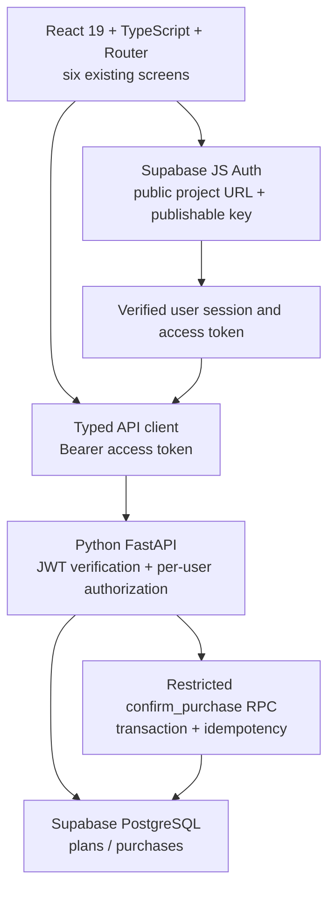

# BUS4012 ASM3 — STUDENT MONEY RUNWAY
## CODE-FIRST FULL-STACK MASTER IMPLEMENTATION PLAN (NO PLUGIN DEPENDENCY)

**Version:** 1.0 — 12 October 2026  
**Workspace:** `C:\Dev\BUS4012\student-money-runway-mvp`  
**Repository:** `https://github.com/khuongvuthien1995-png/student-money-runway-asm3.git`  
**Supabase development project:** `student-money-runway-asm3-dev` (`mnjmugwkjtihqswssiwa`, Sydney)  
**Goal:** Preserve the completed ASM2 frontend, finish an integrated React + Python/FastAPI + Supabase full-stack codebase, test code locally **without any cloud plugin**, then perform CLI/browser authentication, deployment and live verification only at the later checkpoints.

> **Snapshot caveat:** The findings below are grounded in the uploaded `student-money-runway-asm3-main.zip`. The user's VS Code workspace may already contain newer P2B/Git changes. Codex must re-inspect the *actual working tree*, preserve completed work, and never overwrite newer code with the ZIP snapshot. This plan is not a statement that live P2B tests or deployment have passed.

---

## 1. Scope and invariants

**In scope, required for completion:** Real Supabase Email/Password Auth; auth session restoration and logout; secure FastAPI bearer token verification; typed React API client; one authenticated current plan per user; save/read/edit plan via backend; purchase preview without write; atomic purchase confirmation via backend RPC; idempotent retry; 2-user isolation; loading/empty/error/conflict UX; responsive six-screen flow; backend & frontend automated tests; GitHub source portability; Vercel deployment configuration and real HTTPS tests; honest prompt and demo evidence.

**Outside scope unless official instructions or a demonstrated broken flow require:** Banking integrations, real financial advice, charts/analytics, new AI features, multi-plan ledger, broad Figma redesign, separate admin portal, every extra Figma screen, fabricated Git history.

**Unbreakable business rules:**

1. `protectedCents = fixedEssentialsCents + flexibleEssentialsCents + safetyBufferCents`.
2. `runwayCents = max(0, availableFundsCents - protectedCents)`; `shortfallCents = max(0, protectedCents - availableFundsCents)`.
3. Financial API/database uses **integer AUD cents**; UI may keep strings for editable money fields. Reject negatives, more than 2 decimal places, unsupported separators and out-of-range values. Never round extra decimals silently.
4. Preview never writes. Explicit **Mark as spent** is the only purchase-confirmation mutation.
5. The server-returned plan is authoritative after saving or purchasing. Never subtract locally and claim the persisted balance changed.
6. One `idempotencyKey` per purchase proposal; reuse on retry of the same proposal (including ambiguous network outcomes); only create a new key for a genuinely new proposal.
7. Authenticated identity comes from **verified bearer token**, never from frontend-supplied `userId`.
8. React only uses Supabase **publishable** key for Auth; privileged key is **backend-only**. Browser cannot write financial tables directly.
9. Preserve already-applied migration version `20261012020847`; any database fix requires a **new** migration and explicit approval.
10. The intended app is a **web application with responsive mobile UI**, not a separate React Native app.

---

## 2. Current source baseline (uploaded ZIP; re-verify locally)

### 2.1 React frontend

| Route | Current component | Current source behavior | ASM3 completion work |
|---|---|---|---|
| `/login` | `src/pages/LoginPage.tsx` | Email/password validation followed by local session reset; not actual password authentication | Supabase `signInWithPassword`; optional signup and email-confirmation state; existing-session redirect; real logout |
| `/setup` | `src/pages/RunwaySetupPage.tsx` | Controlled funds/date/buffer, draft in `App.tsx` | Hydrate existing plan for editing; preserve unsaved draft; validate exact cents |
| `/essentials` | `src/pages/ProtectEssentialsPage.tsx` | Controlled fixed/flexible expenses, navigate to runway without saving | `PUT /api/plans/current` and stateful saving/error before navigation |
| `/runway` | `src/pages/RunwayResultPage.tsx` | Derives runway from local state only | GET authoritative plan on bootstrap/refresh; handle no plan/shortfall; optional compact recent purchases |
| `/purchase` | `src/pages/PurchaseCheckPage.tsx` | New purchase name/value, navigates to preview | Validate name/amount; ensure current authoritative plan and draft validity |
| `/result` | `src/pages/ResultPage.tsx` | Preview; local state subtraction on confirm; button always `idle` | `POST` confirmation; async processing/error/replay, stable idempotency and server-authoritative update |

`src/App.tsx` currently owns `INITIAL_RUNWAY_STATE` and uses React Router for all six pages. `src/components/layout/AppShell.tsx` has a three-item responsive navigation; **Manage** currently routes to `/essentials`, not a distinct current-cycle management screen. Important reusable components: `FormSection`, `MoneyInput`, `SummaryRow`, `StatusActionButton`, `AppShell`. Financial helpers: `src/utils/runwayCalculations.ts` and `moneyValidation.ts`.

### 2.2 Python backend and database

- `api/index.py` exports FastAPI for later Vercel use.
- `backend/app/main.py` exposes **three paths and five HTTP operations**:
  - `GET /api/health`
  - `GET /api/plans/current`
  - `PUT /api/plans/current`
  - `GET /api/plans/current/purchases`
  - `POST /api/plans/current/purchases`
- `backend/app/models.py`: exact camelCase JSON contract, strict cent bounds, `PlanEnvelope {plan}`, `PurchasesEnvelope {purchases}`, `PurchaseConfirmationEnvelope {purchase, plan, replayed}`, errors `{error:{code,message}}`.
- `backend/app/security.py`: Supabase Auth JWT verifier; `backend/app/repository.py`: server-only Supabase transport, owns user filtering and RPC invocation; `backend/app/services.py`: business logic.
- `backend/dev.py` and `.env.local` support local secure backend configuration. `backend/tests/integration` is **opt-in** and must not be counted PASS when skipped.
- Hosted P1B migration was reported PASS for `plans`, `purchases`, RLS, constraints and `confirm_purchase`; P2B real two-user and purchase tests were pending at the source snapshot.
- Uploaded `vite.config.ts` has React plugin but **no `/api` proxy**. Uploaded root has **no `vercel.json`**; deployment behavior must be implemented and then verified, not presumed.

---

## 3. Target architecture and contracts



**API payloads must match Pydantic, not invented DTOs:**

```json
PUT /api/plans/current
{
  "planningDate": "2026-10-12",
  "availableFundsCents": 95000,
  "safetyBufferCents": 10000,
  "fixedEssentialsCents": 45500,
  "flexibleEssentialsCents": 18000
}

POST /api/plans/current/purchases
{
  "name": "Test Purchase",
  "amountCents": 16000,
  "idempotencyKey": "<new UUID for this proposal>"
}
```

**Cents-safe conversion:** add a pure string parser at the FE/API boundary. Accept valid AUD-decimal values, reject malformed input, over-precision, negatives and values > AUD 1,000,000. Prefer regex parsing of digits/decimals then constructing integer cents, rather than multiplying an untrusted float. Client-side calculations are explanatory; backend enforces authoritative rules.

**State architecture (avoid double truth):** `auth/session`, `serverPlan`, `planDraft`, `purchaseDraft`, `requestStatus`, `purchaseHistory`, `pendingConfirmationKey`. Keep raw forms in draft; never overwrite serverPlan with uncommitted edits; discard personal state on logout. `PLAN_NOT_FOUND` is a first-time-user flow rather than a generic crash.

---

## 4. Execution strategy without admin-controlled plugins

**Codex may perform locally:** read/write source, install project dependencies, add TypeScript/Python modules, edit Vite configuration, run eslint/build/pytest, run mock/unit/contract tests, run a local FastAPI server, run Playwright with mocked HTTP, inspect repository and prepare config/README/deployment manifests.

**Never require a GitHub, Supabase or Vercel plugin for coding.** Official CLI and ordinary Git are separate from ChatGPT/VS Code plugins and may work if authenticated/authorized. The earlier Supabase CLI was reportedly authenticated; its availability should be rechecked, not assumed.

**Deferred external operations:** Git push, Supabase test account confirmation/real integration calls, Vercel login/link/deploy, environment-variable entry and cloud smoke tests. These require user-controlled authentication/consent/keys, even if Codex can run the CLI command. Do not block offline source implementation for unavailable cloud permissions.

**Testing distinction:** `LOCAL CODE PASS`, `MOCK CONTRACT PASS`, `LIVE BACKEND PASS`, `CLOUD DEPLOY PASS` are separate. Never label mocks, skipped tests, compilation, or a static config check as a successful cloud integration.

---

## 5. Coding packages and acceptance gates (execute in sequence)

### C0 — Repository freeze, contract mapping and rollback safety (short)
**Inspect:** actual `git status`, branch/HEAD/remote, modified files, `.gitignore`, actual P2B outcomes; compare current source to the ZIP baseline if needed. Preserve commits and current in-progress P2B. No repeated general-purpose audit. If source is unpublished, prepare a reviewed checkpoint; ask before first push. Record a concise inventory of actual Pydantic schemas and current React props.

**Deliverable:** `docs/implementation/asm3-c0-code-freeze.md` (one page maximum), verified baseline git commit/hash if available. **Gate:** no secret is staged, unchanged core calculations and deployed migration, integration targets identified.

### C1 — Frontend infrastructure and exact API contract (code now; no cloud access required)
**Implement:**
- `@supabase/supabase-js` in package/lockfile; `src/lib/supabase.ts` initializes URL/publishable key only and fails clearly on missing configuration.
- `src/auth/AuthProvider.tsx` (or equivalent), `useAuth`, session restoration, `onAuthStateChange`, login/logout/signup (if approved), session/loading/error statuses. Guard routing without redirect loops or protected-content flashes.
- `src/services/apiClient.ts`, `planApi.ts`, `purchaseApi.ts`, `src/types/api.ts`: typed DTOs mirroring `backend/app/models.py`, bearer token injection, timeout/abort, `{error:{code,message}}` normalization, 401/404/409/422/503 handling. Do not make direct financial-table calls from React.
- `src/utils/moneyCents.ts`: pure strict AUD decimal↔cents conversion; unit tests for `0`, `0.01`, `950.00`, `1000000`, invalid separators, `1.999`, negative and huge values.
- `vite.config.ts`: conditional dev-only proxy for `/api` to loopback FastAPI, preserving other dev settings. Do not use `localhost` as production API base.
- Safe `.env.example` update for public Vite values, only if absent; protect `.env.local`, `.env.live-tests.local`.

**Offline tests:** component/service unit tests using dependency injection or Mock Service Worker (MSW) where appropriate; verify Authorization header and error envelopes. **Gate:** `npm run lint` and `npm run build` PASS; production bundle contains no server secret; API service contracts typecheck; no cloud credentials required to build.

### C2 — Six-screen integration, state transitions and UX (code now)
**Main integration:** Refactor `App.tsx` without replacing UI with generic templates. Keep routes stable and use a dedicated plan/session state layer, not a second authoritative funds store.

**Route acceptance matrix:**

| Page | User action | Real effect | Error/loading behavior |
|---|---|---|---|
| `/login` | Login/signup/logout paths | Supabase Auth SDK; session restored on reload | Invalid credentials, unconfirmed email, auth unavailable |
| `/setup` | Input funds/date/buffer | Edit draft, continue without mutation | Validation, preserve draft on back/reload as appropriate |
| `/essentials` | Input protected expenses; Save/Calculate | Call authenticated PUT; accept returned plan | In-flight disabled, error displayed, draft retained |
| `/runway` | Load/view/edit plan, start purchase | GET plan after auth; optional GET purchases | Skeleton/loading, missing plan→setup, 401→login, 503→retry |
| `/purchase` | Enter item/amount | Draft only, no writes | Empty/excess/invalid amount; edit/back |
| `/result` | Preview/confirm | Preview=0 writes; confirm=POST; reconcile server plan | `idle→processing→success/error`; idempotent retry; stale balance conflict |

**Specific UX rules:** returning user with plan enters runway, new user enters setup. Reset purchase draft for genuinely new proposals. On ambiguous network response preserve the same UUID until a definitive result. Once POST succeeds, use returned `{plan,purchase,replayed}`; do not do local funds subtraction. Support logout and clear user-specific state. Keep bottom nav mobile-first. Rename misleading “Manage” navigation to accurate existing edit route or implement a focused route only if objectively necessary. Keep six-screen scope as default.

**Gate:** all six pages linked to expected service methods through component/unit tests; key board and 390/768/1024/1280 responsive check if browser available; zero local-only simulated “success” paths in runtime.

### C3 — Backend contract hardening, source comments and automated coverage (code now)
**Do not reimplement backend.** Fix only demonstrated mismatch with the C1/C2 clients; preserve `GET/PUT/GET/POST` behavior, error envelopes, subject derived from JWT, service-only key and RPC. Add/adjust unit tests for 404 no-plan, 401 invalid token, 422 bounds, idempotency replay/mismatch, 409 excess, 503 network/backend failure. Validate 17 local tests baseline or actual count and label live skip correctly. If additional database DDL is required, generate a *new* migration and postpone execution to controlled cloud gate.

**Code style:** preserve existing Tailwind tokens, Prettier + ESLint, React PascalCase/camelCase, Python type annotations/snake_case, SQL snake_case. Existing `@file/@phase` provenance should remain historically true; new ASM3 changes use truthful comments about invariants, not fabricated dates. Repair the `—` UTF-8 artifacts in touched files. Keep attribution for adapted `StatusActionButton` code.

**Gate:** `pytest`, Python compile, npm lint/build PASS; no regression to financial calculations or deployed SQL contract; no secret leaks.

### C4 — Local full-stack simulation and browser QA (code now)
Two different test modes:

1. **Offline deterministic CI:** mock Supabase Auth and `/api/*` only in test environment (MSW/Playwright route interception); test all six routes, reloading, 401/404/409/422/503, loading/error and button state, double-click, refresh restoration of a *mocked* plan. Never ship these mocks as production fallbacks.
2. **Real local HTTP:** start actual Uvicorn through documented `backend.dev` and Vite dev server. Test health/OpenAPI without credentials. If user has provided local secrets and two verified test users, use actual development Supabase and execute opt-in suite. If not, skip live with explicit `BLOCKED/PENDING` result, but complete offline source/test gate.

**Gate:** meaningful browser screenshot/functional evidence where possible; exact results, no fake PASS. Preserve only non-sensitive evidence.

### C5 — Deployment-ready source (code now, deploy later)
- Review `api/index.py`, `requirements.txt` and Vercel Python import paths/runtime compatibility. Preserve one-project React + FastAPI same-origin as preferred target, but do not assume it works until live tested.
- Add **reviewed** `vercel.json` only if required; ensure `/api/*` routes invoke Python and SPA deep links (`/setup`, `/runway`, etc.) return `index.html`. Ordering: API routing must not be swallowed by the frontend catch-all rewrite.
- Ensure frontend production build uses real public URL/key and backend secrets only in server environment, configured **later** on Vercel. No hardcoded `localhost` in production.
- Provide `README.md` with clone/setup for Windows, npm ci, Python 3.12 venv + requirements, frontend/backend start commands, tests, env templates, Supabase migrations (not reapply an applied migration), and Vercel setup. Preserve dependency lockfiles; leave actual secrets in ignored local files only.
- Add a deploy checklist and an early cloud `/api/health` smoke gate. If one Vercel project fails due runtime limitations, propose a verified alternative Vercel topology instead of silently changing app architecture.

**Gate:** local build succeeds, deployment config syntax and files are in repo, static review for SPA/API routing complete. Verdict `DEPLOYMENT CODE READY`, **NOT `CLOUD DEPLOYED`**.

### C6 — Deferred CLI-based cloud verification and external operations (run later with approval)
When the user explicitly authorizes this phase:

**Supabase / P2B live:** confirm exact `mnjmugwkjtihqswssiwa` target and migration history. Use securely configured user A/B (email verified) and ignored env files; run safe live tests for real JWT, GET/PUT plan, purchase, replay, stale funds, no cross-user access, browser role denial, real concurrency, rollback and cleanup. Do not re-run first migration.

**GitHub:** `git status`, ensure private or user-approved visibility, staged secret scan, proper commit identity; commit truthful implementation changes; user approval before first external push; verify remote HEAD and fresh clone, no populated env files. Plugin is unnecessary; authenticated Git/Git Credential Manager can be used.

**Vercel:** login via browser/CLI if authorized, connect verified repository/project; add frontend **public** vars and backend **secret** vars separately in Vercel dashboard or official CLI without echo. Deploy preview first, test `/api/health`, SPA deep links, real login, GET/PUT and purchase. Inspect runtime logs with redaction. Deploy production only when preview acceptance passes and student approves.

**Gate:** separate `P2B LIVE PASS`, `GITHUB REMOTE PASS`, `VERCEL LIVE PASS` with real evidence. If tokens/login unavailable, mark `PENDING HUMAN ACTION` rather than undoing completed code.

### C7 — ASM3 final submission (later)
Create accurate prompt document (actual prompts, follow-ups, results) and 5-minute personal video outline/live recording. Video should show live URL visibly, end-to-end app workflow, Supabase Table Editor live data save/retrieve, React→FastAPI→Supabase, secret handling, GitHub tree and `.gitignore` ≤45 seconds, main prompts. Prepare **three independent peer reviews** with ≥5 actual annotated app screenshots and ≥3 actionable recommendations each. Group supports one another, but deliverables and videos are individual. Do not fabricate evidence.

---

## 6. Priority and dependency table

| Step | Can Codex code now without plugins? | Cloud step needed before starting? | Gate |
|---|---|---|---|
| C0 source freeze | YES | No | Safe source baseline |
| C1 Auth/API infrastructure | YES | No; build/type tests can use placeholders | Typed/auth source ready |
| C2 Six-screen integration | YES | No; contracts exist, use test doubles in tests only | 6 screens connected in code |
| C3 Backend hardening | YES | No | Local backend tests |
| C4 Offline browser QA | YES | No | Mock E2E PASS, live pending distinguished |
| C5 Vercel/README prep | YES | No | Deployment code ready |
| C6 Real integration / pushes / deployments | PARTLY; CLI after consent | YES, auth/keys/test accounts | Verified external results |
| C7 Demo/report/peers | Preparation YES; actual evidence later | Yes for live demo | Individual submission ready |

**Critical sequencing:** Start C1 immediately. C2→C5 can finish even if C6 provider integration is deferred. Do not block frontend code on email verification or plugin access. The key condition is: never claim full-stack/live acceptance without C6.

---

## 7. Immediate Codex kickoff prompt (run only C0 and C1 first)

```text
# BUS4012 ASM3 — CODE-FIRST IMPLEMENTATION (PLUGIN-FREE)

WORKSPACE: C:\Dev\BUS4012\student-money-runway-mvp
TARGET: React + FastAPI + Supabase Student Money Runway
MODE: ACTUALLY MODIFY SOURCE → RUN TESTS → FIX → RETEST

Read the current local source and the master plan:
Student_Money_Runway_ASM3_CODE_FIRST_MASTER_PLAN.md
(or the plan text supplied in this message).

Admin-managed Codex plugins for GitHub, Supabase and Vercel are unavailable.
DO NOT request plugin installation, dashboard access, account creation,
remote push or Vercel deployment during this phase.
These external commands will be approved/run later.

Ground truth:
- Six existing React routes, design system and calculations must remain.
- Existing FastAPI Pydantic API, Supabase migration and backend source must be reused.
- Initial SQL migration has already been applied; never reapply or edit it.
- The uploaded ZIP may be behind this workspace: re-inspect and preserve newer files.
- Do not require P2B live-test PASS to write/test offline FE integration code.
- Do not fake live persistence using mocks in production.

IMPLEMENT C0 + C1 ONLY:
1. Inspect actual Git state, local code and actual API contracts.
2. Verify secrets remain ignored; do not reveal them.
3. Install any missing frontend test/SDK dependencies as project dependencies.
4. Implement real Supabase Auth SDK adapter and auth/session provider.
5. Implement typed FastAPI client, plan and purchase modules from ACTUAL Pydantic models.
6. Implement exact money-string↔integer-cents conversion and unit tests.
7. Set up local Vite /api proxy as needed, with no production localhost dependency.
8. Add unit/contract tests of API bearer/error behavior and auth lifecycle,
   using test-only mocks, never replacing production API calls.
9. Run npm lint/build, frontend tests and existing backend pytest.
10. Repair any actual local failures and rerun tests.
11. Preserve six pages for C2; do not start a major UI rewrite.
12. Produce exact file diff, test results, gaps and acceptance gate.

STOP after C1. Do not push, deploy, execute migrations or expose credentials.
Return one of:
C1 CODE PASS — READY FOR C2
C1 PARTIAL — ACTUAL LOCAL ISSUE
C1 BLOCKED — VERIFIED TECHNICAL DEFECT
```

**After C1 PASS:** Give Codex a narrow instruction: “Implement C2 from the master plan, preserve current UI, edit real source, run tests, stop at the gate.” Then proceed C3, C4, C5. Start C6 only after explicit approval and provider setup, then C7.

---

## 8. Quality gates / acceptance examples

| Scenario | Expected behavior |
|---|---|
| First-time User A | Login → no plan 404 → Setup → Essentials → save through FastAPI → Runway |
| Returning User A | Login/session restore → GET plan → Runway directly |
| Plan edit | Existing fields hydrate into Setup/Essentials → save succeeds → one plan per user |
| Canonical math | A=950, F=455, V=180, B=100 → protected=735, runway=215 |
| Shortfall | If available=650 and protected=734 → shortfall=84 |
| Preview purchase 160 | Remains=55 displayed; zero purchase writes |
| Confirm purchase 160 | HTTP 201, available=790, runway=55, one row |
| Same-key retry | HTTP replay (as defined), no extra deduction/row |
| Excess 300 (baseline) | Rejected by real backend, no mutation |
| Exact purchase 215 | Allowed when baseline runway exactly 215; runway→0 |
| User B | Cannot access User A plan/history; cannot spoof userId |
| Missing or expired token | Protected API rejects; UI leads to safe login/retry |
| API unavailable | Never shows false success; preserve draft, retry safely |
| New browser/refresh | Restores session and persisted plan, not initial blanks |
| Deploy preview | HTTPS app, Python `/api/health`, direct SPA routes, Auth and save/purchase work |

---

## 9. Main risks and controls

- **Plugin denial ≠ inability to write code:** use local editor/terminal and test-only mocks; defer provider authentication to official CLI/browser.
- **Snapshot freshness:** inspect actual `git status` and code before overwriting; ZIP is a fixed snapshot.
- **Auth gate:** do not confuse email validation with true Auth. Keep protected routes closed until session resolved.
- **Server credential:** Supabase secret/server key can bypass RLS; any FastAPI query/RPC must derive user ID from verified JWT, check ownership, and keep server key out of `src`, `public`, and `VITE_*`.
- **Concurrent purchase and retry:** UI button disabling alone is insufficient; rely on RPC transaction and stable idempotency key; test real database later.
- **Plan edit vs history:** available funds are an editable current snapshot, not a reconciled accounting ledger; don't invent transaction reconciliation.
- **Vercel routing/runtime:** `api/index.py` exists but no uploaded `vercel.json`; verify Python function routing and SPA fallback after deploying preview.
- **Documentation:** avoid inflated PASS claims, manufactured commit history, fake time stamps/screenshots; retain genuine prompt history.
- **Time:** stabilize core product over adding all Figma management pages. Actual group peer reviews are separate deliverables.

**Decision:** Implement C0→C5 locally **now**. Trigger C6 only with user approval, secure provider access, and distinct test accounts. Trigger C7 from real deployment evidence. This is the shortest stable route to a full-stack ASM3 without reliance on restricted Codex plugins.
